> 📌 
> 
> <a id="6bcff1ccc9744888b9c06bfe90beb470"></a>
> 
> 내일배움캠프&#95;스프링 7기  &#45; 7주차 개인 프로젝트
> 
> > 기간&#58; 24년 11월 12일 &#126; 11월 15일
> 
> - 팀 노션&#58; <a href="https://beautiful-college-c84.notion.site/13b2dc3ef514816fb2cbf881cefff377">페이지</a> 
> 
> - 발제&#58;<a href="https://beautiful-college-c84.notion.site/13b2dc3ef514801cb5a9f36b8adceef4">페이지</a> 

<a id="13ceda9b0fe180649ac5f47a187b613e"></a>

## 학습

---

<details>
<summary>✅ 숙련주차 학습 개념 &#45; 체크리스트</summary>

- [ ] Spring의 핵심 컨셉에 대해 이해하고 설명할 수 있다&#46;

- [ ] BeanValidation을 적용할 수 있다&#46;

- [ ] 인증/인가의 차이점을 설명할 수 있다&#46;

- [ ] Cookie/Session을 적용하여 사용자 인증을 할 수 있다&#46;

- [ ] 영속성 컨텍스트에 대해 설명할 수 있다&#46;

- [ ] JPA를 이용하여 데이터 중심이 아닌 객체 지향적인 개발을 할 수 있다&#46;

</details>

<details>
<summary>TIL, 데일리 스크랩</summary>

<a id="9510e3acbbff48dab32f7df111add9ba"></a>

<a href="#/post/13ceda9b-0fe1-8077-973d-d84a706d33ac">페이지</a> &#45; 스프링 강의 정리

<a id="13feda9b0fe180699443dd201a66f176"></a>

<a href="#/post/13ceda9b-0fe1-8027-a9c1-d74706f27938">페이지</a> &#45; 스프링 강의 정리 

<a id="13feda9b0fe180dd8253e041ce55f92e"></a>

<a href="#/post/13eeda9b-0fe1-80dd-b5da-f01f0c700e54">페이지</a>  &#45; 스프링 강의 정리

<a id="140eda9b0fe18017afd5f921a1403227"></a>

<a href="#/post/13feda9b-0fe1-80b3-bf5a-fd811c9db795">페이지</a>  &#45; 과제 구현

</details>

<details>
<summary>강의</summary>

<a id="13ceda9b0fe180dcb7c5e14dbc5a5c5e"></a>

<a href="#/post/13ceda9b-0fe1-8067-9531-e4fdae3568a2">페이지</a> 

</details>

<details>
<summary>피드백</summary>

[피드백 정리](#/post/13feda9b-0fe1-8076-91ec-cc8624290036)

</details>

<a id="13ceda9b0fe18039b725d26ab5d9e1b7"></a>

## 과제

---

> 과제 요구사항&#58; <a href="https://beautiful-college-c84.notion.site/13b2dc3ef514805cae64dae7cbf9a5a2">페이지</a> 

<a id="13ceda9b0fe180fba38be6b0758cc2bd"></a>

###  요구사항

<details>
<summary>공통 조건</summary>

- 모든 테이블 → 고유 식별자(ID) 

- 3 Layer Architecture

- JPA, 연관관계 &#45; <code>단방향</code>

- 인증/인가 → Cookie/Session

</details>

<a id="13ceda9b0fe1808187e0d42a4cc0dbbd"></a>

### 2️⃣ <strong>필수 기능 가이드</strong>

<a id="13ceda9b0fe181f6bacdf82034b1e314"></a>

### Lv 0&#46; API 명세 및 ERD 작성   <code>필수</code>

- [ ] <strong><u>API 명세서 작성하기</u></strong>
    - [ ] API명세서는 프로젝트 root(최상위) 경로의 <code>README&#46;md</code> 에 작성

    <details>
    <summary>참고) API 명세서 작성 가이드</summary>

    - API 명세서란 API명, 요청 값(파라미터), 반환 값, 인증/인가 방식, 데이터 및 전달 형식 등 API를 정확하게 호출하고 그 결과를 명확하게 해석하는데 필요한 정보들을 일관된 형식으로 기술한 것을 의미합니다&#46;

    - request 및 response는 <a href="https://namu.wiki/w/JSON">json(링크)</a> 형태로 작성합니다&#46;

    [책 등록](#/post/13ceda9b-0fe1-8112-b84b-ed781f63ac9a)

    [책 조회](#/post/13ceda9b-0fe1-819b-a732-de5457bc6d0b)

    [책 목록 조회](#/post/13ceda9b-0fe1-8135-9a44-df65056f64a1)

    [책 수정](#/post/13ceda9b-0fe1-81ab-a7c9-ebcc6d2fead5)

    [책 삭제](#/post/13ceda9b-0fe1-81ed-924d-e5ae4cccf39d)

    > API 명세서 추천 무료 Tool
    > 
    > [Document your APIs in Postman &#124; Postman Learning Center]()

    </details>

- [x] <strong><u>ERD 작성하기</u></strong>
    - [x] ERD는 프로젝트 root(최상위) 경로의 <code>README&#46;md</code> 에 첨부

    <details>
    <summary>참고) ERD 작성 가이드</summary>

    

    - API 명세 작성을 통해 서비스의 큰 흐름과 기능을 파악 하셨다면 이제는 기능을 구현하기 위해 필요한 데이터가 무엇인지 생각해봐야합니다&#46;
        - 이때, 구현해야 할 서비스의 영역별로 필요한 데이터를 설계하고 각 영역간의 관계를 표현하는 방법이 있는데 이를 ERD(Entity Relationship Diagram)라 부릅니다&#46;

    - ERD 작성간에 다음과 같은 항목들을 학습합니다&#46;
        - E(Entity&#46; 개체)
            - 구현 할 서비스의 영역에서 필요로 하는 데이터를 담을 개체를 의미합니다&#46;
                - ex) <code>책</code>, <code>저자</code>, <code>독자</code>, <code>리뷰</code> 

        - A(Attribute&#46; 속성)
            - 각 개체가 가지는 속성을 의미합니다&#46;
                - ex) 책은 <code>제목</code>, <code>언어</code>, <code>출판일</code>, <code>저자</code>, <code>가격</code> 등의 속성을 가질 수 있습니다&#46;

        - R(Relationship&#46; 관계)
            - 개체들 사이의 관계를 정의합니다&#46;
                - ex) <code>저자</code>는 여러 권의 <code>책</code>을 집필할 수 있습니다&#46; 이때, 저자와 책의 관계는 일대다(1&#58;N) 관계입니다&#46;

    > ERD 추천 무료 Tool
    > 
    > [ERDCloud]()

    > ERD 추천 영상
    > 
    > [video](https://www.youtube.com/watch?v=jsOPr3QfMW0)

    </details>

- [x] <strong><u>SQL 작성하기</u></strong>
    - [x] 설치한 데이터베이스(Mysql)에 ERD를 따라 테이블을 생성

    <details>
    <summary>참고) SQL 작성 가이드</summary>

    - 과제 프로그램의 root(최상위) 경로에<code>schedule&#46;sql</code> 파일을 만들고, 테이블 생성에 필요한 query를 작성하세요&#46;

    </details>

<a id="13ceda9b0fe181ef8d4af2312c48d208"></a>

### Lv 1&#46; 일정 CRUD  <code>필수</code>

- [x] 일정을 저장, 조회, 수정, 삭제할 수 있습니다&#46;

- [x] 일정은 아래 필드를 가집니다&#46;
    - [x] <code>작성 유저명</code>, <code>할일 제목</code>, <code>할일 내용</code>, <code>작성일</code>, <code>수정일</code> 필드

    - [x] <code>작성일</code>, <code>수정일</code> 필드는 <code>JPA Auditing</code>을 활용하여 적용합니다&#46;

<a id="13ceda9b0fe181c09057e8cb01c13357"></a>

### Lv 2&#46; 유저 CRUD  <code>필수</code>

- [x] 유저를 저장, 조회, 삭제할 수 있습니다&#46; 

- [x] 유저는 아래와 같은 필드를 가집니다&#46;
    - [x] <code>유저명</code>, <code>이메일</code>, <code>작성일</code>, <code>수정일</code> 필드

    - [x] <code>작성일</code>, <code>수정일</code> 필드는 <code>JPA Auditing</code>을 활용하여 적용합니다&#46;

- [x] 연관관계 구현
    - [x] 일정은 이제 <code>작성 유저명</code> 필드 대신 <code>유저 고유 식별자</code> 필드를 가집니다&#46;

<a id="13ceda9b0fe18107bfb9eb989136d29f"></a>

### Lv 3&#46; 회원가입  <code>필수</code> 

- [x] 유저에 <code>비밀번호</code> 필드를 추가합니다&#46;
    - 비밀번호 암호화는 도전 기능에서 수행합니다&#46;

<a id="13ceda9b0fe18131931ee9935a2171b9"></a>

### Lv 4&#46; 로그인(인증)  <code>필수</code>

- 키워드
    <a id="13ceda9b0fe1810faea1c58ee24d3aec"></a>

    <strong>인터페이스</strong>

    - HttpServletRequest / HttpServletResponse &#58; 각 HTTP 요청에서 주고받는 값들을 담고 있습니다&#46;

- [x] <strong><u>설명</u></strong>
    - [x] <strong>Cookie/Session</strong>을 활용해 로그인 기능을 구현합니다&#46; → <code>2주차 Servlet Filter</code>

    - [x] 필터를 활용해 인증 처리를 할 수 있습니다&#46;

    - [x] <code>&#64;Configuration</code> 을 활용해 필터를 등록할 수 있습니다&#46;

- [x] <strong><u>조건</u></strong>
    - [x] <code>이메일</code>과 <code>비밀번호</code>를 활용해 로그인 기능을 구현합니다&#46;

    - [x] 회원가입, 로그인 요청은 인증 처리에서 제외합니다&#46;

- [x] <strong><u>예외처리</u></strong>
    - [x] 로그인 시 이메일과 비밀번호가 일치하지 않을 경우 401을 반환합니다&#46;

---

<a id="13ceda9b0fe1802c84a2d79d3f3bba55"></a>

### 3️⃣ 도전 기능 가이드

<a id="dab94c0d328a46d29cee8e902842f945"></a>

### Lv 5&#46; 다양한 예외처리 적용하기  <code>도전</code>

- [x] Validation을 활용해 다양한 예외처리를 적용해 봅니다&#46; → <code>1주차 Bean Validation</code>

- [x] 정해진 예외처리 항목이 있는것이 아닌 프로젝트를 분석하고 예외사항을 지정해 봅니다&#46;
    - [x] Ex) 할일 제목은 10글자 이내, 유저명은 4글자 이내

    - [x] <code>&#64;Pattern</code>을 사용해서 회원 가입 Email 데이터 검증 등
        - [x] 정규표현식을 적용하되, 정규표현식을 어떻게 쓰는지 몰두하지 말 것&#33;

        - [x] 검색해서 나오는 것을 적용하는 것으로 충분&#33;

<a id="09af8c434e204d9b9475a2c55bca168e"></a>

### Lv 6&#46; 비밀번호 암호화  <code>도전</code> 

- [x] Lv&#46;3에서 추가한 <code>비밀번호</code> 필드에 들어가는 비밀번호를 암호화합니다&#46;
    - [x] 암호화를 위한 <code>PasswordEncoder</code>를 직접 만들어 사용합니다&#46;
        <details>
        <summary>PasswordEncoder 참고 코드</summary>

        1. <code>build&#46;gradle</code> 에 아래의 의존성을 추가해주세요&#46;
            <a id="4f4c5f1ecbf54ba584c64a5b1ec60d36"></a>

            ```java
            implementation 'at.favre.lib:bcrypt:0.10.2'
            ```

        1. <code>config</code> 패키지가 없다면 추가하고, 아래의 클래스를 추가해주세요&#46;
            <a id="68facb90147f407abbbcef4a43f16539"></a>

            ```java
            import at.favre.lib.crypto.bcrypt.BCrypt;
            import org.springframework.stereotype.Component;

            @Component
            public class PasswordEncoder {

                public String encode(String rawPassword) {
                    return BCrypt.withDefaults().hashToString(BCrypt.MIN_COST, rawPassword.toCharArray());
                }

                public boolean matches(String rawPassword, String encodedPassword) {
                    BCrypt.Result result = BCrypt.verifyer().verify(rawPassword.toCharArray(), encodedPassword);
                    return result.verified;
                }
            }
            ```

        </details>

<a id="7f90e9dc9b334744881c9474193549d5"></a>

### Lv 7&#46; 댓글 CRUD  <code>도전</code>

- [ ] 생성한 일정에 댓글을 남길 수 있습니다&#46;
    - [ ] 댓글과 일정은 연관관계를 가집니다&#46;

- [ ] 댓글을 저장, 조회, 수정, 삭제할 수 있습니다&#46;

- [ ] 댓글은 아래와 같은 필드를 가집니다&#46;
    - [ ] <code>댓글 내용</code>, <code>작성일</code>, <code>수정일</code>, <code>유저 고유 식별자</code>, <code>일정 고유 식별자</code> 필드

    - [ ] <code>작성일</code>, <code>수정일</code> 필드는 <code>JPA Auditing</code>을 활용하여 적용합니다&#46;

<a id="058250cd1c9343c8a7f8ede3f197a1f8"></a>

### Lv 8&#46; 영속성 전이를 활용한 삭제   <code>도전</code> 

- [ ] 유저를 삭제할 때 해당 유저가 생성한 일정과 댓글도 삭제
    - [ ] 이 때, JPA의 영속성 전이 기능을 활용

<a id="edc6fcdb4b34496faaeb4fd803bd033e"></a>

### Lv 9&#46; 일정 페이징 조회  <code>도전</code>

- 키워드
    <a id="aff9e7fb7e5e4663ab40863930f08120"></a>

    <strong>데이터베이스</strong>

    - offset / limit &#58; SELECT 쿼리에 적용해서 데이터를 제한 범위에 맞게 조회할 수 있습니다&#46;

    <a id="a891e966ef5149d0a24b6a4546a3fe44"></a>

    <strong>페이징</strong>

    - Pageable &#58; Spring Data JPA에서 제공되는 페이징 관련 인터페이스 입니다&#46;

    - PageRequest &#58; Spring Data JPA에서 제공되는 페이지 요청 관련 클래스입니다&#46;

- [ ] 일정을 Spring Data JPA의 <code>Pageable</code>과 <code>Page</code> 인터페이스를 활용하여 페이지네이션을 구현
    - [ ] <code>페이지 번호</code>와 <code>페이지 크기</code>를 쿼리 파라미터로 전달하여 요청하는 항목을 나타냅니다&#46;

    - [ ] <code>할일 제목</code>, <code>할일 내용</code>, <code>댓글 개수</code>, <code>일정 작성일</code>, <code>일정 수정일</code>, <code>일정 작성 유저명</code> 필드를 조회합니다&#46;

    - [ ] 디폴트 <code>페이지 크기</code>는 10으로 적용합니다&#46;

- [ ] 일정의 <code>수정일</code>을 기준으로 내림차순 정렬합니다&#46;

- Repository
    [scheduler_v2](https://github.com/gyungsubLee/scheduler_v2)

<a id="13ceda9b0fe180bdbe36f1fb71250061"></a>

### 구현

<details>
<summary>template</summary>

<details>
<summary>&#91; 코드 &#93; </summary>

<a id="ced0bcc139a24fb3a8a7bc32f69c1e06"></a>

```java

```

</details>

<details>
<summary>&#91; 코드 &#93; </summary>

<a id="429b05a04b2845ffb74ce8b80114967b"></a>

```java

```

</details>

---

<details>
<summary>포스트맨 테스트</summary>

- 성공  &#45; 200 Ok

- 실패  &#45; 404 Not Found

</details>

</details>

<a id="13eeda9b0fe1807f94cdc6b131c11b63"></a>

### Lv0

- [x]  ERD
    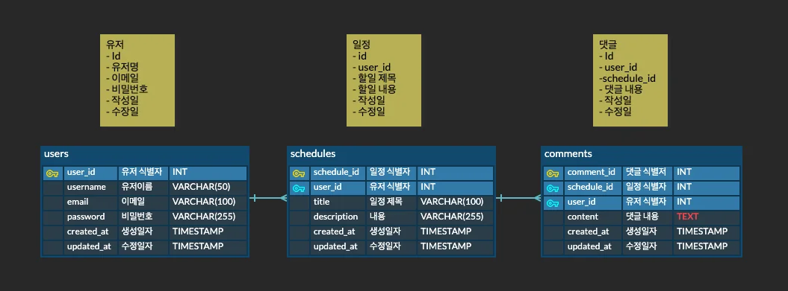

- [x] API
    <details>
    <summary>일정</summary>

    [일정 등록](#/post/13feda9b-0fe1-813a-91bc-d4921fc37c19)

    [전체 일정 조회](#/post/13feda9b-0fe1-8107-919d-e6a8d3818542)

    [일정 조회](#/post/13feda9b-0fe1-8123-ae54-eab7d29c1ad1)

    [일정 수정](#/post/13feda9b-0fe1-81f2-85cf-e91d54eff9dc)

    [일정 삭제](#/post/13feda9b-0fe1-8197-ad5b-de2b26326f40)

    </details>

    <details>
    <summary>회원</summary>

    [회원 등록](#/post/13feda9b-0fe1-8133-86fd-e9ad479a7da6)

    [회원 조회](#/post/13feda9b-0fe1-81b9-b7e0-caac6bb35d2a)

    [회원 수정](#/post/13feda9b-0fe1-8113-b23a-f34fdab8d51b)

    [회원 삭제](#/post/13feda9b-0fe1-81f7-aa4c-f6cecd2450e9)

    </details>

- [x] SQL
    <details>
    <summary>유저</summary>

    <a id="13eeda9b0fe18042bf3bc34adbe25ff5"></a>

    ```sql
    CREATE TABLE User (
        Id INT AUTO_INCREMENT PRIMARY KEY,      -- 유저의 고유 ID, 자동 증가
        Username VARCHAR(50) NOT NULL,          -- 유저명, 최대 50자
        Email VARCHAR(100) NOT NULL UNIQUE,     -- 이메일, 최대 100자, 중복 불가
        Password VARCHAR(255) NOT NULL,         -- 비밀번호, 해시된 값 저장
        CreatedAt TIMESTAMP DEFAULT CURRENT_TIMESTAMP,  -- 작성일, 기본값은 현재 시간
        UpdatedAt TIMESTAMP DEFAULT CURRENT_TIMESTAMP ON UPDATE CURRENT_TIMESTAMP  -- 수정일, 업데이트 시 자동 갱신
    );
    ```

    </details>

    <details>
    <summary>일정</summary>

    <a id="13eeda9b0fe1807b927ed8a3f4178133"></a>

    ```sql
    CREATE TABLE Schedule (
        Id INT AUTO_INCREMENT PRIMARY KEY,               -- 일정의 고유 ID, 자동 증가
        UserId INT NOT NULL,                             -- 유저 ID, 외래 키로 설정
        Title VARCHAR(100) NOT NULL,                     -- 할일 제목, 최대 100자
        Description TEXT,                                -- 할일 내용, 길이에 제한이 없는 텍스트
        CreatedAt TIMESTAMP DEFAULT CURRENT_TIMESTAMP,   -- 작성일, 기본값은 현재 시간
        UpdatedAt TIMESTAMP DEFAULT CURRENT_TIMESTAMP ON UPDATE CURRENT_TIMESTAMP,  -- 수정일, 업데이트 시 자동 갱신
        FOREIGN KEY (UserId) REFERENCES User(Id)         -- User 테이블의 Id를 참조하는 외래 키
    );
    ```

    </details>

    <details>
    <summary>댓글</summary>

    <a id="13eeda9b0fe1808f875bfe1f6a907fc8"></a>

    ```sql
    CREATE TABLE Comment (
        Id INT AUTO_INCREMENT PRIMARY KEY,               -- 댓글의 고유 ID, 자동 증가
        UserId INT NOT NULL,                             -- 유저 ID, 외래 키로 설정
        ScheduleId INT NOT NULL,                         -- 일정 ID, 외래 키로 설정
        Content TEXT NOT NULL,                           -- 댓글 내용, 길이에 제한이 없는 텍스트
        CreatedAt TIMESTAMP DEFAULT CURRENT_TIMESTAMP,   -- 작성일, 기본값은 현재 시간
        UpdatedAt TIMESTAMP DEFAULT CURRENT_TIMESTAMP ON UPDATE CURRENT_TIMESTAMP,  -- 수정일, 업데이트 시 자동 갱신
        FOREIGN KEY (UserId) REFERENCES User(Id),        -- User 테이블의 Id를 참조하는 외래 키
        FOREIGN KEY (ScheduleId) REFERENCES Schedule(Id) -- Schedule 테이블의 Id를 참조하는 외래 키
    );
    ```

    </details>

<a id="13eeda9b0fe18009bee6cdbeaac5b27e"></a>

### Lv1

<details>
<summary>JPA Auditing &#45; 생성일자(createdAt), 수정일자(modifiedAt)</summary>

<details>
<summary>&#91; 코드 &#93; BaseEntity</summary>

<a id="4196c5a9988c4b46bf421488ad6c7638"></a>

```java
@Getter
@MappedSuperclass
@EntityListeners(AuditingEntityListener.class)
public class BaseEntity {

    @CreatedDate
    @Column(updatable = false)
    private LocalDateTime createdAt;

    @LastModifiedDate
    private LocalDateTime modifiedAt;
}
```

</details>

<details>
<summary>&#91; 코드 &#93; &#64;EnableJpaAuditing 적용</summary>

<a id="e92a65675a14458995cb6c5839ea9bf4"></a>

```java
@EnableJpaAuditing
@SpringBootApplication
public class SchedulerV2Application {

    public static void main(String[] args) {
        SpringApplication.run(SchedulerV2Application.class, args);
    }
}

```

</details>

</details>

<details>
<summary>일정 생성 API</summary>

<details>
<summary>&#91; 코드 &#93; ScheduleController</summary>

<a id="13eeda9b0fe180c1b058c1b3f4a31457"></a>

```sql
@RestController
@RequiredArgsConstructor
@RequestMapping("/schedules")
public class ScheduleController {

    private final ScheduleService scheduleService;

    @PostMapping
    public ResponseEntity<ScheduleResponseDto> save(@RequestBody CreateScheduleRequestDto requestDto){
        ScheduleResponseDto scheduleResponseDto = scheduleService.save(requestDto.getTitle(), requestDto.getDescription());

        return new ResponseEntity<>(scheduleResponseDto, HttpStatus.CREATED);
    }
}
```

</details>

<details>
<summary>&#91; 코드 &#93; ScheduleService</summary>

<a id="e7c403b673a74d8e8f1115838857b893"></a>

```sql
@Service
@RequiredArgsConstructor
public class ScheduleService {

    private final ScheduleRepository scheduleRepository;

    public ScheduleResponseDto save(String title, String description) {

        Schedule schedule = new Schedule(title, description);
        scheduleRepository.save(schedule);

        return new ScheduleResponseDto(schedule.getId(), schedule.getTitle(), schedule.getDescriptiom(), schedule.getCreatedAt(), schedule.getModifiedAt());
    }
}
```

</details>

<details>
<summary>&#91; 코드 &#93; ScheduleRepository</summary>

<a id="c7fb0502d9d446b393f1259388d9c8e2"></a>

```sql
package com.example.scheduler_v2.repository;

import com.example.scheduler_v2.entity.Schedule;
import org.springframework.data.jpa.repository.JpaRepository;
import org.springframework.stereotype.Repository;

@Repository
public interface ScheduleRepository extends JpaRepository<Schedule, Long> {

}

```

</details>

<details>
<summary>&#91; 코드 &#93; CreateScheduleRequestDto</summary>

<a id="20fc6b03974941ec8cb8de331b67e363"></a>

```sql
@Getter
@AllArgsConstructor
public class CreateScheduleRequestDto {
    private String title;
    private String description;
}
```

</details>

<details>
<summary>&#91; 코드 &#93; ScheduleResponseDto</summary>

<a id="83d42759e16a41ffa3e80c49dbbcd9ef"></a>

```sql
@Getter
@AllArgsConstructor
public class ScheduleResponseDto {
    private Long id;
    private String title;
    private String descriptiom;
    private LocalDateTime createdAt;   // 생성 날짜
    private LocalDateTime modifiedAt;  // 수정 날짜
}
```

</details>

<details>
<summary>&#91; 코드 &#93; Schedule</summary>

<a id="088b63aad1884936b1c051047ad72102"></a>

```sql
@Getter
@Entity
@NoArgsConstructor
public class Schedule extends BaseEntity{

    @Id
    @GeneratedValue(strategy = GenerationType.IDENTITY)
    @Column(name = "schedule_id")
    private Long id;

    @Column(nullable = false)
    private String title;

    private String descriptiom;

    public Schedule(String title, String descriptiom) {
        this.title = title;
        this.descriptiom = descriptiom;
    }
}
```

</details>

---

<details>
<summary>포스트맨 테스트</summary>

- 성공  &#45; 201 Created
    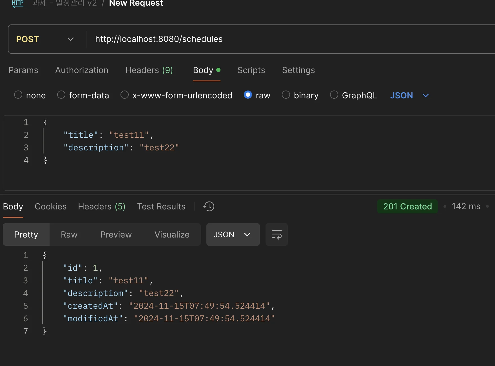

    - content&#45;type&#58; application/json

</details>

</details>

<details>
<summary>일정 조회 API</summary>

<details>
<summary>전체 조회</summary>

<details>
<summary>&#91; 코드 &#93; ScheduleController &#45; findAll()</summary>

<a id="cada7c44fcb149589e874117c30427f6"></a>

```java
@RestController
@RequiredArgsConstructor
@RequestMapping("/schedules")
public class ScheduleController {

    private final ScheduleService scheduleService;

	    . . .

    @GetMapping
    public ResponseEntity<List<ScheduleResponseDto>> findAll() {

        List<ScheduleResponseDto> scheduleResponseDtoList = scheduleService.findAll();

        return new ResponseEntity<>(scheduleResponseDtoList, HttpStatus.OK);
    }
```

</details>

<details>
<summary>&#91; 코드 &#93; ScheduleRepository &#45; findAll()</summary>

<a id="4a1d3b5c53954924ba4ba3f0da88862a"></a>

```java
@Service
@RequiredArgsConstructor
public class ScheduleService {

    private final ScheduleRepository scheduleRepository;
		
			.  .  .
		
		// 전체 일정 조회
		public List<ScheduleResponseDto> findAll() {
        return scheduleRepository.findAll()
                .stream()
                .map(ScheduleResponseDto::toDto)
                .toList();
    }
```

</details>

<details>
<summary>&#91; 코드 &#93; ScheduleResponseDto  &#45; toDto</summary>

<a id="7990c52fcd5c4cd19e6af7ffcc048358"></a>

```java
@Getter
@AllArgsConstructor
public class ScheduleResponseDto {
    private Long id;
    private String title;
    private String descriptiom;
    private LocalDateTime createdAt;   // 생성 날짜
    private LocalDateTime modifiedAt;  // 수정 날짜

    public static ScheduleResponseDto toDto(Schedule schedule){
        return new ScheduleResponseDto(schedule.getId(), schedule.getTitle(), schedule.getDescriptiom(), schedule.getCreatedAt(), schedule.getModifiedAt());
    }
}
```

</details>

---

<details>
<summary>포스트맨 테스트</summary>

- 성공  &#45; 200 Ok
    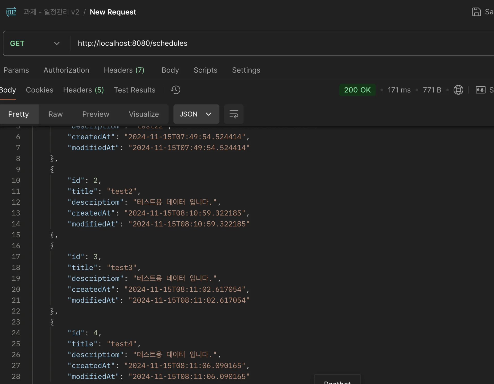

</details>

</details>

<details>
<summary>특정 일정 조회</summary>

<details>
<summary>&#91; 코드 &#93; ScheduleController &#45; findById()</summary>

<a id="882cac0034d0461a91abcaaa22aed1c8"></a>

```java
@RestController
@RequiredArgsConstructor
@RequestMapping("/schedules")
public class ScheduleController {

    private final ScheduleService scheduleService;
		
				.  .  .
		
				
		GetMapping("/{id}")
    public ResponseEntity<ScheduleResponseDto> findById(@PathVariable Long id){

        ScheduleResponseDto scheduleResponseDto = scheduleService.findById(id);

        return new ResponseEntity<>(scheduleResponseDto, HttpStatus.OK);

    }
```

</details>

<details>
<summary>&#91; 코드 &#93; ScheduleService &#45; findById</summary>

<a id="7a73a842343c4dadacc0710e50b2616e"></a>

```java
@Service
@RequiredArgsConstructor
public class ScheduleService {

    private final ScheduleRepository scheduleRepository;
   
		   .  .  . 
    
		public ScheduleResponseDto findById(Long id) {
        Schedule findSchedule = scheduleRepository.findByIdOrElseThrow(id);

        return new ScheduleResponseDto(findSchedule.getId(), findSchedule.getTitle(), findSchedule.getDescriptiom(), findSchedule.getCreatedAt(), findSchedule.getModifiedAt());
    }
```

</details>

<details>
<summary>&#91; 코드 &#93; ScheduleRepository &#45; findByIdOrElseThrow()</summary>

<a id="9fecdd9bdc3140f590ecace20024faed"></a>

```java
@Repository
public interface ScheduleRepository extends JpaRepository<Schedule, Long> {

    default Schedule findByIdOrElseThrow(Long id) {
        return findById(id).orElseThrow(() -> new ResponseStatusException(HttpStatus.NOT_FOUND, "Does not exist id = " + id));
    }
}
```

</details>

---

<details>
<summary>포스트맨 테스트</summary>

- 성공 &#45;  200 Ok
    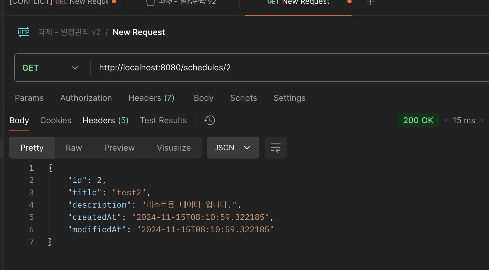

- 실패 404 Not Found
    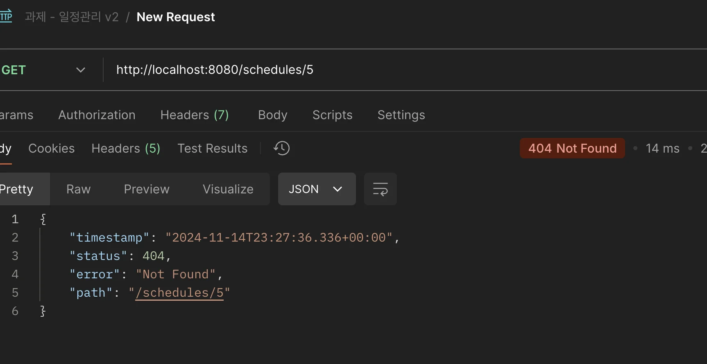

</details>

</details>

</details>

<details>
<summary>일정 수정 API</summary>

<details>
<summary>&#91; 코드 &#93; ScheduleController &#45; updateSchedule()</summary>

<a id="07ff3161dd6945b7967c305a4ca3b0d9"></a>

```java
@RestController
@RequiredArgsConstructor
@RequestMapping("/schedules")
public class ScheduleController {

    private final ScheduleService scheduleService;
    
	    .  .  .
	   
    @PatchMapping("/{id}")
    public ResponseEntity<ScheduleResponseDto> updateSchedule(
            @PathVariable Long id,
            @RequestBody UpdateScheduleRequestDto requestDto){

        ScheduleResponseDto scheduleResponseDto = scheduleService.updateSchedule(id, requestDto.getTitle(), requestDto.getDescription());

        return new ResponseEntity<>(scheduleResponseDto, HttpStatus.OK);
    }
}
```

</details>

<details>
<summary>&#91; 코드 &#93; ScheduleService &#45; updateSchedule()</summary>

- <code>&#64;Transactional</code> &#45; 변경 감지 (dirty checking)

<a id="6c8314a7ce1c447d86b4ee6d1e02698d"></a>

```java
@Service
@RequiredArgsConstructor
public class ScheduleService {

    private final ScheduleRepository scheduleRepository;
    
      .   .  .
     
    @Transactional
    public ScheduleResponseDto updateSchedule(Long id, String title, String description) {

        Schedule findSchedule = scheduleRepository.findByIdOrElseThrow(id);

        findSchedule.update(title, description);  // 변경 감지로 인한 자동 업데이트

        return new ScheduleResponseDto(findSchedule.getId(), findSchedule.getTitle(), findSchedule.getDescriptiom(), findSchedule.getCreatedAt(), findSchedule.getModifiedAt());
    }
}
```

</details>

<details>
<summary>&#91; 코드 &#93; Schedule &#45; update()</summary>

<a id="dcd8ceb3aceb4f4b8510175444dfaba6"></a>

```java
@Getter
@Entity
@NoArgsConstructor
public class Schedule extends BaseEntity{

    @Id
    @GeneratedValue(strategy = GenerationType.IDENTITY)
    @Column(name = "schedule_id")
    private Long id;

    @Column(nullable = false)
    private String title;

    private String descriptiom;

    public Schedule(String title, String descriptiom) {
        this.title = title;
        this.descriptiom = descriptiom;
    }

    public void update(String title, String descriptiom){
        this.title = title;
        this.descriptiom = descriptiom;
    }
}
```

</details>

---

<details>
<summary>포스트맨 테스트</summary>

- 성공  &#45; 200 Ok
    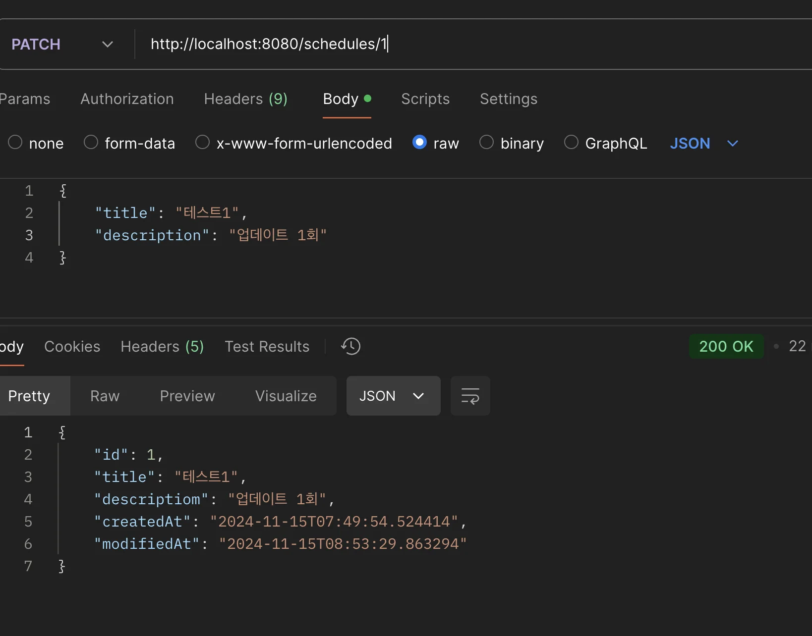

- 실패  &#45; 404 Not Found
    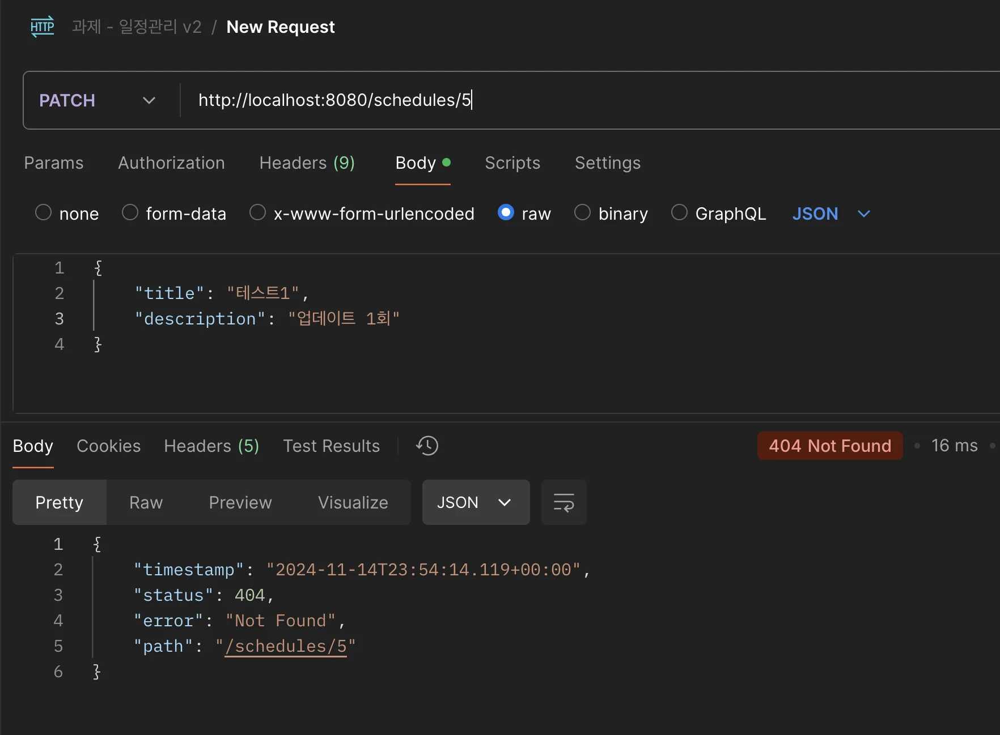

</details>

</details>

<details>
<summary>일정 삭제 API</summary>

<details>
<summary>&#91; 코드 &#93;  ScheduleController  &#45; delete()</summary>

<a id="4bbe98bd8a75454fb00f8125fbc4cfcb"></a>

```java
@RestController
@RequiredArgsConstructor
@RequestMapping("/schedules")
public class ScheduleController {

    private final ScheduleService scheduleService;
    
      .   .  .
    
    @DeleteMapping("/{id}")
    public ResponseEntity<Void> delete(@PathVariable Long id){
        scheduleService.delete(id);

        return new ResponseEntity<>(HttpStatus.NO_CONTENT); // 반환값이 없기 때문에 204 설정
    }
}
```

</details>

<details>
<summary>&#91; 코드 &#93; ScheduleService &#45; delete()</summary>

<a id="b900098e1a2b433ca7e788ea599af06a"></a>

```java
@Service
@RequiredArgsConstructor
public class ScheduleService {

    private final ScheduleRepository scheduleRepository;
		
			.  .  .
			
    public void delete(Long id) {

        Schedule findSchdule = scheduleRepository.findByIdOrElseThrow(id);

        scheduleRepository.delete(findSchdule);
    }
}
```

</details>

---

<details>
<summary>포스트맨 테스트</summary>

- 성공 &#45; 204 No Content
    - 반환값이 없기 때문에 204로 설정

    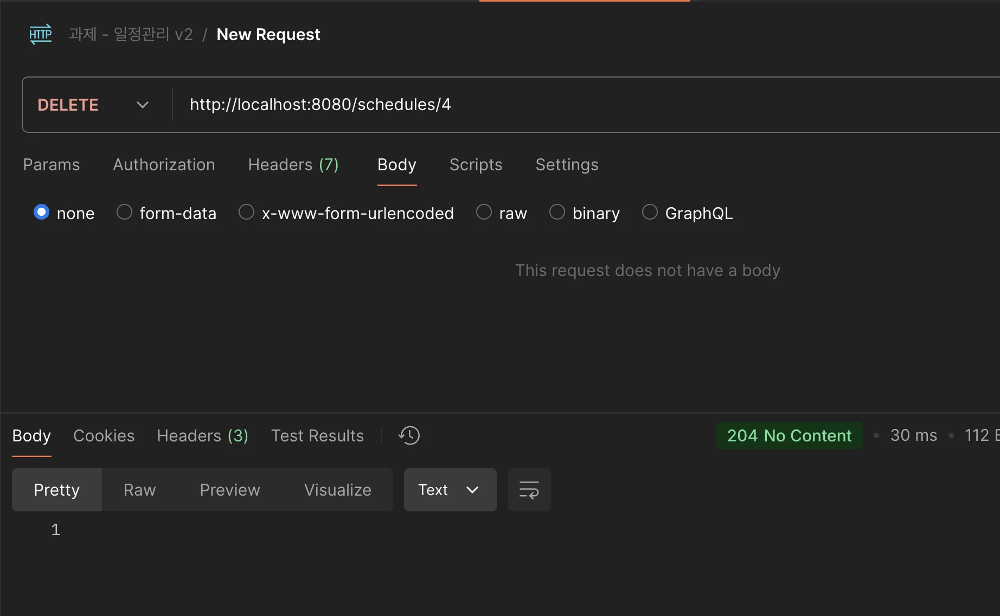

- 실패 &#45; 404 Not Found
    - 재요청 시, 해당 값이 삭제되었기 때문에 컨텐츠 존재 X

    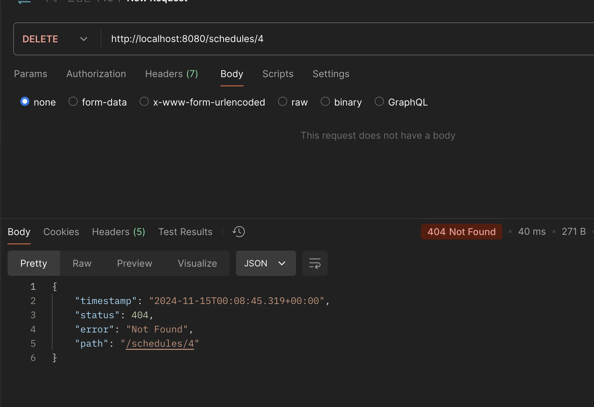

</details>

</details>

<a id="13feda9b0fe18086852bd2cc2e1854b3"></a>

### Lv2

<details>
<summary>Member 엔티티 생성 및 연관관계 설정</summary>

<details>
<summary>&#91; 코드 &#93; Schedule &#45; 연관관계 설정( <code>&#64;ManyToOne</code> ), 지연로딩, 연관관계 메서드 </summary>

<a id="12f56a05bcfb43029a463586b2272093"></a>

```java
package com.example.scheduler_v2.entity;

import jakarta.persistence.*;
import lombok.Getter;
import lombok.NoArgsConstructor;

@Getter
@Entity
@NoArgsConstructor
public class Schedule extends BaseEntity{

    @Id
    @GeneratedValue(strategy = GenerationType.IDENTITY)
    @Column(name = "schedule_id")
    private Long id;

    @Column(nullable = false)
    private String title;

    private String descriptiom;

    @ManyToOne(fetch = FetchType.LAZY)
    @JoinColumn(name = "member_id")
    private Member member;

    public Schedule(String title, String descriptiom) {
        this.title = title;
        this.descriptiom = descriptiom;
    }

    public void update(String title, String descriptiom){
        this.title = title;
        this.descriptiom = descriptiom;
    }

    // 연관관계 메서드
    public void setMember ( Member member ){
        this.member = member;
        member.getScheduleList().add(this);
    }

}

```

</details>

<details>
<summary>&#91; 코드 &#93; Member &#45; 연관관계 설정 ( <code>&#64;OneToMany</code> ), 영속성 전이, 고아객체 </summary>

<a id="3d64c5fa9df343679aed37579651a1fc"></a>

```java
package com.example.scheduler_v2.entity;

import jakarta.persistence.*;
import lombok.Getter;
import lombok.NoArgsConstructor;

import java.util.ArrayList;
import java.util.List;

@Getter
@Entity
@NoArgsConstructor
public class Member extends BaseEntity{
    @Id
    @GeneratedValue(strategy = GenerationType.IDENTITY)
    @Column(name = "user_id")
    private Long id;

    @Column(nullable = false)
    private String username;

    @Column(nullable = false, updatable = true)
    private String email;

    @Column(nullable = false)
    private String password;

    @OneToMany(mappedBy = "member", cascade = CascadeType.ALL, orphanRemoval = true)
    private List<Schedule> scheduleList = new ArrayList<>();
}
```

</details>

</details>

<details>
<summary>회원 생성 API</summary>

<details>
<summary>&#91; 코드 &#93; SignUpRequestDto</summary>

<a id="4f4e9dbf123842ea86d2d303c593cc13"></a>

```java
package com.example.scheduler_v2.dto;

import lombok.AllArgsConstructor;
import lombok.Getter;

@Getter
@AllArgsConstructor
public class SignUpRequestDto {

    private String username;
    private String email;
    private String password;
}

```

</details>

<details>
<summary>&#91; 코드 &#93; SignUpResponseDto</summary>

<a id="79a99f1471b14f208125ab6be0ff39f9"></a>

```java
package com.example.scheduler_v2.dto;

import lombok.AllArgsConstructor;
import lombok.Getter;

@Getter
@AllArgsConstructor
public class SignUpResponseDto {

    private Long id;
    private String username;
    private String email;
}

```

</details>

<details>
<summary>&#91; 코드 &#93; MemberController &#45; signUp()</summary>

<a id="72ccb0d74d1a4d8b8bc9d59594a7738e"></a>

```java
@RestController
@RequiredArgsConstructor
@RequestMapping("/members")
public class MemberController {

    private final MemberService memberService;

    @PostMapping("/signup")
    public ResponseEntity<SignUpResponseDto> signUp(@RequestBody SignUpRequestDto requestDto){

        SignUpResponseDto signUpResponseDto = memberService.signUp(
                requestDto.getUsername(),
                requestDto.getEmail(),
                requestDto.getPassword()
        );

        return new ResponseEntity<>(signUpResponseDto, HttpStatus.CREATED);

    }

}
```

</details>

<details>
<summary>&#91; 코드 &#93; MemberService &#45; signUp()</summary>

<a id="9a1f0f51dc764abfa21574590ba3b982"></a>

```java
@Service
@RequiredArgsConstructor
public class MemberService {

    private final MemberRepository memberRepository;

    public SignUpResponseDto signUp(String username, String email, String password) {
        Member member = new Member(username, email, password);

        Member saveMember = memberRepository.save(member);

        return new SignUpResponseDto(saveMember.getId(), saveMember.getUsername(), saveMember.getEmail());
    }
}
```

</details>

<details>
<summary>&#91; 코드 &#93; MemberRepository</summary>

<a id="50d94accceb04a539c2ac553312de803"></a>

```java
public interface MemberRepository extends JpaRepository<Member, Long> {

}
```

</details>

<details>
<summary>&#91; 코드 &#93; Member &#45; constructor</summary>

<a id="3c83dc513a8e48efb17025e595d34935"></a>

```java
@Getter
@Entity
@NoArgsConstructor
public class Member extends BaseEntity{
    @Id
    @GeneratedValue(strategy = GenerationType.IDENTITY)
    @Column(name = "user_id")
    private Long id;

    @Column(nullable = false)
    private String username;

    @Column(nullable = false, unique = true)
    private String email;

    @Column(nullable = false)
    private String password;

    @OneToMany(mappedBy = "member", cascade = CascadeType.ALL, orphanRemoval = true)
    private List<Schedule> scheduleList = new ArrayList<>();

    public Member(String username, String email, String password) {
        this.username = username;
        this.email = email;
        this.password = password;
    }
}
```

</details>

---

<details>
<summary>포스트맨 테스트</summary>

- 성공  &#45; 201 Created
    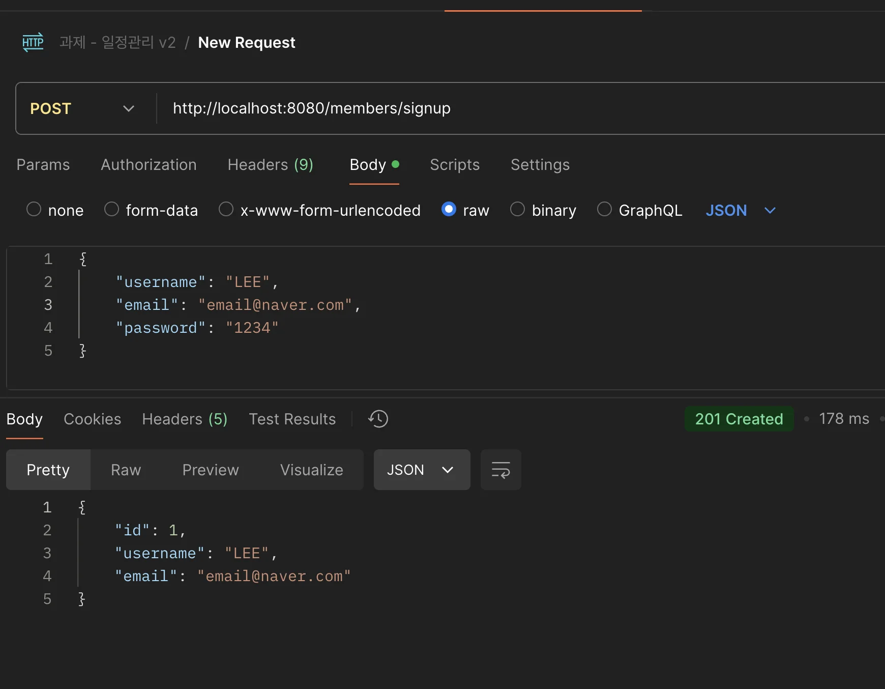

- 실패  &#45; 404 Not Found

</details>

</details>

<details>
<summary>회원 조회 API</summary>

<details>
<summary>&#91; 코드 &#93; MemberResponseDto</summary>

<a id="cde754ac19b54899b895645d283298ec"></a>

```java
@Getter
@AllArgsConstructor
public class MemberResponseDto {

    private String username;
    private String email;
}

```

</details>

<details>
<summary>&#91; 코드 &#93; MemberController &#45; findById()</summary>

<a id="ae622719ad8544bd804f0a2af3350cae"></a>

```java
@RestController
@RequiredArgsConstructor
@RequestMapping("/members")
public class MemberController {

    private final MemberService memberService;
	    
	    .  .  .
	    
    @GetMapping("/{id}")
    public ResponseEntity<MemberResponseDto> findById(@PathVariable Long id){

        MemberResponseDto memberResponseDto = memberService.findById(id);

        return new ResponseEntity<>(memberResponseDto, HttpStatus.OK);
    }
}
```

</details>

<details>
<summary>&#91; 코드 &#93; MemberService &#45; findById()</summary>

<a id="940b9f8bd17342c6b164817cba9e1aeb"></a>

```java
@Service
@RequiredArgsConstructor
public class MemberService {

    private final MemberRepository memberRepository;
    
	    .  .  .
	    
    public MemberResponseDto findById(Long id) {
		    Member findMember = memberRepository.findByIdOrElseThrow(id);
		
		    return new MemberResponseDto(findMember.getUsername(), findMember.getEmail());
		}
}
```

</details>

<details>
<summary>&#91; 코드 &#93; MemberRepository &#45; findByIdOrElseThrow()</summary>

<a id="5461441811fa4f5aa8eeadff92ae430f"></a>

```java
public interface MemberRepository extends JpaRepository<Member, Long> {
    
    default Member findByIdOrElseThrow(Long id){
        return findById(id).orElseThrow(() -> new ResponseStatusException(HttpStatus.NOT_FOUND, "Does not exist id = " + id));
    }
}
```

</details>

---

<details>
<summary>포스트맨 테스트</summary>

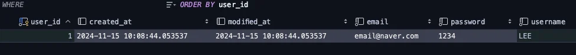

- 성공  &#45; 200 Ok
    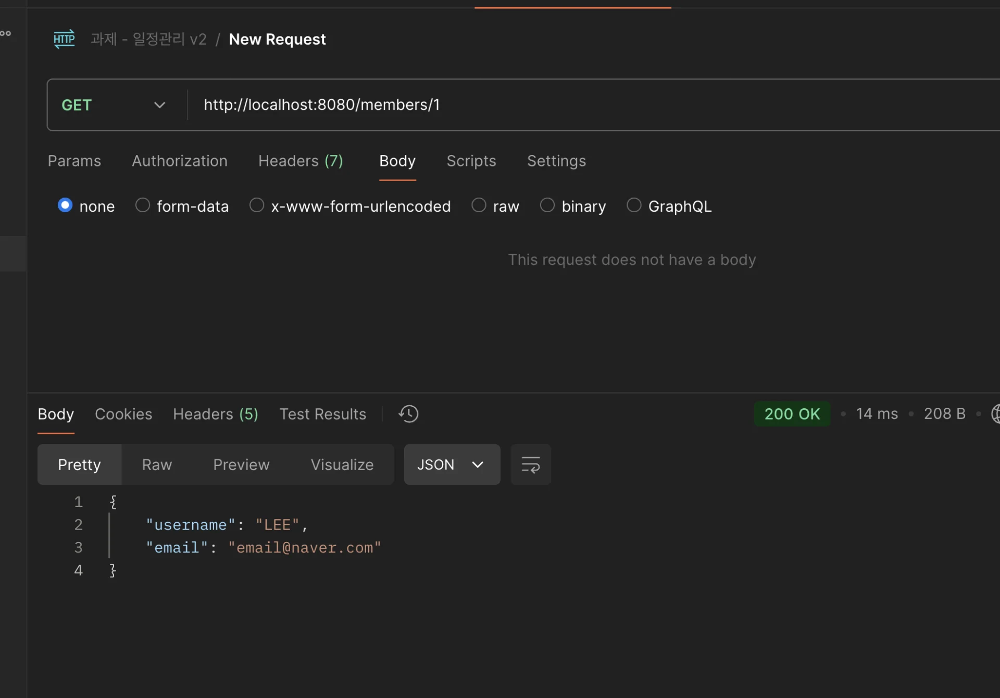

- 실패  &#45; 404 Not Found
    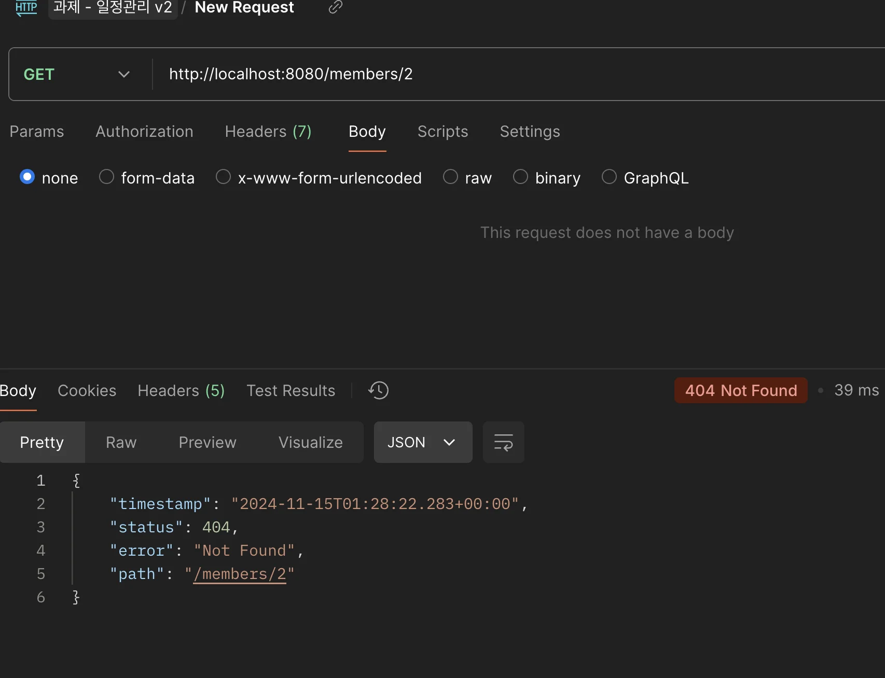

</details>

</details>

<details>
<summary>회원 수정 API</summary>

<details>
<summary>🤬 Error &#45; Path 요청 시, 400 Bad Request가 나옴</summary>

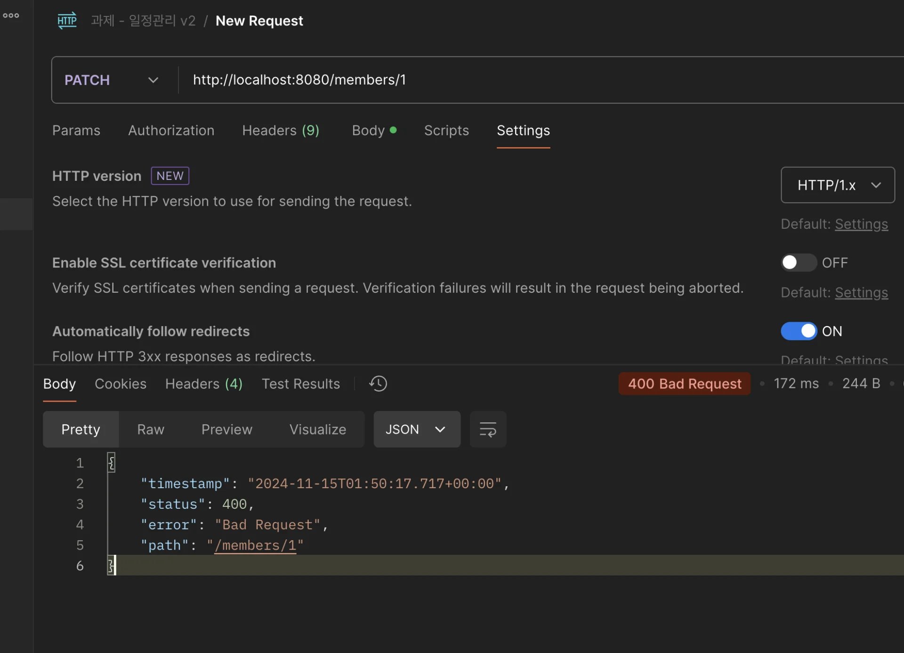

<details>
<summary>&#91; 코드 &#93; UpdateMemberRequestDto</summary>

<a id="13feda9b0fe180f68959c9244200879c"></a>

```java
@Getter
public class UpdateMemberRequestDto {

    private String username;

    public UpdateMemberRequestDto(String username) {
        this.username = username;
    }
}

```

</details>

<details>
<summary>&#91; 코드 &#93; MemberController &#45; updateMember()</summary>

<a id="1141807d6ae749bd8dc5a4f2971f7389"></a>

```java
@RestController
@RequiredArgsConstructor
@RequestMapping("/members")
public class MemberController {

    private final MemberService memberService;
    
	    . . . 
	    
    @PatchMapping("/{id}")
    public ResponseEntity<MemberResponseDto> updateMember(
            @PathVariable Long id,
            @RequestBody UpdateMemberRequestDto requestDto ){

        MemberResponseDto memberResponseDto = memberService.updateMember(id, requestDto.getUsername());

        return new ResponseEntity<>(memberResponseDto, HttpStatus.OK);
    }

```

</details>

<details>
<summary>&#91; 코드 &#93; MemberService &#45; updateMember()</summary>

<a id="5e988d6cd2934fd881319bbd788ef312"></a>

```java
@Service
@RequiredArgsConstructor
public class MemberService {

    private final MemberRepository memberRepository;
    
	    . . . 
	    
    @Transactional
    public MemberResponseDto updateMember(Long id, String username) {

        Member findMember = memberRepository.findByIdOrElseThrow(id);

        findMember.update(username);

        return new MemberResponseDto(findMember.getUsername(), findMember.getEmail());
    }
}

```

</details>

</details>

</details>

<details>
<summary>회원 삭제 API</summary>

<details>
<summary>&#91; 코드 &#93; </summary>

<a id="5d37df1d8f204ce994e476419e2fa3c3"></a>

```java

```

</details>

<details>
<summary>&#91; 코드 &#93; </summary>

<a id="f11181c4c85648fbbd4c5ec824d7b31a"></a>

```java

```

</details>

---

<details>
<summary>포스트맨 테스트</summary>

- 성공 
    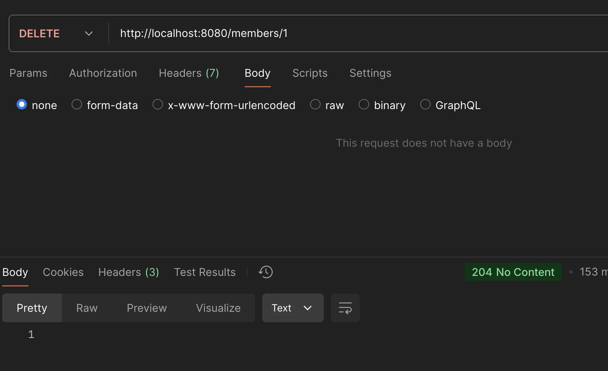

- 실패
    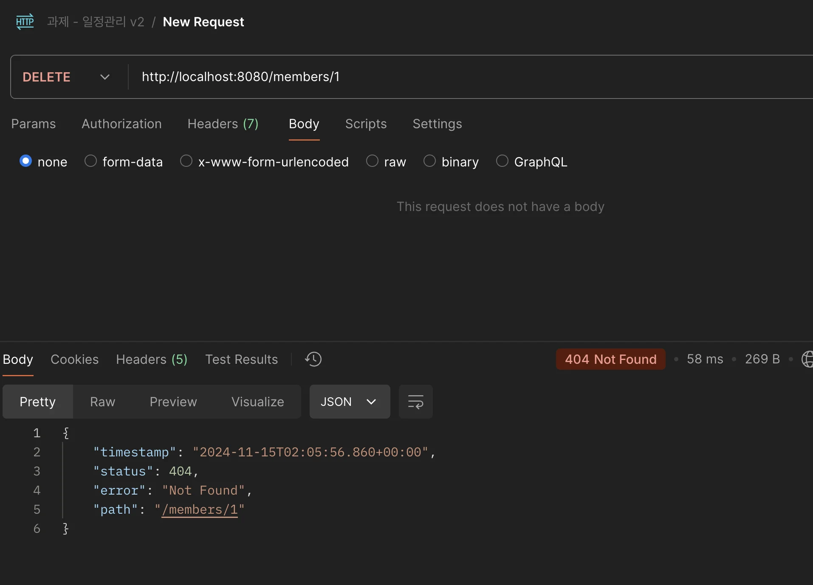

</details>

</details>

<details>
<summary>일정 생성 API 에 회원 연관관계 설정</summary>

<details>
<summary>&#91; 코드 &#93; Schedule &#45; setMember, 연관관계 메서드</summary>

<a id="908ab2c8797b4a15bf550b2c7fd111c1"></a>

```java
@Getter
@Entity
@NoArgsConstructor
public class Schedule extends BaseEntity
		@Id
    @GeneratedValue(strategy = GenerationType.IDENTITY)
    @Column(name = "schedule_id")
    private Long id;

    @Column(nullable = false)
    private String title;

    private String descriptiom;

    @ManyToOne(fetch = FetchType.LAZY)
    @JoinColumn(name = "member_id")
    private Member member;

		.  .  .    
		
		// 연관관계 메서드
    public void setMember ( Member member ){
        this.member = member;
        member.getScheduleList().add(this);
    }
}
```

</details>

<details>
<summary>&#91; 코드 &#93; CreateScheduleRequestDto &#45; <code>memberId</code> 추가</summary>

<a id="512b1f656b1b43ffa573cf067b6c3ab4"></a>

```java
@Getter
@AllArgsConstructor
public class CreateScheduleRequestDto {
    private Long memberId;
    private String title;
    private String description;
}
```

</details>

<details>
<summary>&#91; 코드 &#93; ScheduleController &#45; save()</summary>

- service 로직으로  <code>memberId</code> 값 넘겨주기

<a id="13feda9b0fe1809e8a99e45384e4b22b"></a>

```java
@RestController
@RequiredArgsConstructor
@RequestMapping("/schedules")
public class ScheduleController {

    private final ScheduleService scheduleService;

    @PostMapping
    public ResponseEntity<ScheduleResponseDto> save(@RequestBody CreateScheduleRequestDto requestDto){
        ScheduleResponseDto scheduleResponseDto = scheduleService.save(requestDto.getMemberId(), requestDto.getTitle(), requestDto.getDescription());

        return new ResponseEntity<>(scheduleResponseDto, HttpStatus.CREATED);
    }
```

</details>

<details>
<summary>&#91; 코드 &#93; ScheduleService</summary>

<a id="f82976db2b254eb4b4116f180b9d9b41"></a>

```java

@Service
@RequiredArgsConstructor
public class ScheduleService {

    private final ScheduleRepository scheduleRepository;
    private final MemberRepository memberRepository;
    
    public ScheduleResponseDto save(Long memberId, String title, String description) {

      Member findMember = memberRepository.findByIdOrElseThrow(memberId);

      Schedule schedule = new Schedule(title, description);
      schedule.setMember(findMember);  // 연관관계 메서드

      scheduleRepository.save(schedule);

      return new ScheduleResponseDto(schedule.getId(), schedule.getTitle(), schedule.getDescriptiom(), schedule.getCreatedAt(), schedule.getModifiedAt());
	 }
```

</details>

---

<details>
<summary>포스트맨 테스트 </summary>

- 회원(members)  테이블

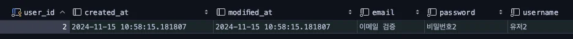

<details>
<summary>성공 &#45; <code>user = 2</code></summary>

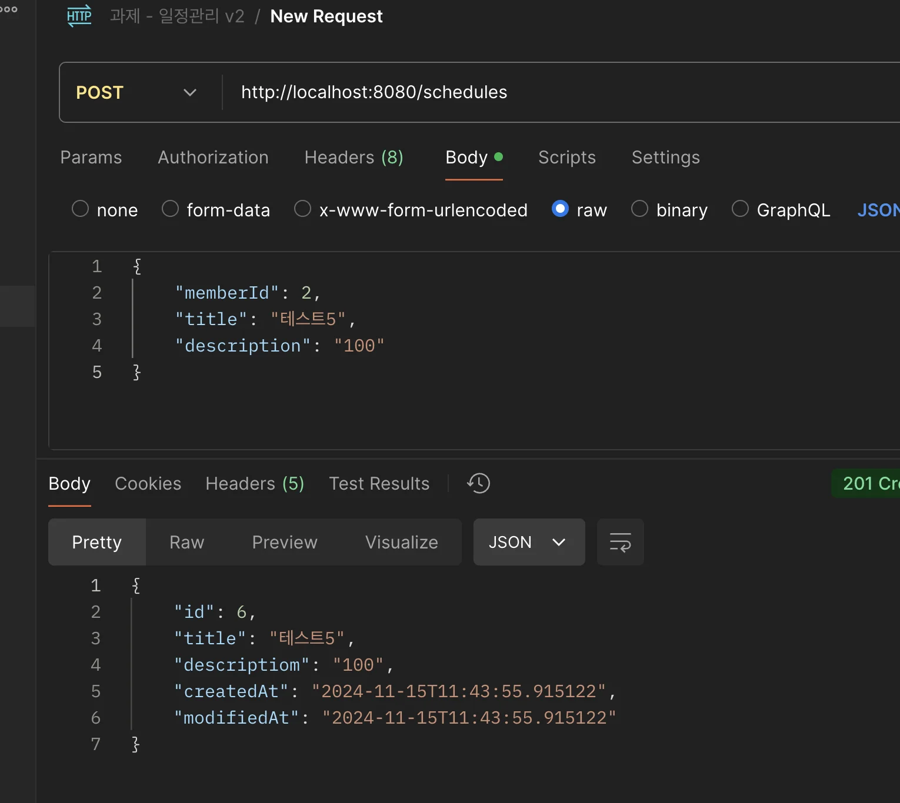

- 일정 테이블에 member&#95;id 값이 정상적으로 들어감
    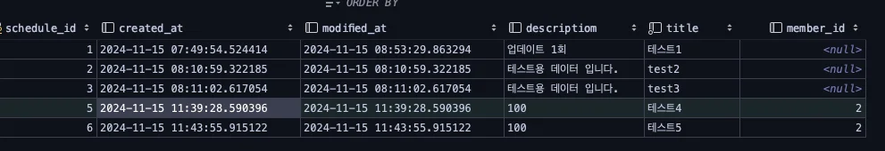

</details>

<details>
<summary>실패 &#45; <code>userId  = 1</code></summary>

- 테이블에 <code>user = 1</code> 없기 때문에 404 Not Found 처리됨

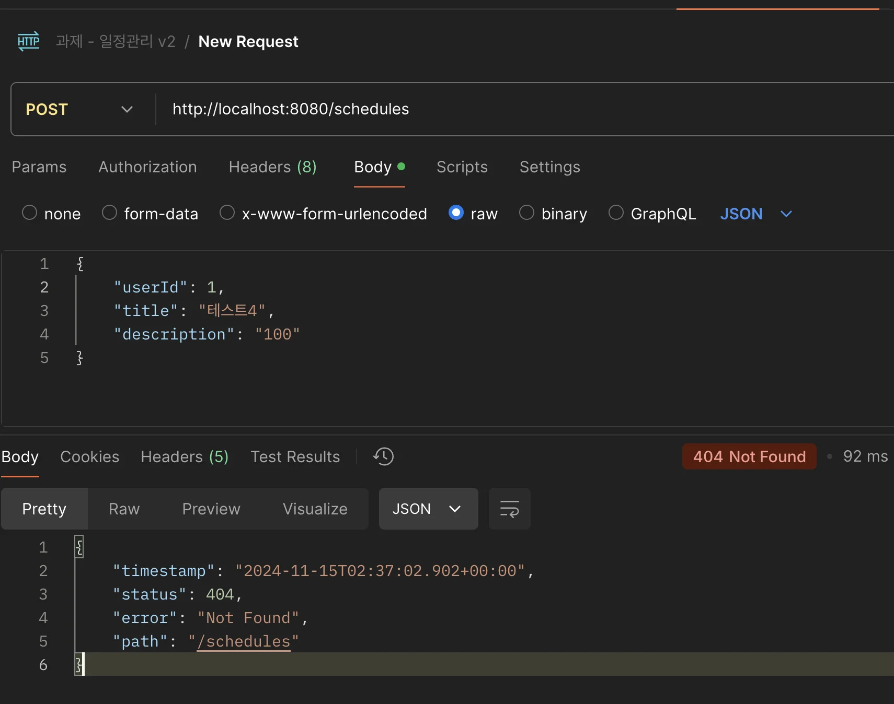

</details>

</details>

</details>

<a id="142eda9b0fe180b2b885db462d77e0c4"></a>

### Lv4

<a id="142eda9b0fe18070a265ccf3c9568f7f"></a>

### Lv5

<a id="142eda9b0fe180e3acf9e4ebe4f40471"></a>

### Lv6
