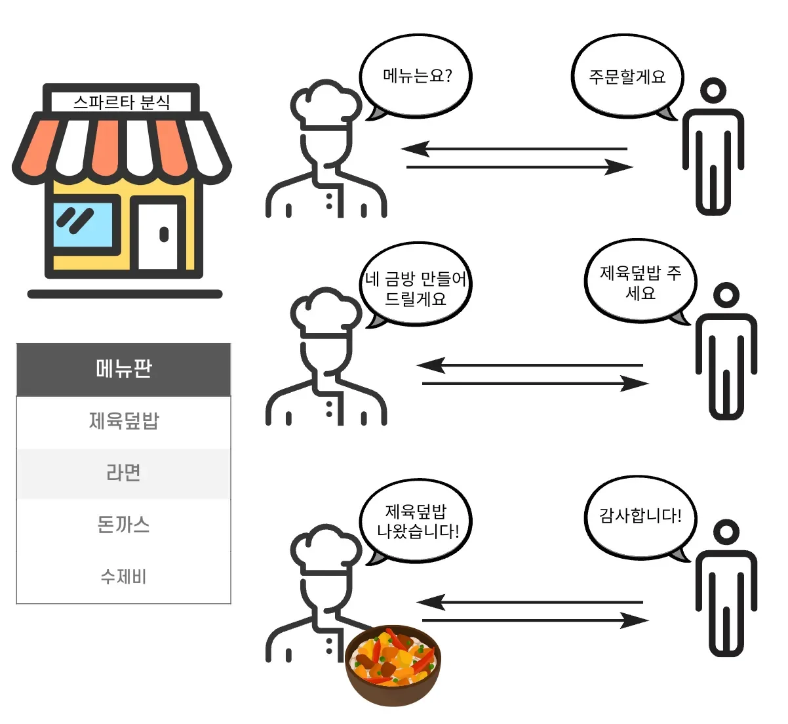
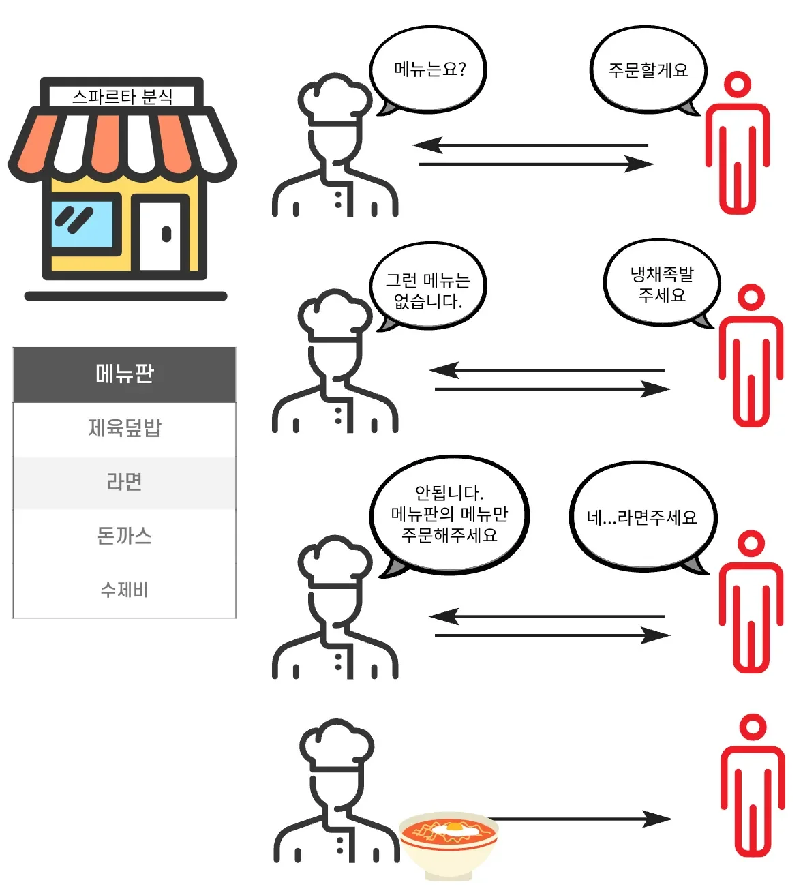
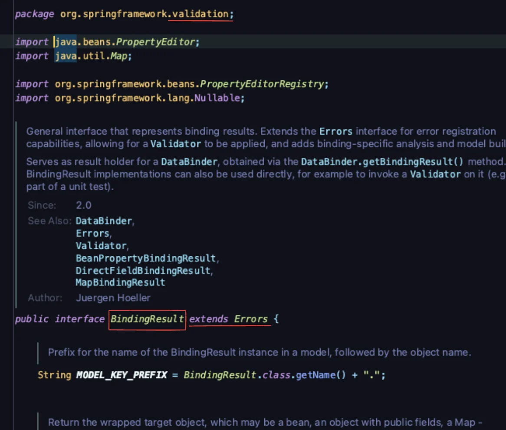
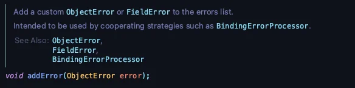
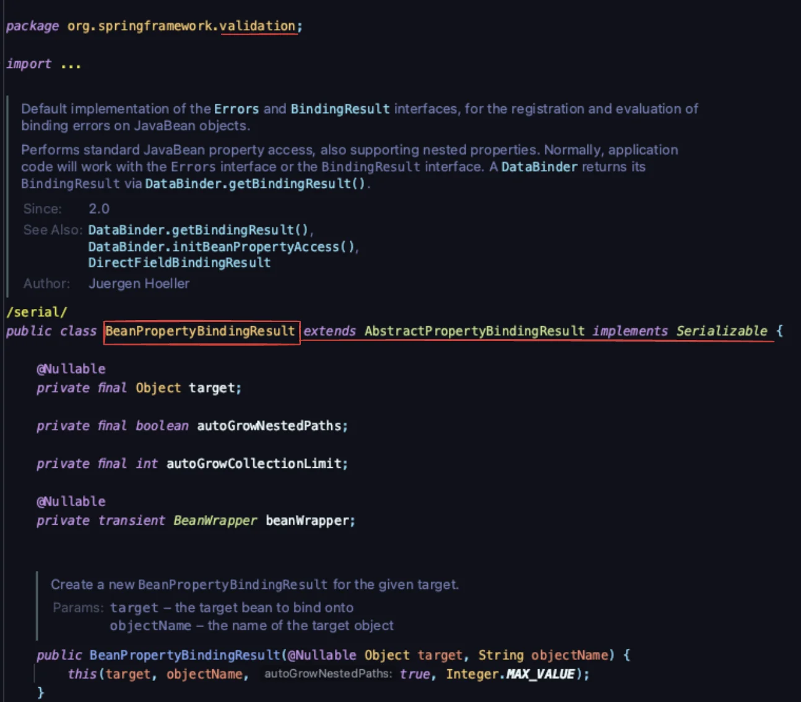
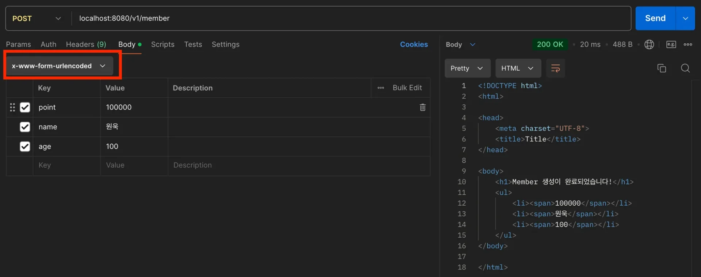
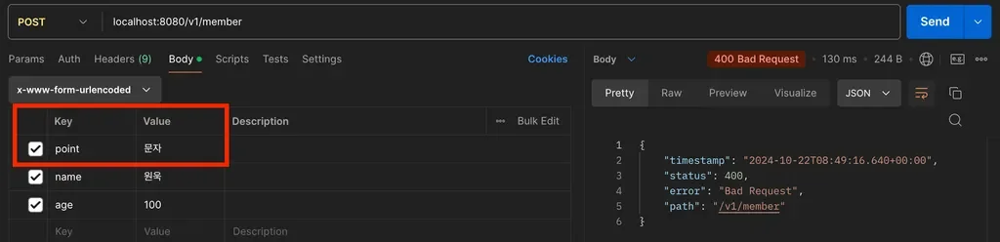
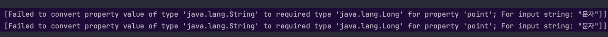
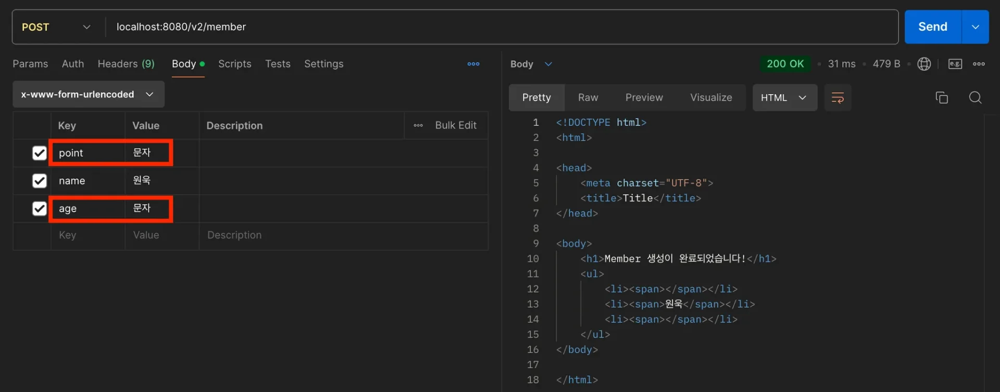
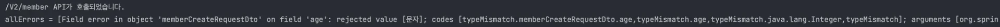

<a id="13ceda9b0fe180e9b2b4c9f6da4f1b8a"></a>

## 검증 ( Validation )

> 📖 
> 
> <a id="13ceda9b0fe18085bb5df835845abc86"></a>
> 
> <strong><u>특정 데이터</u></strong><strong>(주로 </strong><strong><u>클라이언트의 요</u></strong><strong><u>청</u></strong><strong> 데이터)의</strong><strong><u> </u></strong><strong><u>값이 유효한지 확인</u></strong>하는 단계이다&#46;

> ✏️ 
> 
> <a id="13ceda9b0fe18085b81be50691ae4bd5"></a>
> 
> <u>Controlelr의 주요 역할</u> 중 하나는 <strong><code>Validation</code></strong>이다&#46; 
> 
> <a id="5e09d1ef345b4c00a2dd442b89d1011c"></a>
> 
>  → <u>HTTP 요청</u>으로 <u>받아오는 값들</u>이 <u>정상</u>인지 확인

<details>
<summary>Validation</summary>

> <strong>시스템</strong>이 <u>미리 정의한 사양(specification)에 부합</u>하고 있는지 <u>검증</u>하는 것

<details>
<summary>예시 &#45; 식당 음식 주문</summary>



- 식당 메뉴판(specification)에 있는 메뉴만 주문이 가능



- 안내를 통해 제대로된 주문을 받을 수 있다&#46;

</details>

</details>

<details>
<summary>Validation을 사용하는 이유</summary>

- 객체의 필드(상태)에 잘못된 값이 들어가는 경우
    - 동일한 타입이어서 컴파일 오류로 잡아낼 수 없는 경우, 런타임 시 확인 가능하다&#46; 

    - 테스트 코드 작성 시, 테스트를 통해 확인

- <code>null</code> 값이 들어와 <strong><code>NullpointException</code></strong>이 발생 → <u>시스템 실행 중단</u>

</details>

<details>
<summary>Validation의 역할</summary>

- 검증을 통해 적절한 메세지를 유저에게 보여줘야 한다&#46;

- 검증이 되지않아 발생되는 오류가  없어야 한다&#46;

- 사용자가 입력한 데이터는 유지된 상태여야 한다&#46;

</details>

<details>
<summary>검증의 종류</summary>

> ✏️ 
> 
> <a id="df18b4a23aaf4a27b28dd4cfb0cf571b"></a>
> 
> 기본적으로 <u>프론트, 서버, 데이터베이스 모두 검증을 꼼꼼하게 해</u>야한다&#46; Validation으로 <strong><u>수많은 Error</u></strong>와 <u>문제들</u>을 방지할 수 있다&#46;

<details>
<summary>프론트 검증</summary>

- 해당 검증은 <u>유저가 조작 가능</u>하다&#46; 따라서 <u>보안에 취약</u>하다

- 그럼에도<u> 특정 상황에서 꼭 필요</u>하다&#46;

- ex) 비밀번호에 특수문자가 포함되어야 한다면  즉각적으로 alter를 통해 유저에게 알림  → 유저 사용성 증가

</details>

<details>
<summary>서버 검증</summary>

> ☝🏻 
> 
> - 프론트 검증없이 서버에서만 검증한다면 유저의 사용성이 떨어진다&#46;
> 
> - 물론 서버 검증은 선택이 아닌 필수이다&#46;

- API Spec을 정의( <code>API 명세서</code> ) 해서 <strong><u>Validation 오류를 Reponse 예시에 남</u></strong>겨주어야 한다&#46;
    - API 명세서를 잘 만들어야 그에 맞는 대응을 할 수 있다&#46;

</details>

<details>
<summary>데이터베이스 검증</summary>

- <code>Not Null</code>,<code> Default</code>와 같은 제약조건 설정

- 최종 방어선의 역할 수행

</details>

</details>

<a id="13ceda9b0fe1809889b0f0c9d937f403"></a>

## BindingResult

> 📖 
> 
> <a id="412fd89aef264b4c8b60be65fa475843"></a>
> 
> Spring에서 기본적으로 제공되는 <strong><u>Validation 오류를 보관하는 객체</u></strong>이다&#46;<br>주로<u> 사용자 입력을 검증</u>할 때 많이 사용하며, <code>Field Error</code>와 <code>ObjecError</code>를 보관한다&#46; 

<details>
<summary>BindingResult</summary>

<details>
<summary><u>Errors 인터페이스를 상속</u>받는 인터페이스이다&#46;</summary>



</details>

-  Errors 인터페이스는 <u>에러의 저장과 조회</u> 기능을 제공한다&#46;

<details>
<summary>BindingResult는 <code>addError()</code> 와 같은 추가적인 기능을 제공한다&#46;</summary>



</details>

<details>
<summary>Spring이 기본적으로 사용하는 구현체는 <code>BeanPropertyBindingResult</code>이다&#46; </summary>



</details>

</details>

<details>
<summary>파라미터에 BindingResult가 없는 경우</summary>

<details>
<summary>&#91; 코드 &#93; <code>View</code> </summary>

<a id="fba20ccdb4f14b19b6201b828869fca7"></a>

```html
<!DOCTYPE html>
<html xmlns:th="http://www.thymeleaf.org">
<head>
    <meta charset="UTF-8">
    <title>Title</title>
</head>
<body>
    <h1>Member 생성이 완료되었습니다!</h1>
    <ul>
        <li><span th:text="${point}">포인트</span></li>
        <li><span th:text="${name}">이름</span></li>
        <li><span th:text="${age}">나이</span></li>
    </ul>
</body>
</html>
```

</details>

<details>
<summary>&#91; 코드 &#93; <code>Dto</code> &#45;  MemberCreateRequestDto</summary>

- View에서 입력받은 값을 Spring에서 자동으로 해당 Dto 형태로 변환하여 받아온다&#46; 

<a id="13ceda9b0fe180b5b3afd2e74440d670"></a>

```java
@Data
public class MemberCreateRequestDto {
    private Long point;
    private String name;
    private Integer age;
}
```

</details>

<details>
<summary>&#91; 코드 &#93; <code>Controller</code> &#45; BingdingResultController</summary>

<a id="f33318ede2a94255b7b017596994930a"></a>

```java
// View 반환
@Controller
public class BingdingResultController {
	
    @PostMapping("/v1/member")
    public String createMemberV1(@ModelAttribute MemberCreateRequestDto request, Model model) {

        System.out.println("/V1/member API가 호출되었습니다.");

        // Model에 저장
        model.addAttribute("point", request.getPoint());
        model.addAttribute("name", request.getName());
        model.addAttribute("age", request.getAge());

        // Thymeleaf Template Engine View Name
        return "complete";
    }
}
```

</details>

<details>
<summary>포스트맨 테스트</summary>

- 정상 요청
    

- 잘못된 요청 &#45; Long 필드(point) 에 문자열 입력
    

    - <strong>400 Bad Request</strong>가 발생하고 Controller가 호출되지 않음
        

</details>

</details>

<details>
<summary>파라미터에 BindingResult가 있는 경우</summary>

> ☝🏻 
> 
> <a id="18fe3506968c4b86b827f013912b7689"></a>
> 
> <code>BindingResult 파라미터</code>는 <strong><code>검증대상 파라미터</code></strong><strong> </strong><strong><u>뒤</u></strong><strong>에 위치</strong>해야 한다&#46;

<details>
<summary>&#91; 코드 &#93; <code>View</code> </summary>

<a id="87b6f8c1b32c4ac5b0a860d9daeafdc0"></a>

```html
<!DOCTYPE html>
<html xmlns:th="http://www.thymeleaf.org">
<head>
    <meta charset="UTF-8">
    <title>Title</title>
</head>
<body>
    <h1>Member 생성이 완료되었습니다!</h1>
    <ul>
        <li><span th:text="${point}">포인트</span></li>
        <li><span th:text="${name}">이름</span></li>
        <li><span th:text="${age}">나이</span></li>
    </ul>
</body>
</html>
```

</details>

<details>
<summary>&#91; 코드 &#93; <code>Dto</code> &#45;  MemberCreateRequestDto</summary>

- View에서 입력받은 값을 Spring에서 자동으로 해당 Dto 형태로 변환하여 받아온다&#46; 

<a id="02a7339fdfae4d209b59d231200c7f03"></a>

```java
@Data
public class MemberCreateRequestDto {
    private Long point;
    private String name;
    private Integer age;
}
```

</details>

<details>
<summary>&#91; 코드 &#93; <code>Controller</code> &#45; BingdingResultController, BindingResult 사용</summary>

<a id="66a21e5b2ec841a18c895b770bd8f41e"></a>

```java
// View 반환
@Controller
public class BingdingResultController {
	
    
    @PostMapping("/v2/member")
    public String createMemberV2(
            // 검증 대상( @ModelAttribute ) 뒤에 BindingResult 위치
            @ModelAttribute MemberCreateRequestDto request, // 검증 대상
            BindingResult bindingResult,
            Model model
    ) {

        System.out.println("/V2/member API가 호출되었습니다.");

        // BindingResult의 에러 출력
        List<ObjectError> allErrors = bindingResult.getAllErrors();
        System.out.println("allErrors = " + allErrors);

        // Model에 저장
        model.addAttribute("point", request.getPoint());
        model.addAttribute("name", request.getName());
        model.addAttribute("age", request.getAge());

        return "complete";
    }
}
```

</details>

<details>
<summary>포스트맨 테스트</summary>

<details>
<summary>요청 오류 </summary>



- <code>&#64;ModelAttribute</code> 필드 or 객체에 파라미터 바인딩 오류 발생

- 오류가 발생된 필드를 제외한 필드만 정상 바인딩 된다&#46; 
    - <code>BindingResult</code>에 <strong><u>오류가 보관</u></strong>되고 Controller는 정상적으로 호출된다&#46;

    

</details>

</details>

</details>
