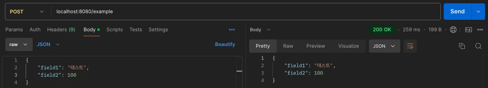
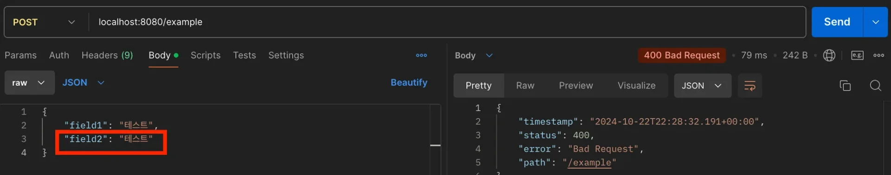
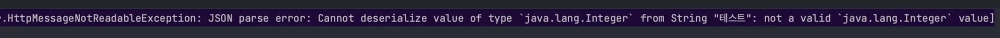
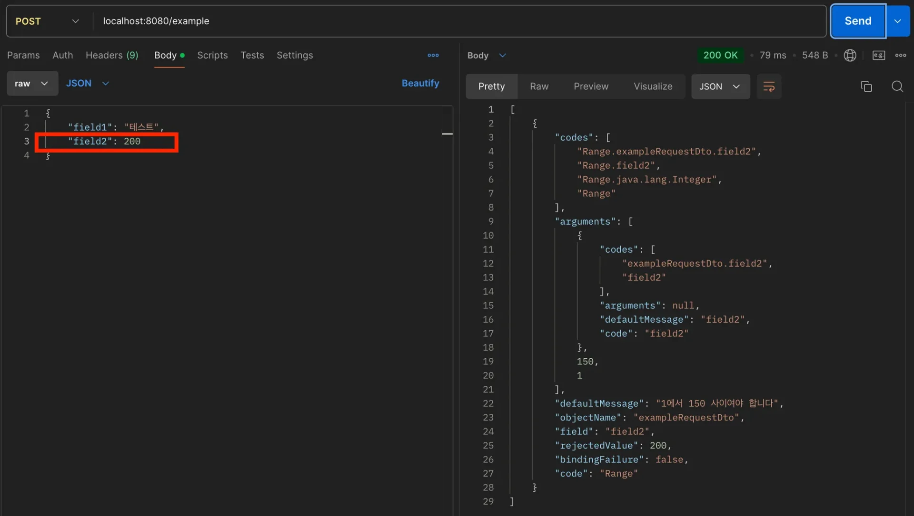

<a id="13ceda9b0fe1807194f2c41c8a3dc8a9"></a>

## <code>&#64;ModelAttribute</code>, <code>&#64;RequestBody</code>

> 📖 
> 
> <a id="13ceda9b0fe1805d9503fa5adea44b14"></a>
> 
> <code>&#64;Valid</code>, <code>&#64;Validated</code>는 <code>&#64;ModelAttribute</code>뿐만 아니라 <code>&#64;RequestBody</code>에도 적용 가능하다&#46;
> 
> - Form Data(x&#45;www&#45;urlencoded) → <code>&#64;ModelAttribute</code>
> 
> - HTTP Body Data &#45; 객체 변환 → <code>&#64;RequestBody</code>

<details>
<summary><strong>&#64;RequestBody 적용</strong></summary>

<details>
<summary>&#91; 코드 &#93;  요청 DTO </summary>

<a id="335eff8da7bb4376b41af4f083a9a152"></a>

```java
@Data
public class ExampleRequestDto {

	@NotBlank
	private String field1;

	@NotNull
	@Range(min = 1, max = 150)
	private Integer field2;

}
```

</details>

<details>
<summary>&#91; 코드 &#93; Controller</summary>

<a id="09db5cc8a0ab40e4acd64431a8d86075"></a>

```java

@Slf4j
@RestController
public class RequestBodyController {
	
    @PostMapping("/example")
    public Object save(
            @Validated @RequestBody ExampleRequestDto dto,
            BindingResult bindingResult
    ) {
        log.info("RequestBody Controller 호출");

        if(bindingResult.hasErrors()) {
            log.info("validation errors={}", bindingResult);
            // Field, Object Error 모두 JSON으로 반환
            return bindingResult.getAllErrors();
        }

        // 성공 시 RequestDto 반환(의미 없음)
        return dto;
    }
}
```

</details>

</details>

<details>
<summary><strong>Rest API 요청 &#45;  세가지 경우 수 ( 성공, 실패, 검증 오류 )</strong></summary>

<details>
<summary>1&#46; 성공</summary>



- Controller 정상 호출 및 응답 반환

</details>

<details>
<summary>2&#46; <code>실패 요청</code>&#58; JSON을 객체로 변환하는 것 자체가 실패</summary>





- <code>field2</code>에 String 입력
    - JSON → Object 변환 실패

> ☝🏻 
> 
> <a id="984105fb873c439f9fc225bb35247725"></a>
> 
> <strong>중요&#33; &#45; Controller가 호출되지 않는다&#46;</strong>
> 
> <a id="13ceda9b0fe180fd92dee7615d53f49e"></a>
> 
> 반드시 JSON → Object로 변환이 되어야 Validation이 진행된다&#46;

</details>

<details>
<summary>3&#46; <code>검증 오류 요청</code>&#58; JSON을 객체로 변환하는 것은 성공, 검증에서 실패</summary>



- field2의 값에 범위를 넘어서는 값 입력 <code>&#64;Range(max = 150)</code>
    - <code>bindingResult&#46;getAllErrors()</code> 가 MessageConverter에 의해 JSON으로 변환되어 반환됨
        - Controller를 실제로 호출하지만 log로 작성한 <strong><u>bindingResult error</u></strong>들이 콘솔에 출력된다&#46;

</details>

</details>
