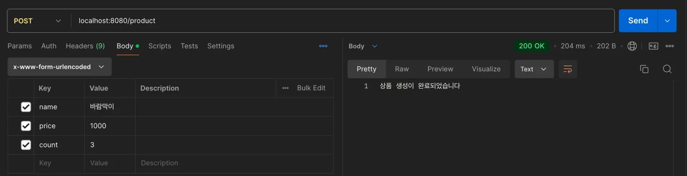
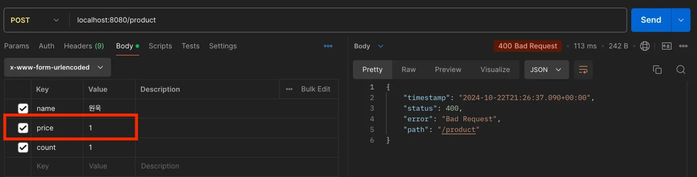
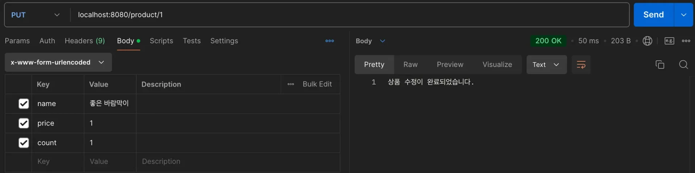
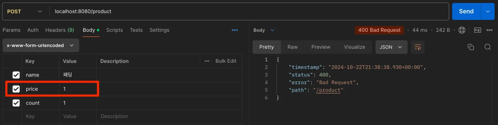
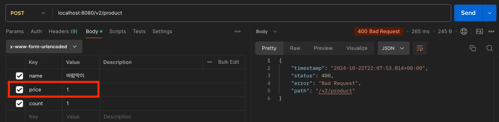
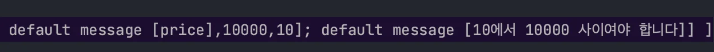
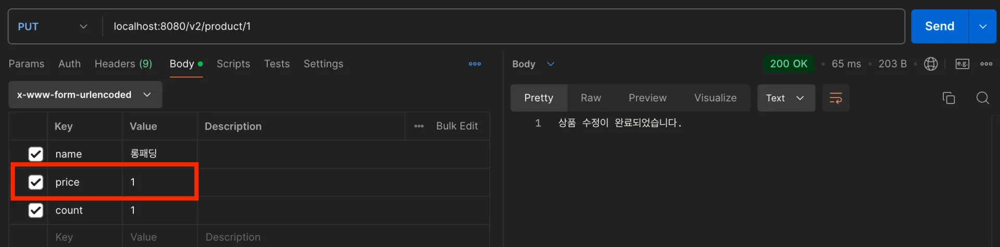

<a id="13ceda9b0fe1803da268f6e9db37291e"></a>

## Bean Validation의 충돌

> ❔ 
> 
> <a id="13ceda9b0fe180c981f6cf583425f090"></a>
> 
> <u>등록, 수정 API</u>에서 각각 <u>다른 Validation이 적용</u>된다면, 즉 충돌이 발생된다면 어떻게 처리해야 하는가?

> ☝🏻 
> 
> <a id="f42f623a625f464e92b067ad497b98dd"></a>
> 
> 일반적으로 <u>수정 API </u> 구성 시, <u>식별자 id 값</u>을 <u>항상 Controller에서 받</u><u>도록</u> 한다&#46;
> 
> <a id="141eda9b0fe1800a8260cfef2a34fec4"></a>
> 
> <u>HTTP 요청</u>은 <u>사용자가 임의로 변경 가능</u>하므로 항상 <u>서버에서 최종적으로 추가 검증</u>을 진행 해야한다&#46;
> 
> - ex) 게시글 수정 시, 요청자 본인이 쓴 글인지 id 값으로 확인

<details>
<summary>Bean Validation 충돌 예시</summary>

<details>
<summary>요구사항</summary>

<details>
<summary>엔티티 &#45; 상품 </summary>

- id (식별자)

- name (이름)

- price (가격)

- count (재고)

</details>

- 상품 등록 API
    - <strong><u>식별자 값 필수 ❌</u></strong><strong> </strong>( 식별자(id) DB에서 해당 상품이 등록 시에 생성됨 )

    - name은 <code>null</code>, <code>“”,</code> <code>“ “</code>을 허용하지 않음

    - <strong>price</strong><strong>는 </strong><strong><u>10 &#126; 10000 사이의 숫자</u></strong><strong>로 생성</strong>

    - count는 1 &#126; 999 사이의 숫자로 생성

- 상품 수정 API 
    - <strong><u>식별자 값 필수</u></strong>  → 검증 필요

    - name은 <code>null</code>, <code>“”,</code> <code>“ “</code>을 허용하지 않음

    - <strong>price</strong><strong>는 </strong><strong><u>무제한</u></strong><strong>으로 허용</strong>

    - count는 1 &#126; 999 사이의 숫자로 생성

</details>

<details>
<summary>오류 상황</summary>

> 🤬 
> 
> <a id="338eda9b0fe180218ce8f3ef8f07021b"></a>
> 
> <strong>Bean Validation 충돌 </strong>
> 
> - <strong><u>상품 등록 및 수정 API</u></strong>에서 <strong>동일한 DTO 사용</strong>
> 
> - 수정 API의  Bean Validdation 변경 시, 동일한 DTO를 사용하는 상품 등록 API 에도 영향이 간다&#46;  
>     - 상품 등록 시 정의한 스펙에 맞는 Validaion이 되지 않음

- 상품 등록(저장) API
    <details>
    <summary>&#91; 코드 &#93;  요청 DTO </summary>

    - price&#58; 10 &#126; 10000 사이의 숫자

    <a id="13ceda9b0fe180a19076ef13b3877a1c"></a>

    ```java
    @Data
    public class ProductReqDto {

    		// 식별자는 Database에서 자동생성
    		
        @NotBlank
        private String name;

        @NotNull
        @Range(min = 10, max = 10000)
        private Integer price;

        @NotNull
        @Range(min = 1, max = 999)
        private Integer count;
    }
    ```

    </details>

    <details>
    <summary>&#91; 코드 &#93; Controller</summary>

    <a id="9f6aa68cddc64da3bd75dd5c4064bd7c"></a>

    ```java
    @Slf4j
    @RestController
    public class ConflictValidationController {

        @PostMapping("/product")
        public String save(
                @Validated @ModelAttribute ProductReqDto requestDto
        ) {
    				log.info("생성 API가 호출 되었습니다.");
            // Validation 성공시 repository 저장로직 호출
            return "상품 생성이 완료되었습니다";
        }
    }
    ```

    </details>

    <details>
    <summary>포스트맨 테스트</summary>

    <details>
    <summary>성공</summary>

    - Controller 정상 호출

    

    </details>

    - 실패 &#45; <strong>400 Bad Request</strong>
        - Controller 호출 ❌ 

        

    </details>

- 상품 <strong>수정 API</strong>
    <details>
    <summary>&#91; 코드 &#93;  요청 DTO </summary>

    - price&#58; 무제한

    <a id="9892f1a14f48430fa7f78f9a570ebdd7"></a>

    ```java
    @Data
    public class ProductReqDto {
    	
    		@NotBlank
        private String name;

    		// price 무제한 요구사항 반영
        @NotNull
        private Integer price;

        @NotNull
        @Range(min = 1, max = 999)
        private Integer count;
    }
    ```

    </details>

    <details>
    <summary>&#91; 코드 &#93; ConflictValidationController</summary>

    <a id="2386a6b272c94a0fa43598637b46b555"></a>

    ```java
    @Slf4j
    @RestController
    public class ConflictValidationController {
        @PutMapping("/product/{id}")
        public String update(
                @PathVariable Long id,
                @Validated @ModelAttribute ProductReqDto test
        ) {
            log.info("수정 API가 호출 되었습니다.");
            // Validation 성공시 repository 수정로직 호출
            return "상품 수정이 완료되었습니다.";
        }
    }
    ```

    </details>

</details>

<details>
<summary>해결 &#45; DTO 분리</summary>

> DTO를 각 API 마다 분리하여 의존성이 형성되지 않도록 리펙토링

- 상품 <strong>수정 API</strong>
    <details>
    <summary>&#91; 코드 &#93;  요청 DTO </summary>

    - price&#58; 무제한

    <a id="338eda9b0fe18019ad79e8094c1664ca"></a>

    ```java
    @Data
    public class ProductUpdateReqDto {
    	
    		@NotBlank
        private String name;

    		// price 무제한 요구사항 반영
        @NotNull
        private Integer price;

        @NotNull
        @Range(min = 1, max = 999)
        private Integer count;
    }
    ```

    </details>

    <details>
    <summary>&#91; 코드 &#93; ConflictValidationController</summary>

    <a id="338eda9b0fe180b4927af2a92ae01d20"></a>

    ```java
    @Slf4j
    @RestController
    public class ConflictValidationController {
        @PutMapping("/product/{id}")
        public String update(
                @PathVariable Long id,
                @Validated @ModelAttribute ProductUpdateReqDto test
        ) {
            log.info("수정 API가 호출 되었습니다.");
            // Validation 성공시 repository 수정로직 호출
            return "상품 수정이 완료되었습니다.";
        }
    }
    ```

    </details>

    <details>
    <summary>포스트맨 테스트</summary>

    

    </details>

- 상품 등록(저장) API
    <details>
    <summary>&#91; 코드 &#93;  요청 DTO </summary>

    <a id="338eda9b0fe18049a0c3db13a9ce5e51"></a>

    ```java
    @Data
    public class ProductCreateReqDto {

    		// 식별자는 Database에서 자동생성
    		
        @NotBlank
        private String name;

        @NotNull
        @Range(min = 10, max = 10000)
        private Integer price;

        @NotNull
        @Range(min = 1, max = 999)
        private Integer count;
    }
    ```

    - price&#58; 10 &#126; 10000 사이의 숫자

    </details>

    <details>
    <summary>&#91; 코드 &#93; Controller</summary>

    <a id="338eda9b0fe180f69653d029cd38aa15"></a>

    ```java
    @Slf4j
    @RestController
    public class ConflictValidationController {

        @PostMapping("/product")
        public String save(
                @Validated @ModelAttribute ProductCreateReqDto requestDto
        ) {
    				log.info("생성 API가 호출 되었습니다.");
            // Validation 성공시 repository 저장로직 호출
            return "상품 생성이 완료되었습니다";
        }
    }
    ```

    </details>

    <details>
    <summary>포스트맨 테스트</summary>

    

    - price 필드에 <code>&#64;Range</code> 가 사라져서 저장시에도 제한없이 저장된다&#46;

    </details>

</details>

</details>

<details>
<summary>해결 방법</summary>

1. DTO 분리
    - 저장할 Object를 직접 사용하지 않고 <code>SaveRequestDto</code>, <code>UpdateRequestDto</code> 따로 사용

1. groups 기능
    - Bean Validation의 groups 기능을 사용

</details>

<a id="13ceda9b0fe180c3bbd3fa474b3e7d07"></a>

## groups

> 📖 
> 
> <a id="13ceda9b0fe1803f9c8af473d55e3519"></a>
> 
> <code>Bean Validation</code>의 <code>groups</code> 속성은 다양한 유효성 검사 시나리오를 정의할 때 사용된다&#46; 동일한 객체에 대한 검증을 상황에 따라 다르게 적용하고 싶을 때 <code>groups</code>를 활용할 수 있다

<details>
<summary><strong>groups 속성 적용</strong></summary>

<details>
<summary>&#91;코드&#93; ProductRequestDtoV2</summary>

<a id="338eda9b0fe180198a50edd30fc96d73"></a>

```java
// 저장용 group
public interface SaveCheck {

}

// 수정용 group
public interface UpdateCheck {

}

@Data
public class ProductRequestDtoV2 {

    // 저장, 수정 @NotBlank Validation 적용
    @NotBlank(groups = {SaveCheck.class, UpdateCheck.class})
    private String name;

    // 사용하는 모든곳에서 @NotNull Validation 적용
    @NotNull
    // 저장만 @Range 반영
    @Range(min = 10, max = 10000, groups = SaveCheck.class)
    private Integer price;

    @NotNull
    @Range(min = 1, max = 999)
    private Integer count;

}

@Slf4j
@RestController
public class ProductController {

    @PostMapping("/v2/product")
    public String save(
            // 저장 속성값 설정
            @Validated(SaveCheck.class) @ModelAttribute ProductRequestDtoV2 requestDtoV2
    ) {
        log.info("생성 API가 호출 되었습니다.");
        // Validation 성공시 repository 저장로직 호출
        return "상품 생성이 완료되었습니다";
    }

    @PutMapping("/v2/product/{id}")
    public String update(
            @PathVariable Long id,
            // 수정 속성값 설정
            @Validated(UpdateCheck.class) @ModelAttribute ProductRequestDto test
    ) {
        log.info("수정 API가 호출 되었습니다.");
        // Validation 성공시 repository 수정로직 호출
        return "상품 수정이 완료되었습니다.";
    }

}
```

</details>

<details>
<summary>Postman 테스트</summary>

- 저장 Validation
    

    

- 수정
    

</details>

</details>

<a id="13ceda9b0fe1807db164e207ea5aeff9"></a>

## groups VS DTO 분리

> 📖 
> 
> <a id="13ceda9b0fe180b5abd0e0edea421f80"></a>
> 
> Bean Validation의 충돌이 발생하는 경우, 대부분 <u>DTO를 분리</u>하는 방법이 적절하다&#46;

<details>
<summary> <strong>groups VS </strong><strong>DTO 분리</strong></summary>

- <u>groups 속성을 사용</u>하면 <u>등록</u>과 <u>수정</u>시 <u>각각 다르게 Validation</u>이 적용된다&#46;

- 실무에서는 <u>등록 폼</u>과 <u>수정 폼</u> 자체를 <u>분리</u>해서 사용하기 때문에 <strong>DTO 분리 방법을 사용</strong>
    - 단, 네이밍은 일관성 있게 작성
        - ex) SaveRequestDto, UpdateRequestDto …

</details>

<details>
<summary><strong>DTO 분리</strong></summary>

<a id="13ceda9b0fe180f78af3c8593b60cbde"></a>

실제로 간단한 프로젝트를 개발해보면 저장, 수정시 Request가 비슷한 경우가 있는데, <br>각각의 장단점이 존재하지만<u> 어설프게 하나로 합칠 경우,</u> 유지보수 시 <u>엄청난 경험 ( 굉장히 무서운 표현…)</u>을 선사한다고 한다&#46;

- <u>RequestDto가 변</u>한다는건 <u>해당 API의 스펙 자체가 변경</u>되어 수많은 변경이 발생된다&#46; 

- 실무에서는 거의 발생하지 않는 경우기 때문에 <u>간단한게 아니라면 대부분 분리해서 처리</u>해야 한다&#46; 

</details>
