<details>
<summary>공식 문서  &#45; Hibernate Validator</summary>

[Hibernate Validator 8&#46;0&#46;1&#46;Final &#45; Jakarta Bean Validation Reference Implementation&#58; Reference Guide]()

</details>

<a id="13ceda9b0fe180fb8a80c74cee524fe3"></a>

## Bean Validation

> 📖 
> 
> <a id="7d2cbb20d91e497d882f187dc4e166ef"></a>
> 
> <u>특정 필드를 검증</u>하는 경우 <u>빈값, 길이, 크기, 패턴 분석(정규식)</u> 등 과 같이 <u>간단하게 하나의 값에 대한 검증</u>만 이뤄진다&#46;<br> 이러한 로직들을 모든 프로젝트에 적용할 수 있도록 표준화 한 것이 Bean Validation이다&#46;

<details>
<summary>Bean Validation 등장배경</summary>

> ✏️ 
> 
> <a id="1eeeda9b0fe180e49376c5b85aa4a725"></a>
> 
> <code>BindingResut</code> 검증 방식의 단점
> 
> ---
> 
> - 검증 기능을 매번  <code>BindingResut</code>로 구현하는 것은 매우 번거롭다&#46; <br>단순 검증도 로직이 굉장히 길다&#46;
> 
> - Controller의 여러 책임(요청/응답 처리, 요청값 검증 …)이 할당되어, <strong><u>단일 책임 원칙에 위배</u></strong>된다&#46;
> 
> ---
> 
> <a id="1eeeda9b0fe180af941eda6ba963b5ad"></a>
> 
>   이러한 문제점들을 해결하기 위해 Bean Validation이 나오게 되었다 

<a id="13ceda9b0fe180c7a086c3365b1c56fb"></a>

### 코드 

<details>
<summary>&#91; 코드 &#93; MemberCreateRequestDto</summary>

<a id="1d461621a134436ba60531590f74c3f7"></a>

```java
@Data
public class MemberCreateRequestDto {
    private Long point;
    private String name;
    private Integer age;
}
```

</details>

<details>
<summary>&#91; 코드 &#93; BindingResult를 사용한 검증</summary>

<a id="13ceda9b0fe1804d88c5d762ca87449b"></a>

```java
@PostMapping("/v3/member")
public String createMemberV3(
        // 검증 대상( @ModelAttribute ) 뒤에 BindingResult가 위치
        @ModelAttribute MemberCreateRequestDto request, // 검증 대상
        BindingResult bindingResult,
        Model model
) {

    System.out.println("/V3/member API가 호출되었습니다.");

    // Validation
    if (request.getAge() == null || request.getAge() < 0) {
        // BindingResult FieldError 추가
        bindingResult.addError(
            new FieldError("request", "age", "age 필드는 필수이며 0 이상의 값이어야 합니다.")
        );
    }

    // error 처리
    if (bindingResult.hasErrors()) {
        System.out.println("Error를 처리하는 로직");
        // error 페이지 반환
        return "error";
    }

    // Model에 저장
    model.addAttribute("point", request.getPoint());
    model.addAttribute("name", request.getName());
    model.addAttribute("age", request.getAge());

    return "complete";
}
```

</details>

<details>
<summary>포스트맨 테스트  &#45; age가 0보다 작은 경우 오류 처리</summary>

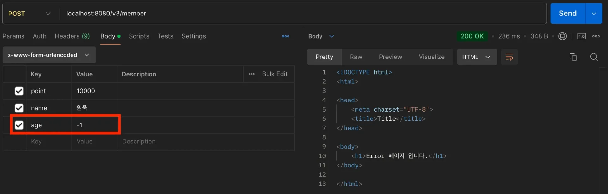

</details>

</details>

<details>
<summary>Bean Validation</summary>

<details>
<summary>이전 정리 내용 <a href="#/post/138eda9b-0fe1-80e9-b72d-cef85dc88546">페이지</a> </summary>

<details>
<summary>라이브러리 확인해보기</summary>

- spring boot starter validation
    - <strong><code>Hibernate Validator</code></strong><strong>가 </strong><strong><code>Jakarta Bean Validation</code></strong><strong>의 구현체이다&#46;</strong>


<details>
<summary>주요 Anotation</summary>


</details>

</details>

---

<details>
<summary>🧐 interface의 메서드에 <code>{}</code> 블록이 존재할 수 있는 이유는? </summary>

- 의문점 발생 코드
    <a id="af71475a223b400d9a0bf5b82c771f4c"></a>

    ```java
    public interface ConstraintValidator<A extends Annotation, T> {

    	default void initialize(A constraintAnnotation) {}
    ```

- 이유
    - 자바 8부터 interface에 default 메서드와 static 메서드가 허용 되었기 때문에<br>인터페이스에서 메서드의 기본 구현을 제공할 수 있게 되었다&#46;

    - 위 코드에서 initialize 메서드는 default 키워드가 사용되어 기본 구현을 가진다&#46;<br>따라서 구현하는 클래스에서<strong> </strong><strong><code>default 메서드</code></strong>는 <strong><u>꼭 오버라이드하지 않아도 된</u></strong>다&#46; 

    - 즉, 인터페이스를 구현하는 클래스는 이 메서드를 <u>그대로 사용</u>할 수 있거나 <u>필요에 따라 오버라이드</u>할 수 있다&#46;

<details>
<summary>ex)</summary>

<a id="686aa9ab0b7e4990a5a8fcca44a05d93"></a>

```java
public interface Example {
    default void sayHello() {
        System.out.println("Hello from default method!");
    }
}
```

<a id="77b6308c06da4284869691a7703f860c"></a>

```java
public class ExampleImpl implements Example {
    // default 메서드인 sayHello 메서드를 구현하지 않아도 자동으로 기본 메서드가 적용된다. 
}

public class Main {
    public static void main(String[] args) {
        Example example = new ExampleImpl();
        example.sayHello(); // 출력: Hello from default method!
    }
}

```

<a id="5dfe833c41064813a407f6ebdebca7d3"></a>

<br>

</details>

</details>

<details>
<summary>Anotation 살펴보기 ( <code>&#64;Constraint</code> )</summary>

<a id="0e20b5856bae485daa0bb9e720e8afc3"></a>

<code>&#64;Constraint</code> 어노테이션에 있는 <strong><code>validateBy</code></strong><strong> 정보에 구현체를 넣어서 검증이 진행된다&#46;<br>그러나 jakarta validation 에 기본 구성으로 나와있는 어노테이션들은 모두 구현체 정보가 존재하지 않는다&#46; 그럼 어디에 구현체 정보가 존재하는 것 인가?</strong>


</details>

<details>
<summary>Jakarta Validation API 구현체  &#45; <code>Hibernate Validator</code></summary>

<details>
<summary><code>org&#46;hibernate&#46;validator&#46;internal&#46;constraintvalidators&#46;bv</code></summary>


</details>

<details>
<summary>&#60; interface &#62; <code>ConstraintValidator</code></summary>

<a id="ef67e46d367b499a9da00b77684d0752"></a>

```java
package jakarta.validation;
	
import java.lang.annotation.Annotation;
import jakarta.validation.constraintvalidation.SupportedValidationTarget;


public interface ConstraintValidator<A extends Annotation, T> {

		default void initialize(A constraintAnnotation) {
		}
	
		boolean isValid(T value, ConstraintValidatorContext context);
}
```

</details>

<details>
<summary><code>&#64;NotNull</code>의 구현체인 <code>NotNullValidator</code></summary>

- <strong>ConstraintValidator</strong> 인터페이스에 <strong>isValid</strong>를 구현하여 검증 로직을 만든다&#46;

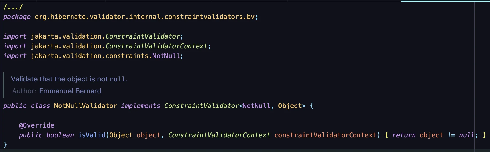

</details>

</details>

<details>
<summary><strong><code>jakarta validation 어노테이션</code></strong><strong>과 </strong><strong><code>hibernate 검증 클래스</code></strong><strong>  연결</strong></summary>

> <code>org&#46;hibernate&#46;validator&#46;internal&#46;metadata&#46;core&#46;ConstraintHelper&#46;java</code>

- <code>ConstraintHelper&#46;java</code>를 살펴보면 아래 코드에서 <code>&#64;NotNull</code> 과 구현체인 <code>NotNullValidator</code>을 연결 해주는 것을 확인할 수 있다&#46; 


</details>

---

<details>
<summary>Spring 에서 <code>&#64;Valid</code> 동작 원리</summary>

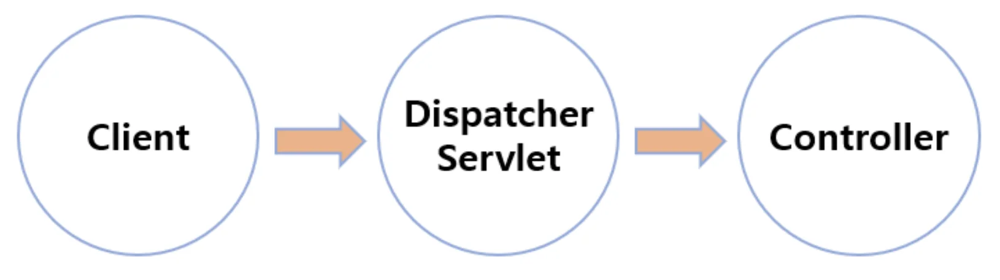

<a id="6b6939a6872c4769a63f4eaa55f97d5d"></a>

client에서 요청을 받으면 DispatcherServlet을 통해 Controller가 호출된다&#46;

<a id="7b8b1c6cf7aa4fdf848fbd944330b7e3"></a>

이 과정에서  Dispatcher Servlet 에서 <code>&#64;Valid</code> 를 찾아 검증을 진행한다&#46; 

> 참조 블로그 글에   더 자세한 내용이 서술되어 있으나, 이해를 하지 못해 우선 여기까지만 정리한다&#46; 

</details>

</details>

> ✏️ 
> 
> <a id="1eeeda9b0fe1801a960ac68b36f42c3d"></a>
> 
> 객체의 <strong><u>필드</u></strong>나 <strong><u>메서드</u></strong>에 <strong><u>제약 조건</u></strong>을 설정하여, <u>올바른 값이 들어오는지 확인</u>하는 <strong><u>표준화</u></strong>된 방법이다&#46;
> 
> - <u>Hibernate</u> Validator 와 ORM JPA <u>Hibernate</u>의 Hibernate는 <u>이름만 같</u>고 <u>상관없는 기술</u>이다&#46;
> 
> - Bean Validation은 기술 표준 <strong>인터페이스</strong>이다&#46;
> 
> - 다양한 <strong>Annotation</strong>들과 여러가지 <strong>Interface</strong>로 구성되어 있다&#46;
> 
> - Bean Validation(인터페이스) 구현체인 <strong>Hibernate Validator</strong>를 사용한다&#46;

</details>

<details>
<summary><strong>Hibernate Validator 공식 문서 </strong></summary>

> 모든 기술의 정확한 사용법은 공식문서에 있다&#46;

[The Bean Validation reference implementation&#46; &#45; Hibernate Validator]()

- <a href="https://docs.jboss.org/hibernate/validator/">버전별 공식 문서</a>
    [Index of /hibernate/validator]()

</details>

<details>
<summary>라이브러리 살펴보기</summary>

<details>
<summary><strong>External Libraries</strong></summary>

- 프로젝트에 적용된 라이브러리 목록


</details>

<details>
<summary>정의된 (사용 가능한) Annotation들 ( Interface )</summary>

- <code>jakarta&#46;validation&#46;constraints</code>

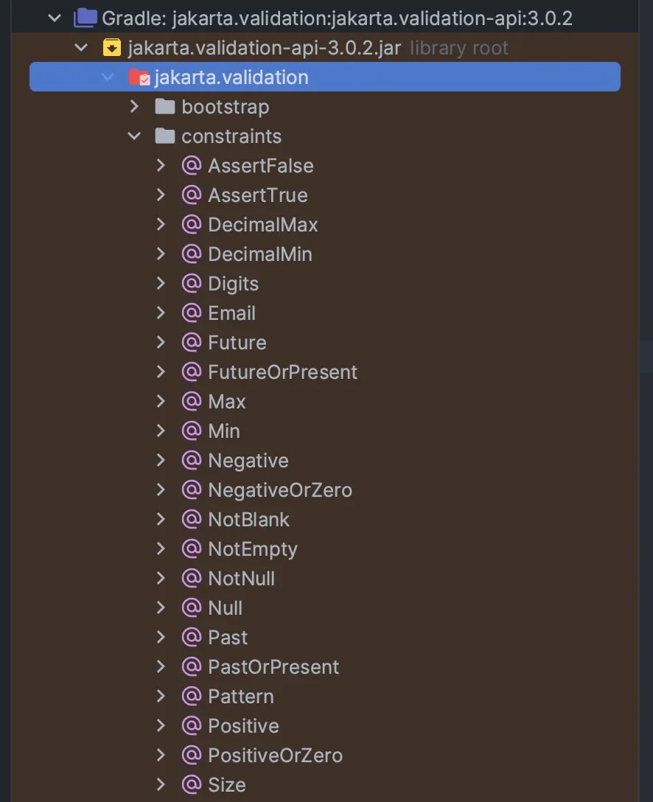

<a id="13ceda9b0fe1801eb90be91b474bfa9c"></a>

 

</details>

<details>
<summary>  Annotation 들이 동작하게 만들어주는 Validator ( 구현체 ) </summary>

- <code>org&#46;hibernate&#46;validator&#58;hibernate&#45;validator&#58;&#36;{version}</code>

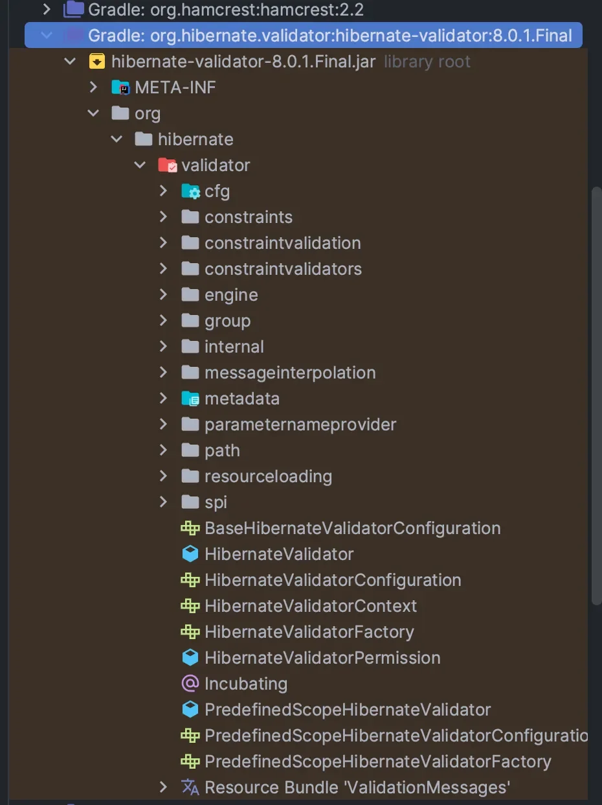

</details>

</details>

<details>
<summary>적용 예시</summary>

<details>
<summary>간단하게 Annotation 만으로도 Validation 처리 가능하다&#46;</summary>

- 검증 로직을 작성할 필요가 없음

- <code>&#64;NotBlank</code>, <code>&#64;NotNull</code>, <code>&#64;Range</code>, <code>&#64;Validated</code> …
    - <code>&#64;Range</code> &#45; Hibernate Validator 에서만 동작

    - <code>&#64;NotBlank</code>, <code>&#64;NotNull</code> &#45; validation 표준 인터페이스

</details>

- RestController의 <code>&#64;RequestBody</code>에도 사용 가능

<details>
<summary>🧐 <code>&#64;Valid</code> 와 <code>&#64;Validated</code>의 차이점</summary>

- <code>&#64;Valid</code>
    - <strong>Java Bean Validation API 표준 어노테이션</strong>

    - 주로 <u>JPA 엔티티</u>나 <u>DTO</u>에서 사용

    - jakarta&#46;validation 패키지를 활용하여 데이터의 유효성을 검사함

- <code>&#64;Validated</code>
    - <strong>Spring Framework에서 제공</strong>하는 어노테이션

    - AOP(Aspect&#45;Oriented Programming) 와 결합하여 작동 가능

    - 그룹 검증 기능 지원

</details>

<a id="1eeeda9b0fe18028bf84e106b0cd3d5d"></a>

### 코드

<details>
<summary>validation 의존성 추가 </summary>

<a id="2e2487da30224017b98cd6e1cad51bd2"></a>

```groovy
// Gradle
implementation 'org.springframework.boot:spring-boot-starter-validation'
```

</details>

<details>
<summary>&#91; 코드 &#93;  <code>DTO</code> &#45; Bean Validation을 통한 검증 요청 값 검증</summary>

<a id="13ceda9b0fe1803fb5f2f4cc7a8c9102"></a>

```java
@Getter
public class SignUpRequestDto {
	
	@NotBlank
	private String name;

	@NotNull
	@Range(min = 1, max = 120) // Min, Max 사용 가능
	private Integer age;
}
```

</details>

<details>
<summary>&#91; 코드 &#93; BeanValidationController</summary>

<a id="13ceda9b0fe180a0b644e117c96e9eb1"></a>

```java
@Controller
public class BeanValidationController {

		@PostMapping("/model-attribute")
    public String beanValidationV1(
            @Validated @ModelAttribute SignUpRequestDto dto
    ) {
        // 로직
        
        // ViewName
        return "complete";
    }
}

@RestController
public class BeanValidationRestController {

		@PostMapping("/request-body")
    public String beanValidationV2(
            @Validated @RequestBody SignUpRequestDto dto
    ) {
        // 로직
        
				// 문자 Data 반환
        return "회원가입 완료";
    }
}
```

</details>

</details>

<a id="13ceda9b0fe180a5b832ec5a327f9dc4"></a>

## Field Error

> 📖 
> 
> <a id="e1f45f31d0524f50a0720b374e12749a"></a>
> 
> 필드에 대한 검증은 <strong><u>빈값, 길이, 크기, 형식</u></strong> 과 같은 간단한 확인만 한다&#46;
> 
> <a id="338eda9b0fe180828c55c566ff9d2d3d"></a>
> 
> 이러한 로직들을 모든 프로젝트에 적용할 수 있도록 표준화 한 것이 Bean Validation이다&#46;

> ☝🏻 
> 
> <a id="338eda9b0fe180ef97ade47a7cc275d6"></a>
> 
> import가 <code>org&#46;hibernate&#46;validator</code>로 시작하면 하이버네이트를 사용할 때만 제공되는 검증 기능으로 다른 구현체로 validator를 교체하였을 경우 동작하지 않는다&#46; 하지만 <code>org&#46;hibernate&#46;validator</code>를 대부분 사용한다&#46;

<details>
<summary><strong>Bean Validation 적용</strong></summary>

<details>
<summary>의존성 추가(build&#46;gradle)</summary>

<a id="338eda9b0fe180118b73ceb88651e38c"></a>

```plaintext
implementation 'org.springframework.boot:spring-boot-starter-validation'
```

- implementation 뒤에 version이 따로 적혀있지 않은 이유 → <strong>Spring Boot 기능</strong>

</details>

<details>
<summary><strong>External Libraries</strong></summary>

- 프로젝트에 적용된 라이브러리 목록
    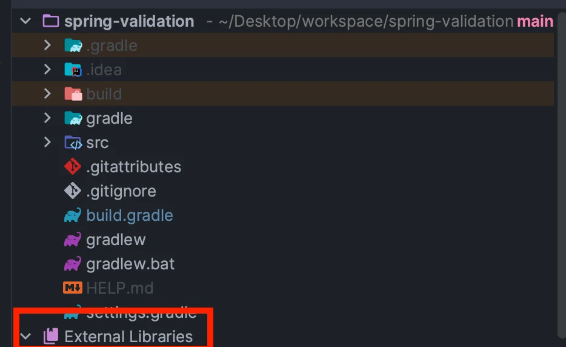

</details>

<details>
<summary>파일경로 <code>jakarta&#46;validation&#45;api&#45;&#36;{version}&#46;jar</code></summary>

- <code>jakarta&#46;validation&#46;constraints</code>
    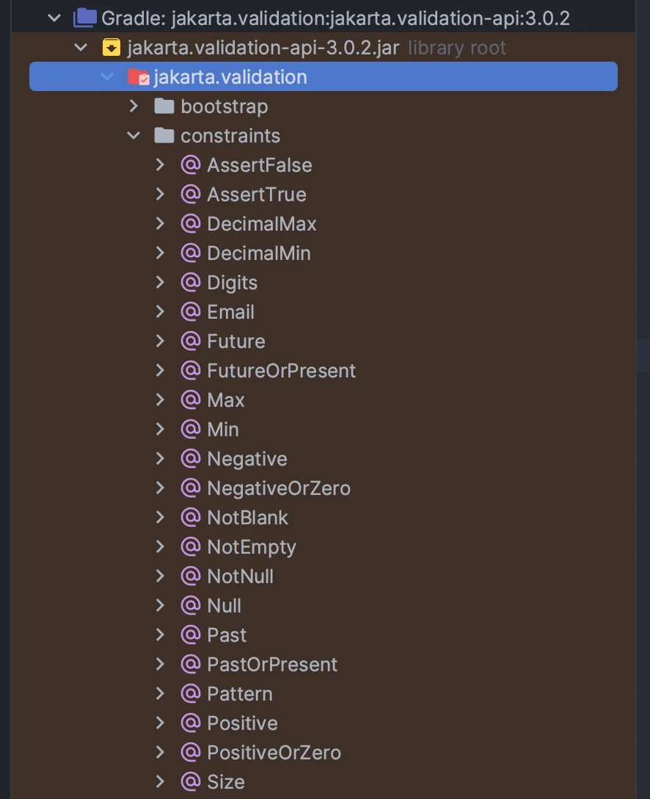

    - 사용할 수 있는 다양한 Annotation들을 확인할 수 있다&#46;

</details>

<details>
<summary>파일경로 <code>org&#46;hibernate&#46;validator&#58;hibernate&#45;validator&#58;&#36;{version}</code> </summary>

- 위 Annotation 들이 동작하게 만들어주는 Validator
    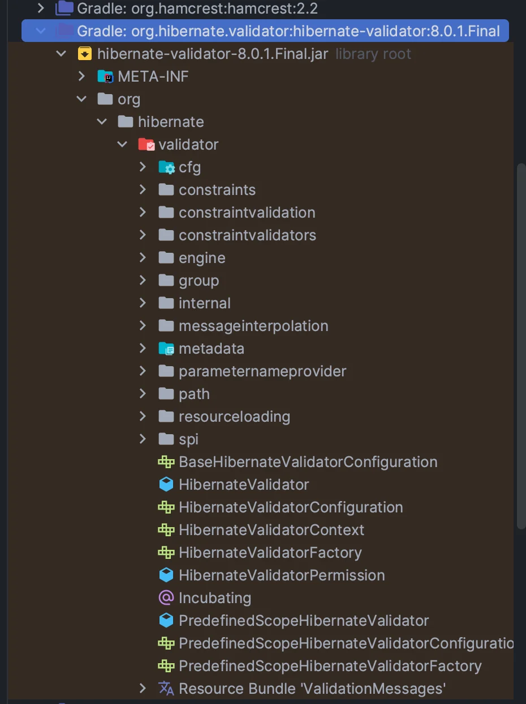

    1. <code>jakarta&#46;validation&#45;api</code> &#58; Interface

    1. <code>org&#46;hibernate&#46;validator&#58;hibernate&#45;validator</code> &#58; 구현체

</details>

<details>
<summary><strong>실제코드 import</strong></summary>

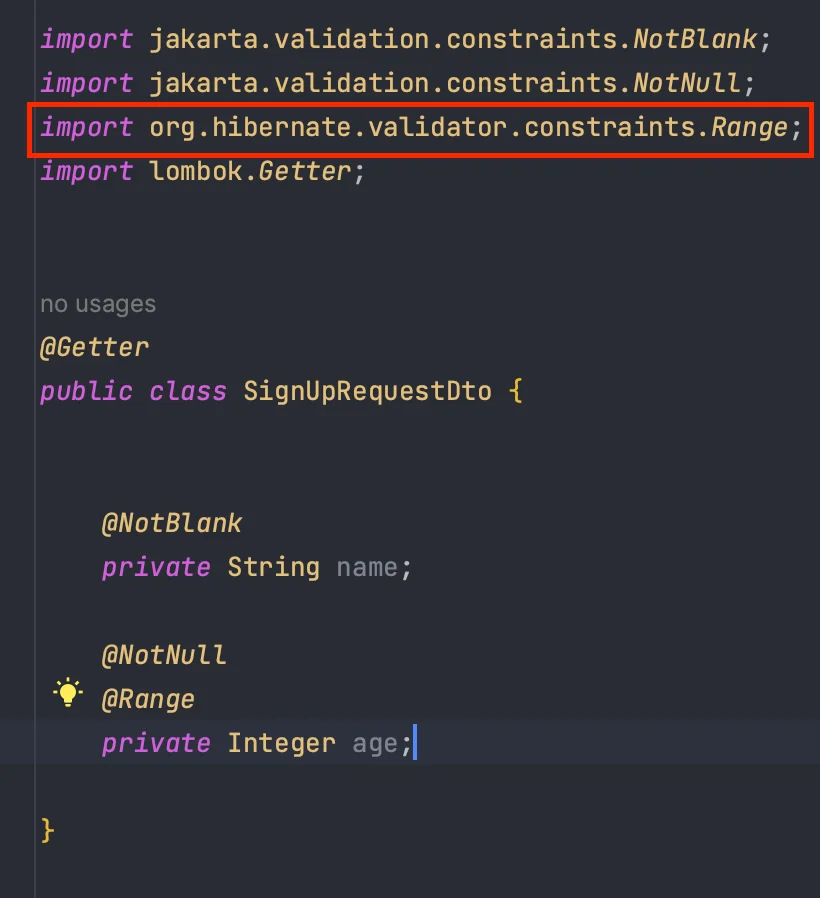

- <code>&#64;Range</code> Annotation은 Hibernate Validator 에서만 동작하는것

- <code>&#64;NotBlank</code>, <code>&#64;NotNull</code> 은 validation 표준 인터페이스
    <details>
    <summary><strong>사용된 Annotation 설명</strong></summary>

    - <strong><code>&#64;NotBlank</code></strong>
        1. null을 허용하지 않는다&#46;

        1. 공백(” “)을 허용하지 않는다&#46; 하나 이상의 문자를 포함해야한다&#46;

        1. 빈값(””)을 허용하지 않는다&#46;

        1. CharSequence 타입 허용
            - String은 CharSequence(Interface)의 구현체이다&#46;

    - <strong><code>&#64;NotNull</code></strong>
        1. null을 허용하지 않는다&#46;

        1. 모든 타입을 허용한다&#46;

    - <strong><code>&#64;NotEmpty</code></strong>
        1. null을 허용하지 않는다&#46;

        1. 빈값(””)을 허용하지 않는다&#46;

        1. CharSequence, Collection, Map, Array 허용

    </details>

</details>

</details>

<details>
<summary>테스트 코드 </summary>

<a id="338eda9b0fe18008848cc24d934106fb"></a>

```java
@Data
public class TestDto {
	// 테스트 하고싶은 Annotation으로 변경 가능
	@NotBlank
	private String stringField;
	
	@NotNull
	@Range(min = 1, max = 9999)
	private Integer integerField;
	

}

import static org.assertj.core.api.Assertions.assertThat;

public class BeanValidationTest {
	
	@Test
	void beanValidation() {
		
		// Spring과 통합하면 아래 두줄의 코드는 사용하지 않는다.
		ValidatorFactory factory = Validation.buildDefaultValidatorFactory();
		Validator validator = factory.getValidator();
		
		// Test 하고싶은 상황을 만들어서 검증 가능
		TestDto dto = new TestDto();
		dto.setStringField(" ");
		dto.setIntegerField(1);
		
		// DTO를 검증
		Set<ConstraintViolation<TestDto>> violations = validator.validate(dto);

		// 검증 결과가 예상대로 발생했는지 확인
		// 검증에 걸린 필드가 있어야 함
    assertThat(violations).isNotEmpty();
    // 2개의 제약 위반 발생
    assertThat(violations.size()).isEqualTo(2);
		
		// Validation에 걸린 내역을 출력
		for(ConstraintViolation<TestDto> violation : violations) {
			// 아래의 결과에 Message가 있으면 Validation에 걸린것.
			// Default Message가 있기 때문에 출력됨
			// Message를 수정하고싶다면 Annotation 속성값(message="입력")으로 설정할 수 있다.
			// 결과가 비어있으면 Validation에 걸리지 않은것.
			System.out.println("violation = " + violation.getMessage());
		}
		
	}

}
```

<details>
<summary>출력 확인</summary>

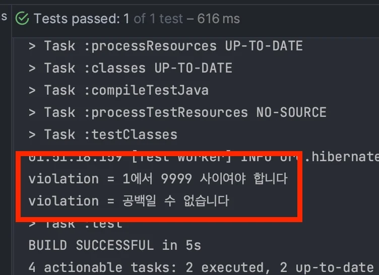

- 테스트 통과

- Default Message가 출력된다&#46;

</details>

</details>

<details>
<summary><strong>Annotation 총정리(공식문서)</strong></summary>

[Hibernate Validator 8&#46;0&#46;3&#46;Final &#45; Jakarta Bean Validation Reference Implementation&#58; Reference Guide]()

</details>

<a id="13ceda9b0fe180e9a149c0e5d4f66388"></a>

## Validator

> 📖 
> 
> <a id="30d0ccd48a87449b944a443901a4a9e3"></a>
> 
> 단순히 Annotation 선언을 통해 검증이 되는 이유는, <strong><code>Va</code></strong><strong><u><code>lidator</code></u></strong><strong><u>(Validation을 사용하는것)가 존재</u></strong>하기 때문이다&#46; 
> 
> - Spring Boot는 validation 라이브러리를 설정하면 <code>&#39;org&#46;springframework&#46;boot&#58;spring&#45;boot&#45;starter&#45;validation&#39;</code>에 자동으로 <strong><u>Bean Validator를 Spring에 통합</u></strong>한다&#46; 

<details>
<summary>동작 순서</summary>

- Spring Boot Application 실행 시 자동으로 Bean Validator가 통합된다&#46;

- <code>LocalValidatorFactoryBean</code> 을 Global Validator로 등록
    <details>
    <summary>Class Diagram</summary>

    <details>
    <summary>&#91; 코드 &#93; LocalValidatorFactoryBean</summary>

    <a id="13ceda9b0fe180e09a90ec2576596296"></a>

    ```java
    public class LocalValidatorFactoryBean extends SpringValidatorAdapter
    		implements ValidatorFactory, ApplicationContextAware, InitializingBean, DisposableBean {

    	@SuppressWarnings("rawtypes")
    	@Nullable
    	private Class providerClass;

    	@Nullable
    	private ValidationProviderResolver validationProviderResolver;

    	@Nullable
    	private MessageInterpolator messageInterpolator;

    	@Nullable
    	private TraversableResolver traversableResolver;

    	@Nullable
    	private ConstraintValidatorFactory constraintValidatorFactory;

    	@Nullable
    	private ParameterNameDiscoverer parameterNameDiscoverer;

    	@Nullable
    	private Resource[] mappingLocations;

    	private final Map<String, String> validationPropertyMap = new HashMap<>();

    	@Nullable
    	private Consumer<Configuration<?>> configurationInitializer;

    	@Nullable
    	private ApplicationContext applicationContext;

    	@Nullable
    	private ValidatorFactory validatorFactory;

    	@SuppressWarnings("rawtypes")
    	public void setProviderClass(Class providerClass) {
    		this.providerClass = providerClass;
    	}
    	
    	public void setValidationProviderResolver(ValidationProviderResolver validationProviderResolver) {
    		this.validationProviderResolver = validationProviderResolver;
    	}

    	public void setMessageInterpolator(MessageInterpolator messageInterpolator) {
    		this.messageInterpolator = messageInterpolator;
    	}

    	public void setValidationMessageSource(MessageSource messageSource) {
    		this.messageInterpolator = HibernateValidatorDelegate.buildMessageInterpolator(messageSource);
    	}


    	public void setTraversableResolver(TraversableResolver traversableResolver) {
    		this.traversableResolver = traversableResolver;
    	}

    	public void setConstraintValidatorFactory(ConstraintValidatorFactory constraintValidatorFactory) {
    		this.constraintValidatorFactory = constraintValidatorFactory;
    	}

    	public void setParameterNameDiscoverer(ParameterNameDiscoverer parameterNameDiscoverer) {
    		this.parameterNameDiscoverer = parameterNameDiscoverer;
    	}

    	public void setMappingLocations(Resource... mappingLocations) {
    		this.mappingLocations = mappingLocations;
    	}

    	public void setValidationProperties(Properties jpaProperties) {
    		CollectionUtils.mergePropertiesIntoMap(jpaProperties, this.validationPropertyMap);
    	}

    	public void setValidationPropertyMap(@Nullable Map<String, String> validationProperties) {
    		if (validationProperties != null) {
    			this.validationPropertyMap.putAll(validationProperties);
    		}
    	}

    	public Map<String, String> getValidationPropertyMap() {
    		return this.validationPropertyMap;
    	}

    	public void setConfigurationInitializer(Consumer<Configuration<?>> configurationInitializer) {
    		this.configurationInitializer = configurationInitializer;
    	}

    	@Override
    	public void setApplicationContext(ApplicationContext applicationContext) {
    		this.applicationContext = applicationContext;
    	}


    	@Override
    	@SuppressWarnings({"rawtypes", "unchecked"})
    	public void afterPropertiesSet() {
    		Configuration<?> configuration;
    		if (this.providerClass != null) {
    			ProviderSpecificBootstrap bootstrap = Validation.byProvider(this.providerClass);
    			if (this.validationProviderResolver != null) {
    				bootstrap = bootstrap.providerResolver(this.validationProviderResolver);
    			}
    			configuration = bootstrap.configure();
    		}
    		else {
    			GenericBootstrap bootstrap = Validation.byDefaultProvider();
    			if (this.validationProviderResolver != null) {
    				bootstrap = bootstrap.providerResolver(this.validationProviderResolver);
    			}
    			configuration = bootstrap.configure();
    		}

    		// Try Hibernate Validator 5.2's externalClassLoader(ClassLoader) method
    		if (this.applicationContext != null) {
    			try {
    				Method eclMethod = configuration.getClass().getMethod("externalClassLoader", ClassLoader.class);
    				ReflectionUtils.invokeMethod(eclMethod, configuration, this.applicationContext.getClassLoader());
    			}
    			catch (NoSuchMethodException ex) {
    				// Ignore - no Hibernate Validator 5.2+ or similar provider
    			}
    		}

    		MessageInterpolator targetInterpolator = this.messageInterpolator;
    		if (targetInterpolator == null) {
    			targetInterpolator = configuration.getDefaultMessageInterpolator();
    		}
    		configuration.messageInterpolator(new LocaleContextMessageInterpolator(targetInterpolator));

    		if (this.traversableResolver != null) {
    			configuration.traversableResolver(this.traversableResolver);
    		}

    		ConstraintValidatorFactory targetConstraintValidatorFactory = this.constraintValidatorFactory;
    		if (targetConstraintValidatorFactory == null && this.applicationContext != null) {
    			targetConstraintValidatorFactory =
    					new SpringConstraintValidatorFactory(this.applicationContext.getAutowireCapableBeanFactory());
    		}
    		if (targetConstraintValidatorFactory != null) {
    			configuration.constraintValidatorFactory(targetConstraintValidatorFactory);
    		}

    		if (this.parameterNameDiscoverer != null) {
    			configureParameterNameProvider(this.parameterNameDiscoverer, configuration);
    		}

    		List<InputStream> mappingStreams = null;
    		if (this.mappingLocations != null) {
    			mappingStreams = new ArrayList<>(this.mappingLocations.length);
    			for (Resource location : this.mappingLocations) {
    				try {
    					InputStream stream = location.getInputStream();
    					mappingStreams.add(stream);
    					configuration.addMapping(stream);
    				}
    				catch (IOException ex) {
    					closeMappingStreams(mappingStreams);
    					throw new IllegalStateException("Cannot read mapping resource: " + location);
    				}
    			}
    		}

    		this.validationPropertyMap.forEach(configuration::addProperty);

    		// Allow for custom post-processing before we actually build the ValidatorFactory.
    		if (this.configurationInitializer != null) {
    			this.configurationInitializer.accept(configuration);
    		}
    		postProcessConfiguration(configuration);

    		try {
    			this.validatorFactory = configuration.buildValidatorFactory();
    			setTargetValidator(this.validatorFactory.getValidator());
    		}
    		finally {
    			closeMappingStreams(mappingStreams);
    		}
    	}

    	private void configureParameterNameProvider(ParameterNameDiscoverer discoverer, Configuration<?> configuration) {
    		final ParameterNameProvider defaultProvider = configuration.getDefaultParameterNameProvider();
    		configuration.parameterNameProvider(new ParameterNameProvider() {
    			@Override
    			public List<String> getParameterNames(Constructor<?> constructor) {
    				String[] paramNames = discoverer.getParameterNames(constructor);
    				return (paramNames != null ? Arrays.asList(paramNames) :
    						defaultProvider.getParameterNames(constructor));
    			}
    			@Override
    			public List<String> getParameterNames(Method method) {
    				String[] paramNames = discoverer.getParameterNames(method);
    				return (paramNames != null ? Arrays.asList(paramNames) :
    						defaultProvider.getParameterNames(method));
    			}
    		});
    	}

    	private void closeMappingStreams(@Nullable List<InputStream> mappingStreams){
    		if (!CollectionUtils.isEmpty(mappingStreams)) {
    			for (InputStream stream : mappingStreams) {
    				try {
    					stream.close();
    				}
    				catch (IOException ignored) {
    				}
    			}
    		}
    	}

    	protected void postProcessConfiguration(Configuration<?> configuration) {
    	}


    	@Override
    	public Validator getValidator() {
    		Assert.state(this.validatorFactory != null, "No target ValidatorFactory set");
    		return this.validatorFactory.getValidator();
    	}

    	@Override
    	public ValidatorContext usingContext() {
    		Assert.state(this.validatorFactory != null, "No target ValidatorFactory set");
    		return this.validatorFactory.usingContext();
    	}

    	@Override
    	public MessageInterpolator getMessageInterpolator() {
    		Assert.state(this.validatorFactory != null, "No target ValidatorFactory set");
    		return this.validatorFactory.getMessageInterpolator();
    	}

    	@Override
    	public TraversableResolver getTraversableResolver() {
    		Assert.state(this.validatorFactory != null, "No target ValidatorFactory set");
    		return this.validatorFactory.getTraversableResolver();
    	}

    	@Override
    	public ConstraintValidatorFactory getConstraintValidatorFactory() {
    		Assert.state(this.validatorFactory != null, "No target ValidatorFactory set");
    		return this.validatorFactory.getConstraintValidatorFactory();
    	}

    	@Override
    	public ParameterNameProvider getParameterNameProvider() {
    		Assert.state(this.validatorFactory != null, "No target ValidatorFactory set");
    		return this.validatorFactory.getParameterNameProvider();
    	}

    	@Override
    	public ClockProvider getClockProvider() {
    		Assert.state(this.validatorFactory != null, "No target ValidatorFactory set");
    		return this.validatorFactory.getClockProvider();
    	}

    	@Override
    	@SuppressWarnings("unchecked")
    	public <T> T unwrap(@Nullable Class<T> type) {
    		if (type == null || !ValidatorFactory.class.isAssignableFrom(type)) {
    			try {
    				return super.unwrap(type);
    			}
    			catch (ValidationException ex) {
    				// Ignore - we'll try ValidatorFactory unwrapping next
    			}
    		}
    		if (this.validatorFactory != null) {
    			try {
    				return this.validatorFactory.unwrap(type);
    			}
    			catch (ValidationException ex) {
    				// Ignore if just being asked for ValidatorFactory
    				if (ValidatorFactory.class == type) {
    					return (T) this.validatorFactory;
    				}
    				throw ex;
    			}
    		}
    		throw new ValidationException("Cannot unwrap to " + type);
    	}

    	@Override
    	public void close() {
    		if (this.validatorFactory != null) {
    			this.validatorFactory.close();
    		}
    	}

    	@Override
    	public void destroy() {
    		close();
    	}

    	private static class HibernateValidatorDelegate {

    		public static MessageInterpolator buildMessageInterpolator(MessageSource messageSource) {
    			return new ResourceBundleMessageInterpolator(new MessageSourceResourceBundleLocator(messageSource));
    		}
    	}

    }
    ```

    </details>

    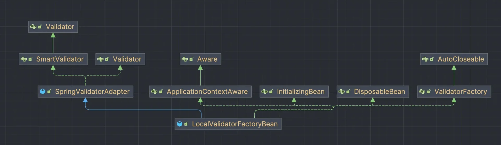

    > ☝🏻 
    > 
    > <a id="7712d2e6d2884a3e98c056a767c0c0d8"></a>
    > 
    > Global Validator를 수동으로 등록 시, <code>LocalValidatorFactoryBean</code> 를 등록하지 않는다&#46; 

    </details>

- Global Validator가 Default로 적용된다&#46; 따라서 <code>&#64;Valid</code>, <code>&#64;Validated</code> 만 적용

- Bean Validation Annotation이 있으면 검증을 수행

- Validation Error가 발생하면 <code>FieldError</code>, <code>ObjectError</code>를 생성하여 <code>BindingResult</code>에 담는다&#46;

</details>

<details>
<summary><strong><code>&#64;Valid</code></strong><strong>, </strong><strong><code>&#64;ValiValidatordated </code></strong><strong>차이점</strong></summary>

1. <code>&#64;Valid</code> 는 JAVA 표준이고 <code>&#64;Validated</code> 는 Spring 에서 제공하는 Annotation이다&#46;

1. <code>&#64;Validated</code> 를 통해 <u>Group Validation</u> 혹은 <u>Controller 이외 계층에서 Validation이 가능</u>하다&#46;

1. <code>&#64;Valid</code> 는 <code>MethodArgumentNotValidException</code> 예외를 발생시킨다&#46;

1. <code>&#64;Validated</code> 는 <code>ConstraintViolationException</code> 예외를 발생시킨다&#46;

</details>

<details>
<summary><strong>Validator 적용</strong></summary>

- 적용 전
    - <code>&#64;ModelAttribute</code> → 각의 필드 타입에 맞추어 바인딩(변환)
        - 성공&#58; Controller 정상 호출

        - 실패&#58; <code>TypeMismatch</code> FieldError 발생

- 적용 후
    - <code>&#64;ModelAttribute</code> → 각 필드 바인딩 → 성공한 필드만 Bean Validation 적용
        - 성공
            - ex) String 필드, 문자입력 <br>        → 바인딩 성공 <br>        → String 필드에 Bean Validation 적용

        - 실패
            - ex)  Integer 필드, 문자 입력 
                <a id="13ceda9b0fe1804680f0c42053905cd8"></a>

                         → 바인딩 실패

                <a id="13ceda9b0fe180f4a8e0cbf96256755b"></a>

                         → <code>bindingResult</code>에 <u><code>TypeMismatch</code></u><u> FieldError</u> 추가됨

                <a id="13ceda9b0fe180c4a5f0f6b89195d46a"></a>

                   → 바인딩이 실패한 필드는 값이 없기(<code>null</code>) 때문에 Bean Validation이 적용되지 않음

</details>

> ☝🏻 
> 
> <a id="13ceda9b0fe1800cb002fd88ceb07f07"></a>
> 
> Bean Validator( 구현체 )는 <strong><u>바인딩에 실패한 필드는 Bean Validation을 적용하지 않</u></strong>는다&#46;<br>즉, <strong><u>바인딩(변환)에 성공한 필드만  검증(Bean Validation 적용)</u></strong>한다&#46;
