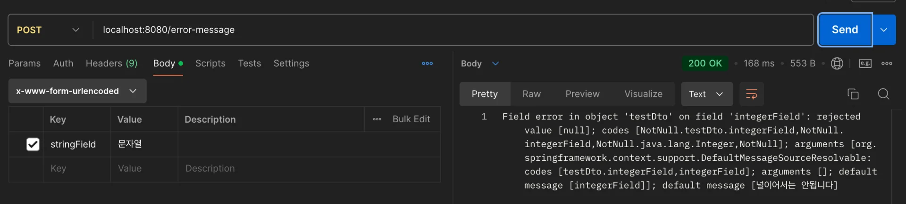
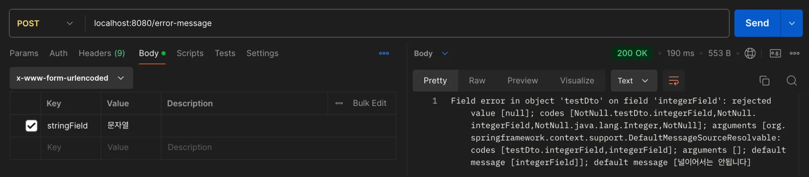
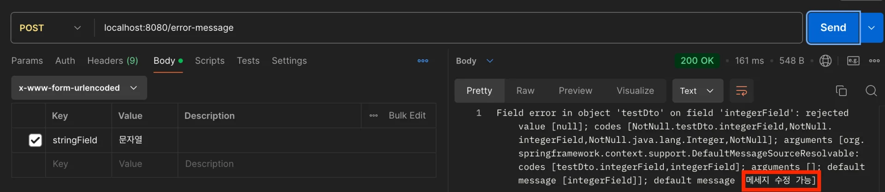
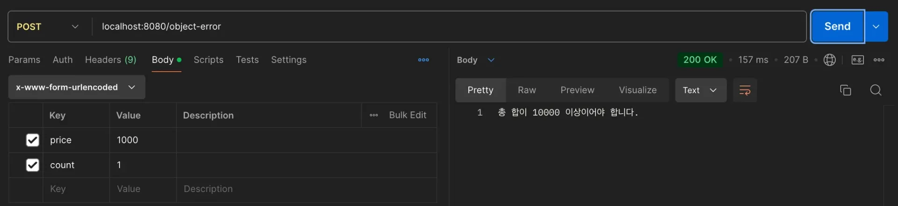

<a id="13ceda9b0fe180d3b79edbd7ecbcf3e7"></a>

## Error Message

> 📖 
> 
> <a id="13ceda9b0fe18057a244d310c0493a11"></a>
> 
> Spring의 Bean Validation은 <u>기본으로 제공하는 Message들</u>이 존재한다
> 
> - 임의로 수정 가능

<details>
<summary>Error Message</summary>

> ✏️ 
> 
> <a id="338eda9b0fe1804c8277edcbd85db1cd"></a>
> 
> Bean Validation을 적용하고 <code>BindingResult</code>에 등록된 검증 오류를 확인해보면 오류가 Annotation 이름으로 등록되어 있다&#46;

<details>
<summary>&#91; 예시코드 &#93; &#45; <code>bindingResult&#46;getFieldError()</code></summary>

<a id="338eda9b0fe180c6a974cf428b82603b"></a>

```java
@Data
public class TestDto {

    @NotBlank
    private String stringField;

    @NotNull
    @Range(min = 1, max = 9999)
    private Integer integerField;

}

@Slf4j
@RestController
public class BeanValidationController {

    @PostMapping("/error-message")
    public String beanValidation(
            @Validated @ModelAttribute TestDto dto,
            BindingResult bindingResult
    ) {
				// bindingResult Field Error 출력
        if (bindingResult.hasErrors()) {
            return String.valueOf(bindingResult.getFieldError());
        }

        // 성공시 문자열 반환
        return "회원가입 성공";
    }

}
```

</details>

<details>
<summary>Postman 테스트</summary>

- <code>integerField</code> 는 비워두고 <code>stringField</code> 만 값(”문자열”) 입력
    

    

- 출력결과
    <a id="338eda9b0fe180e69066fef0e58806e1"></a>

    ```plaintext
    Field error in object 'testDto' on field 'integerField': rejected value [null]; codes [NotNull.testDto.integerField,NotNull.integerField,NotNull.java.lang.Integer,NotNull]; arguments [org.springframework.context.support.DefaultMessageSourceResolvable: codes [testDto.integerField,integerField]; arguments []; default message [integerField]]; default message [널이어서는 안됩니다]
    ```

    - NotNull 오류 코드를 기반으로 <code>MessageCodesResolver</code> 를 통해 메세지 코드 생성

</details>

</details>

<details>
<summary>Error Messge 수정 </summary>

> ✏️ 
> 
> <a id="338eda9b0fe180c3938ad801679aa1bc"></a>
> 
> 네가지 방법중 Annotation의 message 속성을 사용하여 에러 메세지를 수정하면 된다&#46;

1. <code>NotNull&#46;Object&#46;fieldName</code>
    - Annotation의 <code>message</code> 속성 사용
        <a id="338eda9b0fe1800182b2f3d90d8e87fe"></a>

        ```java
        @Data
        public class TestDto {

        	@NotBlank(message = "메세지 수정 가능")
        	private String stringField;

        }
        ```

        <details>
        <summary>Postman 테스트</summary>

        

        </details>

1. <code>NotNull&#46;fieldName(MessageSource)</code>
    - 필드명에 맞춘 사용자 정의 Message

1. <code>NotNull&#46;FieldType(MessageSource)</code>
    - 필드 타입에 맞춘 사용자 정의 Message

1. <code>NotNull</code>
    - Annotation 자체에 포함된 Default Message

</details>

<a id="13ceda9b0fe180f2ac56fba5467c398f"></a>

## Object Error

> 📖 
> 
> <a id="2ce8fab0f8ac4e89a7ce6d00b5f12ea8"></a>
> 
> 필드 단위가 아닌, <u>객체 전체에 대한 오류</u>를 나타낸다&#46; 
> 
> - ex) 두 필드 간의 관계를 검증 시, ObjectError를 통해 해당 오류를 BindingResult에 기록 가능

> 이전까지 정리한 내용은 <u>필드 단위의 검증</u> 및 그에 발생되는 <u>Field Error</u> 대한 내용이었다&#46; 

<details>
<summary><code>&#64;ScriptAssert</code> &#45; 안씀</summary>

> ✏️ 
> 
> <a id="338eda9b0fe18025a81fe7aca4f792b1"></a>
> 
> 실제로는 제약사항 때문에 사용하지 않는다&#46; 
> 
> <a id="338eda9b0fe180d180d5f9b925519161"></a>
> 
> 따라서 Object Error의 경우, 직접 java 코드로 Validation 처리한다&#46; 
> 
> - 실무에서는 훨씬 복잡한 Validation 들이 필요한데, <strong><code>&#64;ScriptAssert</code></strong><strong> 사용 시 대응이 불가능하다&#46;</strong>
> 
> - ex) 다른 객체끼리의 비교, DB조회 결과와 비

- ex) 비밀번호와 비밀번호 확인 필드가 동일한지 검증
    <a id="13ceda9b0fe180459f47e1df9e5b8e41"></a>

    ```java
    @Data
    @ScriptAssert(
    				lang = "javascript", 
    				script = "_this.password === _this.confirmPassword",
    				message = "Passwords do not match" )
    public class UserRegistrationDto {

        @NotBlank(message = "Password is required")
        private String password;

        @NotBlank(message = "Confirm password is required")
        private String confirmPassword;
    }
    ```

</details>

<details>
<summary><strong>Java 코드로 </strong>Object Error 처리</summary>

> ✏️ 
> 
> <a id="338eda9b0fe1806e93b5e7fc4c43ddeb"></a>
> 
> 검증할 내용&#58; <u>총 구매 가격이 10000원 이상</u>이어야 한다&#46;
> 
> - <code>price &#42; count ≥ 1000</code>

<details>
<summary>&#91; 코드 &#93;  <code>DTO</code> &#45; OrderRequestDto</summary>

<a id="13ceda9b0fe1804f9482c6a8b223cf9e"></a>

```java
@Getter
@AllArgsConstructor
public class OrderRequestDto {

    @NotNull
    @Range(min = 1000)
    private Integer price;

    @NotNull
    @Range(min = 1)
    private Integer count;

}
```

</details>

<details>
<summary>&#91; 코드 &#93; <code>Controller</code> &#45;   자바 코드로 검증 </summary>

<a id="416c6e3485b1488d931aeb0d72651ffb"></a>

```java
@Slf4j
@RestController
public class BeanValidationController {

    @PostMapping("/object-error")
    public String objectError(
            @Validated @ModelAttribute OrderRequestDto requestDto,
            BindingResult bindingResult
    ) {

        // 합이 10000원 이상인지 확인
        int result = requestDto.getPrice() * requestDto.getCount();
        if (result < 10000) {
            // Object Error
            bindingResult.reject("totalMin", new Object[]{10000, result}, "총 합이 10000 이상이어야 합니다.");
        }
        
        // Error가 있으면 출력
        if (bindingResult.hasErrors()) {
            log.info("errors={}", bindingResult);
            return bindingResult.getAllErrors().get(0).getDefaultMessage();
        }

        // 성공로직 ...
        return "성공";
    }    
}
```

- 총 가격(<code> Price &#42; Count</code> )은 <u>price 필드</u>와 <u>count 필드</u>가 <u>곱</u>해진 값이기 때문에, Object Error에 해당한다&#46;

</details>

<details>
<summary>포스트맨 테스트</summary>



</details>

</details>

> ✏️ 
> 
> <a id="cd06ce68a74a4e1b9f92cc79b35f6a64"></a>
> 
> <code>&#64;ModelAttribute</code> 바인딩
> 
> - 기본 생성자만 있는 경우,  <u>setter를 통해 파라미터 바인딩</u>
> 
> - 생성자 존재, <strong><u>그 생성자를 이용해서 파라미터 바인딩</u></strong>
