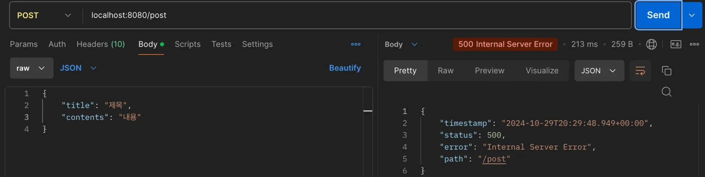
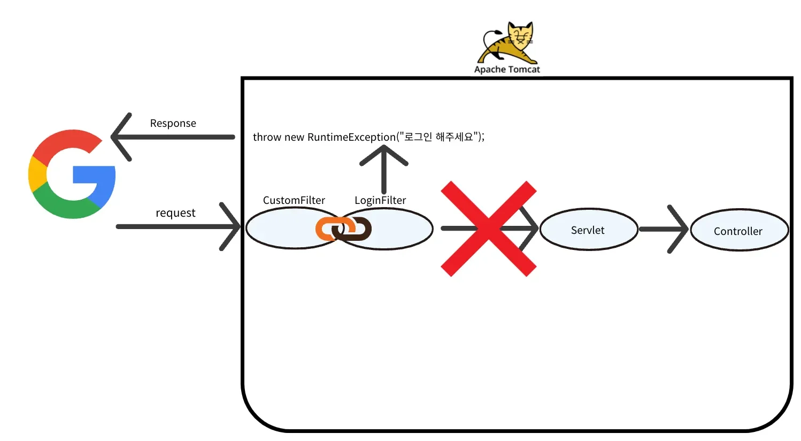

<a id="13deda9b0fe18026a531fa794f9d2d07"></a>

## Login Filter 실습

---

> ✏️ 
> 
> <a id="6095e253019d498b9b9accf9dae3ea00"></a>
> 
> 요구사항
> 
> - Cookie/Session 방식으로 로그인 기능 구현
> 
> - 로그인 인증은 Servlet Filter로 구현
> 
> - <code>/</code>, <code>/user/signup</code>, <code>/login</code>, <code>/logout</code> URL로 들어오는 요청은 인증 Filter로직을 수행하지 않도록 해야한다&#46; 

<details>
<summary>Login Filter 구현</summary>

<details>
<summary>&#91; 코드 &#93; LoginFilter</summary>

<a id="13eeda9b0fe180f2bfdad84506e14a7d"></a>

```java
@Slf4j
public class LoginFilter implements Filter {
    // 인증을 하지 않아도될 URL Path 배열
    private static final String[] WHITE_LIST = {"/", "/user/signup", "/login", "/logout"};

    @Override
    public void doFilter(
            ServletRequest request,
            ServletResponse response,
            FilterChain chain
    ) throws IOException, ServletException {

        // 다양한 기능을 사용하기 위해 다운 캐스팅
        HttpServletRequest httpRequest = (HttpServletRequest) request;
        String requestURI = httpRequest.getRequestURI();

        // 다양한 기능을 사용하기 위해 다운 캐스팅
        HttpServletResponse httpResponse = (HttpServletResponse) response;
        
        log.info("로그인 필터 로직 실행");

        // 로그인을 체크 해야하는 URL인지 검사
        // whiteListURL에 포함된 경우 true 반환 -> !true = false
        if (!isWhiteList(requestURI)) {

            // 로그인 확인 -> 로그인하면 session에 값이 저장되어 있다는 가정.
            // 세션이 존재하면 가져온다. 세션이 없으면 session = null
            HttpSession session = httpRequest.getSession(false);

            // 로그인하지 않은 사용자인 경우
            if (session == null || session.getAttribute("sessionKey값") == null) {
                throw new RuntimeException("로그인 해주세요.");
            }

            // 로그인 성공 로직

        }

        // 1번경우 : whiteListURL에 등록된 URL 요청이면 바로 chain.doFilter()
        // 2번경우 : 필터 로직 통과 후 다음 필터 호출 chain.doFilter()
        // 다음 필터 없으면 Servlet -> Controller 호출
        chain.doFilter(request, response);


    }

    // 로그인 여부를 확인하는 URL인지 체크하는 메서드
    private boolean isWhiteList(String requestURI) {
        // request URI가 whiteListURL에 포함되는지 확인
        // 포함되면 true 반환
        // 포함되지 않으면 false 반환
        return PatternMatchUtils.simpleMatch(WHITE_LIST, requestURI);
    }
}
```

</details>

</details>

<details>
<summary>Filter 빈으로 수동 등록하기</summary>

<details>
<summary>&#91; 코드 &#93; WebConfig</summary>

<a id="13eeda9b0fe1802aa152dc4c7b51c2a5"></a>

```java
@Configuration
public class WebConfig {

		@Bean
		public FilterRegistrationBean loginFilter() {
				FilterRegistrationBean<Filter> filterRegistrationBean = new FilterRegistrationBean<>();
				filterRegistrationBean.setFilter(new LoginFilter()); // Filter 등록
				filterRegistrationBean.setOrder(1); // Filter 순서 2 설정
				filterRegistrationBean.addUrlPatterns("/*"); // 전체 URL에 Filter 적용
				
				return filterRegistrationBean;
		}
}
```

</details>

</details>

<details>
<summary>포스트맨 테스트 </summary>



- 이미 만들어져있는 POST &#43; <code>/post</code> API를 호출

- 로그인하지 않고 (session이 비어있는 채로 요청) 요청
    - <code>throw new RuntimeException(&#34;로그인 해주세요&#46;&#34;)</code> 처리 
        

        - 요청이 Controller로 넘어가지 않고 Filter에서 처리된다&#46; 

</details>

> ☝🏻 
> 
> <a id="090ca6ea7a874b87915e71e9d2304e3d"></a>
> 
> Filter 몇 개는 있어도 괜찮다&#46;<br>Spring MVC 구조를 보면 요청이 한번 들어올 때 수백, 수천 가지의 메서드가 호출되는 것을 확인할 수 있듯이 Filter로 발생하는 부하는 사소한 부분이다&#46;

<a id="13eeda9b0fe180048388fbded4274308"></a>

### 정리

<details>
<summary>예외처리할 URL을 Filter 내부에서 처리 </summary>

- <code>WHITE&#95;LIST</code> 
    - <code>/</code>, <code>/user/signup</code>, <code>/login</code>, <code>/logout</code>

    <a id="13eeda9b0fe180d9bcb9c0be7e54e6c9"></a>

    ```java
    private static final String[] WHITE_LIST = {"/", "/user/signup", "/login", "/logout"};
    ```

- <code>isWhiteList()</code>
    - PatternMatchUtils을 통해 포함 여부 판별

    <a id="13eeda9b0fe1801c9be6f65ed8e3c81e"></a>

    ```java
    private boolean isWhiteList(String requestURI) {
        // request URI가 whiteListURL에 포함되는지 확인
        // 포함되면 true 반환
        // 포함되지 않으면 false 반환
        return PatternMatchUtils.simpleMatch(WHITE_LIST, requestURI);
    }
    ```

</details>

<details>
<summary>로그인 하지 않은 경우 예외 처리 &#45; <code>RuntimeException</code></summary>

- 요청에 담긴 Sesttion 값을 확인 후 <code>null</code>일 경우 예외처리

<a id="13eeda9b0fe18032bc97e2e60c7b8d95"></a>

```java
if (session == null || session.getAttribute("sessionKey값") == null) {
    throw new RuntimeException("로그인 해주세요.");
}
```

<a id="13eeda9b0fe18051b629df8a8cadb285"></a>

<br>

</details>

<details>
<summary><strong>단일 책임 원칙</strong></summary>

- 공통 관심사(로그인 인증)를 Servlet Filter로 해결

- 로그인 인증 로직이 바뀌거나 <code>WHITE&#95;LIST</code> 가 추가되어도 <code>LoginFilter</code>만 수정하면 된다&#46;
    - 단일 책임 원칙 순주

</details>

<details>
<summary><strong>Spring Security</strong> </summary>

<details>
<summary>JWT</summary>

- <code>Spring Security</code> 는 JWT, OAuth와 같은 인증을 표준화된 방식으로 지원한다&#46;

- <code>Spring Security</code>를 사용하면 보안 결함의 위험을 줄이고 코드의 일관성을 유지할 수 있다&#46;

- <code>Servlet Filter</code> 로도 JWT를 구현할 수 있지만 <code>Spring Security</code>를 사용하면 인증/인가 로직을 더 안전하고 관리하기 쉽게 구성할 수 있다&#46;

</details>

<details>
<summary>Filter</summary>

> 🥸 
> 
> <a id="13eeda9b0fe180c7ae0dc4034e4fe67b"></a>
> 
> Spring Security에서 Filter를 어떻게 사용하고 있는지 가볍게 알아보기 

[Architecture &#58;&#58; Spring Security]()

</details>

</details>
