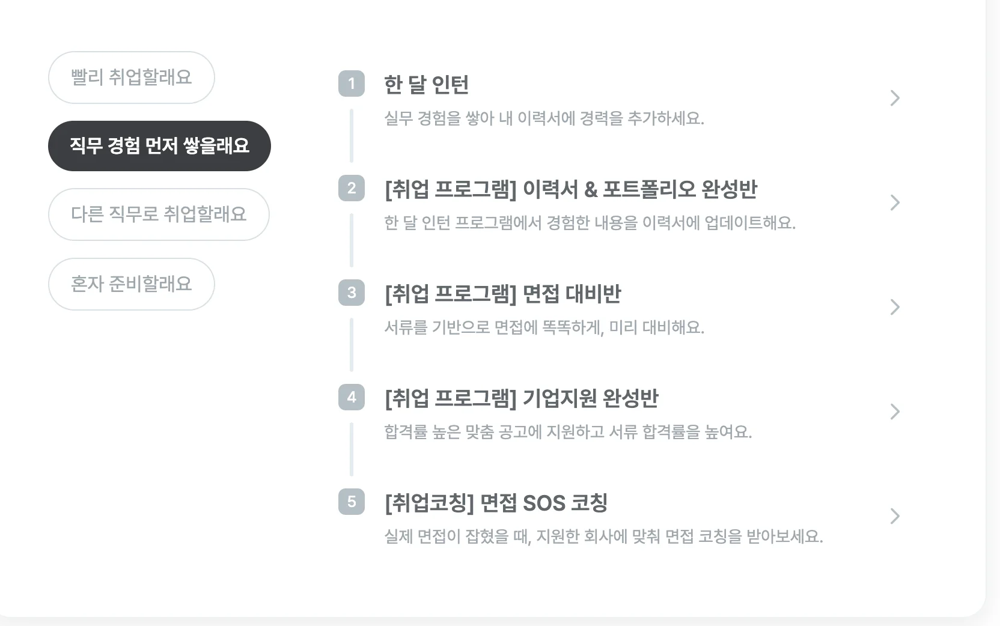

- 기간&#58; 24&#46;11&#46;13(수)

- 이현중 코치님

> 준비한 내용을 바탕으로  향후 취업 프로그램 진행  안내

→3번 정도 진행

### 채용 공고 확인하기

---

> <a href="https://www.saramin.co.kr/zf_user/search?search_area=main&#38;search_done=y&#38;search_optional_item=n&#38;searchType=auto&#38;searchword=%EB%B0%B1%EC%97%94%EB%93%9C%2F%EC%84%9C%EB%B2%84%EA%B0%9C%EB%B0%9C">사람인 &#45; 백엔드 개발자 채용정보</a>

- 우선 경험과 성장을 중심으로 진행하는 것이 가장 좋다&#46;
    - 스타트업 중 나의 가치와 맞는 기업들을 고르고, 그에 맞게 준비
        - 해당 회사에서 중요하게 다뤄지는 것부터 확인
            - 어떤 것을 포커싱해서 방향성을 갖출 지가 중요하다&#46;

### 긍정적 마인드를  과정에 충실하기 

---

- 준비는 끝이 없다, 과정을 충실하게 배워나가야한다&#46; 

- 임계점을 넘을 때까지는 항상 계속해서 나가야한다&#46; 
    - <u>긍정성을 잃</u>지않고 준비해 나가야한다&#46; 

    - 부정적인 마음을 잘 케어해야 한다&#46; 

    - 소통이 잘 안 되거나 부정적 태도를 가지면 어느 회사에서든지 원하지 않는다&#46;
        - 기술만 보지 않는다&#46; 협업, 소통 

### 캠프 이후 진행되는 취업 지원 프로그램 

---

> <a href="https://intellipick.spartacodingclub.kr/">인텔리 픽</a>

- 아래의 인턴쉽 지원 프로그램 고려

### 취업 준비

---

- 백엔드 분야가 채용이 가장 활발하다&#46;
    - 그러나 경력자 우선이기 때문에, 신입으로서 진입 장벽이 높다&#46; 
        - 경력자 우선이라는 것은 바로 실무 투입 가능한 인원이 필요하다는 얘기이다&#46; 
            - 관련 자격증, 기술 스택을 더 많이  준비

            - 지원하는 인턴쉽 프로그램도 진행할 필요가 있을 것 같다&#46;  

- 포토폴리오를 통해 이 사람이 어떤 경험을 하였는지, 어떤 결과물을 냈는지 알 수 있다&#46; 즉, 현재 배우는 과정들을 잘 정리하고, 포토폴이오에 녹여내야 한다&#46; 
    - 결과물 → 포토폴리오 → 기록한 내용들

### 전망

---

- 백엔드가 다른 개발 시장보다 더 많은 수요가 있다&#46; 즉,  경쟁력이 있다&#46;  때문에 관련 기술을 더 전문화 시켜서 준비해야 한다&#46; 
    - 백엔드 특히 자바가 다른 기술보다는 수요가 많다&#46; 

- 어떻게든 발을 붙인는 것을 중요하게 생각한다&#46; 
    - 소규모 회사 &#45; 일을 하드하게 진행 → 역량 키우기 

    - 이직이 활발하기 때문에, 우선 경력을 쌓고 계속해서 이직을 진행하는 것이 좋다&#46; 

    - 취업 후 프로젝트를 진행하면서 각 거래처들 인맥 형성
        - 개인 회사 → 거래처
