<a id="13deda9b0fe18035b260dbea3b145dcb"></a>

## JWT 인증

---

> 📖 
> 
> <a id="6204477caca44406a8dc90bdec264dfd"></a>
> 
> JWT는 <u><code>Base64</code></u><u>로 인코딩</u>되어 <u>쉽게 복호화 가능</u>하다<br><u>Payload가 그대로 노출</u>되기 때문에 <strong>비밀번호나 민감한 정보를 저장하지 않</strong>는다&#46; 

<details>
<summary>🧐 Base64 인코딩, 암호화 알고리즘</summary>

<details>
<summary>🧐 의문점</summary>

- JWT Base 64로 인코딩 된다&#46;

- 암호화 알고리즘을 사용하여 보안성을 증가시킨다&#46; 

<a id="13eeda9b0fe18049b7b2e1fb113c2a1e"></a>

암호화를 두번한다는 말인가? 아니면 암호화 알고리즘으로 Base 64를 사용한다는 것인가?<br>위 문장을 보면 Base 64로 인코딩하는 것이 보안적인 이유는 아닌 것 같은데… 

</details>

<a id="13eeda9b0fe18050be6bc7ef4d6cc0a2"></a>

JWT는 <code>Header</code>, <code>Payload</code>, <code>Signature(서명)</code> 로 구성되어 있다&#46;

<a id="13eeda9b0fe18053bf36fc587bfcd9c6"></a>

이때 <code>서명(Signature)</code>은 토큰의 <strong><u>무결성(변조되지 않았음)을 검증하는데 사용</u></strong>된다&#46;

- <code>서명(Signature)</code>은 JWT의 <code>Header</code>와 <code>Payload</code>를 서버<code>Secret Key</code>와 <code>암호화 알고리즘</code>으로 암호화된 해시값(서명) 이다&#46;

- 자세한 내용은 아래 <code>🧐 서명 생성 과정</code> 참조

<a id="13eeda9b0fe180ee913bd3b6c10e8912"></a>

클라이언트에서 인증에 성공하여 jwt 토큰을 받으면<u> 인가(유저 확인)가 필요한 요청 시 같이 jwt 토큰을 같이 보</u>내는데, 

<a id="13eeda9b0fe180fd9dc0ed69b9cd5fd9"></a>

이때 <code>전달받은 jwt의 서명(Signature)</code> 과  <code>서버에 보관된 Secret Key</code> 와 <code>전달 받은 jwt의 header와 playload</code>를 사용한 <code>새로 생성된 서명(Signature)</code>을 비교하여 해당 유저가 맞는지 판별한다&#46; 

<a id="13eeda9b0fe1808aba15d545b1073cf0"></a>

정리

> 위 의문점은 jwt를 제대로 이해하지 못해 생긴 것이었음

-  <code>암호화 알고리즘</code>은 JWT의 <code>header</code>, <code>payload</code> 와 <code>Secret Key</code>를 사용한 서명 즉, <u>암호화된 해시값을 생성</u>하는데 사용된다&#46;

- JWT의 Header와 Payload는 사람이 읽을 수 있는 JSON 형태이기 때문에, 이를 <strong><u>안전하고 압축된 문자열로 변환</u></strong>하기 위해 <strong><code>Base64URL 인코딩</code></strong><strong>을 사용한다&#46; </strong>

</details>

<details>
<summary>🧐 서명(Signature) 생성 과정</summary>

<details>
<summary><strong>1&#46; Header와 Payload 결합</strong></summary>

<a id="13eeda9b0fe180259ea3ecd6f7dd3340"></a>

<u>Base64URL로 인코딩</u>된 <code>Header</code>와 <code>Payload</code>를 <code>&#46;</code>으로 연결하여 하나의 문자열을 만든다&#46;

<a id="13eeda9b0fe18057b4a3e2931403fa19"></a>

```json
Header.Base64URL.Payload.Base64URL
```

</details>

<details>
<summary>2&#46; 서명 생성</summary>

<a id="13eeda9b0fe18068b060c6cd6376f4ca"></a>

위 결합된 문자열을 <code>비밀 키(Secret Key)</code>와 함께 선택된 서명 알고리즘(예&#58; HS256)을 사용해 해싱한다&#46;

<a id="13eeda9b0fe180d1b4bfe579c2128eaa"></a>

이로 인해 생성된 서명은 인증과 무결성 검증을 위한 역할로 사용된다&#46;

- ex) HMAC&#45;SHA256 알고리즘을 사용
    <a id="13eeda9b0fe18032a783ec6d3a53796d"></a>

    ```java
    Signature = HMAC_SHA256(secret_key, Header.Base64URL.Payload.Base64URL)
    ```

</details>

<details>
<summary>3&#46; 서명 인코딩</summary>

- 생성된 서명 값은 <strong>Base64URL</strong>로 인코딩되어 JWT의 마지막 부분에 추가된다&#46; 

</details>

<details>
<summary>4&#46; 최종 JWT</summary>

<a id="13eeda9b0fe180f0adddcee32a508f41"></a>

```java
Header.Base64URL.Payload.Base64URL.Signature.Base64URL
```

</details>

</details>

<details>
<summary>🧐 <strong><code>Base64</code></strong><strong> vs </strong><strong><code>Base64URL</code></strong></summary>

- <code>Base64</code>
    - <code>&#43;</code>, <code>/</code>, <code>=</code>와 같은 문자를 사용하기 때문에 URL이나 파일 이름에 포함될 때 문제가 발생할 수 있음
        - <code>&#43;</code>와 <code>/</code>는 URL에서 다른 의미를 가질 수 있음

        - <code>=</code>는 URL 파라미터에서 혼란을 줄수 있음

- <strong><code>Base64URL</code></strong>
    - <strong>Base64URL</strong>은 이러한 문제를 방지함
        - <code>&#43;</code> → <code>&#45;</code>

        - <code>/</code> → <code>&#95;</code>

        - <code>=</code>(패딩문자) 생략

<a id="13eeda9b0fe180128175f349eb98ec33"></a>

JWT는 JSON Web Token의 표준에 따라 <strong>Base64URL</strong> 인코딩을 사용하여 헤더와 페이로드를 인코딩한다&#46;

<a id="13eeda9b0fe180229360ede123817252"></a>

해당 표준을 따르는 이유는 JWT가 주로 URL이나 헤더에 포함되어 사용되기 때문이다&#46; 

- <code>Base64URL</code>을 사용하는 이유
    <a id="13eeda9b0fe180bc9476e378ad5b5c1a"></a>

    <strong><u>JWT</u></strong>는 <strong><u>클라이언트와 서버 간</u></strong>에 <strong><code>인증 정보</code></strong>나 <strong><code>기타 데이터</code></strong>를 <strong><u>안전하고 효율적으로 교환</u></strong>하기 위한 목적으로 사용된다 

    <a id="13eeda9b0fe1804e9883f5231a517c6f"></a>

    이때, JWT를 <u>URL에 포함</u>하거나<u> HTTP 헤더에 삽입</u>할 때 <u>문제가 없</u>도록 하기 위해 <strong><u>Base64URL 인코딩이 사용</u></strong>된다&#46; 

</details>

<details>
<summary>JWT 인증 과정</summary>

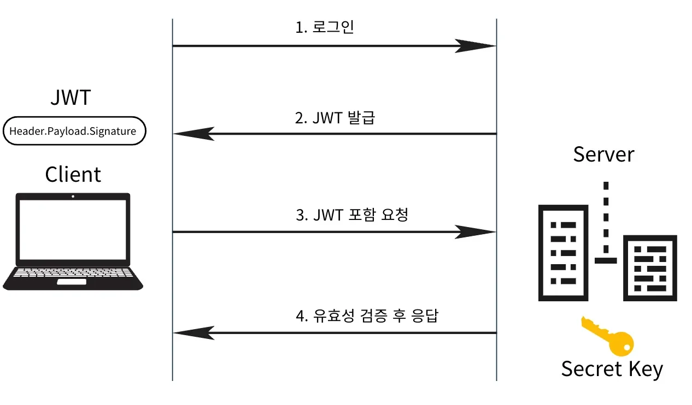

1. 클라인트에서 로그인 요청 ( 인증 )

1. 서버에서 확인 후 인증에 성공하면, JWT를 발급하여 클라이언트에게 전달
    - Header, Payload에 Secret Key를 사용하여 Signature 만듬 

    - 이후 Base64URL로 Encoding 

    - 일반적으로 Cookie에 담아 클라이언트에게 JWT를 발급

1. 발급받은 JWT를 저장 후 서버에 요청할 때 <code>Authorization</code> Header에 JWT를 담아 보냄 ( 인가 요청 )

1. 서버에서 <u>JWT의 유효성 검사를 통해 통과</u>한다면 인증에 성공하여 요청을 처리
    - JWT 만료, 위변조 여부 검사

</details>

<details>
<summary>JWT 유효성 검사 ( JWT 탈취 상황 가정 )</summary>

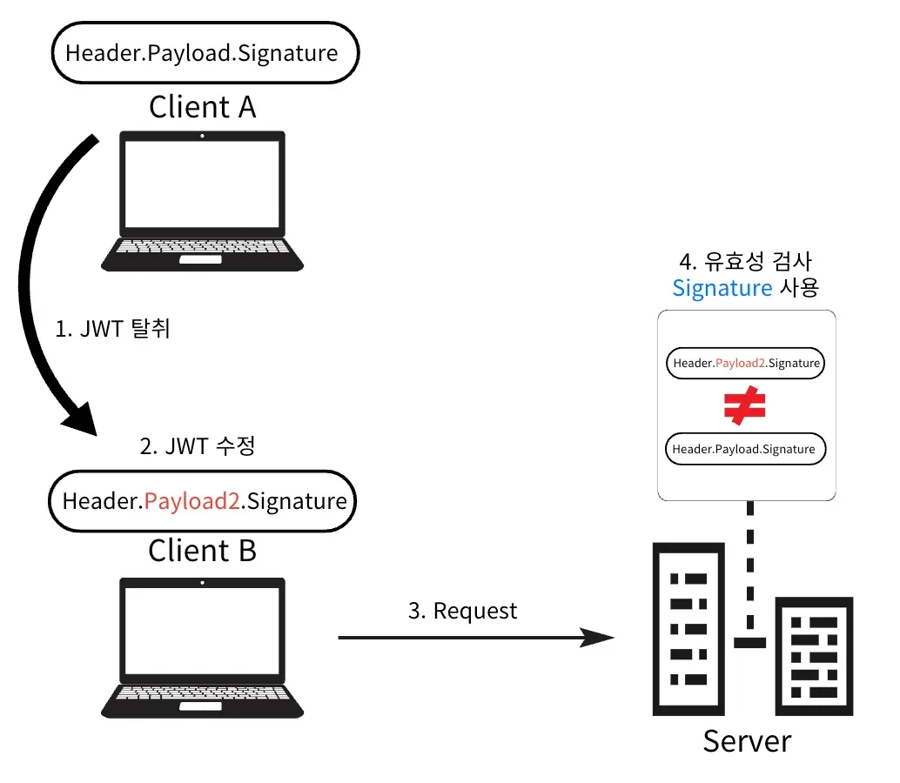

1. A의 JWT를 B가 탈취

1. B가 탈취한 JWT를 임의로 수정

1. B가 수정한 JWT로 Server에 요청

1. 서버는 Signature를 사용하여 유효성 검사 → Signature 불일치
    - 요청으로 받은 JWT의 Header, Payload를 서버의 Secret Key값을 이용해 Signature를 다시 만들어 비교

    - <u>payload가 조작</u>된 경우, 다른 signature가 생성되기 때문에 <u>조작 여부를 판별</u>할 수 있다&#46; 

> ☝🏻 
> 
> <a id="db8544d236534faa8dea4242c7b27e65"></a>
> 
> JWT의 목적은 정보 보호가 아닌, <u>위조 방지</u>에 있다&#46;

</details>

<a id="13deda9b0fe180d79646c7e03c298344"></a>

## JWT 장단점

---

<details>
<summary>JWT 장점</summary>

- <code>Signature</code>로 인한 서버의 보안성이 증가

- Token 자체가 필요한 정보(유저 및 검증 정보)들을 모두 가지고 있다,

- 서버는 인증 정보와 관련된 별도의 저장소를 사용하지 않는다&#46;

- 서버의 수평 확장성(Scale Out)이 높아진다&#46;

- Cookie가 없는 다른 환경에서도 인증/인가를 적용할 수 있다&#46;

- DB를 조회하지 않아도 된다&#46;

</details>

<details>
<summary><strong>JWT 단점</strong></summary>

- Payload는 암호화 된 것이 아니라 민감한 정보를 다루지 못한다&#46;

- Token의 길이가 길다&#46; 따라서  트래픽이 증가하면 네트워크에 부하가 증가한다&#46;

- 클라이언트 측에서 Token을 관리하기 때문에 탈취당하면 대처하기 어렵다&#46;

</details>

<a id="13deda9b0fe180df8da1fe5b5fb9fbf5"></a>

## Access Token,  Refresh Token

---

> 📖 
> 
> <a id="a22bd45853b043dbab99a05aa7d1258c"></a>
> 
> Token은 클라이언트에서 관리하기 때문에 탈취당할 위험성이 높다&#46; <br>따라서 <u>만료시간 설정을 짧</u>게 주는데, 이러하면 <u>사용자의 사용성이 떨</u>어진다&#46;  → 지속된 로그인 요청   
> 
> <a id="13eeda9b0fe180c6b785ee0d4afb2ec3"></a>
> 
> 이 때 발생되는 단점을  <code>Access Token</code>과  <code>Refresh Token</code>을 사용하여 해결한다&#46;

<details>
<summary>Token 유형</summary>

- Access Token
    - 사용자 인증 후 서버가 발급하는, 유저 정보가 담기 토큰

    - 유효기간 동안 API 및 리소스 접근에 사용함

- Refresh Token
    - Access Token은 보안을 위해 <u>짧은 수명</u>을 가진다&#46;

    - Access Token이 만료된 경우, 재발급을 받기위해 사용한다 &#46;

    - 주로 데이터베이스에 유저 정보와 같이 저장한다 &#46;

</details>

<details>
<summary>🧐 &#91; 비밀번호, jwt &#93; 암호화 알고리즘</summary>

<a id="13eeda9b0fe180abb9c6d37f4ba9c99e"></a>

<strong>비밀번호 해싱</strong>과 <strong>JWT 서명 생성</strong>은 보통 <strong>다른 목적과 알고리즘</strong>을 사용한다&#46;

<a id="13eeda9b0fe180b98100c8efe953ebd1"></a>

이 둘은 <u>보안의 측면</u>에서 <u>서로 다른 요구 사항을 충족</u>하기 때문에 다른 알고리즘을 사용해야 한다&#46;

- 비밀번호 해싱 
    - 목적 &#45; 데이터 안전하게 저장

    - <u>알고리즘</u>
        - <u>bcrypt</u>, <u>argon2</u>, 또는 <u>PBKDF2</u>와 같은 <strong><u>단방향 해시 함수</u></strong> 사용

    - 특징
        - 해시된 비밀번호는 <strong><u>솔트(salt)라는 랜덤 데이터를 추가</u></strong>하여 동일한 비밀번호에 대해서도 <strong>항상 다른 해시 값을 생성</strong>한다&#46;
            > 🧐 어떻게 비밀번호의 유효성을 확인하는가? → 아래 참조

- <strong>JWT 서명 </strong>
    - <strong>목적 &#45; JWT의 무결성을 보장, </strong><strong>위조 여부 판별</strong>

    - 알고리즘
        - 대칭 키 &#45; <code>HMAC&#45;SHA256(H256)</code>

        - 비대칭 키 &#45; <code>RS256</code>

    - 특징
        - 서명은 <u>JWT의 헤더와 페이로드</u>에 대한 <u>무결성을 보장</u>하기 위해 사용되며, <code>비밀 키(대칭)</code> 또는 <code>공개/개인 키(비대칭)</code>를 사용해 서명된다&#46; 

</details>

<details>
<summary>🧐 비밀번호 해시화  시, <u><code>솔트(salt)</code></u><u>라는 랜덤 데이터를 추가</u>하여 해시값을 생성한다&#46; 그렇다면 <u>동일한 비밀번호도 매번 다른 해시값이 생성</u>된다는 것인데, 어떻게 비밀번호의 유효성 검사를 하는가? </summary>

---

- <u>해시된 비밀번호</u>는 데이터베이스에 저장될 때 <strong>솔트와 해시 값이 함께 저장</strong>된다&#46;
    - 보통 솔트는 <u>해시 값의 앞부분</u>이나 <u>특정한 구조</u>로 저장된다&#46; 

- <strong>솔트의 식별 및 저장</strong>
    - 솔트는 보통 사용자 계정과 연관된 테이블의 한 컬럼에 저장된다&#46; 

    - users 테이블의 각 사용자 레코드에 <u><code>salt</code></u><u>라는 컬럼을 추가</u>하여 <u>솔트를 함께 저장</u>할 수 있다&#46;
        - 테이블 예시 
            | user&#95;id | username | password&#95;hash | salt |
            | --- | --- | --- | --- |
            | 1 | user1 | &#60;해시 값&#62; | ABCD1234 |
            | 2 | user2 | &#60;해시 값&#62; | XYZ5678 |

</details>

<details>
<summary><strong>Access Token, Refresh Token 인증</strong></summary>

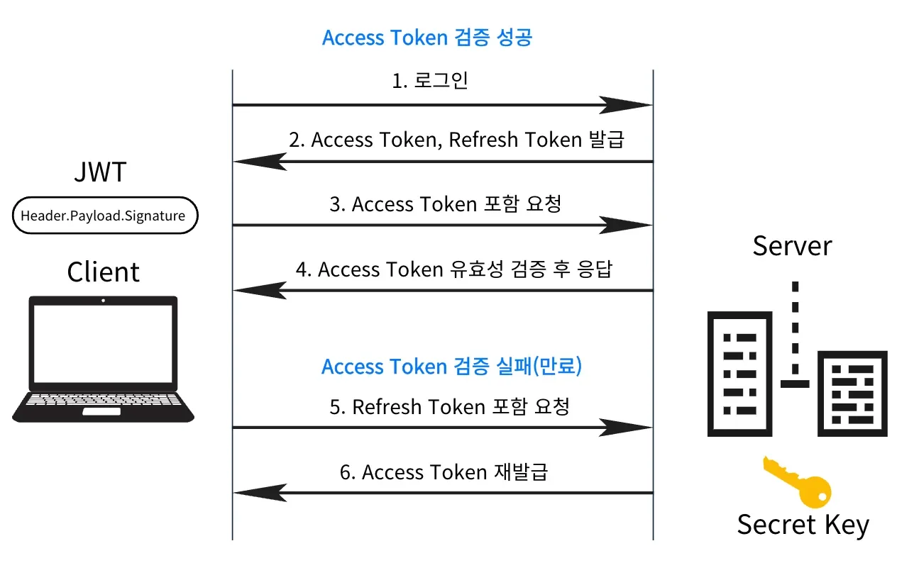

1. 클라이언트의 로그인 요청

1. 인증(로그인) 성공 시, Header, Payload를 생성하고 <code>Secret Key</code>를 사용하여 <code>Signature</code>를 만든다&#46;

1. 발급받은 JWT를 저장 후,  요청할 때 <code>Authorization</code> Header에 JWT(<code>Access Token</code>)를 담아 보낸다&#46;
    - <code>Authorization&#58; Bearer &#60;JWT&#62;</code> 

1. 서버에서 JWT의 유효성 검사를 통해 통과한다면 인증에 성공하여 요청을 처리한다&#46;

1. <code>Access Token</code>이 만료 되었다면 <code>Refresh Token</code> 으로 토큰 재발급을 요청한다&#46;

1. 버로부터 <code>Access Token</code>을 재발급 받는다&#46;

</details>

<details>
<summary>참고 &#45; ‣</summary>

<details>
<summary>session</summary>

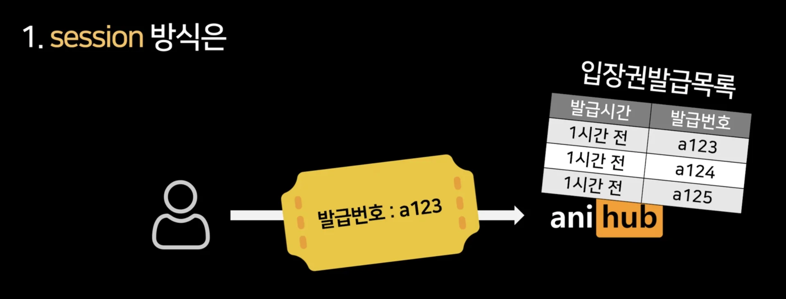

</details>

<details>
<summary>jwt</summary>

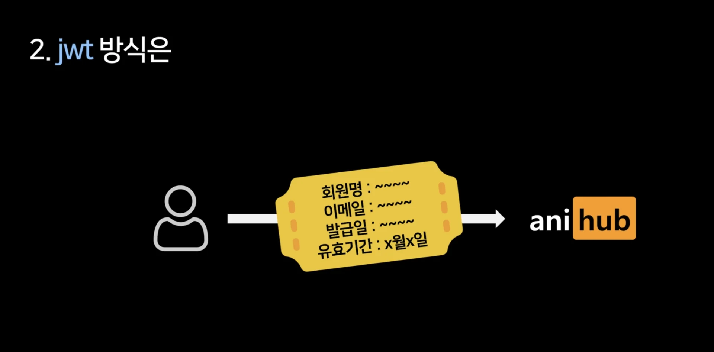

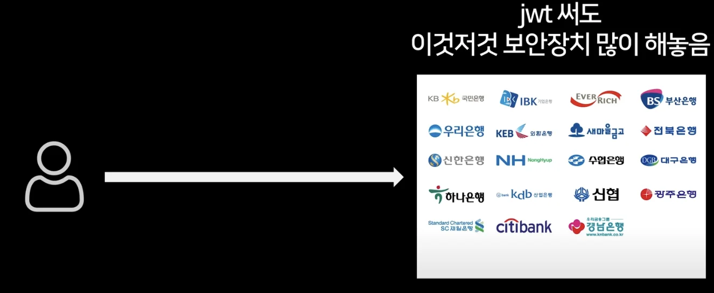

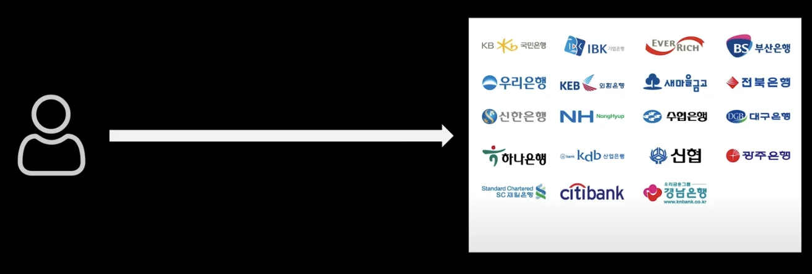

</details>

---

- 취약점 1 ) header에 알고리즘 none 검증 필요하다&#46;

- 취약점 2 )JWT는 디코딩이 매우 쉽다(base64URL) 따라서 민감한 정보를 적으면 안된다&#46;

- 취약점 3 )시크릿 키 대충 적으면 안된다&#46;
    - 시크릿 키를 털리면 탈취자가 jwt를 마음대로 생성할 수 있다&#46; 

    - 생성용키/검증용키 2개 사용
        <a id="13eeda9b0fe180f3a196da1ac77a907f"></a>

        → 귀찮으니 jwt 라이브러리 확인해보기

- 취약점 4 ) 탈취 시 jwt를 서버에서 정지시킬 수 없다&#46; 유효기간이 만료된 경우만 해당 jwt가 유효하지 않게 된다&#46; 
    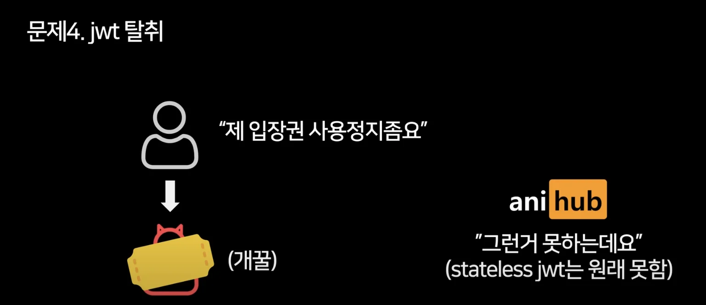

    - 솔루션 1 ) 훔치기 어렵게 만든다&#46;

    <details>
    <summary>솔루션 2 ) jwt 블랙리스트를 만든다&#46; </summary>

    - 세션 방식이랑 동일, jwt 사용의 이점이 없어진다&#46; 
        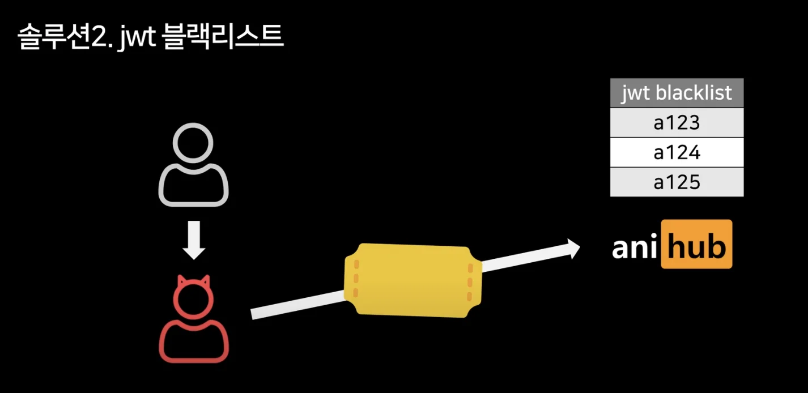

    </details>

    <details>
    <summary>솔루션3 ) jwt 유효기간 짧게 </summary>

    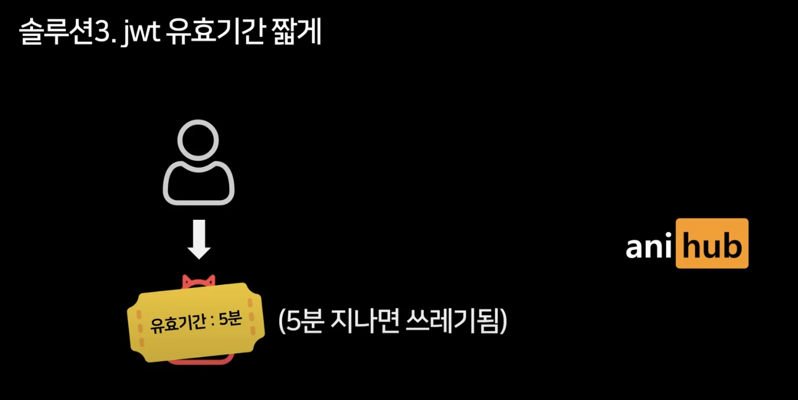

    </details>

    - 솔루션 4 ) refresh token rotation → <u>refresh token 1회용</u>
        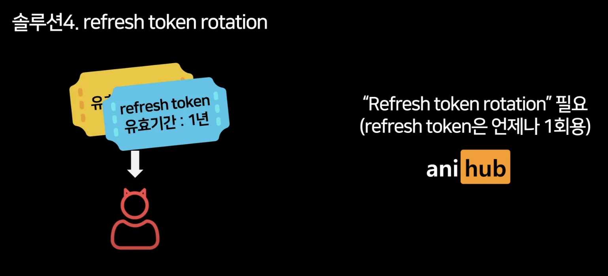

</details>
