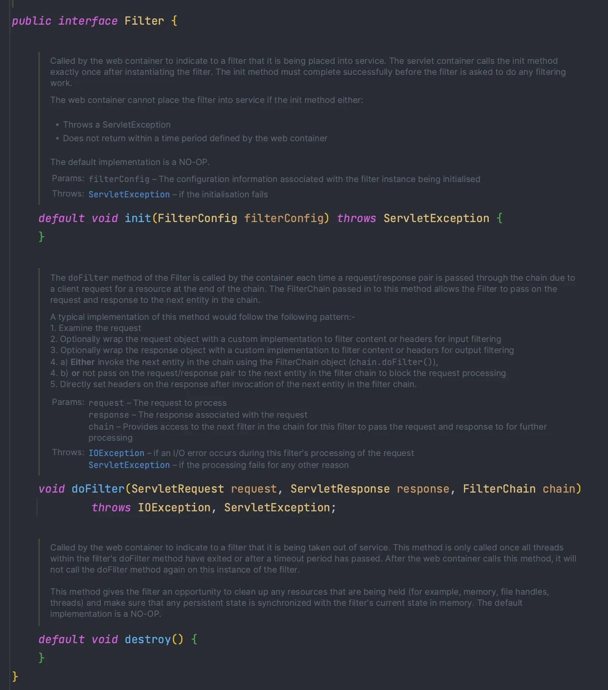
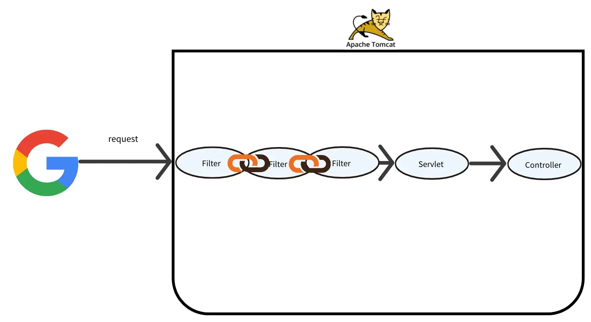

<a id="13deda9b0fe1805b97cff98baa985f75"></a>

## Filter Interface

---

> 📖 
> 
> <a id="01edb046f6344b2d84bd4bce6841fd5a"></a>
> 
> Filter는 Servlet 앞단에 위치하여, HTTP 요청과 응답을 Servlet에 도착하기 전에 가로채, 다양한 작업(공통 관심 사항 )을 수행하는데, 이러한 filter를 구현(implements)하는데 사용되는 interface이다&#46;

<details>
<summary><code>jakarta&#46;servlet&#46;Filter</code></summary>

- Filter는 <code>Filter Interface</code>를 Implements하여 구현하고 <u>Bean으로 등록</u>하여 사용한다&#46;
    - <code>Servlet Container</code>가 <strong>Filter</strong>를 <u>Singleton 객체로 생성 및 관리</u>한다&#46;



</details>

<details>
<summary>주요 메서드 </summary>

<details>
<summary><code>init()</code></summary>

- Filter 초기화

- Servlet Container가 생성될 때, 호출됨

- <u><code>default method</code></u> 이므로  구현 X
    - java8 부터 추가된 기능, 인터페이스에서 메서드 구현 가능

</details>

<details>
<summary><code>doFilter()</code></summary>

- Client에서 요청이 올 때 마다 <code>doFilter()</code> 메서드가 호출됨
    - <code>doFilter()</code> 내부에 필터 로직(공통 관심사 로직)을 구현

- WAS에서 <code>doFilter()</code> 를 호출해주고 하나의 필터의 <code>doFilter()</code>가 통과된다면, Filter  Chain에 따라서 순서대로 <code>doFilter()</code> 를 호출한다&#46;<br>더이상 <code>doFilter()</code> 를 호출할 Filter가 없으면 Servlet이 호출된다&#46;

</details>

<details>
<summary><code>destroy()</code></summary>

- 필터 종료

- Servlet Container가 종료될 때 호출

- init()과 동일하게 default 메서드이다&#46; 구현 ❌

</details>

<a id="13eeda9b0fe180b7aa75d3fa78b5d555"></a>

필터의 생성 메서드인 <code>init()</code> 과  종료 메서드인 <code>destroy()</code>는 default method이기 때문에 구현이 필요가 없다&#46; 

<a id="13eeda9b0fe180879239c45a5586ccb8"></a>

따라서 Filter 구현 시, <u><code>doFilter()</code></u><u>만 </u><u>오버라이드</u>하여 <u>내부</u><u>에서 </u><u>공통 관심사항을 처리</u>하면 된다&#46; 

</details>

<a id="13deda9b0fe180f9b77fe255f249cb0f"></a>

## Servlet Filter 구현

---

> 📖 
> 
> <a id="20724c89954b47dcbfcf6663d02ec3b8"></a>
> 
> <code>Filter Interface</code>를 구현(implements) 하여 만든다&#46; <br>생성 메서드(<code>init()</code> )와 소멸 메서드(<code>destroy()</code>)가 <code>default</code> 메서드 이므로  <code>doFilter()</code>만 오버라이드하여  <u>공통 관심 사항을 처리</u> 하면된다&#46; 
> 
> - 파라미터&#58; <code>ServletRequest</code>, <code>ServletResponse</code>, <code>FilterChain</code>

<details>
<summary>Filter 구현 </summary>

- 요청 URL을 Log로 출력하는 Filter

<a id="13eeda9b0fe180ba8265d425cb4da825"></a>

```java
@Slf4j
public class CustomFilter implements Filter {
    @Override
    public void doFilter(
            ServletRequest request,
            ServletResponse response,
            FilterChain chain
    ) throws IOException, ServletException {

        // Filter에서 수행할 Logic
        HttpServletRequest httpRequest = (HttpServletRequest) request;
        String requestURI = httpRequest.getRequestURI();

        log.info("request URI={}", requestURI);
        // chain 이 없으면 Servlet을 바로 호출
        chain.doFilter(request, response);
    }
}
```

- <code>doFilter()</code> 는 더 이상 호출할 Filter가 없다면 Servlet을 호출한다&#46;

> ☝🏻 
> 
> <a id="13eeda9b0fe180948734e6ed8e2095e2"></a>
> 
> <code>ServletRequest</code> 는 기능이 별로 없어서 대부분 기능이 많은 <code>HttpServletRequest</code> 를 다운 캐스팅 하여 사용한다&#46;
> 
> - <code>(HttpServletRequest) request</code>

</details>

<details>
<summary>Filter 빈 등록</summary>

<details>
<summary>1&#46; Filter를 Bean으로 수동 등록할 config 클래스를 생성한다&#46; </summary>

- <code>&#64;Configuration</code>

- <code>WebMvcConfigurer</code>를 인터페이스를 상속하여 구현

</details>

<details>
<summary>2&#46; <code>FilterRegistrationBean</code>를 사용하여 filter 세부사항을 편라하게 설정 가능하다&#46;</summary>

<a id="13eeda9b0fe180158b27fa4a01f8bdd3"></a>

```java
@Bean
public FilterRegistrationBean customFilter() {
		FilterRegistrationBean<Filter> filterRegistrationBean = new FilterRegistrationBean<>();
		
		// 등록할 필터, 필터 순서, 허용할 url 지정
		
		return filterRegistrationBean;
}
```

</details>

<details>
<summary>3&#46; <code>FilterRegistrationBean</code> &#45; 주요 메서드 </summary>

<details>
<summary><code>setFilter()</code> </summary>

- 등록할 필터를 파라미터로 전달

</details>

<details>
<summary><code>setOrder()</code></summary>

- Filter는 chain 형태로 동작하기 때문에, 순서를 지정해줘야 한다&#46; 

- 파라미터로 전달될 숫자에 따라 우선순위가 정해진다&#46;
    - 숫자가 낮을수록 우선순위가 높다&#46;

</details>

<details>
<summary><code>addUrlPatterns()</code></summary>

> ☝🏻 
> 
> <a id="dd239e7373f04e3db4fa18865ccc4e9a"></a>
> 
> <u>Spring이 제공</u>하는 <code>URL Pattern</code>은 Servlet과 다르게 <u>더욱 세세하게 설정</u> 가능하다&#46;

- 필터를 적용할 URL 패턴을 지정
    - 여러개 URL 패턴을 한번에 지정 가능

    - 규칙은 Servlet URL Pattern과 동일
        - ex) <code>filterRegistrationBean&#46;addUrlPatterns(&#34;/&#42;&#34;)</code> 

        - 모든 Request는 Custom Filter를 항상 지나간다&#46;

</details>

</details>

---

<details>
<summary>&#91; 코드 &#93; 빈 등록</summary>

<a id="13eeda9b0fe180f38c3ccfc895f622b4"></a>

```java
@Configuration
public class WebConfig implements WebMvcConfigurer {
		
		@Bean
		public FilterRegistrationBean customFilter() {
				FilterRegistrationBean<Filter> filterRegistrationBean = new FilterRegistrationBean<>();
				// Filter 등록
				filterRegistrationBean.setFilter(new CustomFilter());
				// Filter 순서 설정
				filterRegistrationBean.setOrder(1);
				// 전체 URL에 Filter 적용
				filterRegistrationBean.addUrlPatterns("/*");
				
				return filterRegistrationBean;
		}
}
```

</details>

</details>

<a id="1e5eda9b0fe18080a65bfa1507bd4acb"></a>

### 책임 연쇄 ( <strong>Chain of Responsibility ) </strong>패턴 

<a id="1e5eda9b0fe180f58b93d6a9cf0c4dc2"></a>

<a href="#/post/1c3eda9b-0fe1-81c3-a969-f75a75b9b3a3">페이지</a> 

<a id="13eeda9b0fe180b3a700dbe5b5eab624"></a>

### 정리



- Filter는 Filter Interface를 구현(<code>implements</code>) 하며 만든다&#46;
    - 구현 시 <code>doFilter()</code>만  오버라이드하여 공통 관심 사항을 처리한다&#46; 

- 스프링 부트의 경우 <code>FilterRegistrationBean</code>를 통해 수동으로 빈으로 등록하여 사용한다&#46;
    - Filter를 등록하는 방법은 여러가지가 있다&#46;

- HTTP 요청이 오면 <code>doFilter()</code> 메서드가 호출된다&#46; 
    - 요청 처리 시, <code>SevletRequest</code>는 기능이 별로 없기 때문에, <code>HttpServletRequest</code>로 다운캐스팅하여 사용한다 

- <code>chain&#46;doFilter(request, response)</code>
    - 다음 필터가 있으면 Filter를 호출한다&#46;

    - 다음 실행할 필터가 없으면 Servlet이 호출된다&#46; 

    - 해당 메서드가 호출되지 않으면 다음 단계로 진행되지 않는다&#46; 
        - 다음 <code>Filter</code> 나 <code>Servlet</code>이 호출되지 않음

    - 순서는 수동 빈 등록 시, <code>FilterRegistrationBean&#46;setOrder()</code>를 통해 지정 가능하다&#46;
