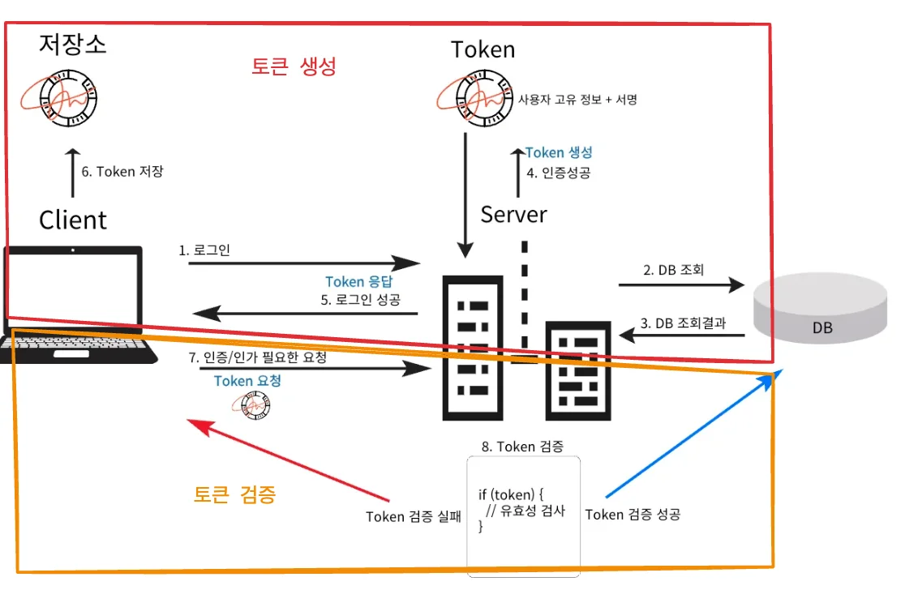
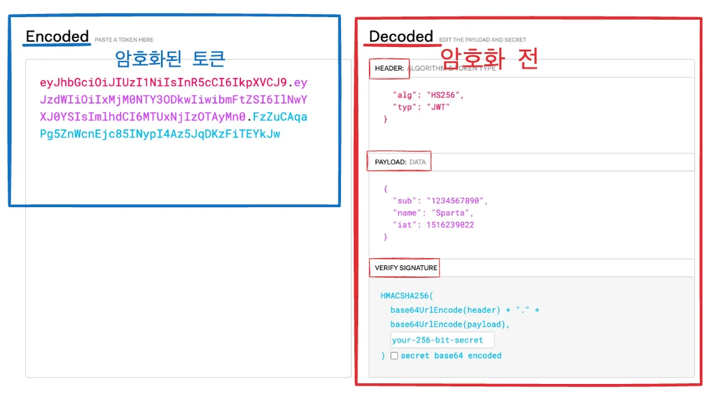

<a id="13deda9b0fe180849aece873cecd1c55"></a>

## Token

---

> 📖 
> 
> <a id="9893aabf69d943beaa5d021a02fe0361"></a>
> 
> Web Application 이나 API에서 <code>인증(Authentication)</code> 과 <code>인가(Authorization)</code> 과정에서 사용되며<u> 사용자 또는 시스템의 신원과 권한을 증명</u>하고 요청의 유효성을 검증하는데 사용되는<u> 디지털 문자열</u>이다&#46; 

<details>
<summary>Token 사용 이유</summary>

1. Token은 서버가 아닌 클라이언트에 저장되어 서버의 부담을 덜 수 있다&#46; 

1. Cookie는 웹 브라우저에만 존재하며 모바일 앱 등의 다양한 클라이언트에서 인증을 처리할 수 없다&#46; 

1. Token 방식은 Stateless를 기반으로 하기 떄문에 확장성이 뛰어나다 

1. 인증된 사용자임을 확인하기 위한 <strong><u>고유 서명을 포함</u></strong>하여 위조된 요청인지 확인 가능하다&#46;

</details>

<details>
<summary>Token 동작 순서 </summary>



- Token 생성 시 사용자의 고유한 정보를 포함한다 &#46;

- 데이터베이스에 접근 하지않고 Token의 유효성만 검증한다 &#46;

</details>

<details>
<summary>Token의 단점</summary>

- Cookie/Session 방식보다 Token 자체의 데이터 용량이 많다&#46; 
    - 요청이 많아지면 그만큼 트래픽이 증가한다&#46; 

- Payload(전송되는 데이터)는 <strong><u>암호화 되지 않</u></strong>아서 중요한 데이터를 담을 수 없다 &#46;

- 탈취 시 대처하기가 어렵다 ( 만료시간 30분 설정 )

</details>

<a id="13deda9b0fe18006ae2ae2b04db430ef"></a>

## JWT(JSON Web Token)

---

> 📖 
> 
> <a id="dff4dfa6c09e48ca997490b366ecff53"></a>
> 
> 인증에 필요한 정보들을 암호화시킨 JSON 형태의 Token
> 
> <a id="13eeda9b0fe18035ab41f10fe36ae3c0"></a>
> 
> <u>JSON 데이터 포맷</u>을 사용하여 <u>정보를 효율적으로 저장하고 암호화</u><br> → 서버의 보안성 ↑

<details>
<summary>JWT 구조</summary>



<a id="13deda9b0fe1806c9aeae7ff56c91af6"></a>

```java
XXXXXX.YYYYYY.ZZZZZZ
(Header).(Payload).(Signature)
```

</details>

<details>
<summary>Header</summary>

<a id="b3ca11dd5f3e4232bacd41abdcef3a04"></a>

<u>토큰의 타입</u>과 <u>해싱 알고리즘</u>을 정의

- ex)
    <a id="650d63157b7c429b98affaa50ef04469"></a>

    ```json
    {
    	"alg": "HS256",
    	"typ": "JWT"
    }
    ```

</details>

<details>
<summary>Payload</summary>

- 실제로 인증과 관련된 데이터(<code>Claims</code>)를 담고 있다&#46; 

- <u>Claims</u>(데이터)의 종류
    - <code>Registered Claims</code>&#58; 미리 정의된 Claims
        - <code>iss</code>(issuer)&#58; 토큰 발급자

        - <code>exp</code>(expiration)&#58; 만료시간

        - <code>sub</code>(subject)&#58; 제목

        - <code>iat</code>(issued At)&#58; 발행 시간

        - <code>jti</code>(JWT ID)&#58; 토큰의 고유 식별자

    - <code>Public Claims</code>&#58; 사용자가 정의할 수 있는 클레임, 공개용 정보 전달 목적

    - <code>Private Claims</code>&#58; 사용자 지정 클레임, 당사자들 간에 정보를 공유하기 위한 목적 

    <details>
    <summary>ex) </summary>

    <a id="13eeda9b0fe180f2b85ce6564b692b6b"></a>

    ```json
    {
      "iss": "example.com",
      "sub": "1234567890",
      "aud": "example.org",
      "exp": 1716239022,
      "iat": 1516239022,
      "name": "John Doe",
      "admin": true
    }
    ```

    </details>

</details>

<details>
<summary>Signature</summary>

- Header 와 Payload를 서버의 <code>Secret Key</code>로 서명하여 암호화

- Header에서 정의한 암호화 알고리즘(alg)를 사용하여 암호화한다&#46; 

- 서명을 통해 서버는 Token이 변조되지 않았음을 확인할 수 있다&#46;

- ex)
    <a id="13eeda9b0fe1800ea513d55c80d8a6de"></a>

    ```json
    HMACSHA256(
      base64UrlEncode(header) + "." +
      base64UrlEncode(payload),
      secret
    )
    ```

> ☝🏻 
> 
> <a id="c446a16885ac4a5fbc7be6b0b4e1aea2"></a>
> 
> base64UrlEncode는 값을 URL에서 사용할 수 있도록 <code>&#43;</code>, <code>/</code>를 각각 <code>&#45;</code>, <code>&#95;</code>로 표기한다&#46;

> ☝🏻 
> 
> <a id="13eeda9b0fe180ab9a78d7076658de0f"></a>
> 
> <code>Header</code>와 <code>Payload</code>는 <strong><u>Encoding된 값</u></strong>이기 때문에 복호화 혹은 값을 수정할 수 있지만 <code>Signature</code> 서버에서 관리하기 때문에 Secret Key가 유출되지 않는 이상 복호화 할 수 없다&#46; 

</details>
