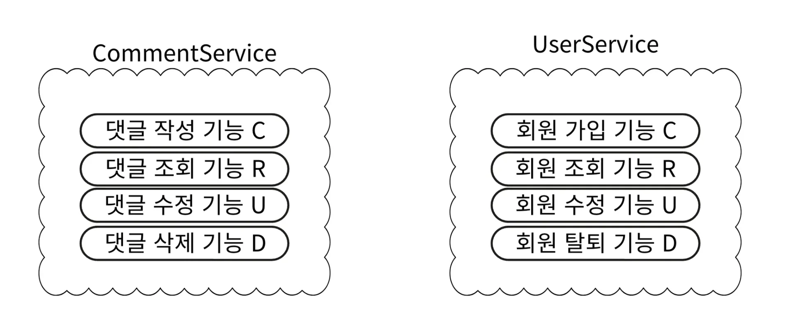
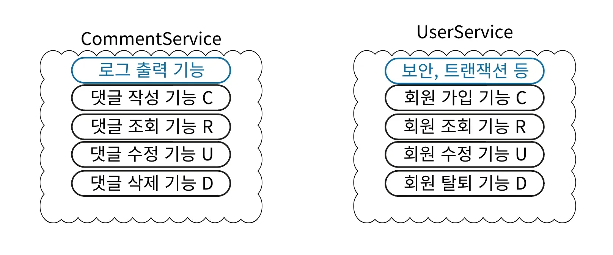
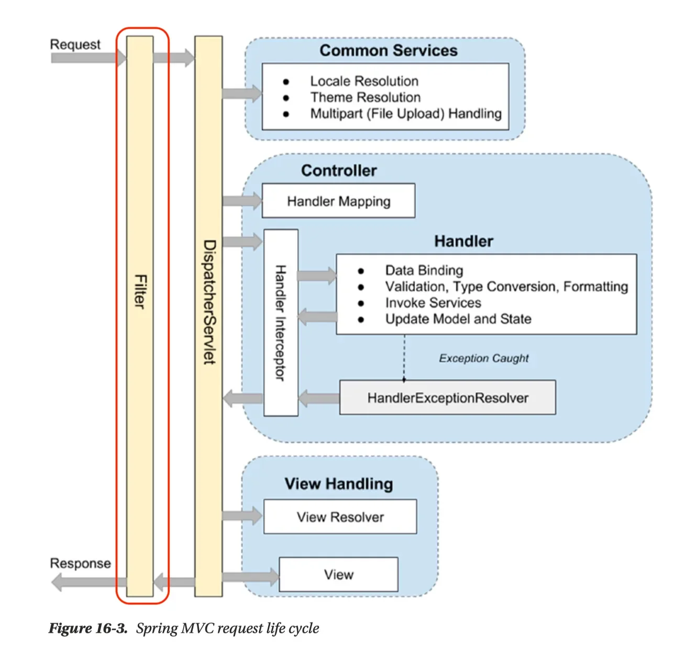
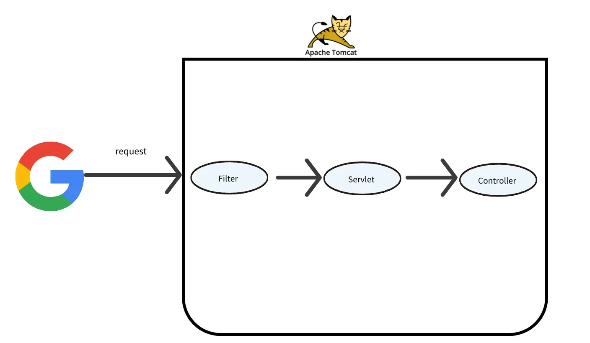
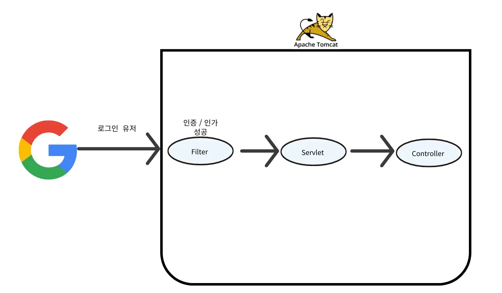
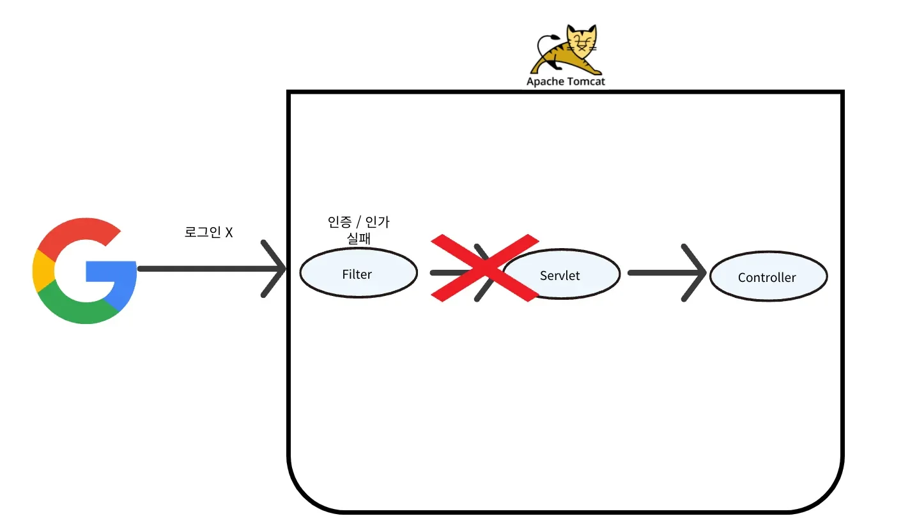
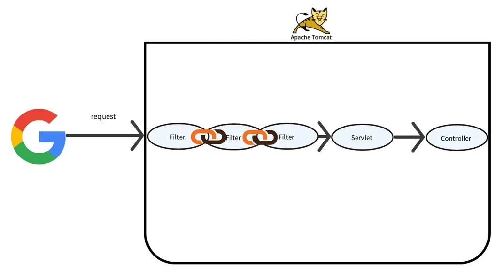

<a id="13deda9b0fe180a8ac00e32d3ef622f6"></a>

## 공통 관심 사항(cross&#45;cutting concerns)

---

> 📖 
> 
> <a id="9134aecfdec744119fe6242a34b8830c"></a>
> 
> <u>여러 위치에서 공통적으로 사용</u>되는 <code>부가 기능</code>을 말한다&#46; 
> 
> <a id="13eeda9b0fe180c3aecdd8d4aaf125f9"></a>
> 
> <code>Filter</code>는 이러한 <u>공통 관심사(Cross Cutting Concern)의 처리</u>하기 위해서 사용된다&#46; 
> 
> - 횡단 관심사 라고도 한다&#46; 

<details>
<summary>핵심 기능</summary>

- 비지니스 로직



</details>

<details>
<summary><strong>부가 기능</strong></summary>

- 비지니스 로직과는 별개로 동작하는 기능



</details>

<details>
<summary>예시 &#45; 공통 관심 사항 ( 로그인 )</summary>

<details>
<summary><strong>요구사항 </strong></summary>

- 로그인 한 유저만 특정 API를 사용할 수 있어야 한다&#46;<br>즉, 화면에서 로그인 하지 않으면 API를 사용하지 못하도록 막는다&#46;
    <a id="13eeda9b0fe180e68d1af4ab4160e2d3"></a>

     → 로그인 유무를 판단하여 예외처리 

</details>

<details>
<summary>&#91; 코드 &#93;</summary>

-  여러가지 로직에서 공통으로 관심이 있는 부분을 <u>공통 관심사</u>라고 한다&#46;
    <a id="13eeda9b0fe18019926be11f8e702b1b"></a>

    ```java
    로그인 여부 확인 로직 -> 공통 관심사 (인증 : 로그인)
    ```

<a id="13eeda9b0fe180d18d37cd439d34e06f"></a>

```java
@RestController
@RequestMapping("/post")
public class PostController {

    @PostMapping
    public PostResponseDto create(PostCreateRequestDto request) {
        // 로그인 여부 확인 로직
        // 생성 로직
    }

    @PutMapping("/{postId}")
    public void update(
            @PathVariable Long postId,
            PostUpdateRequestDto request
    ) {
        // 로그인 여부 확인 로직
        // 수정 로직
    }

    @DeleteMapping("/{postId}")
    public void delete(@PathVariable Long postId) {
        // 로그인 여부 확인 로직
        // 삭제 로직
    }

}
```

</details>

---

<a id="13deda9b0fe180bc80c7f8311f9ec547"></a>

위 예시처럼 공통 관심사는 로그인 뿐만아니라 더 큰 범위를 나타낸다&#46; 

- <strong>Spring AOP</strong>를 활용

- <u>Web과 관련된 공통 관심사</u>는 <strong>Servlet Filter</strong>나 <strong>Spring Intercepter</strong>를 사용하여 처리한다&#46; 
    - <code>HttpServletRequest</code> 객체를 제공하기 때문에 HTTP 정보나 URL 정보에 접근하기 쉽다&#46;
        - ex) HTTP Header Cookie → 인증

        - ex ) 특정 URL의 요청을 인증처리 → URL 정보

</details>

<a id="13deda9b0fe1800d8166db8950e98eef"></a>

## Servlet Filte

---

> 📖 
> 
> <a id="13eeda9b0fe1803b844bfab242f96164"></a>
> 
> <code>Servlet Filter</code>는 <u>보안, 로깅, 인코딩, 인증/인가</u> 등 다양한 작업을 처리하기 위해 사용된다&#46;

<details>
<summary><strong>Servlet Filter 특징</strong></summary>

- 1&#46; 공통 관심사 로직 처리
    - 공통된 로직을 중앙 집중적으로 구현하여 <u>재사용성이 높</u>고 <u>유지보수가 쉽</u>다

    - 모든 요청이 하나의 입구를 통해 처리되어 일관성을 유지한다&#46;
        - 프론트 컨트롤러 패턴 ( dispatcherSerlvet )과 유사

        <details>
        <summary>filter는 dispatcherSerlvet  앞단에 존재</summary>

        

        </details>

- 2&#46; HTTP 요청 및 응답 필터링

- 3&#46; <code>Filter Chain</code>
    - 여러 개의 필터가 순차적으로 적용될 수 있다&#46;

    - <code>filterChain&#46;doFilter(request, response)</code>
        - 다음 필터로 제어를 전달함

- 4&#46; <code>doFilter()</code>
    - 실제 필터링 작업을 수행하는 주요 메소드로 필터가 처리할 작업을 정의한다&#46;

    - 다음 필터로 제어를 넘길지 여부를 결정한다&#46;

</details>

<details>
<summary><strong>Servlet Filter 적용</strong></summary>



- filter는 servlet  앞단에 위치, servlet 호출 전 filter를 거치고 넘어간다&#46;
    - 스프링 &#45; DispatcherServlet

- <u>공통 관심사</u>를 <strong><u>필터에만 적용</u></strong>하면 <u>모든 요청 or 응답에 적용</u>된다&#46; 

- Filter는 <u>특정 URL Pattern에 적용</u> 가능하다&#46;

</details>

<details>
<summary><strong>인증/인가 필터 동작</strong></summary>

<details>
<summary>로그인 성공</summary>



- 정상적으로 Controller를 호출

</details>

<details>
<summary>로그인 실패</summary>



- 적절하지 않은 요청이면 filter에서 걸러짐
    - controller를 호출하지 않음

</details>

</details>

<details>
<summary><strong>Filter Chain</strong></summary>



- Filter는 체인 형식으로 구성되며, 순서 지정 및 추가가 가능하다&#46; 
    - <code>filterChain&#46;doFilter(request, response)</code>

</details>
