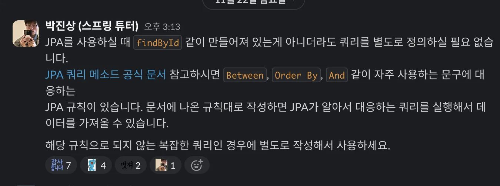
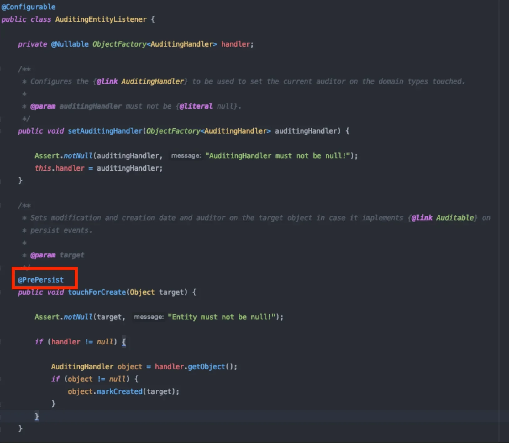

<a id="13eeda9b0fe18067bf1be80d0cdd4be3"></a>

## Query Methods

---

> 📖 
> 
> <a id="d7583fc437a84f309131b4a61d6690e0"></a>
> 
> <u>Spring Data JPA</u>에서 <strong><u>메서드 이름을 기반</u></strong><strong>으로 </strong><strong>데이터베이스 쿼리를 자동 생성</strong> 하는 기능이다&#46;

<details>
<summary>공식 문서 </summary>

[JPA Query Methods &#58;&#58; Spring Data JPA]()

</details>

<details>
<summary>추가 팁</summary>



<a id="13eeda9b0fe1806280b6e9024e1e0851"></a>

‣

</details>

<details>
<summary>Query Methods</summary>

- <code>JpaRepository</code>는 <code>findAll()</code>, <code>save()</code>  와 같은 기본적인 기능만 제공한다&#46;  

- 따라서 실제 앱 개발 시, <u>상황에 따라 더 복잡한 조건을 가지는 메서드가 필요</u>한데, 이를 <strong><code>Query Methods</code></strong>를 사용하여 <u>메서드 이름</u>으로 <u>상황에 맞는 SQL을 자동으로 생성</u>할 수 있다&#46;
    <details>
    <summary>ex) Query Method → SQL </summary>

    - Query Methods
        <a id="13eeda9b0fe180ccb98ce90a621797ab"></a>

        ```java
        public interface MemberRepository extends JpaRepository<Member, Long> {
        		// Query Methods
            Member findByNameAndAddress(String name, String address);
        }
        ```

        - <code>find</code>&#58; Entity에 매핑된 테이블(member)을 조회
            <a id="13eeda9b0fe18062b55bf5fafca5218b"></a>

            → <code>SELECT &#42; </code><u><code>FROM Member</code></u>

        - <code>ByName</code> &#58; 조건1 &#45; member 테이블의 name 필드

        - <code>AndAddress</code>&#58; 조건2 &#45;  member 테이블의 address 필드
            <a id="13eeda9b0fe180e5842fdaba5df2369a"></a>

            &#45;&#62; <code>WHERE nam =? AND address = ?; </code>

    - 자동 생성되는 SQL
        <a id="13eeda9b0fe18070b109ecf4e5e591e6"></a>

        ```sql
        SELECT * FROM member WHERE name = ? AND address = ?;
        ```

    </details>

> ☝🏻 
> 
> <a id="7b2d1a42cd114196b6a2da33f0c5d652"></a>
> 
> 기본적인 기능이 아니라면 <u>반드시 실제 실행되는 SQL을 확인</u>하여 내가 <u>의도한 대로 SQL Query가 실행는지 검증</u> 해야한다&#46;
> 
> - <u>메서드 이름</u>으로 실행되는 SQL 추측하는 것은 지양해야 한다&#46; 

</details>

<details>
<summary>Query Methods의 장점과 한계</summary>

<details>
<summary>장점</summary>

- 간단한 쿼리 쉽게 작성 가능

- 메서드 이름을 통해 직관적으로 의도를 표현할 수 있음

- Spring Data JPA가 메서드 이름을 분석하여 적절한 JPQL을 생성
    - 개발자가 직접 JPQL을 작성하지 않아도 됨

</details>

<details>
<summary>한계</summary>

- 복잡한 쿼리를 작성할 때, 메서드 이름이 너무 길어질 수 있음

- <u>조건이 여러 개 있는 복잡한 쿼리</u>는 <u>메서드 이름</u>으로 표현하기 어렵거나 불가능함

- 동적 쿼리를 지원하기 어려움
    - <u>조건이 상황에 따라 달</u>라지는 경우, Query Methods만으로 구현이 복잡하다&#46;

-  <strong><u>메서드 이름을 통한 쿼리 생성</u></strong>은 가독성과 유지보수성 측면에서 제한적임

</details>

</details>

> 🥸 
> 
> <a id="e854f3809a624e9ca894764069928a54"></a>
> 
> 이후에 배우는 <code>QueryDSL</code>를 사용하여 동적 쿼리나 복잡한 조건의 쿼리를 유연하게 구성할 수 있다&#46; 

<details>
<summary>QueryDSL 사용 이유</summary>

- <strong>복잡한 비즈니스 로직</strong>을 처리할 때 직관적이고 유지보수 가능한 코드를 작성 가능하다&#46;
    - Query Methods로 작성하기 어려운 복잡한 SQL을 유연하게 작성 수 있다&#46;

- <strong>동적 쿼리</strong>가 필요한 경우, 조건에 따라 다르게 쿼리를 구성할 수 있어 코드 재사용성과 가독성이 높다&#46;

- <strong>타입 세이프티</strong>를 제공하여 쿼리 작성 시 타입 오류를 컴파일 타임에 방지할 수 있다&#46;

</details>

<a id="13eeda9b0fe1809c911bd981fb1a9fa9"></a>

## JPA Auditing

---

> 📖 
> 
> <a id="32d5671bcf2a4a8cb5a523216dd73965"></a>
> 
> 엔티티의 <u>생성 및 수정 시간</u>을 자동으로 관리해주는 기능이다&#46; <br>이를 통해 손쉽게 엔티티의 생성과 수정을 자동으로 추적할 수 있다&#46; 

<details>
<summary>요구사항</summary>

- 모든 클래스에 <code>생성 시간</code>, <code>수정 시간</code> 추가

<details>
<summary>&#91; 코드 &#93; <code>Entity</code> &#45; User</summary>

<a id="13eeda9b0fe180419703f30853dad5e6"></a>

```java
@Entity
public class User {
		@Id
		private Long id;
		private String name;
		private String address;
		
		// 생성 시간
		private LocalDateTime createdAt;
		// 수정 시간
		private LocalDateTime updatedAt;
}
```

</details>

<details>
<summary>&#91; 코드 &#93; <code>Entity</code> &#45; Item</summary>

<a id="0871d922dfb54c0092fc294bcc5ed949"></a>

```java
@Entity
public class Item {
		@Id
		private Long id;
		private String name;
		private String description;
		
		// 생성 시간
		private LocalDateTime createdAt;
		// 수정 시간
		private LocalDateTime updatedAt;
}
```

</details>

---

<a id="13eeda9b0fe1806cb7f5d708804f8517"></a>

모든 Entity의 생성 시간, 수정 시간에 대한 연산을 수행

<a id="13eeda9b0fe1806b8fb1c66ec3d0de25"></a>

 → JPA Auditing을 이런 연산을 자동화 해준다&#46; 

> 🥸 
> 
> <a id="2cf949c5ee034243a8fab771ce6e192d"></a>
> 
> 개발자는 <u>반복되는 불편함</u>을 참지 않는다&#46; 

</details>

<details>
<summary>순수 JPA에서의 Auditing 사용</summary>

> JPA의 라이프사이클 이벤트를 사용하여 엔티티의 createAt(생성시간) 과 updatedAt(수정시간) 필드를 자동으로 설정한다&#46; 

<details>
<summary>&#91; 코드 &#93; BaseEntity &#45; createAt, updatedAt 자동 설정</summary>

<details>
<summary><code>&#64;MappedSuperclass</code></summary>

- 다른 엔티티의 부모 클래스 역할

- 상속받는 엔티티 클래스에 필드를 매핑해줌

- <code>&#64;MappedSuperclass</code>로 지정된 클래스는 <u>데이터베이스에 테이블로 생성되지 않</u>지만, 해당 필드는 상속받은 엔티티의 컬럼으로 표시됨

</details>

<details>
<summary><code>&#64;Column(updatable = false)</code></summary>

- 업데이트 방지

- createdAt 필드는 데이터베이스에 삽입될 때만 설정되며, 이후 업데이트되지 않는다&#46;

</details>

<details>
<summary><code>&#64;PrePersist</code></summary>

- 엔터티가 처음 저장되기 전에 실행

- createdAt과 updatedAt 필드를 현재 시간으로 설정함

</details>

<details>
<summary><code>&#64;PreUpdate</code></summary>

- 엔터티가 업데이트되기 전에 실행

- updatedAt 필드를 현재 시간으로 갱신함

</details>

---

<a id="64e0e97105724683a89dfd25209a2b8f"></a>

```java
@MappedSuperclass
public class BaseEntity{
		@Column(updatable = false)
		private LocalDateTime createdAt;
		private LocalDateTime updatedAt;

		@PrePersist
		public void prePersist(){
			LocalDateTime now = LocalDateTime.now();
			created_at = now;
			updated_at = now;
		}
	
		@PreUpdate
	  public void preUpdate() {
	    updated_at = LocalDateTime.now();
	  }
}
```

</details>

<details>
<summary>&#91; 코드 &#93; Schedule &#45; BaseEntity 상속</summary>

- BaseEntity <u>상속</u>하여   createAt(생성시간) 과 updatedAt(수정시간) 필드 자동으로 설정 

<a id="7ecb339cdc03495eae86697cec14980e"></a>

```java
@Entity
@Getter @Setter
public class Schedule extends BaseEntity {
    @Id
    @GeneratedValue(strategy = GenerationType.IDENTITY)
    private Long id;

    private String description;
}
```

</details>

</details>

<a id="13eeda9b0fe180dab508d93ec275f123"></a>

## Spring Data JPA Auditing

---

> 📖 
> 
> <a id="b3c9872b41e1465095c05bb10f35764a"></a>
> 
> Spring Data JPA 사용 시, 애노테이션으로 간편하게 Auditing 기능 활성화 가능하다&#46; 

<details>
<summary>주요 Annotation</summary>

<details>
<summary><code>&#64;EnableJpaAuditing</code> </summary>

- JPA Auditing 기능을 활성화

<details>
<summary>ex)</summary>

- 최상단(시작) 클래스에 <code>&#64;EnableJpaAuditing</code>을 추가하여 <br>JPA Auditing 기능을 활성화 한다&#46;  

<a id="13eeda9b0fe180c8902acbc841799fcc"></a>

```java
@SpringBootApplication
@EnableJpaAuditing
public class Application {
    public static void main(String[] args) {
        SpringApplication.run(Application.class, args);
    }
} 
```

</details>

</details>

<details>
<summary><code>&#64;MappedSuperClass</code></summary>

- 해당 어노테이션이 선언된 클래스를 상속받는 Entity에 공통 매핑 정보를 제공함

- 위 <code>JPA Auditing</code> 예시 참조

</details>

<details>
<summary><strong><code>&#64;EntityListeners(AuditingEntityListener&#46;class)</code></strong></summary>

- JPA 엔티티의 라이프사이클 이벤트를 감지하여 특정 동작을 수행하도록 설정하는 애노테이션이다&#46; 

- Spring Data JPA에서 Auditing 기능을 활성화 하기 위해 사용된다&#46; 

- 엔티티가 생성되거나 수정될 때, 자동으로 관려 필드를 업데이트한다&#46; 

---

<details>
<summary><code>&#64;EntityListeners</code></summary>

- JPA 엔터티 클래스에 적용되며, 엔티티가 저장되거나 업데이트될 때 특정 리스너 클래스를 호출하여 추가 작업을 수행할 수 있도록 한다&#46;

</details>

<details>
<summary><code>AuditingEntityListener&#46;class</code></summary>

- Spring Data JPA에서 제공하는 리스너 클래스이다&#46;
    - 내부적으로 <code>&#64;PrePersist</code> 을 사용

    

- 엔티티에 <code>&#64;CreatedDate</code>, <code>&#64;LastModifiedDate</code>, <code>&#64;CreatedBy</code>, <code>&#64;LastModifiedBy </code>등의 애너테이션이 있는 경우, 해당 애너테이션이 있는 필드를 자동으로 설정해주는 역할을 한다&#46;
    - &#64;CreatedDate, &#64;LastModifiedDate
        -  엔터티가 처음 저장되거나 수정될 때 자동으로 날짜와 시간을 업데이트함

    - &#64;CreatedBy, &#64;LastModifiedBy
        - 인증된 사용자 정보를 기반으로 엔터티의 생성자와 수정자를 설정함

</details>

</details>

---

<details>
<summary><code>&#64;CreateDate</code></summary>

- 생성 시점의 날짜 자동 기록

</details>

<details>
<summary><code>&#64;LastModifiedData</code></summary>

- 수정 시점의 날짜 자동 기록

</details>

<details>
<summary><code>&#64;Temporal</code></summary>

- 날짜 타입을 세부적으로 지정
    - <code>DATE</code>, <code>TIME</code>, <code>TIMESTAMP</code> 등

</details>

---

> Spring Security

<details>
<summary><code>&#64;CreatedBy</code></summary>

- Entity 생성자의 정보를 자동으로 저장한다&#46;

- 생성하는 주체를 지정하기 위해, <code>AuditorAware&#60;T&#62;</code> 를 지정해야 한다&#46; 
    - Spring Security에서 다룸

</details>

<details>
<summary><code>&#64;LastModifiedBy</code></summary>

- 마지막 수정자의 정보를 자동으로 저장함

- 생성하는 주체를 지정하기 위해서 <code>AuditorAware&#60;T&#62;</code>를 지정해야 한다&#46; 
    - 동일하게 Spring Security에서 다룸

</details>

<details>
<summary><strong>🧐 </strong><strong>AuditorAware 구현 클래스</strong></summary>

<a id="13eeda9b0fe18033979ff538a3c50ede"></a>

```java
@Component
public class AuditorAwareImpl implements AuditorAware<String> {
    @Override
    public Optional<String> getCurrentAuditor() {
        // 실제 구현에서는 SecurityContextHolder에서 인증된 사용자 정보를 가져올 수 있습니다.
        return Optional.of("system"); // 예시로 고정된 값을 반환 (실제 코드에서는 사용자명 반환)
    }
}
```

</details>

</details>

<details>
<summary>적용</summary>

<details>
<summary>1&#46; Auditing 기능 활성화 </summary>

- 시작(최상단) 클래스에 설정

<a id="13eeda9b0fe180b7a345c4f0a7edeac9"></a>

```java
@EnableJpaAuditing
@SpringBootApplication
public class SpringDataJpaApplication {
    public static void main(String[] args) {
        SpringApplication.run(SpringDataJpaApplication.class, args);
    }

}
```

</details>

<details>
<summary>2&#46; <strong>BaseEntity 생성 </strong></summary>

<a id="13eeda9b0fe1803ab022dd609d7073ed"></a>

```java
@Getter
@MappedSuperclass
@EntityListeners(AuditingEntityListener.class)
public abstract class BaseEntity {

    @CreatedDate
    @Column(updatable = false)
    @Temporal(TemporalType.TIMESTAMP)
    private LocalDateTime createdAt;

    @LastModifiedDate
    @Temporal(TemporalType.TIMESTAMP)
    private LocalDateTime modifiedAt;
}
```

</details>

<details>
<summary>3&#46; <strong>BaseEntity 상속</strong></summary>

- User 엔티티는 BaseEntity를 상속 받는다&#46;
    - <code>createdAt</code>, <code>modifiedAt</code> 필드를 가짐

    - 상속 받는 것만으로도 생성, 수정 시간을 자동으로 생성할 수 있음

<a id="13eeda9b0fe18001be8eda5837686942"></a>

```java
@Entity
public class User extends BaseEntity{
    @Id
    private Long id;
    private String name;
}
```

</details>

</details>
