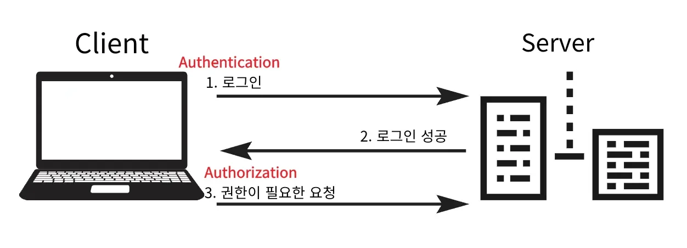

### 인증, 인가

- <strong>인증 (Authentication)</strong>
    - 사용자가 누구인지 확인하는 과정

    - ex) 로그인

- 인가 <strong>(Authorization)</strong>
    - 용자가 어떤 권한을 가지고 있는지 결정하는 과정

    - 반드시 인증이 선행되어야 한다&#46;

    - ex) 회원만 조회 가능한 게시글, 본인이 작성한 게시글 수정

### 쿠키 ( Cookie )

- 정의 
    - 웹 브라우저(Client 측)에 저장되는 데이터

- 용도 
    - 사용자 방문 기록, 로그인 상태 유지, 개인 맞춤 설정 등을 저장, HTTP 특성 극복, 광고 정보

- 특징
    - 클라이언트 측에서 저장되며, 서버에 요청을 보낼 때마다 포함되어 전송됨

- 수명
    - 만료 날짜를 설정할 수 있음, 
        - 세션 쿠키 ( 브라우저 종료 시 삭제)

        - 영속 쿠키 ( 지정된 기간 동안 유지)

### 세션 ( <strong>Session</strong> )

- 정의
    - 사용자와 서버 간의 상태를 유지하기 위한 방법

- 용도
    - 로그인 정보, 사용자 활동 등을 서버 측에서 관리

- 특징
    - 서버 측에서 저장되며, 세션 ID가 쿠키에 저장되어 클라이언트와 연결됨

- 수명
    - 브라우저를 닫거나 일정 시간이 지나면 만료됨

- Session 관리
    1. 세션은 메모리를 사용
        - 세션이 많아지면 서버의 장애가 발생할 수 있음 (메모리 리소스 부족 )

        - 최소한의 데이터만 저장

    1. <code>pSession</code>은 <code>LastAccessedTime</code>을 기준으로 30분의 생명주기를 가지고 있음

    1. 세션의 시간을 너무 오래 유지하여도 메모리 리소스가 부족할 수 있음
        - 적당한 시간 설정 필요 ( Default 30분 )
