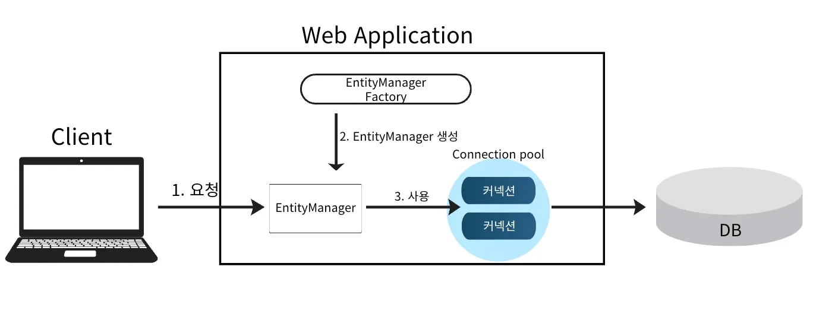
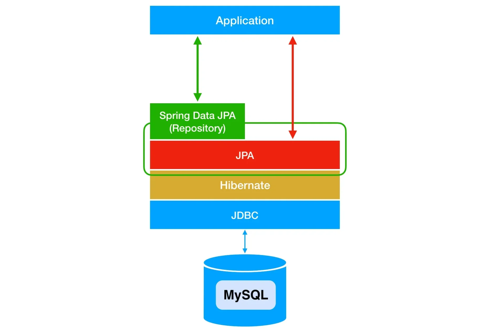
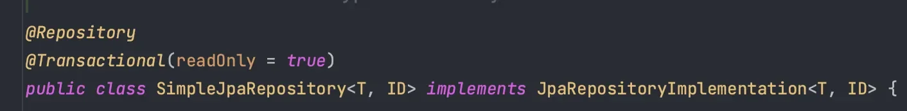
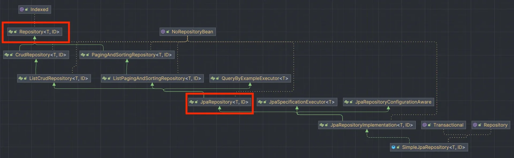
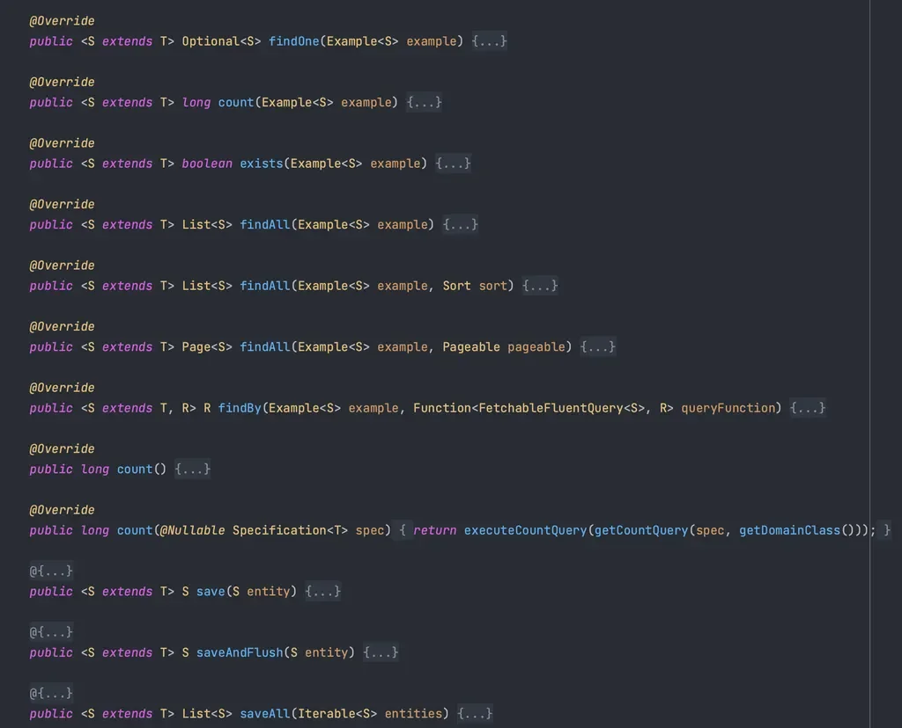

<a id="13eeda9b0fe180b79627f1edefc2ee5e"></a>

## Spring Boot 와 JPA

---

> 📖 
> 
> <a id="1332c073fe494ed9919b5e7fa2f728cc"></a>
> 
> Spring Boot는 <u>JPA 설정을 자동으로 구성</u>하여 JPA 쉽게 사용하도록 도와준다&#46;
> 
> <a id="13eeda9b0fe18024af3ae4b53720d60c"></a>
> 
> 기본적으로 필요한Entit ManagerFactory 와 TransactionManager를 자동으로 설정하고 데이터베이스 관련 설정을 <code>application&#46;properties</code> 파일에서 간단히 지정할 수 있게 해준다&#46; 

<details>
<summary> SpringBoot 사용 전</summary>

<details>
<summary>1&#46; 엔티티 매니저 팩토리를 생성</summary>

<a id="13eeda9b0fe18011b51ecea5a294b1ae"></a>

```java
EntityManagerFactory emf = Persistence.createEntityManagerFactory("test");
```

</details>

<details>
<summary>2&#46; 엔티티 매니저 생성</summary>

<a id="13eeda9b0fe1808ea238d80242162bee"></a>

```java
EntityManager em = emf.createEntityManager();
```

</details>

<details>
<summary>3&#46; 트랜젝션 가져와 시작 및 커밋</summary>

<a id="13eeda9b0fe180b6b61ff7fc06a52e53"></a>

```java
transaction.begin();

try {

		// 영속성 컨텍스트에 데이터 업데이트 

		
	transaction.commit();
} catch (Exception e) {
      // 실패 -> 롤백
      e.printStackTrace();
      transaction.rollback();
}
```

</details>

<details>
<summary>4&#46; 엔티티 매니저 연결 종료</summary>

<a id="13eeda9b0fe180edace3f7cad2ba93f7"></a>

```java
} finally {
    // 엔티티 매니저 연결 종료
    em.close();
}
```

</details>

<details>
<summary>5&#46; 엔티티 매니저 팩토리 연결 종료</summary>

<a id="13eeda9b0fe1807c9533cc6d67674176"></a>

```java
emf.close();
```

</details>

---

<details>
<summary>&#91; 코드 &#93; </summary>

<a id="13eeda9b0fe1806d82d5ed6185387811"></a>

```java
public static void main(String[] args) {
    // EntityManagerFactory 생성
    EntityManagerFactory emf = Persistence.createEntityManagerFactory("test");
    // EntityManager 생성
    EntityManager em = emf.createEntityManager();
    // Transaction 생성
    EntityTransaction transaction = em.getTransaction();

    // 트랜잭션 시작
    transaction.begin();

    try {
        // 비영속
        Tutor tutor = new Tutor(1L, "wonuk", 100);

        System.out.println("persist 전");
        // 영속
        em.persist(tutor);
        System.out.println("persist 후");

        // transaction이 commit되며 실제 SQL이 실행된다.
        transaction.commit();
    } catch (Exception e) {
        // 실패 -> 롤백
        e.printStackTrace();
        transaction.rollback();
    } finally {
        // 엔티티 매니저 연결 종료
        em.close();
    }
    
    emf.close();

}
```

</details>

</details>

<details>
<summary><strong>Spring Boot와 JPA</strong></summary>



- JPA는 Spirng에 종속적인 것이 아니다&#46; 

- Spring Boot에서 JPA를 사용하기 위해서는 build&#46;gradle에 의존성 추가가 필요하다&#46; 
    <details>
    <summary>JPA 의존성 추가</summary>

    <a id="13eeda9b0fe180f5b952f5747f3ad86e"></a>

    ```java

    ```

    </details>

- 자동으로 내부에서 EntityManagerFactory를 하나만 생성해서 관리(싱글톤)한다&#46;
    - 자동으로 Bean으로 등록

    - 직접 생성 X

    - 직접 종료(<code>&#46;close()</code>) X

    - application&#46;properties에 설정된 DB 정보로 생성

- <code>&#64;PersistenceContext</code>를 통해 자동으로 생성된 <code>EntityManager</code>를 주입 받아 사용한다&#46; 
    - <code>EntityManager</code> 는 Spring Data JPA에서 관리하여 직접 관리하지 않아도된다&#46;

<details>
<summary>ex) </summary>

<a id="13eeda9b0fe180aba9e9f09f0e9bd718"></a>

```java
@Repository
public class TutorRepository {
    
    @PersistenceContext
    private EntityManager em;

    public void save(Tutor tutor) {
        em.persist(tutor);
    }

    public Tutor findById(Long id) {
        return em.find(Tutor.class, id);
    }

    public List<Tutor> findAll() {
        return em.createQuery("SELECT * FROM tutor", Tutor.class).getResultList();
    }

    public void delete(Tutor tutor) {
        em.remove(tutor);
    }
}
```

</details>

</details>

> 📌 
> 
> <a id="af9f41bf99404c178e87b2d07722f373"></a>
> 
> <code>EntityManager</code> 는 <u>동시성 문제 방지</u>를 위해 <u>싱글톤으로 등록되지 않</u>는다&#46; Spring Boot는 프록시(가짜 객체)를 싱글톤으로 등록해 요청마다 별도의 <code>EntityManager</code> 인스턴스를 제공하여 각 요청은 독립적으로 <code>EntityManager</code> 를 사용해 안전하게 데이터베이스 작업을 처리할 수 있게 된다&#46;

<a id="c393d08bb4a444f9b19af093485cabbd"></a>

## Spring Data JPA

---

> 📖 
> 
> <a id="13eeda9b0fe180ce9971e60ec332f4a1"></a>
> 
> Spring Data JPA는 Spring Framework에서 제공하는 모듈로 JPA를 쉽게 사용할 수 있도록 지원한다&#46;<br>이를 통해 데이터베이스와 상호작용을 간단하게 구현할 수 있고 코드를 간소화할 수 있다&#46; 

<details>
<summary><strong>JPA </strong>vs<strong> Spring Data JPA</strong></summary>

<details>
<summary>JPA</summary>

- <code>&#64;PersistenceContext</code>를 통해 자동으로 생성된 <code>EntityManager</code>를 주입받아 사용

- 반복적인 CRUD 작업을 간편하게 할 수 있음

- 하지만 Entity 개수만큼 코드가 반복됨

<a id="13eeda9b0fe180669b8af83fc4fb83be"></a>

```java
public class MemberRepository {
    
    @PersistenceContext
    private EntityManager em;

    public void save(Member member) {
        em.persist(member);
    }

    public Member findById(Long id) {
        return em.find(Member.class, id);
    }

    public List<Member> findAll() {
        return em.createQuery("SELECT * FROM member", Member.class).getResultList();
    }

    public void delete(Member member) {
        em.remove(member);
    }
}
```

</details>

<details>
<summary>Spring Data JPA</summary>

- <code>JpaRepository</code> 인터페이스와 <code>Query Methods</code> 기능으로 비약적으로 생산성이 상승한다&#46;

- 반복적인 CRUD 작업들을 구현할 필요가 없다&#46;

<a id="13eeda9b0fe18039a7b0e07df37df6ad"></a>

```java
public interface MemberRepository extends JpaRepository<Member, Long> {
		// JPA Query Methods
		public Member findById(Long id);
}
```

</details>

</details>

<details>
<summary><strong>Spring Data JPA</strong></summary>

> Spring Framework 제공하는 모듈 



- JPA 추상화 Repository 제공
    - <code>CrudRepository</code>, <code>JpaRepository</code> 인터페이스 제공

    - SQL, EntityManager를 직접 호출하지 않아도 기본적인 CRUD 기능을 손쉽게 구현 가능

- JPA 구현체와 통합
    - 일반적으로 Hinernate를 통해 자동으로 SQL 생성됨

- QueryMethods
    - Method 이름만으로 SQL 자동 생성

    - <code>&#64;Query</code>룰 사용해 JPQL 또는 Native Quey 정의 가능
        - 복잡한 SQL 직접 구현할 때 사용

- 트랜잭션 관리와 Lazy Loading
    - 트랜젝션 기능 Spring 과 통합하여 제공

    - 지연로딩 기능을지원

</details>

<a id="13eeda9b0fe1801ca8fad018ea6d5dcd"></a>

##  SimpleJpaRepository

---

> 📖 
> 
> <a id="738a1bea9a924665bc6a2b649e59fee0"></a>
> 
> Spring Data JPA의 <u>기본 Repository 구현체</u>로 JpaRepository 인터페이스의 기본 메서드들을 실제로 수행하는 클래스 
> 
> <a id="13eeda9b0fe18047a25cfc89366be868"></a>
> 
> 내부적으로 <code>EntityManager</code>를 사용하여 JPA Entity를 DB에 CRUD 방식으로 저장하고 관리하는 기능을 제공함

<details>
<summary>SimpleJpaRepository</summary>





- Spring Data JPA는 <u><code>JpaRepository</code></u><u> 인터페이스를 구현한 클래스( </u><code>SimpleJpaRepository</code>) 를 자동으로 생성한다&#46;
    - 기본적으로 <code>SimpleJpaRepository</code>를 구현체로 사용

</details>

<details>
<summary>사용 방법</summary>

<a id="13eeda9b0fe180119b2de71bc8f35e2c"></a>

```java
public interface MemberRepository extends JpaRepository<Member, Long> {
}
```

- Repository를 <code>interface</code>로 선언

- <code>JpaRepository&#60;&#34;&#64;Entity 클래스&#34;, &#34;&#64;Id 데이터 타입&#34;&#62;</code> 상속

</details>

<details>
<summary>내부 동작</summary>

- Spring이 실행되면서 <u><code>JpaRepository</code></u><u> 인터페이스를 상속받은 인터페이스</u>가 있는지 확인하고 있다면 <u>해당 인터페이스의 정보로 토대로</u><u><code>SimpleJpaRepository</code></u><u>를 생성</u>하여 Bean으로 등록한다&#46;
    - 정의한 인터페이스의 구현 클래스를 직접 만들지 않아도 JpaRepository의 기능을 사용할 수 있다&#46; 

    - 직접 <code>SimpleJpaRepository</code> 사용 및 참조할 필요가 없다&#46; 

</details>

<details>
<summary>SimpleJpaRepository &#45; 주요 메서드</summary>



<details>
<summary><code>save(S Entity)</code></summary>

- 대상 Entity를 DB 테이블에 저장
    - 엔티티가 새로 생성된 객체면 → <code>persist()</code>

    - 이미 존재하는 객체면 → <code>merge()</code>

- ex)
    <a id="13eeda9b0fe1809bba5ef3a50b89eb80"></a>

    ```java
    Entity savedEntity = repository.save(newEntity);
    ```

</details>

<details>
<summary><code>findById(ID id)</code></summary>

- 식별자 id 값을 기준으로 엔티티를 조회
    - 반환 타입 → Optional

    - 존재하지 않을 경우 빈 Optional 반환

- ex) 
    <a id="13eeda9b0fe1802abb0fc54ec3dde012"></a>

    ```java
    Optional<Entity> entity = repository.findById(1L);
    ```

</details>

<details>
<summary><code>findAll()</code></summary>

- 모든 엔티티 리스트 형태로 반환

- ex)
    <a id="13eeda9b0fe1807a8cfde6ca77dbc98b"></a>

    ```java
    List<Entity> entities = repository.findAll();
    ```

</details>

<details>
<summary><code>findAll(Pageable pageable)</code></summary>

- 페이지네이션된 결과 반환
    - Pageable 객체를 사용해 페이지 번호, 크기, 정렬 방식 지정 가능

- ex)
    <a id="13eeda9b0fe18009988fe53f60117e72"></a>

    ```java
    Page<Entity> pagedEntities = repository.findAll(PageRequest.of(0, 10));
    ```

</details>

<details>
<summary><code>deleteById(ID id)</code></summary>

- 식별자 Id 값을 기준으로 해당하는 엔티티 삭제

- ex)
    <a id="13eeda9b0fe1808f893ad79bd54599df"></a>

    ```java
    repository.deleteById(1L);
    ```

</details>

<details>
<summary><code>delete(Entity entity)</code></summary>

- 대상 Entity를 데이터베이스에서 삭제

- ex)
    <a id="13eeda9b0fe18044914be5575e18ed15"></a>

    ```java
    repository.delete(existingEntity);
    ```

</details>

<details>
<summary><code>count()</code></summary>

- 데이터베이스의 엔티티 수 반환

- ex) 
    <a id="13eeda9b0fe18021b5f0fa85bac95861"></a>

    ```java
    long count = repository.count();
    ```

</details>

<details>
<summary><code>existsById(ID id)</code></summary>

- 식별자 id 값을 기준으로 엔티티가 존재하는지 확인

- ex)
    <a id="13eeda9b0fe1805eaba6d2e1c0c27fb5"></a>

    ```java
    boolean exists = repository.existsById(1L);
    ```

</details>

</details>
