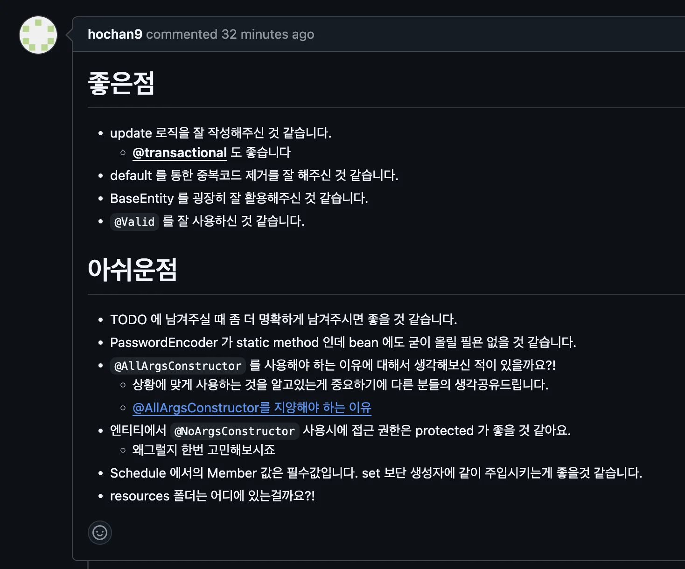
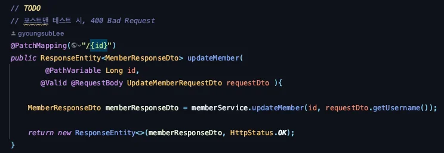
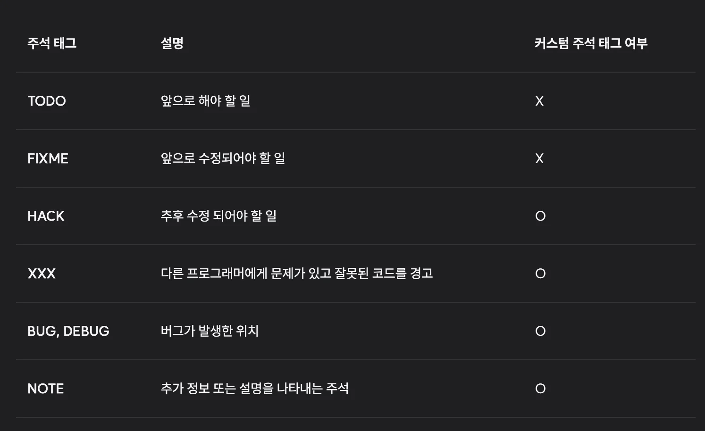
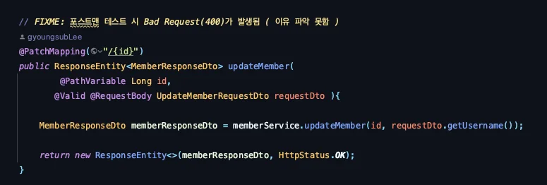

- 피드백 내용



<details>
<summary>피드백 1 &#45; TODO 사용 시 더 명확하게 메세지 남기기   &#45; 주석 태그</summary>

<details>
<summary>reference</summary>

<a id="13feda9b0fe180c0ae95fb4a2d29206b"></a>

‣<br>‣

</details>



<a id="13feda9b0fe18000a8dbf58964e22f4d"></a>

회원 정보 수정 api 에서 포스트맨 테스트 시, 자꾸 400 bad request 가 나와서 우선 TODO 명시하고 넘어갔다&#46;  그랬더니 더 명확하게 내용을 서술하면 좋을 것 같다는 말씀을 들었다&#46; 

<a id="13feda9b0fe180baabc3fb694fc05a11"></a>

해당 내용을 검색해 보니, 더 다양한 상황을 나타낼 수 있는<strong><u> 주석 태그&#91;Comment Tag&#93;</u></strong><strong>가 있다는 것을 알게 되었다&#46; (TODO와 같은 주석을 ‘주석 태그’라 한다&#46;)</strong><strong><u><br></u></strong><strong>그래서 해당 내용을 아래에 간단하게 종류와 예시로 정리함</strong>

- 주석 태그 종류
    - 커스텀 주석 태그 여부가 <code>O</code> 이면 직접 인텔리제이 설정에 등록해야 한다&#46;  → 커스텀 설정을 해야함

    - 인텔리제이에서는 기본적으로 <code>TODO</code>, <code>FIXME</code> 주석 태그를 제공함

    

- 작성 방법
    <a id="13feda9b0fe18013ad00e10684db045d"></a>

    ```java
    // 주석 태그: 설명할 내용

    ex) // TODO: 회원 로그인 기능 구현 필요
    ```

- 커스텀 설정
    <a id="13feda9b0fe1808eb9a0f48fb2f64f83"></a>

    해당내용은 아래 포스팅 참조

    <a id="13feda9b0fe180d29e74fa7c25d52c8b"></a>

    ‣

- 수정한 내용
    - 테스트 시, 잘못된 요청이 발생되어 실패함 그러나 원인을 파악하지 못했음

    - 따라서 TODO 보다는 앞으로 수정될 상황을 나타내는 <code>FIXME</code> 로 표함
        

</details>

<details>
<summary>피드백 2 &#45; PasswordEncoder가  static method인데 빈으로 등록함</summary>

- 피드백 받은 코드
    - 요구사항에 비밀번호 암호화를 위한 util 클래스를 복사해서 사용함

    - 간단하게 encode 와 matches 메서드만 가져와 사용하여 <br>빈을 통한 의존성 주입 방법보단, static으로 선언하여 가져와 사용함
        - 여기서 빈 등록을 제거하는 것을 까먹음

    <a id="13feda9b0fe180379e99c1719429d0bb"></a>

    ```java
    @Component
    public class PasswordEncoder {

        public static String encode(String rawPassword) {
            return BCrypt.withDefaults().hashToString(BCrypt.MIN_COST, rawPassword.toCharArray());
        }

        public static boolean matches(String rawPassword, String encodedPassword) {
            BCrypt.Result result = BCrypt.verifyer().verify(rawPassword.toCharArray(), encodedPassword);
            return result.verified;
        }
    }
    ```

- 수정 
    - <code>&#64;Component</code> 제거

    <a id="13feda9b0fe18025bc12eda00898d474"></a>

    ```java
    public class PasswordEncoder {

        public static String encode(String rawPassword) {
            return BCrypt.withDefaults().hashToString(BCrypt.MIN_COST, rawPassword.toCharArray());
        }

        public static boolean matches(String rawPassword, String encodedPassword) {
            BCrypt.Result result = BCrypt.verifyer().verify(rawPassword.toCharArray(), encodedPassword);
            return result.verified;
        }
    }
    ```

</details>

<details>
<summary>피드백 3 &#45; <strong><code>&#64;AllArgsConstructor</code></strong> 사용을 지양해야 한다&#46; → 생성자, 빌더패턴</summary>

<details>
<summary>reference</summary>

<a id="13feda9b0fe18089a826c184d9b6b3e9"></a>

‣

</details>

<a id="13feda9b0fe180ef95a5d631c462cf3f"></a>

DTO 나 Entity 에서 롬복을 통해 생성자를 자동 생성  &#45; <code>&#64;AllArgsConstructor</code>

<a id="13feda9b0fe180febc80da46a561222b"></a>

그냥 편해서 무지정으로 사용했는데, 해당 부분에 피드백을 받았다&#46;

---

<details>
<summary><code>&#64;AllArgsConstructor</code> 사용의 단점</summary>

- 타입의 필드가 여러 가지가 된다면 버그가 발생될 수 있다&#46; 
    - 자동으로 생성하기 때문에 <strong><u>타입만 맞</u></strong>다면 에러를 <strong><u>컴파일 시점에 에러가 발생하지 않</u></strong>는다&#46;

    - 이는 협업 시, 발생되는 오류를 찾기 어렵다 &#46;

    <details>
    <summary>ex)  오류 발생 상황</summary>

    <a id="13feda9b0fe18072901af71d06a97f87"></a>

    ```java
    @Getter
    @AllArgsConstructor
    private class Member {
        private String firstName;
        private String lastName;
    }
    ```

    - A가 작성한 테스트 
        <a id="13feda9b0fe180a99bc0d333624ca805"></a>

        ```java
        @Test
        void createMember() {
            Member member = new Member("성", "이름");
            assertThat(member.getFirstName()).isEqualTo("성");
            assertThat(member.getLastName()).isEqualTo("이름");
        }
        ```

    - B가 작성한 테스트  →  테스트 실패 
        - 타입은 동일하기 때문에, 컴파일 시점에 오류가 발생되지 않는다&#46; 

        - 따라서 테스트 시, 해당 케이스가 실패한다&#46; 

        - 하지만 생성자를 찾아봐도 프로덕션 코드에는 &#64;AllArgsConstructor 어노테이션만 있을 뿐 생성자를 찾을 수 없어 한 번 더 확인해야 된다&#46;
            - 자동 생성이기 때문에 코드가 감춰져 있어 가독성이 매우 나쁨

        <a id="13feda9b0fe1805d9430c5e1720a6e79"></a>

        ```java
        @Test
        void createMember2() {
            Member member = new Member("이름", "성");
            assertThat(member.getFirstName()).isEqualTo("성");
            assertThat(member.getLastName()).isEqualTo("이름");
        }
        ```

    </details>

</details>

- 개선점
    <details>
    <summary>1&#46; 생성자 직접 생성</summary>

    <a id="13feda9b0fe180ce8af6ce12fbf73f99"></a>

    ```java
    private class Member {
        private String firstName;
        private String lastName;

    		// 생성자 직접 생성
        public Member(String firstName, String lastName) {
            this.firstName = firstName;
            this.lastName = lastName;
        }
    }
    ```

    </details>

    <details>
    <summary>2&#46; <code>빌더 패턴</code> 사용</summary>

    - 생성자를 직접 생성한다면, 필드가 무수히 많다면 항상 해당 순서에 맞게 전달해야하는데, 그렇지 못해 오류가 발생될 수 있다&#46; 
        - 이를 해결하기 위해 나온게 <code>빌더 패턴</code>이다&#46; 

        - 순서없이 인자로 전달 가능

    <details>
    <summary>빌더 직접 구현</summary>

    <details>
    <summary>내부에서 빌더 객체 생성 &#45; <code>Member&#46;builder()</code></summary>

    - bulider를 외부에서 호출할 수 있게 static 선언을 해야한다&#46; ( <code>static method</code> )
        - static 영역에서 접근 가능하게 Builder 객체도 <code>static</code>으로 선언 해야한다&#46;

    <a id="140eda9b0fe1800fbd7fe2d5a9bbc609"></a>

    ```java
    public static Builder builder() {
        return new Builder();
    }

    public static class Builder {
    ```

    </details>

    <details>
    <summary><code>this</code> 반환</summary>

    <a id="140eda9b0fe180e095b9f05be7f7fdb7"></a>

    <code>this</code>를 반환하여 <strong><u>체이닝</u></strong>을 통해 <strong><u>각 메서드를 연결해서 호출</u></strong>할 수 있다&#46; 

    - 가독성 향상 

    </details>

    <a id="140eda9b0fe1801888b8f0b2f4f6c823"></a>

    ```java
    public class Member {
        private final String firstName;
        private final String lastName;

        private Member(Builder builder) {
            this.firstName = builder.firstName;
            this.lastName = builder.lastName;
        }

        // builder 메서드를 통해 내부에서 Builder 객체 생성
        // staic method로 외부에서 호출 가능하도록 해야한다.
        public static Builder builder() {
            return new Builder();
        }

        // Builder 클래스
        public static class Builder {
            private String firstName;
            private String lastName;


          public Builder firstName (String firstName) {
              this.firstName = firstName;
              return this;
          }

          public Builder lastName(String lastName) {
              this.lastName = lastName;
              return this;
          }

          public Member build() {
              return new Member(this);
          }
      }
    ```

    - 테스트
        - new 키워드를 사용하여 Builder(Member&#46;Builder) 객체 생성 

        - 각 필드의 해당되는 메서드에 값을 넣고 <code>build()</code> 호출 시 내부의 <code>private</code>으로 선언된  Member 생성자를 통해 객체를 생성하고 값을 할당함

        <a id="13feda9b0fe18094825be93792598cd3"></a>

        ```java
        public class Main {
            public static void main(String[] args) {
                // 빌더 패턴을 사용하여 Member 객체 생성
                Member member = new Member.Builder()  // mew Builder
                        .firstName("John")
                        .lastName("Doe")
                        .build();

                // 출력 결과 확인
                System.out.println(member);
            }
        }
        ```

    </details>

    <details>
    <summary>롬복 사용</summary>

    <details>
    <summary><code>&#64;Builder</code> </summary>

    - <code>&#64;Builder</code>를 사용해 간단하게 구현 가능
        <a id="13feda9b0fe180cd99f3d61ba40ba126"></a>

        ```java
        import lombok.Builder;
        import lombok.Getter;
        import lombok.ToString;

        @Getter
        @ToString
        @Builder
        public class Member {
            private String firstName;
            private String lastName;
        }
        ```

    - 테스트 
        - <code>new</code> 키워드를 통해 빌더 객체를 직접 생성하지 않고 Lombok이 자동 생성함
            -  Lombok이 자동 생성한 Member&#46;Builder 클래스(빌더 객체)의 인스턴스 반환함

        <a id="13feda9b0fe18052836ef946658561af"></a>

        ```java
        public class Main {
            public static void main(String[] args) {
                // Lombok의 빌더 패턴을 사용하여 Member 객체 생성
                Member member = Member.builder()
                        .firstName("John")
                        .lastName("Doe")
                        .build();

                // 출력 결과 확인
                System.out.println(member);
            }
        }
        ```

    </details>

    - <code>&#64;Builder</code> &#43; <code>&#64;AllArgsConstructor</code> 
        - 생성자를 빌더 패턴으로 자동 생성 해준다&#46; 

        - 이거 쓰면 되는 거 아닌가? 

    </details>

    </details>

</details>

<details>
<summary>피드백 4 &#45; <strong><code>&#64;NoArgsConstructor</code></strong> 사용 시 <code>PROTECTED</code> 선언</summary>

<details>
<summary>reference</summary>

<a id="13feda9b0fe180d5873fe3ec97ec388f"></a>

‣<br>‣<br>

</details>

<details>
<summary><code>&#64;NoArgsConstructor</code> &#45; <code>PROTECTED</code> 로 선언</summary>

<a id="13feda9b0fe1806fbbf7e7ff423313c7"></a>

```java
@NoArgsConstructor(access = AccessLevel.PROTECTED)
```

</details>

<details>
<summary>JPA 엔티티에서 기본 생성자를 <code>PROTECTED</code> 로 선언해야 하는 이유</summary>

<details>
<summary><strong>🧐 </strong><code>Reflection API</code><strong> </strong></summary>

<a id="13feda9b0fe180aa9832e24284921292"></a>

<strong>구체적인 클래스 타입을 알지 못해도</strong> <strong><u>그 클래스의 이름</u></strong>을 통해 <strong><u>클래스 정보(메서드, 타입, 변수 등등)에 접근할 수 있게 해주는 자바 API</u></strong>이다&#46;

<a id="13feda9b0fe180d182b9f5764d0e38a4"></a>

기본생성자로 객체를 생성하기 하기 때문에  <code>Reflection</code>을 사용하기 위해선 기본 생성자가 필수이다&#46;

-  <code>setter</code> 사용 없이 값을 초기화 가능

> 🧐 어떻게 가능한 것인가?

<a id="13feda9b0fe180978455df9c4f80afd1"></a>

JVM이 소스 코드를 &#46;class 파일로 변환시킨 뒤 static 영역에 저장하는데 <strong>Reflection은 해당 static 영역에 접근이 가능하기 때문에, 이름만으로 클래스 대한 대부분의 정보에 접근이 가능하다&#46; </strong>

<a id="13feda9b0fe1804ab87acdcd7a36d756"></a>

그러나 생성자의 매개변수에 대한 접근이 불가능하기 때문에 기본생성자로 객체를 생성한다&#46; <br>

</details>

<a id="13feda9b0fe18067aff7df0d77f2c2b5"></a>

JPA가 <code>Reflection API</code>를 사용하기 때문에 발생된다&#46;

<a id="13feda9b0fe180059152e9b75b5387a0"></a>

JPA와 같은 ORM은 <strong><u>엔티티를 리플렉션을 통해 인스턴스화</u></strong>할 때 기본 생성자가 필요한데, 

<a id="13feda9b0fe180178669ecb9b18d43e4"></a>

 <code>&#64;NoArgsConstructor</code>를 <code>public</code>으로 선언하면 누구나 객체를 생성할 수 있어 <strong>무분별한 객체 생성</strong>을 막기 어렵다&#46;

<a id="13feda9b0fe180fa8cd8d3491b698d6d"></a>

<code>protected</code>로 선언하면, 같은 패키지 내의 클래스나 서브 클래스에서만 기본 생성자를 사용할 수 있기 때문에 <strong>체의 불필요한 생성을 제한</strong>하고, 객체 생성이 특정 컨텍스트(예&#58; JPA에서의 사용)에서만 이루어지도록 제어할 수 있다&#46;

</details>

</details>

<details>
<summary>피드백 5 &#45; Schdule에서 Member는 필수값이므로 생성자에 넣어 같이 주입하는 것이 좋다&#46;  → 생성 메서드 </summary>

- 양방향 연관관계로 설계하여 한번에 양쪽 연관관계를 성정하기 위해 아래와 같이 편의 메서드를 만들어 설정함
    <a id="13feda9b0fe180cab8cde85a54520d3d"></a>

    ```java
    public setMember(Member member){
    		this.member = member;
    		member.getScheduleList().add(this);
    }
    ```

- 그러나 이는 setter를 사용한 방법으로 객체지향의 특성인 ‘캡슐화’를 위반함
    - 외부에서 접근이 가능하여 무분별하게 변경될 수 있음 → 불변성 해침

    - 여러 곳에서 setter 호출할 수 있기 때문에 코드의 추적 및 유지보수가 어려움

    - 객체의  일관성을 손실
        - 객체는 자신의 상태를 스스로 관리해야 하는데,  외부에서 접근하여 상태를 변경하기 때문에 일관성이 깨진다&#46;

<details>
<summary>시도 ) 생성자</summary>

- 아래와 같이 생성자에 member 값을 추가하면 캡슐화 및 불변성, 일관성을 지킬 수  있으나,<br>양방향 연관관계로 설계한 부분에 있어 번거로움 
    - 일정이 생성될 때마다 일일이 <code>member&#46;getScheduleList()&#46;add(schedule)</code>를 해야함
        <a id="13feda9b0fe18030b043e5365bbdcdfb"></a>

        ```java
        @OneToMany(mappedBy = "member", cascade = CascadeType.ALL, orphanRemoval = true)
        private final List<Schedule> scheduleList = new ArrayList<>();
        ```

<a id="13feda9b0fe1809faf5de422539a2720"></a>

```java
    public Schedule(String title, String descriptiom, Member member) {
        this.title = title;
        this.descriptiom = descriptiom;
        this.member = member;
    }
```

</details>

<details>
<summary>해결 ) 생성 메서드</summary>

> 외부에서 생성자를 통한 객체 생성을 막고 필드와 연관관계 메서드를 <code>private</code>으로 선언하여 생성 메서드를 통해서만 값을 설정 가능하게 해 불변성 및 일관성을 지킨다&#46; 

<details>
<summary>1&#46; 기본생성자 protected 선언</summary>

<a id="13feda9b0fe18075bb0bff0f18b652b0"></a>

```java
@NoArgsConstructor(access = AccessLevel.PROTECTED)
```

</details>

<details>
<summary>2&#46; 연관관계 메서드 privat 선언</summary>

<a id="13feda9b0fe1806f8e89d66e640eb301"></a>

```java
// 연관관계 메서드, private 선언
private void setMember ( Member member ){
    this.member = member;
    member.getScheduleList().add(this);
}
```

</details>

<details>
<summary>3&#46; 생성 메서드 </summary>

<a id="13feda9b0fe1809c85e4f0f764c56b60"></a>

```java
// 생성 메서드
public static Schedule createSchedule(String title, String descriptiom, Member member){
    Schedule schedule = new Schedule();
    schedule.title = title;
    schedule.descriptiom = descriptiom;
    schedule.setMember(member);
    return schedule;
}
```

</details>

---

<details>
<summary>&#91; 코드 &#93; Schedule</summary>

<a id="13feda9b0fe180e59f6ed7f50e90f62d"></a>

```java
@Getter
@Entity
@NoArgsConstructor(access = AccessLevel.PROTECTED)
public class Schedule extends BaseEntity{

    @Id
    @GeneratedValue(strategy = GenerationType.IDENTITY)
    @Column(name = "schedule_id")
    private Long id;

    @Column(nullable = false)
    private String title;

    private String descriptiom;

    @ManyToOne(fetch = FetchType.LAZY)
    @JoinColumn(name = "member_id")
    private Member member;

    // 생성 메서드
    public static Schedule createSchedule(String title, String descriptiom, Member member){
        Schedule schedule = new Schedule();
        schedule.title = title;
        schedule.descriptiom = descriptiom;
        schedule.setMember(member);
        return schedule;
    }

    // 연관관계 메서드, private 선언
    private void setMember ( Member member ){
        this.member = member;
        member.getScheduleList().add(this);
    }

    public void update(String title, String descriptiom){
        this.title = title;
        this.descriptiom = descriptiom;
    }
}
```

</details>

<details>
<summary>&#91; 코드 &#93; ScheduleService</summary>

<a id="debf32a013584da9beb51d87187d3fb9"></a>

```java
@Service
@RequiredArgsConstructor
public class ScheduleService {

    private final ScheduleRepository scheduleRepository;
    private final MemberRepository memberRepository;

    public ScheduleResponseDto save(Long memberId, String title, String description) {

        Member findMember = memberRepository.findByIdOrElseThrow(memberId);

        // 피드백) setter -> 생성 메서드를 사용하여 캡슐화 보장
        Schedule schedule = createSchedule(title, description, findMember);

        scheduleRepository.save(schedule);

        return new ScheduleResponseDto(schedule.getId(), schedule.getTitle(), schedule.getDescriptiom(), schedule.getCreatedAt(), schedule.getModifiedAt());
    }
```

</details>

</details>

</details>

---

- 마지막 resoures 폴더를 <code>application&#46;properties</code> 설정때문에 물어보신 것 같은데, 따로 뷰를 생성하지 않았고 <code>application&#46;properties</code> &#46;gitignore로 업로드되지 못하게 막아서 resouces에 내용이 없어 git에 업데이트 되지 않은 것 같음
    <a id="13feda9b0fe180ce9266d2d4393986a2"></a>

    → 아마 JPA나 MYSQL 이나 로그 레벨 설정을 확인하시려고 하신 듯 해보임&#46; 

    <a id="13feda9b0fe180e58bdbdf2af4d64a60"></a>

    → 이미 다 전에 학습한 내용이고 지금은 별로 중요한 내용이 아닌 것 같으니 패스
