<details>
<summary>Reference</summary>

<a id="150eda9b0fe180678fc1e771919c1086"></a>

<a href="https://beautiful-college-c84.notion.site/3dbb0605f1fa4f589d9bfa4eefc76b56">페이지</a> 

<a id="150eda9b0fe180d1b0f1d039468cf769"></a>

‣

</details>

> ✏️ 
> 
> <a id="8c0248a705454d74806c8102cab5bad6"></a>
> 
> ### 학습 목표
> 
> - 정규식 내용의 5%만 알고 80% 이상 활용한다&#46;
> 
> - IntelliJ  &#45; 정규식 활용
>     - DB 스키마를 바로 Java 모델로 변환
> 
>     - 원하는 코드만 검색
> 
>     - 원하는 문자열만 뽑아와서 코드 생성
> 
>     - 디버그 모드의 객체 확인 창의 값을 복사하여 JUnit 테스트 검증용 객체 만들기 

> ☝🏻 
> 
> <a id="c58db5f35a7c48fdb6a8c9f283c547b8"></a>
> 
> 정규식을 꼭 코드 안에 특정 패턴을 검출하는 용도로만 쓰는 것보다 <br>단순 반복 작업을 정규식으로 처리하면 훨씬 효율적으로 개발을 할 수 있다&#46;<br>그에 대한 간단한 케이스들을 학습하고 정리한다&#46; 

<a id="143eda9b0fe1800a9db5ee3ff8c8aac6"></a>

## 정규식

---

> 📖 
> 
> <a id="1b5f90903e8b42de8f65829d64c702d0"></a>
> 
> <u>정규 표현식</u>(regular expression, regexp, regex, rational expression) 또는 <u>정규식</u>은 <br>특정한 규칙을 가진 문자열의 집합을 표현하는 데 사용하는 <u>형식 언어</u>이다&#46;

<a id="143eda9b0fe180b3b32df5424b271f9b"></a>

정규식의 표준은 아래 2가지로 크게 나눌 수 있다&#46;

- POSIX (Basic 과 Extended로 나뉨)

- Perl 방식의 PCRE

> ☝🏻 
> 
> <a id="695752c8c5cf4baa86c5aff8f5bbdc90"></a>
> 
> 정규식은 표준이 있긴하지만, <u>프로그래밍언어, IDE 등에서 미묘하게 다른 문법을 가진</u>다&#46; <br>따라서 정규식 가져다 쓸때,<u> 반드시 테스트</u>를 해봐야 한다&#46;

<a id="143eda9b0fe180009f93e76bfb680935"></a>

## <strong>정규식 문법</strong>

---

- 정규식 패턴 예시
    <a id="150eda9b0fe180fc8da5d12538c13a1e"></a>

    ```java
    [ ] . * + {m, n} | ^ $ ? \ ( ) (x) (?:x) x(?=y) x(?!y) x
    ```

    <a id="150eda9b0fe1808298aef72b1a51357b"></a>

    위와 같이 많은 패턴들이 있지만, 자주 쓰이는  6개의 패턴만 학습을 진행

- 입문용 패턴
    <a id="150eda9b0fe18003ac84c2d5997f4dde"></a>

    ```java
    . * + | ( ) [ ]
    ```

    <a id="150eda9b0fe18077b0c7cec8ad18207e"></a>

    정규식은 패턴에 일치하는 문자열들을 Match 되었다고 표현한다&#46; 

    |  | <strong>패턴</strong> | <strong>설명</strong> | <strong>패턴 예</strong> | <strong>문자열 예</strong> | Match 결과 |
    | --- | --- | --- | --- | --- | --- |
    | <strong>1</strong> | <code>&#46;</code> | 임의의 문자 1개를 의미 | <code>&#46;&#46;</code> | abc | ab |
    | <strong>2</strong> | <code>&#42;</code> | <u>단독으로 사용할 수 없</u>으며, 바로 앞의 패턴이 0개 이상 반복됨을 의미 | <code>&#46;&#42;</code> | abcdef ghij | abcdef ghij |
    | <strong>3</strong> | <code>&#43;</code> | <u>단독으로 사용할 수 없</u>으며, 바로 앞의 패턴이 1개 이상 반복됨을 의미 | <code>&#46;&#43;</code> | abcdef ghij | abcdef  ghij |
    | <strong>4</strong> | <code>()</code> | 뽑아내고 싶은 문자열을 하나의 단위로 묶을 때 사용하며, 묶인 값은 변수로 치환 된다 | <code>(apple)</code> | grapeapplemelon | apple (이 값은 &#36;1에 저장되어 사용할 수 있음) |
    | <strong>5</strong> | <code>&#124;</code> | OR 연산으로 단독으로 사용 불가능하고, ( )와 함께 사용 | <code>(a&#124;b)</code> | acd | a |
    | <strong>6</strong> | <code>&#91; &#93;</code> | 문자 선택을 표현하고 안에 들어 있는 문자 중 하나를 의미한다 | <code>&#91;ab1&#93;</code> | aaabbcde11234 | aaabb1 (연속된 문자열이 아닌 각 1개가 선택) |

<a id="150eda9b0fe180cd98a7dd124fe01f2b"></a>

## <strong>IntelliJ IDEA의 정규식 사용</strong>

---

- 파일 내 코드 검색&#58; <code>cmd</code> &#43; <code>f</code> 
    

    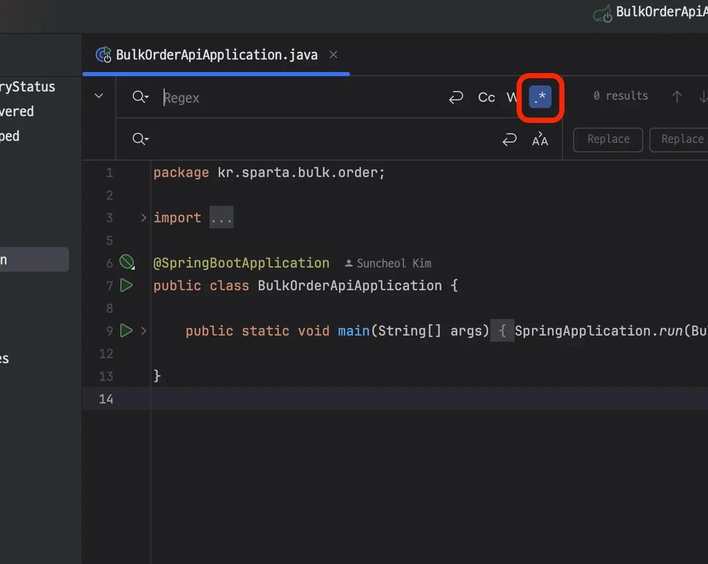

- 프로젝트 단위로 검색&#58; <code>shift</code> &#43; <code>cmd</code> &#43; <code>R</code> 
    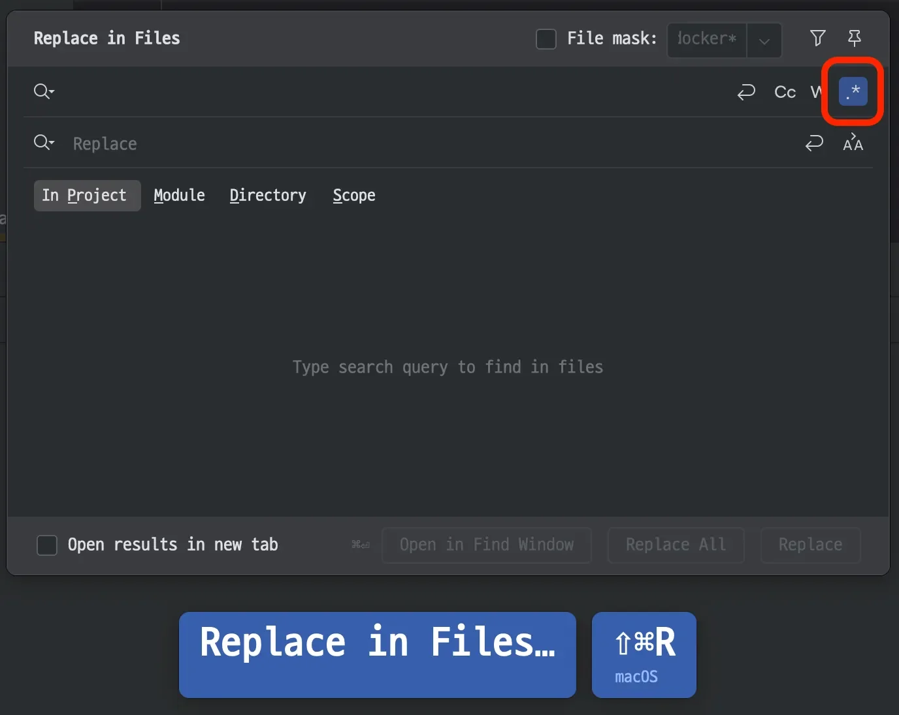

---

<a id="150eda9b0fe1808788e7dbebbb40f736"></a>

## <strong>활용 1) JUnit 검증용 데이터 만들기</strong>

---

> ✏️ 
> 
> <a id="c7292a49c64d43578ee09430449efbf9"></a>
> 
> JUnit 테스트를 하려면 실행 결과를 기대한 값과 비교하기 위해 <u>상수 값을 가지는 비교용 객체를 생성</u>해야 할 때가 있다&#46; 필드가 몇 개 없다면 단순히 타이핑으로 만들면 좋겠지만,  그렇지 않은 경우 값을 만들기가 매우 귀찮다&#46; 이때 아래와 같이  정규식을 처리하면 편리하다&#46; 

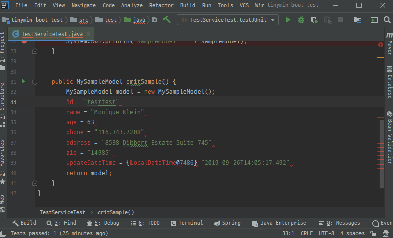

<details>
<summary><u>IntelliJ가 제공 정규식</u></summary>

- 외에도 몇가지 기능들이 있는데, 자주 쓰이는 기능은 아래와 같다&#46; 
    |  | <strong>정규식</strong> | <strong>의미</strong> |
    | --- | --- | --- |
    | <strong>1</strong> | <code>&#92;u</code> | <u>다음 1글자</u>만 <strong><u>대문자</u></strong>로 변경 |
    | <strong>2</strong> | <code>&#92;U</code> | <strong><u>다음에 오는 모든 문자</u></strong>를 <strong><u>대문자</u></strong>로 변경 |
    | <strong>3</strong> | <code>&#92;l</code> (소문자L) | <strong><u>다음 1글자</u></strong>만 <strong><u>소문자</u></strong>로 변경 |
    | <strong>4</strong> | <code>&#92;L</code> | <strong><u>다음에 오는 모든 문자</u></strong>를 <strong><u>소문자</u></strong>로 변경 |

</details>

<a id="150eda9b0fe180aea8a6d1f3adb8f8b9"></a>

### 정규식을 사용하여 테스트용 객체 생성 

1. Local 환경에서 서버를 구동, Debug 모드로 객체의 값을 복사해 객체 생성
    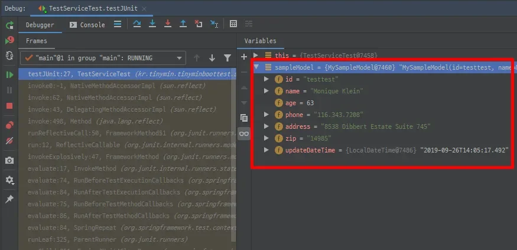

    <a id="150eda9b0fe180e98696ecb85bbeff6f"></a>

    Debug 윈도우에서 값을 복사해 오면 아래와 같은 형태로 복사가 된다&#46; 

    <a id="150eda9b0fe18055b916ef3a3075daa9"></a>

    ```java
    id = "testtest"
    name = "Monique Klein"
    age = 63
    phone = "116.343.7208"
    address = "8538 Dibbert Estate Suite 745"
    zip = "14985"
    updateDateTime = {LocalDateTime@7486} "2019-09-26T14:05:17.492"
    ```

1. 정규식으로 값들을 구분하여 한번에 변경
    - 복사한 값 아래와 같은 형태로 1차 생성

    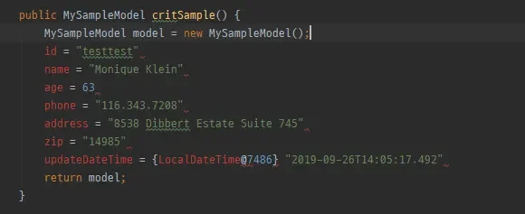

    <a id="150eda9b0fe1800f9121c629d8673875"></a>

    위 값들을 보면 <code>=</code>을 기준으로 값이 나뉘는 것을 확인할 수 있다&#46; 

    <a id="150eda9b0fe18012822cebc23ad465b6"></a>

    <u><code>=</code></u><u>를 기준</u>으로 아래와 같이 변환해야 하는데, 여기서 중요한 점은 <strong><u>첫 글자를 대문자로 변경</u></strong>하는 것이다&#46; 

    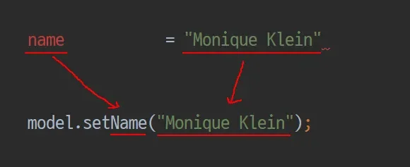

    <a id="150eda9b0fe18057bd0fc226b96be959"></a>

    이는 <u>IntelliJ가 제공</u>하는 <u><code>&#92;u</code></u><u> 를 사용</u>하면 <strong><u>가져온 문자를 대문자로 변환 가능</u></strong>하다

    - 사용한 정규식
        <a id="150eda9b0fe180b09bbdfed838bd8294"></a>

        ```java
        search : (.)(.+) = (.+)
        replace : model.set\u$1$2($3);
        ```

        - 위의 정규식은 아래와 같이 매칭된다&#46;
            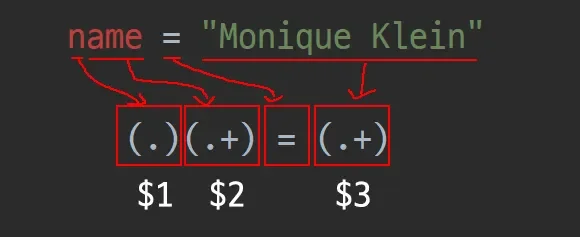

        - 이를 Setter 형태로 만들어야 하는데, 각 <code>&#36;숫자</code>를 통해 매핑된 값을 가져와 <br>치환될 문자열 <code>m</code><em><code>odel&#46;set&#92;u&#36;1&#36;2(&#36;3);</code></em> 로 값을 치환하여 처리한다&#46; 
            - 이 때 <em><code>&#36;1</code></em> 항목은 대문자로 변경해야 하므로 <u><code>&#92;u&#36;1</code></u><u>을 사용</u>하여 소문자 n이 대문자 N으로 변경된다&#46;

            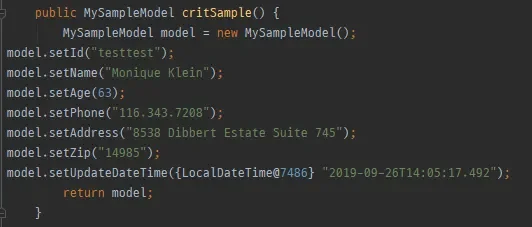

<a id="150eda9b0fe180998674fc6fefc1a9f0"></a>

## <strong>활용 2) DB스키마를 Java 모델로 변환하기</strong>

---

> ✏️ 
> 
> <a id="31e8a86742aa4d20a5bf05c682a2bd1d"></a>
> 
> 개발 하다보면 신규 테이블에 대해서 Java 모델을 새로 만들어야 하는 경우가 있는데, <br>컬럼이 몇개 없는 경우에는 금방 끝나지만, 많은 경우에는 일일이 코드를 수정해야 한다&#46;<br>이를 정규식을 통해 간단하게 아래와 같이 처리할 수 있다&#46;

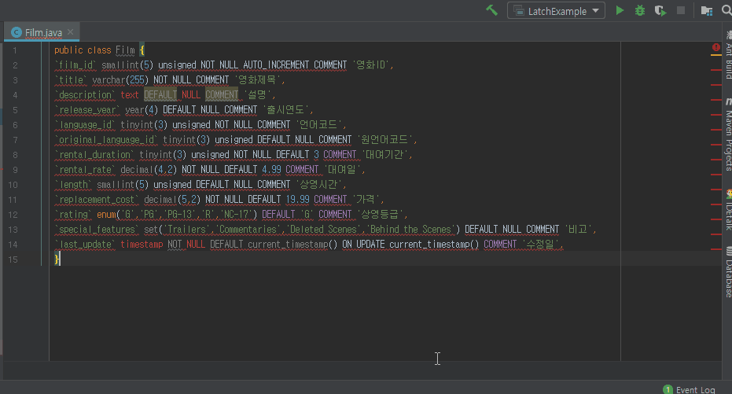

---

<a id="150eda9b0fe18028865ff4d0e047472a"></a>

### 정규식을 사용하여 스키마 수정하기 

<details>
<summary>예시 &#45;  스키마 </summary>

<a id="150eda9b0fe180fdbba4c7531eb7e9d1"></a>

```java
CREATE TABLE `film` (
  `film_id` smallint(5) unsigned NOT NULL AUTO_INCREMENT COMMENT '영화ID',
  `title` varchar(255) NOT NULL COMMENT '영화제목',
  `description` text DEFAULT NULL COMMENT '설명',
  `release_year` year(4) DEFAULT NULL COMMENT '출시연도',
  `language_id` tinyint(3) unsigned NOT NULL COMMENT '언어코드',
  `original_language_id` tinyint(3) unsigned DEFAULT NULL COMMENT '원언어코드',
  `rental_duration` tinyint(3) unsigned NOT NULL DEFAULT 3 COMMENT '대여기간',
  `rental_rate` decimal(4,2) NOT NULL DEFAULT 4.99 COMMENT '대여일',
  `length` smallint(5) unsigned DEFAULT NULL COMMENT '상영시간',
  `replacement_cost` decimal(5,2) NOT NULL DEFAULT 19.99 COMMENT '가격',
  `rating` enum('G','PG','PG-13','R','NC-17') DEFAULT 'G' COMMENT '상영등급',
  `special_features` set('Trailers','Commentaries','Deleted Scenes','Behind the Scenes') DEFAULT NULL COMMENT '비고',
  `last_update` timestamp NOT NULL DEFAULT current_timestamp() ON UPDATE current_timestamp() COMMENT '수정일',
  PRIMARY KEY (`film_id`),
  KEY `idx_title` (`title`),
  KEY `idx_fk_language_id` (`language_id`),
  KEY `idx_fk_original_language_id` (`original_language_id`),
  CONSTRAINT `fk_film_language` FOREIGN KEY (`language_id`) REFERENCES `language` (`language_id`) ON UPDATE CASCADE,
  CONSTRAINT `fk_film_language_original` FOREIGN KEY (`original_language_id`) REFERENCES `language` (`language_id`) ON UPDATE CASCADE
) ENGINE=InnoDB AUTO_INCREMENT=1001 DEFAULT CHARSET=utf8
```

</details>

<details>
<summary>1&#46; 스키마에서 필요한 요소 구분하기</summary>

<a id="150eda9b0fe1809baccefd5bc8f615e9"></a>

위 예시 스키마에서 <u>1차적으로 필요한 요소를 찾</u>아낸다&#46; 

<a id="150eda9b0fe1809d98d5fd67fd30ce5c"></a>

아래와 이미지와 같이 <u>변수명으로 쓸 컬럼명</u>과 <u>변수 타입에 해당하는 컬럼의 데이터 타입</u>, <br><u>주석으로 쓸 컬럼 코멘트</u>까지 총 3가지를 뽑는다&#46; ( 주석은 생략 가능 )

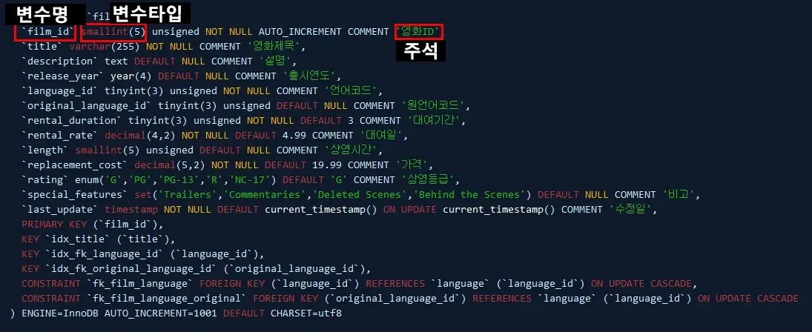

</details>

<details>
<summary>2&#46; 구분한 요소를 기준으로 패턴 만들기</summary>

<a id="150eda9b0fe180f1952bc77a9212c43f"></a>

이를 기준으로 패턴을 만들면 아래와 같다&#46;

<a id="150eda9b0fe1806fae06dd74cfa72904"></a>

```java
`(.+)` (.+)\(.+'(.+)',
```

<a id="150eda9b0fe18053bc2dcef0e48ef5bf"></a>

위 패턴은 각각 아래와 같이 매칭된다&#46;

<a id="150eda9b0fe180b681b7e97f6bce7246"></a>

또한 <u><code>()</code></u><u> 안에 있는 문자열</u>은 순서대로 <code>&#36;1</code>, <code>&#36;2</code>, <code>&#36;3</code>에 매핑되어 변수처럼 사용 가능하다&#46;


</details>

<details>
<summary>3&#46; IntellJ 검색 및 변환 기능을 활용하여 생성한 패턴을 자바 객체로 변환하기 </summary>

<a id="150eda9b0fe180d1bc87c7bcca7ff702"></a>

이를 아래와 같이 <code>&#91; private &#36;2 &#36;1;    // &#36;3 &#93;</code> 으로 변환하게 되면 스키마를 Java 모델로 간단하게 변환할 수 있다&#46;

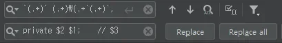

</details>

<a id="150eda9b0fe1806d926df9bcf1b9ac00"></a>

### 추가) <code>CamelCase</code> ↔ <code>snake&#95;case </code>전환 플러그인

- IntelliJ 플러그인에서 CamelCase 검색

<a id="150eda9b0fe180a18dc4d89eba4b8106"></a>

‣

<a id="150eda9b0fe180a2ab72f5daf56cf8b2"></a>

## 활용 3) 정규식으로 검색

> ✏️ 
> 
> <a id="c33c1b3142b54175a6baa473625d5225"></a>
> 
> 개발을 하다보면 초면인 코드를 많이 만나게 되는데, 이럴 때 소스 검색을 자주 사용한다&#46; <br>이때 도 정규식을 이용하면 원하는 코드를 쉽게 찾을 수 있다&#46; 
> 
> - IntelliJ 검색 기능
>     - 현재 파일 검색&#58; <code>cmd</code> &#43; <code>f</code>
> 
>     - 프로젝트 전체 검색&#58; <code>cmd</code> &#43; <code>shift</code> &#43; <code>f</code>

<a id="150eda9b0fe18008a631e6cfd1d343e4"></a>

### <strong>Case 1 ) </strong><strong><code>&#39;cache&#39;</code></strong><strong> 라는 글자를 포함하는 메소드만 검색하기</strong>

<a id="150eda9b0fe180ff8d75ffd0f1021905"></a>

매소드 검색 시 아래와 같은 특징을 패턴으로 정의한다&#46; 

- 조건 1) 메서드는 대부분 <code>private</code> or <code>public</code>으로 시작한다&#46;
    - <code>(public&#124;private)</code> 

- 조건 2) 메서드 헤더의 끝은 대부분 <code>{</code> 로 끝난다 &#46;
    - <code>&#46;&#42;&#92;{</code>

<a id="150eda9b0fe1803f916dfbb5807e9db2"></a>

```java
(public|private).*cache.*\{
```

<a id="150eda9b0fe180ce8f18db602a3ebd2a"></a>

### <strong>Case 2 ) </strong><strong><code>&#64;Autowired</code></strong><strong> 가 적용 된 Service 만 검색하기</strong>

<a id="8ea738a997fc4645aaf00823af0d870e"></a>

```java
@Autowired\n?.+Service
```

- <code>&#92;n?</code> &#58; 물음표를 붙임으로써 개행문자열이 있을 수도 있고 없을 수도 있음을 의미한다&#46;

- <code>&#46;&#43; </code>&#58; 임의의 문자열 1개 이상이 반복 됨을 의미한다&#46;

<a id="150eda9b0fe180ceb5acc398c5517b36"></a>

### Case 3 ) 특<strong>정 숫자 이상의 숫자 찾기</strong>

<a id="150eda9b0fe1801d996fc1360797d869"></a>

보통 정규식에서 숫자는 &#91;0&#45;9&#93;로 표현하지만, IntelliJ에서는 <code>&#92;d</code>를 사용할 수 있다&#46; 

- 이를 이용하여 특정 숫자 이상의 수를 검색

---

<details>
<summary>ex 1) 50,00 이상의 수 검색</summary>

- 조건 
    - 50,000 이상의 숫자는 5자리이다&#46;

    - 자바7부터 숫자에 &#39;&#95;&#39;를 허용하므로 중간에 &#39;&#95;&#39;가 있을 수 있다&#46;

- 패턴
    <a id="150eda9b0fe1800fa95ddeb33b31e9ac"></a>

    ```java
    5\d_?\d\d\d
    ```

</details>

<details>
<summary>ex 2)  5만 &#126; 10만 사이의 수</summary>

- 조건
    - 5만 &#126; 10만 사이의 수

    - 자바7부터 숫자에 &#39;&#95;&#39;를 허용하므로 중간에 &#39;&#95;&#39;가 있을 수 있다&#46;

- 패턴
    <a id="150eda9b0fe1801c9519e658b27ec188"></a>

    ```java
    [5-9]\d_?\d\d\d
    ```

</details>

<a id="145eda9b0fe18001aa4be9fedbf9de21"></a>

## 활용 4) 리눅스 명령어와 조합 &#45; 정량적으로 작업 현황(통계) 구하기

> ✏️ 
> 
> <a id="610424ec6a4045b894fc965918a5eb85"></a>
> 
> 리눅스 명령어와 조합하면 좀 더 강력한 방법으로 활용할 수 있다&#46;
> 
> <a id="150eda9b0fe180638bb4ea7b26c4c7ff"></a>
> 
> 전체 디렉토리에서 원하는 모든 파일 안의 내용을 검색 가능하며 이를 통해 <strong><u>작업 내용을 정량적으로 수치로 관리</u></strong>할 수 있다&#46;

<details>
<summary>🧐 리눅스 명령어</summary>

|  | <strong>명령여</strong> | <strong>설명</strong> |
| --- | --- | --- |
| <strong>1</strong> | <code>find</code> | <u>파일을 찾</u>는 명령어 |
| <strong>2</strong> | <code>&#46;/</code> | 현재 디렉토리&#46; <code>find &#46;/</code> 는 현재 디렉토리에서 파일을 찾는 다는 의미 |
| <strong>3</strong> | <code>&#45;iname ‘&#42;&#46;java’</code> | <u>대소문자를 가리지 않</u>고 <u>확장자가 java인 파일 검색</u> |
| <strong>4</strong> | <code>&#124;  (shift &#43; &#92;)</code> | <u>리눅스의 파이프</u>&#46; <u>이전의 결과를 </u><u><code>&#124;</code></u><u> 다음으로 넘</u>겨준다&#46; <br>여기서는 <u>find의 결과가 넘</u>어간다 |
| <strong>5</strong> | <code>xargs</code> | <u>파이프 앞의 결과를 하나씩 처리</u>한다&#46; find의 결과는 n개 이상의 파일 목록이다&#46; <br>여기서 <u>xargs는 파일 경로를 하나하나 처리</u>할 수 있게 해준다&#46; <u>일종의 반복문</u> |
| <strong>6</strong> | <code>grep</code> | 파일 내에서 <u>문자열 검색</u> |
| <strong>7</strong> | <code>&#45;n</code> | <u>grep의 옵션</u>으로 <u>라인 번호를 알</u>려준다 |
| <strong>8</strong> | <code>‘&#64;RequestMapping’</code> | 검색하고자 하는 문자열 |

- 리눅스 검색 예시
    <a id="150eda9b0fe180148b14c507930b7177"></a>

    ```java
    find ./ -iname '*.java' | xargs grep -n '@RequestMapping'
    ```

</details>

>  <strong>정규화 및 리눅스 검색을 활용하여 구글 시트로 통계적으로 관리하기</strong>

<a id="150eda9b0fe180d995b1f1615d44a2ef"></a>

### Case 1)  레거시 코드 수정

<details>
<summary>요구사항</summary>

- 현재 프로젝트 코드에는 오래된 코드가 많습니다&#46;

- 우리 팀의 이번 분기 목표는 오래된 코드를 최신화하는 것입니다&#46;

- 그 중에 Controller 에 예전의 방식인 <code>&#64;RequestMapping</code> 으로 선언된 코드들이 있습니다&#46;

- 최근에는 각 메소드에 따라 <code>&#64;GetMapping, &#64;PostMapping</code> 으로 사용되고 있습니다&#46;

- 프로젝트 내에서 &#64;RequestMapping 을 모두 &#64;GetMapping, &#64;RequestMapping 등으로 변경하세요&#46;

</details>

1. 검색하고자 하는 디렉토리로 이동


- 리눅스 검색
    <a id="150eda9b0fe180748c49f2e42e3cf301"></a>

    ```java
    find ./ -iname '*.java' | xargs grep -n '@ReqeustMapping'
    ```

    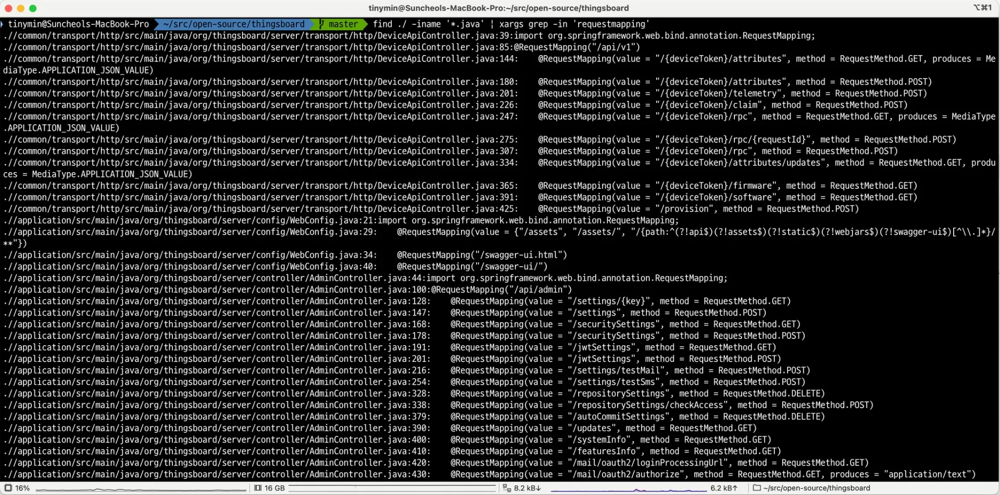

- 현재 디렉토리에서 하위까지 모든 java 파일에서 <code>&#64;RequestMapping</code>을 검색
    <a id="150eda9b0fe180f6a5f9ed36a4f47879"></a>

    해당 내용이  구글 스프레드 시트에 아래와 같이 정리한다&#46; 

    >  정량적으로 수치를 파악할 수 있다&#46;

    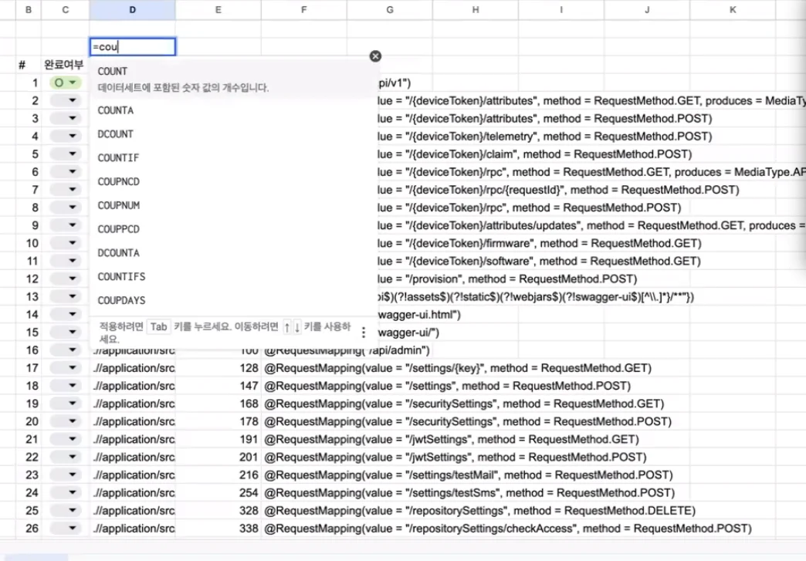

    - 이렇게 작업을 하면 업무 공유시에도 얼마나 작업을 했는지 정량적 수치를 뽑을 수 있어 좋다&#46;

<details>
<summary>구글 시트 사용법</summary>

<details>
<summary>복사한 데이터들에 id 값 자동으로 지정하기 </summary>


</details>

<details>
<summary>복사한 데이터 열 분할처리</summary>

- 분할 아이콘 &#45; 텍스트 분할 

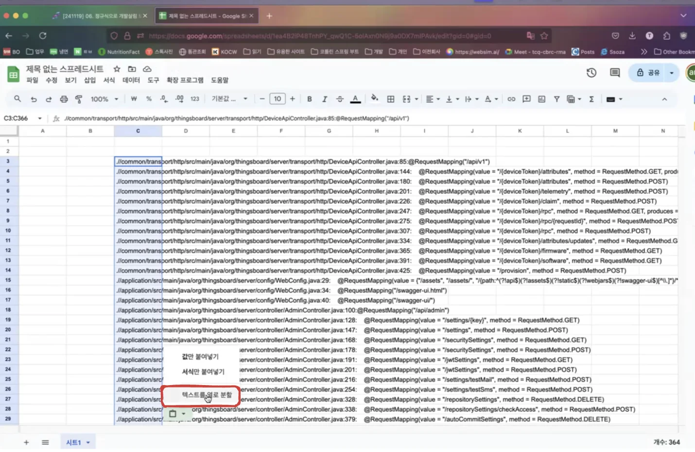

- <code>&#58;</code> 구분자로 텍스트 열 분할하기 

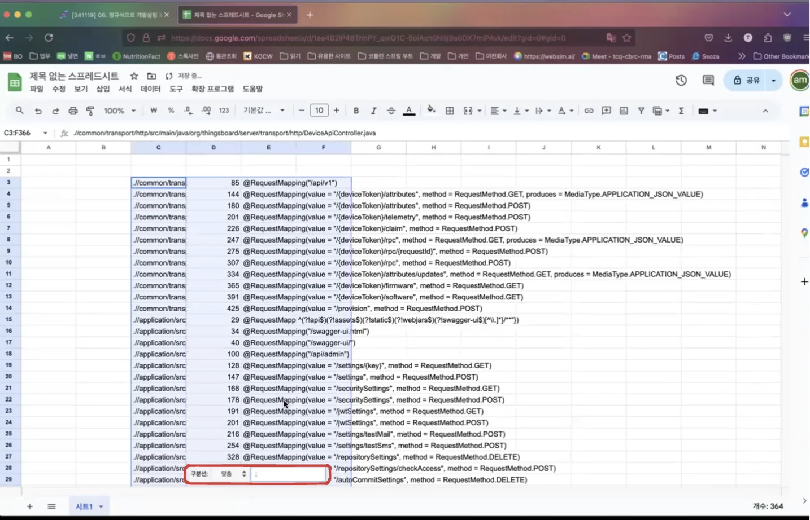

</details>

<details>
<summary><code>완료 여부</code> 확인 할  컬럼 추가하기</summary>

- id 값 오른쪽에  열 추가하기
    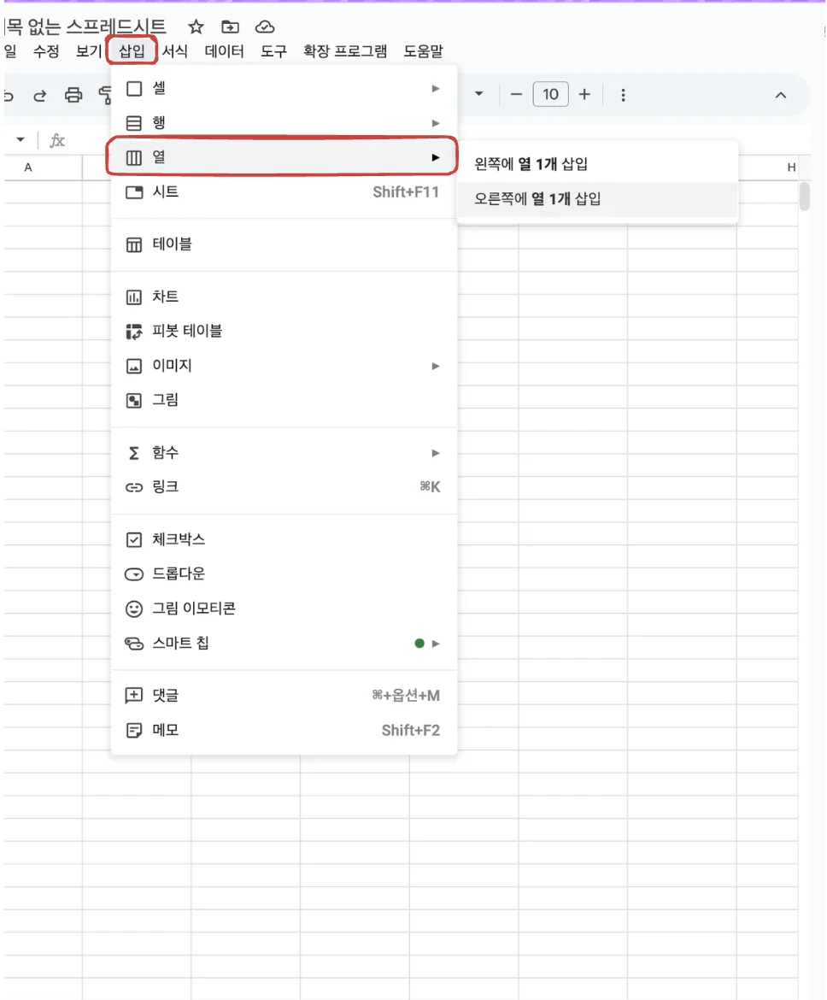

- 데이터 규칙 지정하기


- 완료 여부를 지정할 영역 드래그 하기 
    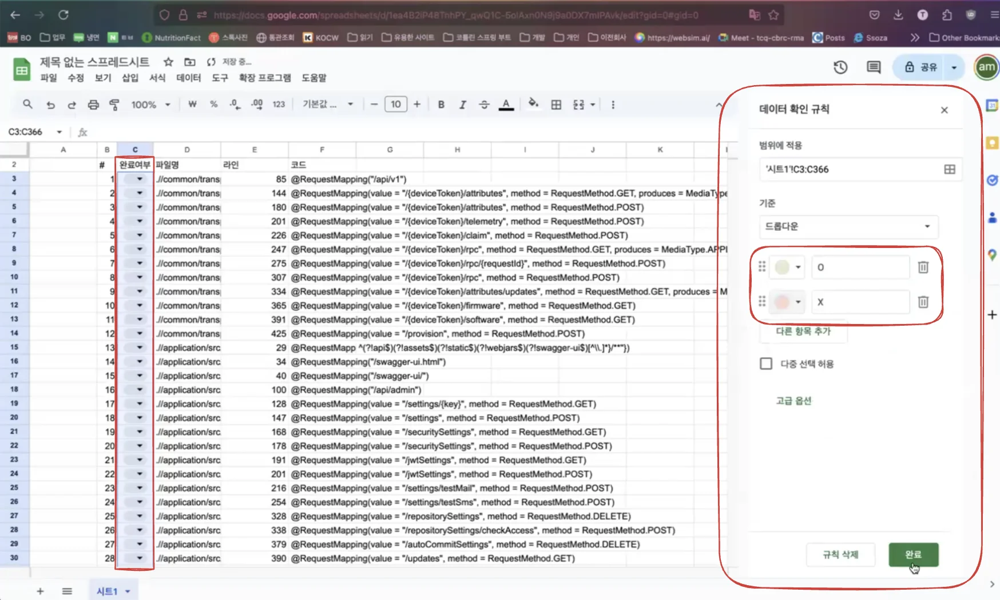

</details>

<details>
<summary>완료 여부에 따라 통계(수식) 계산하기 </summary>

- 수식을 출력할 컬럼을 지정하여 아래의 계산식 입력하기 
    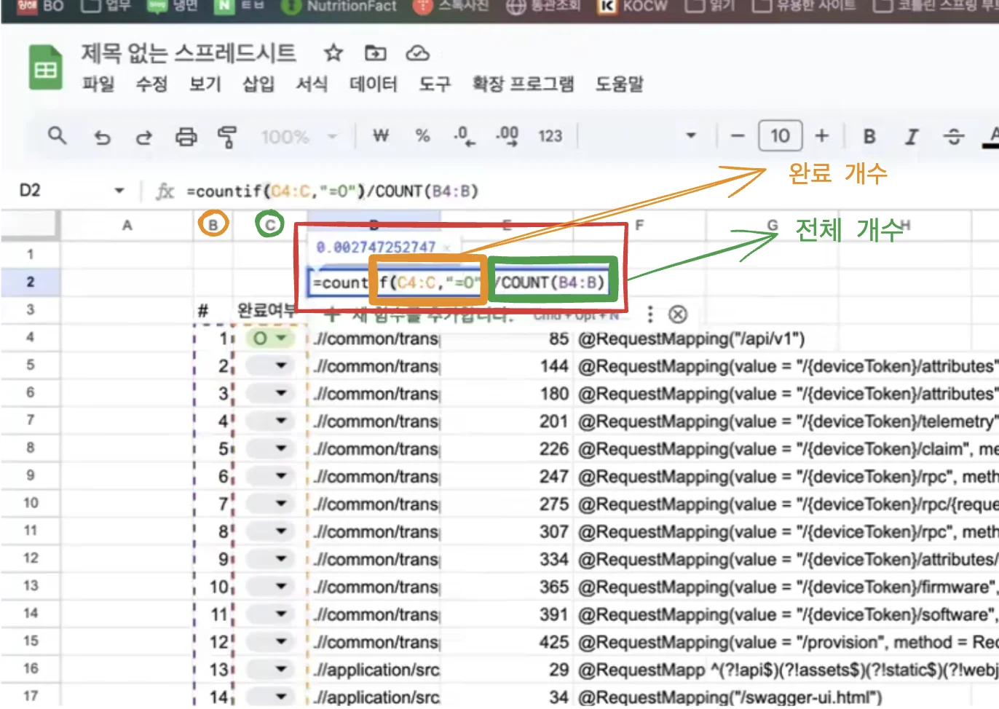

    - 통계 수식
        <a id="150eda9b0fe180529d19f03b4b3a5400"></a>

        ```java
        =countif(C4:C. "=O")/COUNT(B4:B)
        ```

        - <code>COUNT</code> &#45; 개수 구하는 함수

        - <code>countif(조건)</code> &#45; 조건에 해당하는 값 구함
            - 위 <code>%</code> 클릭을 통해 <code>%</code>로  값을 구할 수 있음
                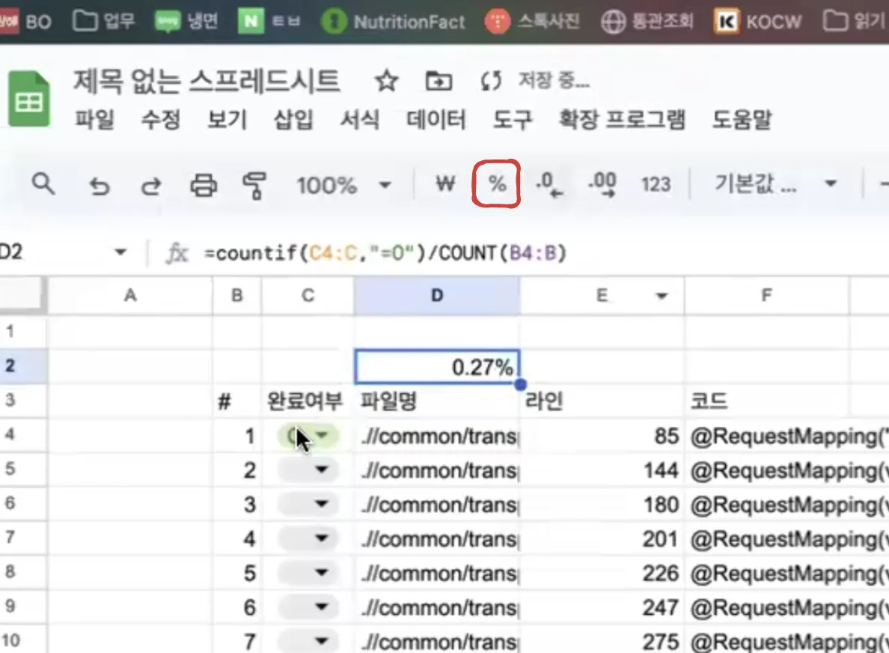

</details>

</details>
