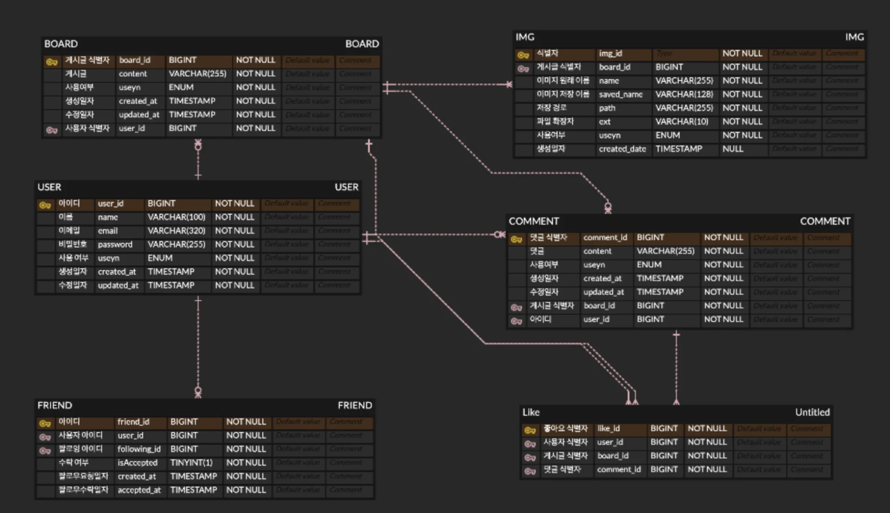
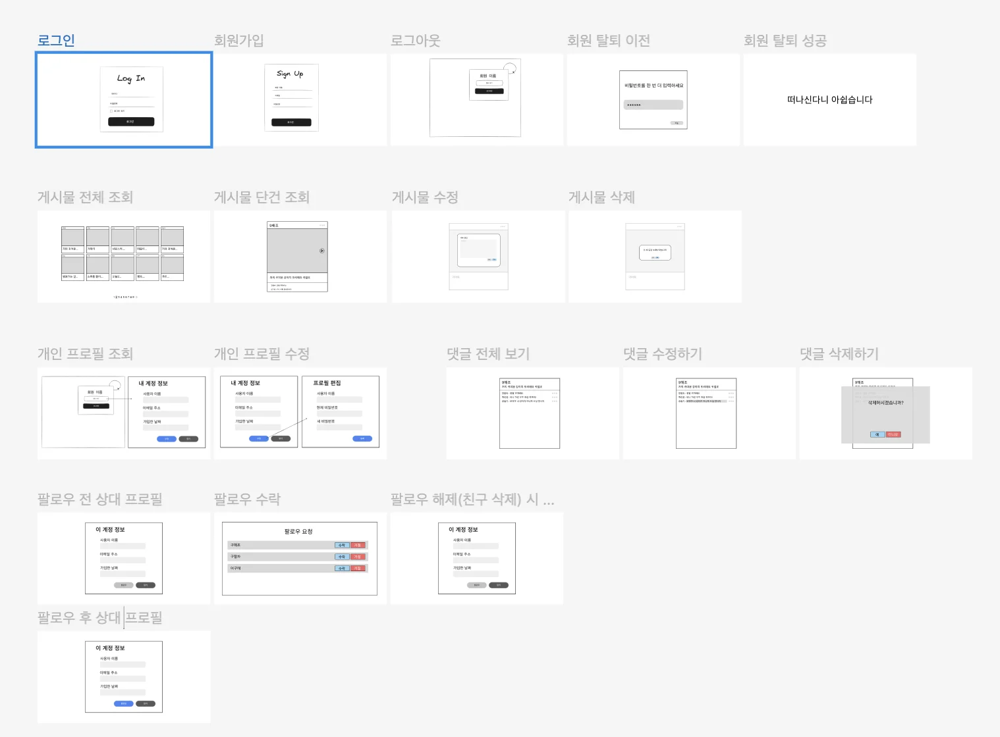

> 📌 
> 
> <a id="0e06de458cb34689bec289b518f1a848"></a>
> 
> 내일배움캠프&#95;스프링 7기  &#45; 8주차 팀 프로젝트
> 
> > 기간&#58; 24년 11월 19일 &#126; 11월 25일
> 
> - 팀 노션&#58; <a href="https://beautiful-college-c84.notion.site/13b2dc3ef514816fb2cbf881cefff377">페이지</a> 
> 
> - 발제&#58; <a href="https://beautiful-college-c84.notion.site/1432dc3ef51480e08e3bd6d88f142b3b">페이지</a> 

<a id="143eda9b0fe180cd96bdf775e7bbde81"></a>

### 요구사항 정의 

[사용자 인증](#/post/146eda9b-0fe1-8111-a157-c99e5eb150d4)

[제목 없음](#/post/146eda9b-0fe1-81c8-b6a0-c055159b7539)

[제목 없음](#/post/146eda9b-0fe1-800e-a279-e66d96d5aa10)

[제목 없음](#/post/146eda9b-0fe1-8135-86f5-cc6234e31570)

[개인 프로필](#/post/146eda9b-0fe1-814b-999a-c6bbdef16cdb)

[제목 없음](#/post/146eda9b-0fe1-81b7-a060-d90d331b68e9)

[게시글 정보](#/post/146eda9b-0fe1-819c-94dc-c0cd7755ed0f)

[제목 없음](#/post/146eda9b-0fe1-814c-9cc6-cc2a3185698e)

[제목 없음](#/post/146eda9b-0fe1-81b4-84b9-d822708c0f0d)

[제목 없음](#/post/146eda9b-0fe1-819a-b784-cf2036862925)

[친구 관리](#/post/146eda9b-0fe1-812a-8aa6-d7987421779f)

[제목 없음](#/post/146eda9b-0fe1-81ff-b2a3-d90a6e991d63)

[제목 없음](#/post/146eda9b-0fe1-8163-9ed9-d075594b2e60)

[댓글](#/post/146eda9b-0fe1-8120-8630-d2d1f07e1205)

[제목 없음](#/post/146eda9b-0fe1-8194-a2dd-dc6a73a32eb4)

[제목 없음](#/post/146eda9b-0fe1-81b8-b663-fe820766cf0c)

[제목 없음](#/post/146eda9b-0fe1-81f4-b1b1-f970107f4d5a)

<a id="143eda9b0fe1807aaf06ccaac037c33a"></a>

### API 명세서

[회원가입](#/post/146eda9b-0fe1-81f5-9e21-db5728ec7c2d)

[로그인](#/post/146eda9b-0fe1-814c-a347-d332515d1308)

[로그아웃](#/post/146eda9b-0fe1-81e2-a386-de88c02648f1)

[탈퇴](#/post/146eda9b-0fe1-818d-bd69-f7c1c29b456f)

[조회](#/post/146eda9b-0fe1-81cf-8606-edaa3c87a5d5)

[수정](#/post/146eda9b-0fe1-81e7-9618-d9a1d116e450)

[작성](#/post/146eda9b-0fe1-819c-9fe3-c96340ea859c)

[조회](#/post/146eda9b-0fe1-81da-8387-c8d7e6659723)

[수정](#/post/146eda9b-0fe1-818c-a613-c63875b5035b)

[삭제](#/post/146eda9b-0fe1-810c-b1c5-c251517086e9)

[친구 추가](#/post/146eda9b-0fe1-8120-bfc9-c10993be0972)

[친구 수락](#/post/146eda9b-0fe1-81c6-baf1-e5f1488efe5e)

[친구 삭제](#/post/146eda9b-0fe1-8185-82d9-e61cfafbc383)

[생성](#/post/146eda9b-0fe1-813b-914c-fdd724e69610)

[조회](#/post/146eda9b-0fe1-8189-881f-e2db57b6968d)

[수정](#/post/146eda9b-0fe1-811d-8d74-f5768eaa7171)

[삭제](#/post/146eda9b-0fe1-8125-a2bc-d398e8adc701)

[좋아요](#/post/146eda9b-0fe1-816a-bbe6-c3b3b5511630)

[좋아요 취소](#/post/146eda9b-0fe1-8100-96c2-c69a831dc492)

<details>
<summary>회원 </summary>

<details>
<summary>회원가입</summary>

| 메서드  | 요청 URL |
| --- | --- |
| POST | /signup |

<details>
<summary>요청 데이터</summary>

- header
    - <code>Content&#45;Type</code>&#58; application/json

- body
    | 파라미터 | 데이터 타입 | 필수 여부 | 설명 |
    | --- | --- | --- | --- |
    | name | String | Y | 유저 이름 |
    | password | String | Y | 비밀번호 |
    | email | String | Y | 이메일 |

</details>

<details>
<summary>응답 데이터</summary>

- 성공
    - 상태코드&#58; <code>201 Created</code>

    - redierct&#58; /login

- 실패 
    - 상태코드&#58; <code>400 Bad Reqeust</code>

</details>

<details>
<summary>예제</summary>

- 요청
    <a id="146eda9b0fe18108b5dfd15bd6e46bfb"></a>

    ```java
    {
    	 "name": "LEE",
    	 "email": "test123@gmail.com",
    	 "password": "1234" 
    }
    ```

- 응답
    - 상태코드&#58; <code>200 OK</code>

    - redirect&#58; <code>/login</code>

</details>

</details>

<details>
<summary>로그인</summary>

| 메서드  | 요청 URL |
| --- | --- |
| POST | /login |

<details>
<summary>요청 데이터</summary>

- header
    - <code>Content&#45;Type</code>&#58; application/json

- body
    | 파라미터 | 데이터 타입 | 필수 여부 | 설명 |
    | --- | --- | --- | --- |
    | password | String | Y | 비밀번호 |
    | email | String | Y | 이메일 |

</details>

<details>
<summary>응답 데이터</summary>

<details>
<summary>성공 </summary>

- 상태 코드&#58; <code>200 OK</code>

- <code>header</code>
    - 쿠키 값
        - <code>Set&#45;Cookie</code>&#58; 회원세션 id

    - 보안
        - <code>HttpOnly</code> ( true/false )

        - <code>Secure</code> ( true/false )

    - 유효기간
        - <code>Max&#45;Age</code> =   ( 초 단위 ) 

- <code>body</code> &#45; 없음

</details>

<details>
<summary>실패 </summary>

- 상태 코드
    - <code>400 Bad Reqeust</code>

    - <code>401 Unauthorized</code>

</details>

</details>

<details>
<summary>예제</summary>

- 요청
    <a id="146eda9b0fe1818ea39bcd845aa593b4"></a>

    ```java
    {
    	 "email": "test123@gmail.com",
    	 "password": "1234" 
    }
    ```

- 응답 
    - 성공 
        - 상태 코드&#58; <code>200 OK</code>

        - header
            <a id="146eda9b0fe181eb8da5f6b5b3d1f04e"></a>

            ```java
            Set-Cookie: sessionId=uniqueSessionId123; 
            HttpOnly; Secure; 
            Max-Age=3600; 
            Path=/
            ```

        - body &#45; none

</details>

</details>

<details>
<summary>로그아웃</summary>

| 메서드  | 요청 URL |
| --- | --- |
| POST | /logout |

<details>
<summary>요청 데이터</summary>

- header 
    - <code>Cookie</code>&#58; SessionId

</details>

<details>
<summary>응답 데이터</summary>

- 성공 
    - 상태코드&#58; <code>200 OK</code>

    - <code>header</code>
        - <code>Content&#45;Type</code>&#58; text/plain;charset=UTF&#45;8

        - <code>Content&#45;Length</code>&#58; 15

    - <code>body</code> 
        - “로그아웃 성공”

- 실패
    - 상태코드
        - <code>401 Unauthorized</code>

        - <code>403 Forbidden</code>

        - <code>500 Internal Server Error</code>

</details>

<details>
<summary>예제</summary>

- 요청
    <a id="146eda9b0fe1812b8bc3ec0630649847"></a>

    ```java
    GET /logout HTTP/1.1
    Host: example.com
    Cookie: JSESSIONID=uniqueSessionId123
    ```

- 응답
    - 성공
        <a id="146eda9b0fe181b8864ae4c2700cb9e5"></a>

        ```java
        HTTP/1.1 200 OK
        Content-Type: text/plain;charset=UTF-8
        Content-Length: 15

        로그아웃 성공
        ```


<details>
<summary>실패 </summary>

- 인가 실패 시, <code>403 Forbidden</code>
    <a id="146eda9b0fe181fb8ab9e4a9cc87b34f"></a>

    ```java
    HTTP/1.1 403 Forbidden
    Content-Type: text/plain;charset=UTF-8

    로그아웃 요청이 거부되었습니다.
    ```

- 잘못된 클라이언트 요청, <code>400 Bad Request</code>
    - 세션 올바르지 않음

    <a id="146eda9b0fe181f29de6cffd2b235fc8"></a>

    ```java
    HTTP/1.1 400 Bad Request
    Content-Type: text/plain;charset=UTF-8

    잘못된 로그아웃 요청입니다.
    ```

- 서버 오류, <code>500 Internal Server Error</code>
    <a id="146eda9b0fe181d1823cd1b89bdb5ecf"></a>

    ```java
    HTTP/1.1 500 Internal Server Error
    Content-Type: text/plain;charset=UTF-8

    로그아웃 처리 중 서버 오류가 발생했습니다.
    ```

</details>

</details>

</details>

<details>
<summary>회원 탈퇴</summary>

| 메서드  | 요청 URL |
| --- | --- |
| POST | /leave |

<details>
<summary>요청 데이터</summary>

- header
    - <code>Content&#45;Type</code>&#58; 없음

</details>

<details>
<summary>응답 데이터</summary>

- 성공 
    - <code>header</code>
        - 쿠키 값
            - <code>Set&#45;Cookie</code>&#58; 유저 세션 id

        - 보안
            - <code>HttpOnly</code> ( true/false )

            - <code>Secure</code> ( true/false )

        - 유효기간
            - <code>Max&#45;Age</code> =   ( 초 단위 ) 

    - <code>body</code> &#45; 없음

- 실패 
    - <code>401 Unauthorized</code>

    - <code>403 Forbidden</code>

    - <code>500 Internal Server Error</code>

</details>

<details>
<summary>예제</summary>

- 요청
    <a id="146eda9b0fe1819db276eac7753b857d"></a>

    ```java
    GET /leave HTTP/1.1
    Host: example.com
    Cookie: JSESSIONID=uniqueSessionId123
    ```

- 응답
    - 성공
        <a id="146eda9b0fe181f8be8df6008dc58b31"></a>

        ```java
        HTTP/1.1 200 OK
        Content-Type: text/plain;charset=UTF-8
        Content-Length: 15

        회원 탈퇴 성공
        ```

</details>

</details>

</details>

<details>
<summary>개인 프로필 </summary>

| 기능 | method | URL | request | response |
| --- | --- | --- | --- | --- |
| 프로필 조회 | GET | /users/{id} | 요청 param | 조회 정보 |
| 프로필 수정 | PATCH | /users{id} | 요청 body | 수정 정보 |

<details>
<summary>조회 </summary>

| <strong>메소드</strong> | <strong>요청 URL</strong> |
| --- | --- |
| GET | /users/{id} |

<details>
<summary>요청 데이터 </summary>

<a id="146eda9b0fe181c9874de8a1a4f441d1"></a>

<code>GET /users/{id}</code> 

- PathVariable &#58;

| 파라미터 | 타입 | 필수 여부  | NULL CHECK | 설명 |
| --- | --- | --- | --- | --- |
| id | Long | Y | NOT NULL | 회원 식별자 |

- Request Body &#58; 없음

</details>

<details>
<summary>응답 데이터</summary>

<details>
<summary>성공 </summary>

- <code>200 OK</code>
    | 파라미터 | 타입 | 필수 여부  | NULL CHECK | 설명 |
    | --- | --- | --- | --- | --- |
    | user&#95;id | Long | Y | NOT NULL | 회원 식별자 |
    | name | String | Y | NOT NULL | 회원 이름 |
    | email | String | Y | NOT NULL, UNIQUE | 회원 이메일 |
    | created&#95;at | timestamp | Y | NOT NULL | 가입 일자 |

</details>

<a id="146eda9b0fe181078cc1d99240eab520"></a>

실패

- <code>404 Not found</code>

- <code>500 </code><strong><code>Internal Server Error</code></strong>

</details>

<details>
<summary>예제 </summary>

<details>
<summary>요청 </summary>

<a id="146eda9b0fe181bcb44ff88d81d9d476"></a>

```json
없음
```

</details>

<details>
<summary>응답</summary>

<a id="146eda9b0fe1813cbf72f6ddc23522b7"></a>

```json
{
    "user_id": 1,
    "name": "test",
    "email": "test@test.com",
    "created_at": "2024-11-15T20:07:00.6628193"    
}
```

</details>

</details>

</details>

<details>
<summary>수정</summary>

| <strong>메소드</strong> | <strong>요청 URL</strong> |
| --- | --- |
| PATCH | /users/{id} |

<details>
<summary>요청 데이터</summary>

<a id="146eda9b0fe1811d8b11e88b05ec1b72"></a>

<code>PATCH /users/{id}</code> 

- PathVariable
    | 파라미터 | 데이터 타입 | 필수 여부 | NULL CHECK | 설명 |
    | --- | --- | --- | --- | --- |
    | id | String | Y | NOT NULL | 회원 식별자 |

- Request Body
    | 파라미터 | 타입 | 필수 여부  | NULL CHECK | 설명 |
    | --- | --- | --- | --- | --- |
    | name | String | N | NULL | 회원 이름 |
    | password | String | Y | NOT NULL | 기존 비밀번호 |
    | newPassword | String | N | NULL | 변경 비밀번호 |

</details>

<details>
<summary>응답 데이터</summary>

<details>
<summary>성공</summary>

- <code>200 OK</code>
    | 파라미터 | 타입 | 필수 여부  | NULL CHECK | 설명 |
    | --- | --- | --- | --- | --- |
    | user&#95;id | Long | Y | NOT NULL | 회원 식별을 위한 고유 ID |
    | name | string | Y | NOT NULL | 회원 이름 |
    | email | string | Y | NOT NULL, UNIQUE | 회원 이메일 |
    | updated&#95;at | timestamp | Y | NOT NULL | 수정 일자 |

</details>

<details>
<summary>실패</summary>

- <code>400 Bad Request</code>

- <code>401 Unauthorized</code>

- <code>404 Not Found</code>

- <code>500 </code><strong><code>Internal Server Error</code></strong>

</details>

</details>

<details>
<summary>예제 </summary>

<details>
<summary>요청 </summary>

<a id="146eda9b0fe18148b341fe4051042236"></a>

```json
{
	 "name": "수정된 이름",
	 "password": "1234",
	 "newPassword": "1235"
}
```

</details>

<details>
<summary>응답</summary>

<a id="146eda9b0fe1818db1dbce2324e1f03d"></a>

```json
{
  "id": 1,
  "name": "수정된 이름",
  "email": "test@test.com",
  "updatedAt": "2024-11-18T11:30:14.195214"
}
```

</details>

</details>

</details>

</details>

<details>
<summary>게시글 정보</summary>

<details>
<summary>게시글 작성 </summary>

| <strong>메소드</strong> | <strong>요청 URL</strong> |
| --- | --- |
| POST | /board |

<details>
<summary>요청 데이터 </summary>

> <code>POST /board HTTP 1&#46;1</code> 

- path variable &#58; 없음

- 파라미터 JSON 형태로 넘김

| 파라미터 | 데이터 타입 | 필수 여부 | NULL CHECK | 설명 |
| --- | --- | --- | --- | --- |
| content | string | Y | NOT NULL | 게시글 |
| imgs | multipart | Y | NOT NULL | 사진 |

</details>

<details>
<summary>응답 데이터</summary>

<details>
<summary>성공 </summary>

- <strong><code>201 Created</code></strong>
    | depth 1 | depth2 | 타입 | 필수 여부  | NULL CHECK | 설명 |
    | --- | --- | --- | --- | --- | --- |
    | board&#95;id |  | Long | Y | NOT NULL | 게시글 식별자 |
    | content |  | String  | Y | NOT NULL | 게시글 |
    | updated&#95;at |  | timestamp | Y | NOT NULL | 수정 일자 |
    | name |  | String | Y | NOT NULL | 사용자 이름 |
    | email |  | String  | Y | NOT NULL | 사용자 이메일 |
    | IMG | name | String | N | NULL | 이미지 이름 |
    |  | path | String | N | NULL | 이미지 저장 경로 |

    |  |  |  |  |  |
    | --- | --- | --- | --- | --- |

</details>

<details>
<summary>실패</summary>

- <code>400 Bad Request</code>

- <code>404 Not Found</code>

- <code>500 </code><strong><code>Internal Server Error</code></strong>

</details>

</details>

<details>
<summary>예제 </summary>

<details>
<summary>요청 </summary>

<a id="146eda9b0fe1813bb471c2a48b9ded20"></a>

```json
{
	 "content": "게시글",
	 "imgs": 3 files selected
}
```

</details>

<details>
<summary>응답</summary>

<a id="146eda9b0fe181cdb755e0f0c3bfc27e"></a>

```json
{ 
	 "board_id":  {자동 생성 값, AUTO_INCREMENT}
} 	
```

</details>

</details>

</details>

<details>
<summary>게시글 조회</summary>

| <strong>메소드</strong> | <strong>요청 URL</strong> |
| --- | --- |
| GET | /board/{page} |

<details>
<summary>요청 데이터 </summary>

> <code>POST /board HTTP 1&#46;1</code> 

- path variable &#58; 

| 파라미터 | 데이터 타입 | 필수 여부 | NULL CHECK | 설명 |
| --- | --- | --- | --- | --- |
| page | int | Y | NOT NULL | 페이지 숫자 |

- request body &#58; 없음

</details>

<details>
<summary>응답 데이터</summary>

<details>
<summary>성공 </summary>

- <strong><code>200 </code></strong><code>Success</code>
    | depth 1 | depth2 | 타입 | 필수 여부  | NULL CHECK | 설명 |
    | --- | --- | --- | --- | --- | --- |
    | board&#95;id |  | Long | Y | NOT NULL | 게시글 식별자 |
    | content |  | String  | Y | NOT NULL | 게시글 |
    | updated&#95;at |  | timestamp | Y | NOT NULL | 수정 일자 |
    | name |  | String | Y | NOT NULL | 사용자 이름 |
    | email |  | String  | Y | NOT NULL | 사용자 이메일 |
    | IMG | name | String | Y | NOT NULL | 이미지 이름 |
    |  | path | String | Y | NOT NULL | 이미지 저장 경로 |
    |  | ext | String | Y | NOT NULL | 이미지 확장자 |
    |  | saved&#95;name | String | Y | NOT NULL | 이미지 저장이름 |

</details>

<details>
<summary>실패</summary>

- <code>400 Bad Request</code>

- <code>404 Not Found</code>

- <code>500 </code><strong><code>Internal Server Error</code></strong>

</details>

</details>

<details>
<summary>예제 </summary>

<details>
<summary>요청 </summary>

<a id="146eda9b0fe18189bcb6d1de70c413e6"></a>

```json
body 없음
```

</details>

<details>
<summary>응답</summary>

<a id="146eda9b0fe181cbbf28e59602bf5547"></a>

```json
{
	"board_id": 1
	"content"	:"내용"
	"updated_at":"2024-11-19"
	"name":"9해조"
	"email"	:"hel9Me@gmail.com"
"IMG":[
		{
			"name":"이미지1.png"
			"path":"\src\img"
	}
}
```

</details>

</details>

</details>

<details>
<summary>게시글 수정</summary>

| 메서드  | 요청 URL |
| --- | --- |
| PATCH | /board/{id} |

<details>
<summary>요청 데이터</summary>

- <code>PATCH /board/{id} HTTP 1&#46;1</code>

- path variable 
    | 파라미터 | 데이터 타입 | 필수 여부 | 설명 |
    | --- | --- | --- | --- |
    | id | Long | Y | 게시글 아이디 |

- body
    | 파라미터 | 데이터 타입 | 필수 여부 | 설명 |
    | --- | --- | --- | --- |
    | content | String | Y | 게시글 내용 |

</details>

<details>
<summary>응답 데이터</summary>

- 성공 
    - <code>200 </code><strong><code>OK</code></strong>

- 실패 
    - <code>401 </code><strong><code>Unauthorized</code></strong>

    - <code>404 </code><strong><code>Not Found</code></strong>

</details>

<details>
<summary>예제</summary>

- 요청

<a id="146eda9b0fe181548737c57067f61b4f"></a>

```json
{
	"content" : "수정할 내용"
}
```

- 응답

<a id="146eda9b0fe181bba517c768bde500fe"></a>

```json
body 없음
```

</details>

</details>

<details>
<summary>게시글 삭제</summary>

| <strong>메소드</strong> | <strong>요청 URL</strong> |
| --- | --- |
| DELETE | /board/{id} |

<details>
<summary>요청 데이터 </summary>

- <code>DELETE /board/{id} HTTP 1&#46;1</code> 

- path variable &#58;
    | 파라미터 | 데이터 타입 | 필수 여부 | NULL CHECK | 설명 |
    | --- | --- | --- | --- | --- |
    | id | Long | Y | NOT NULL | 게시글 아이디 |

</details>

<details>
<summary>응답 데이터</summary>

<details>
<summary>성공 </summary>

- <strong><code>200 OK</code></strong>

</details>

<details>
<summary>실패</summary>

- <code>401 </code><strong><code>Unauthorized</code></strong>

- <code>404 </code><strong><code>Not Found</code></strong>

</details>

</details>

<details>
<summary>예제 </summary>

<details>
<summary>요청 </summary>

<a id="146eda9b0fe181c0b899f685fdd73916"></a>

```json
body 없음
```

</details>

<details>
<summary>응답</summary>

<a id="146eda9b0fe181449765d450babfbdd9"></a>

```json
body 없음
```

</details>

</details>

</details>

</details>

<details>
<summary>친구 관리</summary>

<details>
<summary>친구 추가 </summary>

| <strong>메소드</strong> | <strong>요청 URL</strong> |
| --- | --- |
| POST | /follow/request |

<details>
<summary>요청 데이터 </summary>

> <code>POST /follow/request HTTP 1&#46;1</code> 

- 파라미터 JSON 형태로 넘김

| 파라미터 | 데이터 타입 | 필수 여부 | NULL CHECK | 설명 |
| --- | --- | --- | --- | --- |
| user&#95;id | Long | Y | NOT NULL | 유저 아이디 |
| following&#95;id | Long | Y | NOT NULL, | 팔로잉 아이디 |

</details>

<details>
<summary>응답 데이터</summary>

<details>
<summary>성공  </summary>

- <strong><code>201 Created</code></strong>
    | 파라미터 | 타입 | 필수 여부  | NULL CHECK | 설명 |
    | --- | --- | --- | --- | --- |
    | following&#95;id | Long | Y | NOT NULL | 팔로잉 아이디 |

</details>

<details>
<summary>실패</summary>

- <code>400 Bad Request</code>

- <code>500 </code><strong><code>Internal Server Error</code></strong>

</details>

</details>

<details>
<summary>예제 </summary>

<details>
<summary>요청 </summary>

<a id="146eda9b0fe18154a9c2e5c54e6edfc4"></a>

```json
{
	 "userId" : 1,
	 "userFollowerId" : 2
}
```

</details>

<details>
<summary>응답</summary>

<a id="146eda9b0fe181389420cd1937056efe"></a>

```json
{ 
	 "userFollowerId" : 2,
	 "accepted": false
}
```

</details>

</details>

</details>

<details>
<summary>친구 수락</summary>

| 메서드  | 요청 URL |
| --- | --- |
| POST | /follow/accept |

<details>
<summary>요청 데이터</summary>

- <code>POST /follow/request HTTP 1&#46;1</code> 

- body
    | 파라미터 | 데이터 타입 | 필수 여부 | 설명 |
    | --- | --- | --- | --- |
    | following&#95;id | Long | Y | 팔로잉 아이디 |

<details>
<summary>응답 데이터</summary>

<details>
<summary>성공  </summary>

- <strong><code>200 Ok</code></strong>

</details>

<details>
<summary>실패</summary>

- <code>400 Bad Request</code>

</details>

</details>

</details>

<details>
<summary>예제</summary>

<details>
<summary>요청 </summary>

<a id="146eda9b0fe181d5810aebaaeee09403"></a>

```json
{
	 "userFollowerId" : 2
}
```

</details>

<details>
<summary>응답 &#58; 없음</summary>


</details>

</details>

</details>

<details>
<summary>친구 삭제</summary>

| 메서드  | 요청 URL |
| --- | --- |
| POST | /follow/remove |

<details>
<summary>요청 데이터</summary>

- <code>POST /follow/remove HTTP 1&#46;1</code> 

- body
    | 파라미터 | 데이터 타입 | 필수 여부 | 설명 |
    | --- | --- | --- | --- |
    | user&#95;id | Long | Y | 유저 아이디 |
    | following&#95;id | Long | Y | 팔로잉 아이디 |

<details>
<summary>응답 데이터</summary>

<details>
<summary>성공  </summary>

- <strong><code>200 Ok</code></strong>

</details>

<details>
<summary>실패</summary>

- <code>400 Bad Request</code>

</details>

</details>

</details>

<details>
<summary>예제</summary>

<details>
<summary>요청 </summary>

<a id="146eda9b0fe181b99338c7bc60a41b3c"></a>

```json
{
	 "userId" : 1,
	 "userFollowerId" : 2
}
```

</details>

<details>
<summary>응답 &#58; 없음</summary>


</details>

</details>

</details>

</details>

<details>
<summary>댓글 기능</summary>

<details>
<summary>댓글 작성</summary>

| <strong>메소드</strong> | <strong>요청 URL</strong> |
| --- | --- |
| POST | /comment/{board&#95;id} |

<details>
<summary>요청 데이터 </summary>

> <code>POST /board HTTP 1&#46;1</code> 

- path variable &#58; 없음

| 파라미터 | 데이터 타입 | 필수 여부 | NULL CHECK | 설명 |
| --- | --- | --- | --- | --- |
| board&#95;id | Long | Y | NOT NULL | 게시글 식별자 |

- request body &#58; 

| 파라미터 | 데이터 타입 | 필수 여부 | NULL CHECK | 설명 |
| --- | --- | --- | --- | --- |
| comment | String | Y | NOT NULL | 댓글 |

</details>

<details>
<summary>응답 데이터</summary>

<details>
<summary>성공 </summary>

- <strong><code>200 </code></strong><code>Success</code>
    | depth 1 | 타입 | 필수 여부  | NULL CHECK | 설명 |
    | --- | --- | --- | --- | --- |
    | comment&#95;id | Long | Y | NOT NULL | 댓글 식별자 |
    | board&#95;id | Long | Y | NOT NULL | 게시글 식별자 |
    | comment | String  | Y | NOT NULL | 게시글 |
    | updated&#95;date | timestamp | Y | NOT NULL | 수정 일자 |

</details>

<details>
<summary>실패</summary>

- <code>400 Bad Request</code>

- <code>404 Not Found</code>

- <code>500 </code><strong><code>Internal Server Error</code></strong>

</details>

</details>

<details>
<summary>예제 </summary>

<details>
<summary>요청 </summary>

<a id="146eda9b0fe181248754d0fefe821b0a"></a>

```json
{
	"board_id":1,
	"comment":"댓글 내용"
}
```

</details>

<details>
<summary>응답</summary>

<a id="146eda9b0fe181d5ae52f5e053bf3419"></a>

```json

```

</details>

</details>

</details>

<details>
<summary>댓글 조회</summary>

| <strong>메소드</strong> | <strong>요청 URL</strong> |
| --- | --- |
| GET | /comment/{board&#95;id} |

<details>
<summary>요청 데이터 </summary>

> <code>POST /board HTTP 1&#46;1</code> 

- path variable &#58; 

| 파라미터 | 데이터 타입 | 필수 여부 | NULL CHECK | 설명 |
| --- | --- | --- | --- | --- |
| board&#95;id | Long | Y | NOT NULL | 게시글 식별자 |

- request body &#58; 없음

</details>

<details>
<summary>응답 데이터</summary>

<details>
<summary>성공 </summary>

- <strong><code>200 </code></strong><code>Success</code>
    | depth 1 | 타입 | 필수 여부 | NULL CHECK | 설명 | 설명 |
    | --- | --- | --- | --- | --- | --- |
    | comment&#95;id | Long | Y | NOT NULL | 댓글 식별자 |  |
    | board&#95;id | Long | Y | NOT NULL | 게시글 식별자 |  |
    | comment | String | Y | NOT NULL | 게시글 |  |
    | updated&#95;date | timestamp | Y | NOT NULL | 수정 일자 |  |

</details>

<details>
<summary>실패</summary>

- <code>400 Bad Request</code>

- <code>404 Not Found</code>

- <code>500 </code><strong><code>Internal Server Error</code></strong>

</details>

</details>

<details>
<summary>예제 </summary>

<details>
<summary>요청 &#58; body 없음</summary>


</details>

<details>
<summary>응답</summary>

<a id="146eda9b0fe1814db19adfa3941d2929"></a>

```json
{
	"board_id":1,
	"comment_id":1,
	"comment":"댓글 내용"
	"updatedDate":"2024-11-19"
}
```

</details>

</details>

</details>

<details>
<summary>댓글 수정</summary>

| <strong>메소드</strong> | <strong>요청 URL</strong> |
| --- | --- |
| PATCH | /comment/{comment&#95;id} |

<details>
<summary>요청 데이터 </summary>

> <code>POST /board HTTP 1&#46;1</code> 

- path variable &#58; 

| 파라미터 | 데이터 타입 | 필수 여부 | NULL CHECK | 설명 |
| --- | --- | --- | --- | --- |
| comment&#95;id | Long | Y | NOT NULL | 댓글 식별자 |

- request body &#58;

| 파라미터 | 데이터 타입 | 필수 여부 | NULL CHECK | 설명 |
| --- | --- | --- | --- | --- |
| password | String | Y | NOT NULL | 비밀번호 |
| comment | String | Y | NOT NULL | 변경할 댓글 |

</details>

<details>
<summary>응답 데이터</summary>

<details>
<summary>성공 </summary>

- <strong><code>200 </code></strong><code>Success</code>
    | depth 1 | 타입 | 필수 여부 | NULL CHECK | 설명 | 설명 |
    | --- | --- | --- | --- | --- | --- |
    | comment&#95;id | Long | Y | NOT NULL | 댓글 식별자 |  |
    | board&#95;id | Long | Y | NOT NULL | 게시글 식별자 |  |
    | comment | String | Y | NOT NULL | 게시글 |  |
    | updated&#95;date | timestamp | Y | NOT NULL | 수정 일자 |  |

</details>

<details>
<summary>실패</summary>

- <code>400 Bad Request</code>

- <code>404 Not Found</code>

- <code>500 </code><strong><code>Internal Server Error</code></strong>

</details>

</details>

<details>
<summary>예제 </summary>

<details>
<summary>요청 </summary>

<a id="146eda9b0fe181b9b094d08aee5144b0"></a>

```json
{
	"password":"1111",
	"comment":"변경 내용"
}
```

</details>

<details>
<summary>응답</summary>

<a id="146eda9b0fe181d38475fce785cb4ba1"></a>

```json
{
	"boardId": 1
	"content"	:"내용"
	"updatedDate":"2024-11-19"
	"name":"9해조"
	"email"	:"hel9Me@gmail.com"
"IMG":[
		{
			"name":"이미지1.png"
			"path":"\src\img"
	}
}
```

</details>

</details>

</details>

<details>
<summary>댓글 삭제</summary>

| <strong>메소드</strong> | <strong>요청 URL</strong> |
| --- | --- |
| DELETE | /comment/{comment&#95;id} |

<details>
<summary>요청 데이터 </summary>

> <code>POST /board HTTP 1&#46;1</code> 

- path variable &#58; 

| 파라미터 | 데이터 타입 | 필수 여부 | NULL CHECK | 설명 |
| --- | --- | --- | --- | --- |
| comment&#95;id | Long | Y | NOT NULL | 댓글 식별자 |

- request body &#58; 없음

| 파라미터 | 데이터 타입 | 필수 여부 | NULL CHECK | 설명 |
| --- | --- | --- | --- | --- |
| password | String | Y | NOT NULL | 비밀번호 |

</details>

<details>
<summary>응답 데이터</summary>

<details>
<summary>성공 </summary>

- <strong><code>200 </code></strong><code>Success</code>

</details>

<details>
<summary>실패</summary>

- <code>400 Bad Request</code>

- <code>404 Not Found</code>

- <code>500 </code><strong><code>Internal Server Error</code></strong>

</details>

</details>

<details>
<summary>예제 </summary>

<details>
<summary>요청 </summary>

<a id="146eda9b0fe181a8a858c39999c2f820"></a>

```json
{
	"password":"1111"
}
```

</details>

<details>
<summary>응답</summary>

<a id="146eda9b0fe181929070fbec223e889e"></a>

<strong><code>200 </code></strong><code>Success</code>

</details>

</details>

</details>

</details>

<details>
<summary>좋아요 기능</summary>

<details>
<summary>좋아요</summary>

| <strong>메소드</strong> | <strong>요청 URL</strong> |
| --- | --- |
| POST | /likes |

<details>
<summary>요청 데이터 </summary>

> <code>POST /board HTTP 1&#46;1</code> 

- path variable &#58; 없음

- request body &#58; 

| 파라미터 | 데이터 타입 | 필수 여부 | NULL CHECK | 설명 |
| --- | --- | --- | --- | --- |
| user&#95;id | Long | Y | NOT NULL | 유저 식별자 |
| board&#95;id | Long | Y | NOT NULL | 게시글 식별자 |

</details>

<details>
<summary>응답 데이터</summary>

<details>
<summary>성공 </summary>

- <strong><code>200 </code></strong><code>Success</code>
    | depth 1 | 타입 | 필수 여부  | NULL CHECK | 설명 |
    | --- | --- | --- | --- | --- |
    | user&#95;id | Long | Y | NOT NULL | 유저 식별자 |
    | board&#95;id | Long | Y | NOT NULL | 게시글 식별자 |
    | comment&#95;id | Long | Y | NOT NULL | 댓글 식별자 |

</details>

<details>
<summary>실패</summary>

- <code>400 Bad Request</code>

- <code>404 Not Found</code>

- <code>409 Conflict</code>

</details>

</details>

<details>
<summary>예제 </summary>

<details>
<summary>요청</summary>

- 게시글 좋아요 요청

<a id="146eda9b0fe1814289c7ea66450ac28c"></a>

```json
{
	"userId" : 1,
	"boardId" : 1,
	"commentId" : null
}
```

<a id="146eda9b0fe18173999dc74efafe7e4c"></a>

 &#45; 댓글 좋아요 요청

<a id="146eda9b0fe181e29e29c583ba55ce25"></a>

```json
{
	"userId" : 1,
	"boardId" : 1,
	"commentId" : 1
}
```

</details>

<details>
<summary>응답</summary>

- 게시글 좋아요 응답

<a id="146eda9b0fe18116ae4fc3792f6b7de8"></a>

```json
{
	"likeid" : 1,
	"userId" : 1,
	"board_id" : 1,
	"comment_id" : null
}
```

- 댓글 좋아요 답

<a id="146eda9b0fe1811eaea7f9b0d250ac35"></a>

```json
{
	"likeid" : 2,
	"user_id" : 1,
	"board_id" : 1,
	"comment_id" : 1
}
```

</details>

</details>

</details>

<details>
<summary>좋아요 취소</summary>

| <strong>메소드</strong> | <strong>요청 URL</strong> |
| --- | --- |
| DELETE | /likes |

<details>
<summary>요청 데이터 </summary>

> <code>POST /board HTTP 1&#46;1</code> 

- path variable &#58; 없음

- request body &#58; 

| 파라미터 | 데이터 타입 | 필수 여부 | NULL CHECK | 설명 |
| --- | --- | --- | --- | --- |
| user&#95;id | Long | Y | NOT NULL | 유저 식별자 |
| board&#95;id | Long | Y | NOT NULL | 게시글 식별자 |

</details>

<details>
<summary>응답 데이터</summary>

<details>
<summary>성공 </summary>

- <strong><code>200 Ok</code></strong>

</details>

<details>
<summary>실패</summary>

- <code>400 Bad Request</code>

- <code>404 Not Found</code>

</details>

</details>

<details>
<summary>예제 </summary>

<details>
<summary>요청</summary>

- 게시글 좋아요 삭제 요청 

<a id="146eda9b0fe181b88656d863dedac9f1"></a>

```json
{
	"userId" : 1,
	"boardId" : 1,
	"commentId" : null
}
```

- 댓글 좋아요 삭제 요청

<a id="146eda9b0fe18151901edfe8932ae66e"></a>

```json
{
	"userId" : 1,
	"boardId" : 1,
	"commentId" : 1
}
```

</details>

<details>
<summary>응답</summary>

<a id="146eda9b0fe1811d9ef4f10214deacb1"></a>

<strong><code>200 </code></strong><code>Success</code>

</details>

</details>

</details>

</details>

<a id="143eda9b0fe18066b89dc6f86949145d"></a>

### ERD 설계



<a id="143eda9b0fe1800b9703efd7a7347c2b"></a>

### 와이어 프레임



<a id="146eda9b0fe1807b9c04ce8e631ceea7"></a>

### Github

[petstagram](https://github.com/Hel9-Me/petstagram)

<a id="151eda9b0fe180b7babae13cabe6f45f"></a>

### 피드백

[중간 피드백](#/post/147eda9b-0fe1-80c3-9d6f-d0b5b6c0b202)

[최종 피드백](#/post/151eda9b-0fe1-8091-8640-d50c97482b54)

<a id="146eda9b0fe180cfa86dd2dc8a9cf6dd"></a>

### 학습 및 정리 내용

[세션 기반 인증/인가  - 학습 및 의문점 정리](#/post/146eda9b-0fe1-80cb-975f-cdf41d2b43eb)

[세션 기반 인증/인가 방식에서 스케일 아웃 시, 정합성 이슈 해결](#/post/146eda9b-0fe1-80ab-8dd3-e149dd422e0d)

[동일한 클라이언트 환경에서의 다중 계정 인증/인가 ( 보류 )](#/post/146eda9b-0fe1-8085-aa0f-fa4935273ae2)

<a id="146eda9b0fe1804e8cc1f7a2adf7b792"></a>

### 이번 주 회고 

<a id="149eda9b0fe1808abd7ddf76aefd62c0"></a>

<a href="#/post/148eda9b-0fe1-800d-bdf1-c4869a9292ff">페이지</a>
