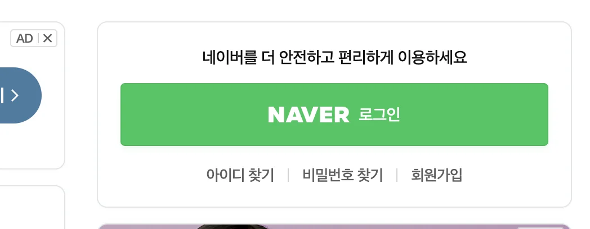
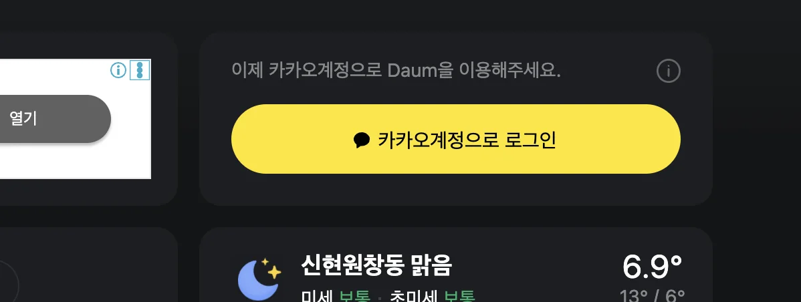
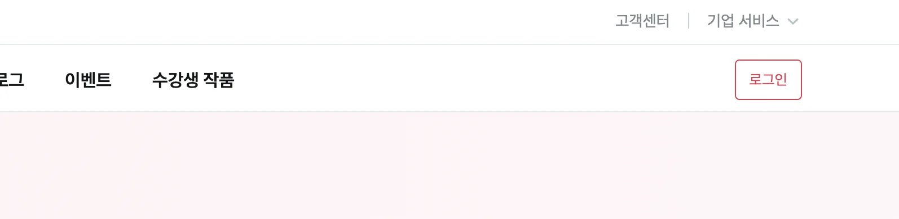
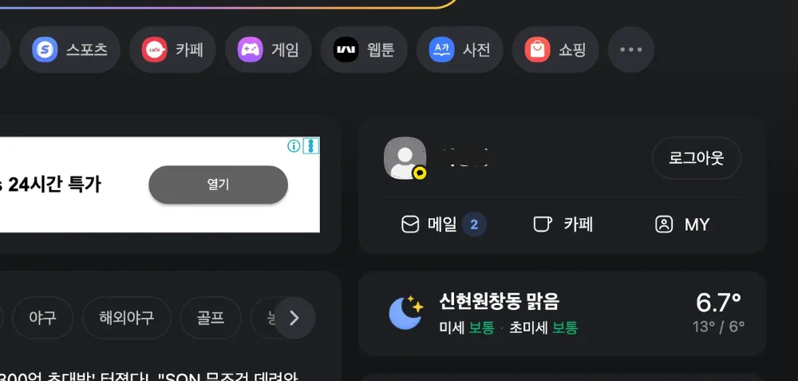
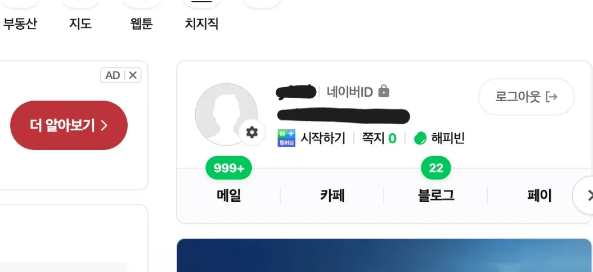
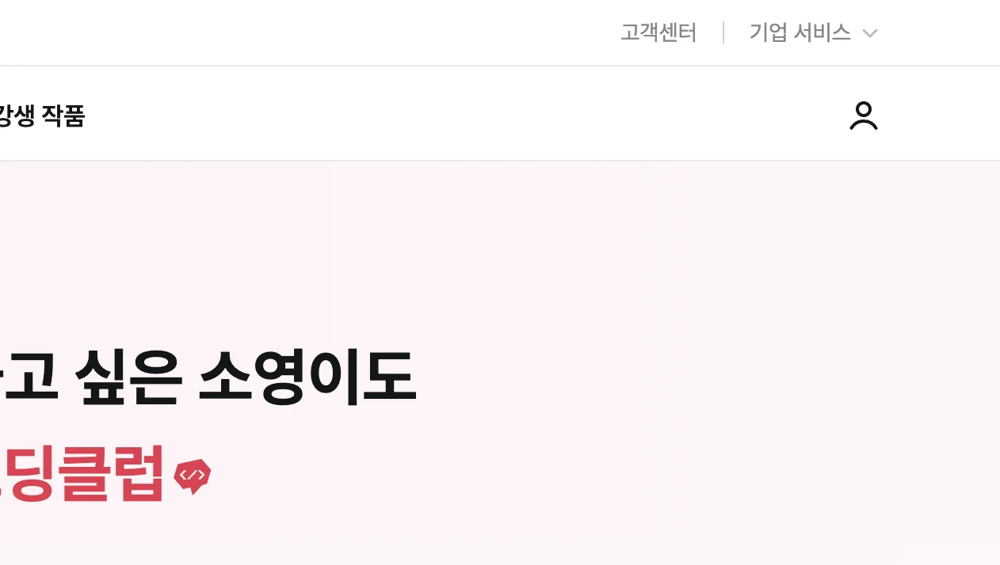
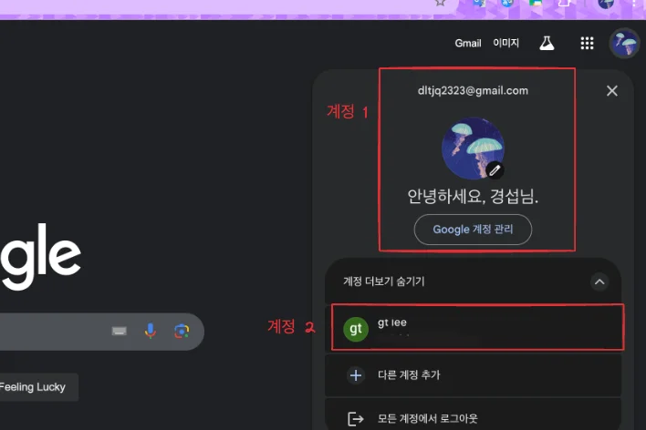

> ☝🏻 
> 
> 
> 
> 해당 포스팅은 현재 학습에 대한 부분으로는 정의가 어려운 것 같아 우선 보류를 진행한다&#46;  나중에 공부하면서 시큐리티나, Redis 등의 내용을 정리하고 진행해야 될 겻 같다&#46;

우선 일반적으로 대부분의 홈페이지에서는 단일 계정으로만 인증이 이뤄진다&#46;

- ex) 네이버, 다음, 스파르타 코딩 클럽 등
    

    
인증 전 화면

    

    

    

    

    

    
인증 후 화면 &#45; 로그인 화면 자체가 사라진다&#46; 즉, 로그인 api 호출 자체가 막힌다&#46;

    

    

    

    

따라서 로그인이 되어 인증에 성공하면, 인증 상태를 관리하기 위해 세션 ID (or JWT 토큰 발급)를 생성 한 후, 쿠키로 담아 클라이언트로 전달한다&#46; 

이후 사용자가 ‘로그인 화면’ 요청 시, 이미 인증된 사용자인지를 검사하여 처리한다&#46;

- 로그인 후 인증 처리가 되면, 이후 요청부터 세션 ID(JWT 토큰)를 담아 보낸다&#46;

- 이후 요청에 인가 여부를 판단하여, 인가 확인 시 로그인 화면을 예외처리한다&#46;

대부분의 사이트가 1개의 계정만 인증/인가 처리를 하지만, 구글의 경우 아래와 같이 동일한 클라이언트 환경에서 여러 개정의 인증을 지원한다&#46; 

### 세션을 통한 다중 계정 인증 환경 설계

---

다중 환경 구현 전, 제한 사항 및 해당 구현을 통해 학습 할 내용을 아래에 정리한다&#46;

- 쿠키/세션 인증 방식에서 확장하는 것으로 다중 인증 환경도 쿠키/세션으로 개발한다&#46;

- 해당 구현을 통해 왜 일반적으로 많은 사이트에서 1개의 인증만을 구현하는지 이해한다&#46;

서비스의 설계 자체가 , 정책 자체에 한 사람이 하나의 아이디만 가질 수 있다&#46;

- 요구사항의 차이 

- 서버에 유저의 상태 정보를 저장하게 되면, 

네이버 

스마트 스토어, → 계정 속의 계정이 존재할 수 있다&#46;

- 구글 &#45; 계정 전환

- 모든 경우의 상황을 검증한다&#46;
    - 동일한 클라이언트 환경을 인증해야지 처리가 된다&#46;
        -  동일한 컴퓨터 내에서 다중 계정 인증에 대한 상태가

        - 다른 컴퓨터로 재 로그인 시, 불가능하다&#46;
            - 일일이 계정을 로그인해서 인증을 다시 받아야한다&#46;

- 세션을 유지하는 방법도 여러가지가 있다&#46;
    - 단일 서버인 경우

    - 서버 확장을 하게되면, 

- 정책을 세밀하게 

- 한사람의 정보로 최대 3개까지 할 수있다&#46;
    - 동일한 사용자의 경우만 인증이 된다&#46;

- 쿠기 세션을 유지하는 만료시간&#46;

인가를 하는 경우 , jwt 토큰을 활용하는 것이 좋다&#46; 

- 유저 상태 정보를 서버에서 세션으로 저장하는 것은 소모가 큰 부분이다&#46;

‣
