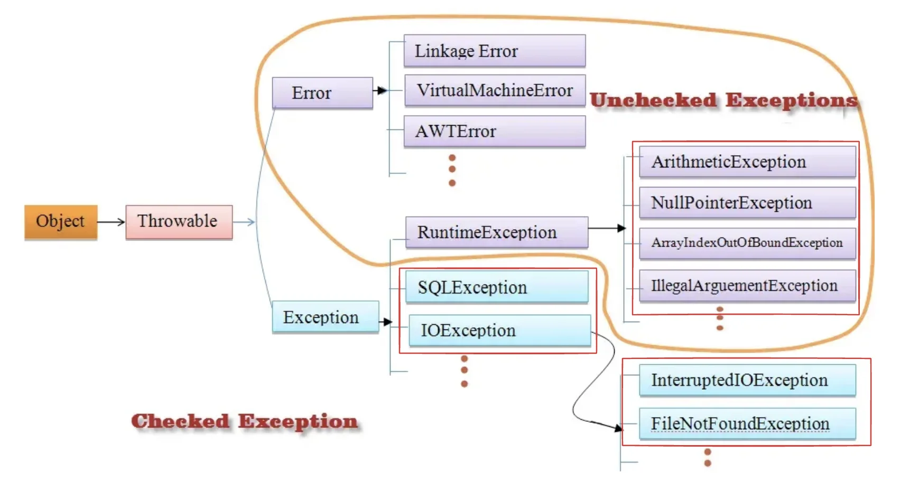
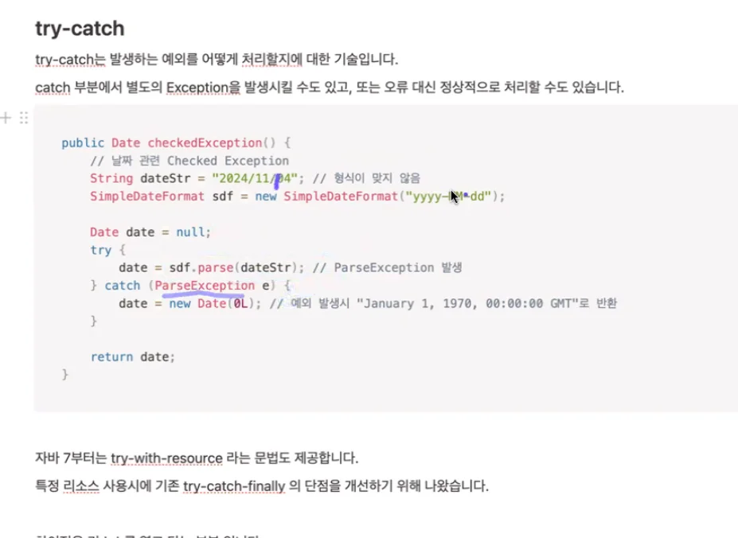
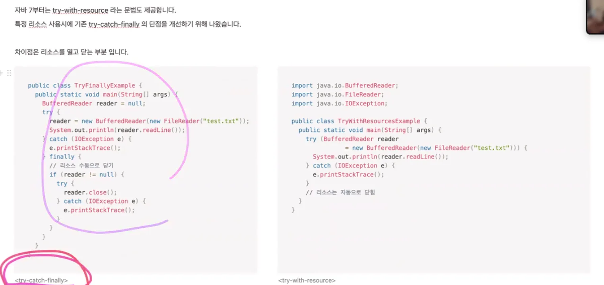

> 📌 
> 
> - 특강 (스탠다드 반) 예외처리
> 
> - 기간&#58; 24&#46;11&#46;22

### 자바에서의 예외처리

---

자바에서의 예외는 크게 2가지로 나뉜다&#46;

<u>예외 자체를 의미</u>하는 <code>Exception</code> 클래스, 그리고 <u>예외를 핸들링</u>하기 위한 <code>try&#45;catch</code>가 있다&#46;

다 못외운다&#46; 

자바에서 Exception은 다시 2가지로 나뉜다&#46;

- Checked Exception

- UnChecked Exception

Checked Exception은 반드시 try&#45;catch나 상위 메소드로 throws 처리를 해야하는 예외를 말한다&#46; 

처리를 하지 않고 컴파일을 시, 오류가 발생되어 실패한다&#46;

왜 2종류는 나누는가?

Checked Exception은 예외에 반드시 어떻게 처리할 지를 구현해야 한다&#46;

내가 작성한 모든 코드에 대해서 100% 예외를 처리해야 된다는 얘기이다&#46; 

과연 이게 가능한가? 가능하더라도 그 코드를 읽는 것이 쉬운가? 

예시

try&#45;cath문을 계속 사용하면, 어떻게 

→ 모든 것을 checked Exception 처리를 하면 가독성이 해친다&#46;

굳이 중요하지 않거나 필요가 없는 경우는 unchecked Exception으로 정의 해서 예외를 처리해야되는 경우를 제외하여 가독성을 높인다 &#46;

예외상황에 대한 처리를 강제함으로써 프로그램의 안정성을 향상 시킨다&#46;

checked Exception

예외처리 강제, 코드 안정성 향상

예외 발생 가능성을 명확히 문서화

가독성 떨어짐, 코드 생산성 하락

불필요한 예외 처리로 코드 복잡성 증가

unchecked Exception 

단순하고 가독성 높은 코드 작성 가능

필요한ㄹ때만 예외 처리

예외 누락할 가능성이  있음, 시스템 신뢰도 하락

### try&#45;catch

---

try&#45;catch는 발생하는 예외를 어떻게 처리할지에 대한 기술이다&#46;

catch 

에러 처리 → 협의

### 스프링 부트 &#45; 예외처리

---

개발 환경에서 일상적으로 ‘예외 처리를 한다’ 라고 말한다면 아래의 2가지 경우를 생각할 수 있다&#46;

- Exception

- 유효성 검증

- 정확한 의미의 예외처리는 Exception 처리만을 말하지만, 

- &#64;ExceptionHandler, &#64;ControllerAdvice

- &#64;Valid, &#64;Valited

### &#64;ExceptionHandler, &#64;ControllerAdvice

---

AOP 기능

- 특정 시점에서 실행되야 하는 로직
    - 컨트롤러가 실행되기 전 실행되어야 하는 로직, 

    - 서비스가 실행되기 전 실행되야하는 로직,

json 포맷터 

‣

배열 사이즈 체크 가능

최대 10개 리스트만 받겠다&#46;

&#64;NonNull, &#64;Nunnull

import 시 패키지 잘 보기

특정 상황에 대한 예외는 커스텀으로 구현하는게 맞는가?

정답은 없다&#46; 

illegal arguments Exception 

기존 것을 활용할 수 있다면 좋다&#46; 

기존의 것을 쓴 경우, 의도가 정확히 전달되지 않는다&#46; → 그러면 커스텀을 통해 처리한다&#46; 

기존의 예외가 충분히 표현할 수 있다면 커스텀읗
