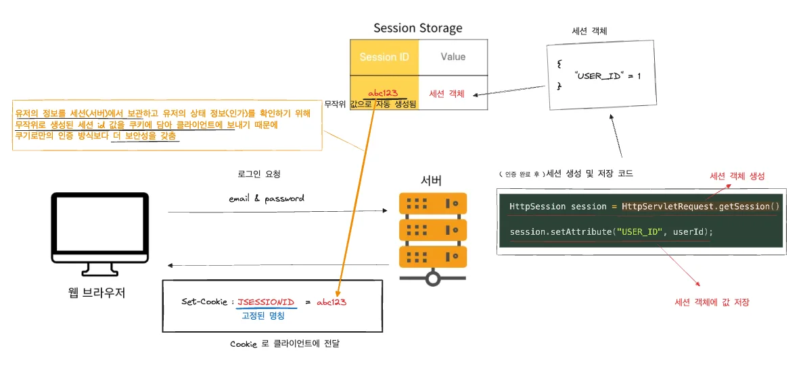
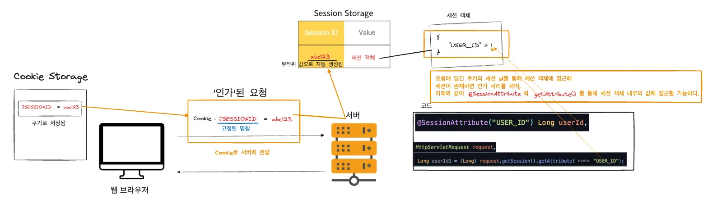

<details>
<summary>reference</summary>

<a id="146eda9b0fe18006846bd71b4336e5f7"></a>

‣

<a id="146eda9b0fe1804e93e2c180485b7f23"></a>

‣

</details>

<a id="146eda9b0fe180aba7dbc0e407ca24b8"></a>

## 서론 

---

<a id="146eda9b0fe180a6ac10d00013b1dc80"></a>

클라이언트와 서버는 HTTP 프로토콜을 통해 통신한다&#46;

<a id="146eda9b0fe18016bbd7ed5baa1dc303"></a>

그러나 HTTP 프로토콜은 <code>비상태성</code>(stateless) 과 <code>비연결성</code>(Connectionless)의 특성을 가진다&#46; 

<a id="146eda9b0fe1809abd3efa99f9c30ee5"></a>

즉,  <u>요청(응답)에 클라이언트에 대한 상태 정보를 유지하지 않</u>는다&#46; 

<a id="146eda9b0fe18000803bc55d5519991c"></a>

하지만, 애플리케이션애서는 클라이언트의 상태를 기억하고, 요청 간에 데이터를 공유할 필요한 경우가 있다&#46;

- ex)
    - 요청에 대한 인증 및 인가에 대한 처리

    - 사용자의 로그인 이후 해당 유저에 대한 인증 여부 확인하여 재로그인이 발생되는 것을 방지 

    - 사용자 로그인인 후 이전에 저장한 장바구니 데이터를 불러오는 경우, 특정 유저의 인가 여부를 판별하여 응답

    - <strong> …</strong>

<a id="146eda9b0fe1801ba9c1cae442b7348d"></a>

이렇게 HTTP 를 통한 <u>클라이언트와 서버 간의 통신</u>에서  <strong><u>어떤 사용자</u></strong><strong><u>가 데이터를 요청을 하는지</u></strong>, <strong><u>해당 요청이 </u></strong><strong><u>데이터에 대한 접근이 확인</u></strong><strong><u> 되는지</u></strong><strong> 등 </strong>요청에 대한 인증, 인가를 확인하기 위해서는 HTTP 통신에  상태정보(state) 를 구별할 수 있는 데이터가 포함되어야 한다&#46; 

<a id="146eda9b0fe1808eaa1ceae754db6613"></a>

이를 여러 기술로 구현 가능하지만, 그 중<u> 세션 기반 인증/인가</u>에 대해 학습 및 의문점을 정리한다&#46;

<a id="146eda9b0fe1800d88e2f8fdfa8b9e4d"></a>

## Http 통신 시,  세션/쿠키 통한 상태정보 유지 ( 세션 기반 인증/인가 )

---

<a id="147eda9b0fe18004b5f6d0971e65cb50"></a>

HTTPSession

<details>
<summary>세션이란?</summary>

<a id="146eda9b0fe1808a8ffbee0d6597a711"></a>

 사용자가 웹 브라우저를 통해 웹서버에 접속한 시점으로부터 웹 브라우저를 종료하여 연결을 끝내는 시점까지, 같은 사용자로부터 오는 일련의 요청을 하나의 상태로 보고, 그 상태를 일정하게 유지하는 기술이다&#46; 즉 방문자가 웹 서버에 접속해있는 상태를 하나의 단위로 보고 그것을 세션이라고 한다&#46;

</details>

<details>
<summary><strong>서블릿을 통한 세션 기반 인증/인가  &#45; 동작 방식</strong></summary>

- 인증 이후 인가를 위한 세션 객체 생성 및 <code>세션id(쿠키)</code>  전달 과정
    > 클라이언트가 로그인하면 서버는 세션 객체를 생성하고 세션 ID를 클라이언트에게 쿠키로 전달한다&#46;

    

    1. <code>HttpSetvletRequest&#46;getSession()</code> 시, 세션이 생성된다&#46;
        - 이때, 생성된 세션을 구분하기 위한 session id 값이 임의로 생성되어 key 값을 처리된다&#46;

    <a id="89eb33ba98a04e488cb78e2bc0998c58"></a>

    2&#46; <code>HttpSetvletRequest&#46;getSession()</code>으로 생성 및 조회한 세션 객체에 <code>&#46;setAttribute()</code>를 통해 값을 담는다&#46; 

    - <code>key &#58; value</code>  형태로 값이 저장된다&#46;

    1. <code>JSESSIONID</code>의 key 와 세션 id를 value 값에 담는 쿠키를 포함하여 응답을 보낸다&#46;
        - ex) set&#45;cookie&#58; <code>JSESSIONID={ 세션 id }</code>

    1. 이후 요청 시, 인가를 위해 쿠키에 응답 받았던 세션 id를 담아 보낸다&#46;
        - ex) cookie&#58; <code>JSESSIONID={ 세션 id }</code>

- 클라이언트에 <code>세션id(쿠키)</code> 전달 후 인가(<code>세션id(쿠키)</code>)를 포함한 요청 과정
    > 서버는 세션 객체에 인증 정보를 저장하고, 클라이언트의 요청에서 받은 세션 ID를 통해 해당 정보를 확인한다

    

    1. 클라이언트의 쿠기 저장소에 저장된 session id 값을 이후 요청에 담아 서버로 보낸다&#46;

    1. 서버는 접근 클라이언트의 Request&#45;Header 필드인 cookie를 확인하여, 클라이언트가 해당 세션ID를 보냈는지 확인한다&#46;

    1. session id 값이 존재한다면 session storage에서 조회하여 해당하는 세션 객체가 존재하면 인가 처리를하고 그렇지 않다면 인가를 거부한다&#46;

    1. 인가 처리가 되면 <code>&#64;SessionAttribute</code>, <code>HttpServletRequest&#46;getSession()&#46;getAttirubute()</code>를 통해 세션 내부의 값에 접근이 가능하다&#46;
        - 정의한 key 값을 통해 value를 반환 받는다&#46;

    1. 세션에 저장된 유저 정보를 확인하여, 해당하는 응답 처리를 한다&#46;


</details>

<details>
<summary>서블릿을 통한 세션 관리 &#45; 의문점 ( getSession  )</summary>

<a id="b81f247887314807b0466be81dd207c3"></a>

```java
HttpSession session = HttpServletRequest.getSession() // default: create = true;

session.setAttribute("USER_ID", userId);
```

<a id="cffb10b4d0ef447a90204b354776ddf7"></a>

서블릿을 통한 세션 값 저장 시, <code>setAttribute()</code>로 이미 생성된 세션 객체에 유저의 상태 정보를 저장한다&#46; 

<a id="e9d3bcb1d2b144aeab1226baf5a58dd8"></a>

여기서 중요한 점은 <u>‘이미 생성된 세션 객체에 데이터를 저장한다’</u>는 점이다&#46; 

<a id="a1e238a7b6d1445880a23a5d2ef20536"></a>

```java
HttpSession session = HttpServletRequest.getSession() // default: required = true;

session.setAttribute("USER_ID", userId);
```

<a id="d6e0c0f2c49b485fa21ceba2b473d6d6"></a>

이미 <code>HttpServletRequest&#46;getSession()</code> 에서 <u>세션 객체가 생성</u>되었다&#46;

<a id="146eda9b0fe1804cbf87e9a9dc55e0cb"></a>

여기서 아래와 같은 의문점이 들었다&#46;

> 🧐 조회(getter, <code>getSession()</code>)만 이뤄지는데,  세션이 생성 로직이 어디에 존재하는가?


<a id="e5d1c6f585d54b71bff101e4c14a4a56"></a>

위 의문에 대한  이유를  <code>HttpServletRequest</code> 스펙에서 찾을 수 있었다&#46;

<a id="146eda9b0fe180de9517d2d97023e7b6"></a>

위 스펙 설명을 보면 <code>HttpServletRequest&#46;getSession()</code>

<a id="146eda9b0fe180c6b4dec0ba83b02fe9"></a>

생성 여부를 판단하는 boolean 데이터(<code>create</code>)를 인자로 받는데, 이 생성 판단 boolean 값은 기본 값이 <code>true</code>로 설정되어 있다&#46;

<a id="146eda9b0fe1804fa442f4a8d517fd94"></a>

즉, <u>세션 조회 시 세션이 없</u>다면<u> 세션 객체를 생성해서 조회</u>한다&#46; 

<a id="146eda9b0fe180c8bee9f883ca04150d"></a>

따라서  따로 <code>false</code> 값을 설정하지 않으면, 세션 조회(getter)에 생성 로직까지 같이 추가되어 동작한다&#46; 

> 이 부분이 이해가 되지 않아, 매우 고생함… 다음 번에는 스펙을 정의한 부분을 잘 읽어볼것

<a id="33ac59f2bd2348c59addf6e54db93d9c"></a>

또한 <code>HttpServletRequest</code>은 요청 처리를 위해 매 요청마다 새로 생성된다&#46; 

- 요청 및 응답을 처리하기 위해  <u>SpringMVC</u>에서 매 요청마다  <code>HttpServletRequest</code>, <code>HttpServletResponse</code> 서블릿 객체를 생성한다&#46;
    

<a id="146eda9b0fe180d9835cd61f15d04fae"></a>

그리고 세션은 요청마다 조회하여 없을 시 <u>새로 생성</u>하거나 및 <u>기존의 세션을 조회하여 가져온</u>다&#46; 

<a id="b1756b6c8b624a0fb1b7e755b1aeeb87"></a>

즉, 매 요청마다 하나의 세션을 유지(생성) 및 재사용한다&#46; 

<a id="146eda9b0fe180c89c16d11bd3074d35"></a>

그럼 여기서 드는 의문점이 있다&#46; 

> 🧐 왜 세션을 하나만 유지(재사용)를 하는가?

<a id="146eda9b0fe1803abee2e1ad6d47ed92"></a>

해당 의문점은 아래에서 정리하겠다&#46;<br>

</details>

<a id="146eda9b0fe180b5aa16d43356ff0bdc"></a>

## 왜 요청마다 1개의 세션만을 유지(재사용)하는가?

---

<a id="146eda9b0fe180afa4f7db86d442b01f"></a>

Servlet으로 세션을 관리 시, 요청마다 한개의 세션만을 관리 ( 생성, 유지 ) 한다&#46; 

<a id="146eda9b0fe180a0910dd84a1040e308"></a>

조회를 한 후 세션이 없으면 세션 객체를 생성하며 한번 생성된 세션 객체를 계속해서 재사용한다&#46; 

> ☝🏻 
> 
> <a id="f67586e58bcb420ba956ca1bb9129087"></a>
> 
> 여기서 <u>“요청마다 한 개의 세션만 관리한다”</u> 의미는 각 클라이언트마다 고유한 세션을 유지한다는 뜻이다&#46; 따라서 여 클라이언트에서 요청이 올 경우, 각각의 클라이언트가 자신만의 세션을 갖는다&#46;

> 🧐 그렇다면 요청마다 왜 한 개의 세션만 유지(재사용)하는가?

<a id="146eda9b0fe18034a329c798cf505707"></a>

의문점에 대한 이유는 아래와 같다&#46; 

<details>
<summary>1&#46; 사용자 식별의 일관성 유지</summary>

<a id="146eda9b0fe1804b9b43e6e7aa2ea434"></a>

만약 <u>동일한 사용자에 대해 여러 세션이 생성</u>되면 어떤 세션이 사용자의 상태를 올바르게 나타내는지 알 수 없다&#46;  

<a id="146eda9b0fe180ba9877ddac3327eee5"></a>

예를 들어, 로그인 상태가 유지되어야 하는데 요청마다 새로운 세션이 생성되면, 매번 로그인(인증)을 새로 해야한다&#46; 결론적으로 인증 이뤄지지 않는다&#46;

</details>

<details>
<summary>2&#46; 리소스 관리의 효율성</summary>

<a id="146eda9b0fe180929f22c4bf1088f9d9"></a>

서버가 모든 요청마다 새로운 세션을 생성하면, 세션 객체가 기하급수적으로 늘어나게 되며 메모리와 CPU 리소스가 불필요하게 소모된다&#46; 

<a id="146eda9b0fe180d385b9e67b9a94ffa7"></a>

따라서 <u>하나의 세션을 요청마다 재사용</u>함으로써 리소스를 효율적으로 관리한다&#46;

</details>

<details>
<summary>3&#46; 클라이언트와 서버 간의 연결 유지</summary>

<a id="146eda9b0fe18041b0d9cf771caf920e"></a>

클라이언트는 서버로 요청을 보낼 때 세션 ID를 함께 전송한다&#46; ( 쿠키 or URL 파라미터 )

<a id="146eda9b0fe1804ca184fdf7ffaedfda"></a>

그리고 서버는 세션 ID를 이용해 서버에 저장된 세션 객체를 조회하여 상태를 관리한다&#46;

<a id="146eda9b0fe1809f8875cbe1ffbc3086"></a>

클라이언트에 대한 요청은 단일 계정에 대한 인가만 처리한다&#46;  따라서 클라이언트 마다 세션은 하나만 생성되어 계증의 상태 정보 확인에 쓰인다&#46;

</details>

<a id="146eda9b0fe180bdbf02e95c4a106c0a"></a>

위와 같이 <u>사용자 식별의 일관성</u>, <u>서버의 리소스 관리의 효율성</u>, 그리고 <u>클라이언트와 서버 간의 통신</u>에서 <u>요청 하나 당</u>  <u>단일 계정에 대한 상태 정보</u>만을  처리하기 때문에<u> 1개의 세션만을 유지</u>한다&#46;

<a id="146eda9b0fe1809686e9e7564e134fe3"></a>

여기서 아래와 같은 의문점이 생긴다&#46; 

> 🧐 클라이언트마다 하나의 다중 계정 인증/인가 처리를 한다고 한다면 어떻게 처리하는가?

<a id="146eda9b0fe1805c8848c110c21ed6c3"></a>

이 부분은 세션만으로는 구현이 힘들다고 한다&#46; 따라서 추가로 공부를 진행하고 정리를 해야할 듯 싶다&#46;

- 세부적인 정책을 정하고 구현한다면 가능은 하지만 현재는 단기간에 구현하기에는 어려운 것 같다&#46;<br>나중에 기회가 된다면 진행해야 될 듯 싶다&#46;
    <a id="146eda9b0fe180499e11c3687e92013f"></a>

    <a href="#/post/146eda9b-0fe1-8085-aa0f-fa4935273ae2">페이지</a> 

<a id="146eda9b0fe180848df9ea62a7bca041"></a>

## 세션 인증/인가 방식의 단점

---

<a id="146eda9b0fe180cabe09f6c590529593"></a>

세션은 쿠키에 비해 보안이 좋지만 서버에 저장되어 서버자원을 사용하기 때문에 사용자가 많을 경우 소보되는 자원이 상당하다&#46; 

<a id="146eda9b0fe180308c25f4f3dd158f26"></a>

또한 세션은 서버가 유저의 상태 정보에 종속적이도록 만든다&#46; 따라서 사용자의 트래픽이 증가함에 따라 서버의 수평적 확장(Scale&#45;out) 시, 서버 세션을 공유 방식에 대한 정합성 이슈를 고려해야한다&#46;

> 서버의 수평적 확장(Scale&#45;out) 시, 서버 세션을 공유 방식에 대한 정합성 이슈 문제는  <br>아래에 대한 포스팅 참고 바람
> 
> <a id="146eda9b0fe1801e9b92d45b940cb990"></a>
> 
> <a href="#/post/146eda9b-0fe1-80ab-8dd3-e149dd422e0d">페이지</a> 

<a id="146eda9b0fe18070aad7e382c658498b"></a>
