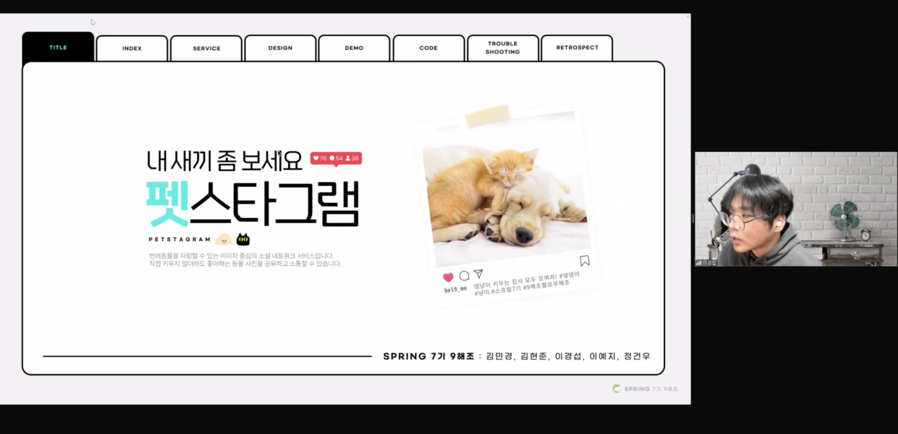

[video](https://www.youtube.com/watch?v=7Ns4kSIl8q8)

### 잘한점

---

- 이전 1주차 팀프로젝트 발표에서는 대사를 따로 적지 않아 중간에 실수가 났을 때, 바로 흐름을 잡기가 어려웠다&#46;  → 이번 발표에서는 <u>대본을 구체적으로 작성</u>해서 중간에 흐름이 끊어지는 실수가 발생되지는 않았다&#46;

### 개선점

---

- <u>실제 발표 환경</u>에서의 <u>테스트 고려</u>  &#91; 내일 배움 캠프 &#45; 줌 &#93;
    - 이전 팀원들과 피드백 및 테스트를 진행했었는데, 해당 환경은 zep 환경이었다&#46;  줌에서는 <u>중간 시연 영상</u>에서 <u>오디오가 공유되지 않</u>는 실수가 발생되었다&#46; 

    - 줌을 별로 써본 기억이 없어서, 구글 슬라이드 공유 시, 해당 화면이 보이지 않았다&#46;  따라서 아래와 같이 화면 공유가 진행되었다&#46; 
        

        → ppt 전체의 화면 공유가 일어나지 않아 발표 자료가 제대로 보이지 않았다&#46;

        

- <u>대본에 대한 구체적인 설명의 예시가 없</u>었다 &#46;
    - ppt 제작 시, <u>자료에 대한 준비를 미흡</u>하게 했었던 것 같다&#46; 

    - 다른 팀원들의 자료를 보니까 <u>동작 흐름에 따른 구체적인 예시들,</u> 그리고 <u>그렇게 설계한 이유를 다뤘</u>는데, 해당 부분이 거의 존재하지 않았다&#46;

    - 기본적으로 내용에 대한 부분이 많이 부실했다&#46; 
        - PPT에 대한 부분이 팀 단위로 논의되지 않았다&#46; 

        - 각 기능에 대한 구현 의도나 설명 부분도 팀적인 소통이 이뤄지지 않았다&#46;

- <u>ERD 설계, API 설계, 와이어프레임 설계</u> 설명 부족
    - 해당 부분도 내가 설계한 기능 빼고,  어떻게 의도로 구현했는지, 동작하는지가 이해하지 못했다&#46;
        

        따라서 해당하는 부분을 제대로 이해하지 못해 발표에서 자세히 담지 못했다&#46; 

        - 이번 주차에 인증/인가에 대한 개념을 확실히 하기 위해서 해당 공부에만 집중을 했다&#46;

        - 따라서 내 기능 개발 후, 팀적으로 논의되는 대부분의 일들을 참여하지 못했다&#46; 
            

            → <u>구체적인 팀회의 시간이나, 방향성, 계획 </u>등을 첫날에 공유하고 진행

            

            → 특히, 코드 컨벤션, git 컨벤션, 발표 준비 등 팀 단위로 이뤄져야할 내용들을 같이 정하기 

            

            → <u>설계 이후, 해당 이유에 대해 논의하기 </u>

- 실제 구현한 내용들을 담지 못함
    - 예외처리, 각 기능 등 구현한 대부분의 내용들을 상세하게 담지 못했다&#46; 

    - 이러한 부분도 충분히 팀 단위로 논의가 이루어져야 한다&#46; 
        - 코드 리뷰 진행, 의문점, 구현 의도가 이해 안되는 부분 그냥 넘어가지 말고  무조건 물어보기

### 결론

---

결국 이번 주차에 대한 피드백을 종합해보면, 발표 자료에 대한 준비가 미흡했다&#46; 

너무 구현에만 초점이 맞춰져, 이후 발표 자료에 대한 내용 논의 자체가 이뤄지지 않았다&#46; 

또한 팀원들과의 소통, 피드백 등이 제대로 이뤄지지 않았다&#46; 

이렇게  다른 사람들 앞에서 발표를 준비하고 다뤄보는 것이 2번째인데, 다른 팀원들의 발표 자료들을 보고 엄청 충격을 받았고, 이후 어떻게 자료 준비를 진행할지를 많이 배웠던 것 같다&#46; 

그래도 이렇게 도전을 하니 배우고 고칠 수 있는 기회가 생기는 것 같다&#46;

 엄청 긴장을 많이 했는데, 녹화 영상을 보니 생각보다 잘한 것 같아서 나름 만족한다&#46;   그렇지만 가야할 길이 멀다&#46;  부지런히, 꾸준히 가자 이번 주 정말 힘들었는데, 너무 고생했고 잘했다&#46;

- 다음 발표 시 고려해야 될 내용
    - <strong>팀적으로 논의하기  ( 매우 중요 )</strong>

    - 주차 목표 넣기

    - 기술 스택 넣기

    - 깃 허브 project Board

    - 플로우 차트 

    - 발표에 대한 설득력
        - 데이터에 근거하여 설명, 구체적인 자료 추가

    - erd 설계, api 설계에 대해 구체적으로 다루기 

- 다음 프로젝트 진행 시 명확히 가져가야 할 내용
    - 플랜, 공통적으로 논의 되어야 할 내용들 방법 정하기 

- 협업 최악의 상황 가정
    - 정말 최악의 상황인 경우 (팀원 탈주), 공유 후 해당 내용을 피드백 받는 것이 좋다&#46; 

- 발표 시 자세가 이상했음
    - 안경 올려쓰기

    - 보여지는 화면에 대해서 신경 쓰기
