<a id="14aeda9b0fe181d6be4dceaf871bdb92"></a>

## FomattingConversionService

---

> 📖 
> 
> <a id="14aeda9b0fe181fb9b1bd53fbed90578"></a>
> 
> <code>ConversionService</code> 와 <code>Formater</code>를 결합한 구현체
> 
> <a id="14aeda9b0fe180d39520e3a47e1f2527"></a>
> 
> <u>타입 변환 포맷팅</u>이 <u>필요한 모든 작업</u>을 한 곳에서 수행할 수 있도록 설계<br>따라서<u> 다양한 타입의 변환과 포맷팅을 쉽게 적용 가능</u>함

<details>
<summary>FormattingConversionService</summary>

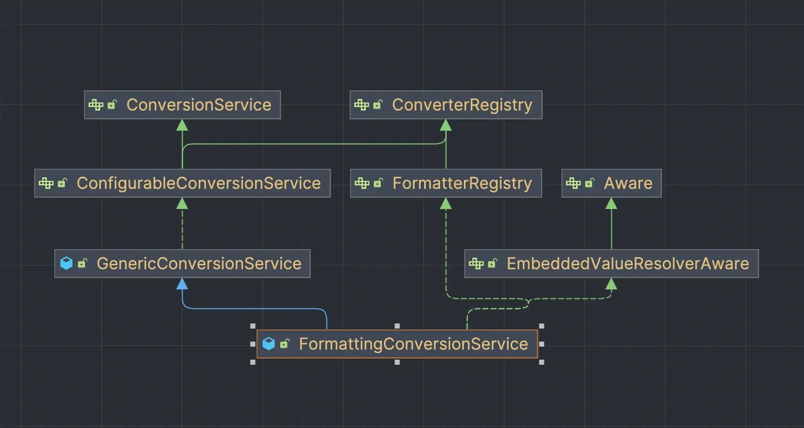

- <code>Formatter</code>를 지원하는 <code>ConversionService</code>

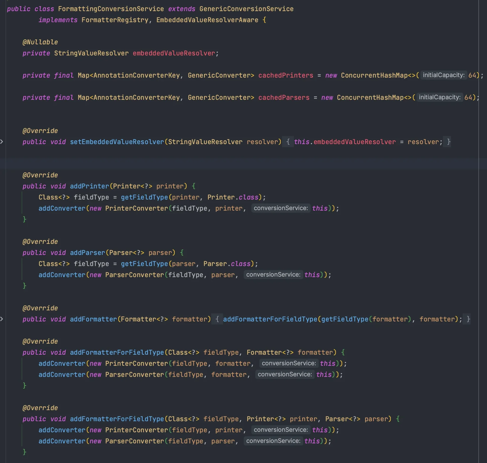

- <u>어댑터 패턴을 사용</u>하여 <code>Formatter</code>가 <code>Converter</code> 처럼 동작하도록 만들어준다&#46; 

</details>

<details>
<summary>DefaultFormattingConversionService</summary>

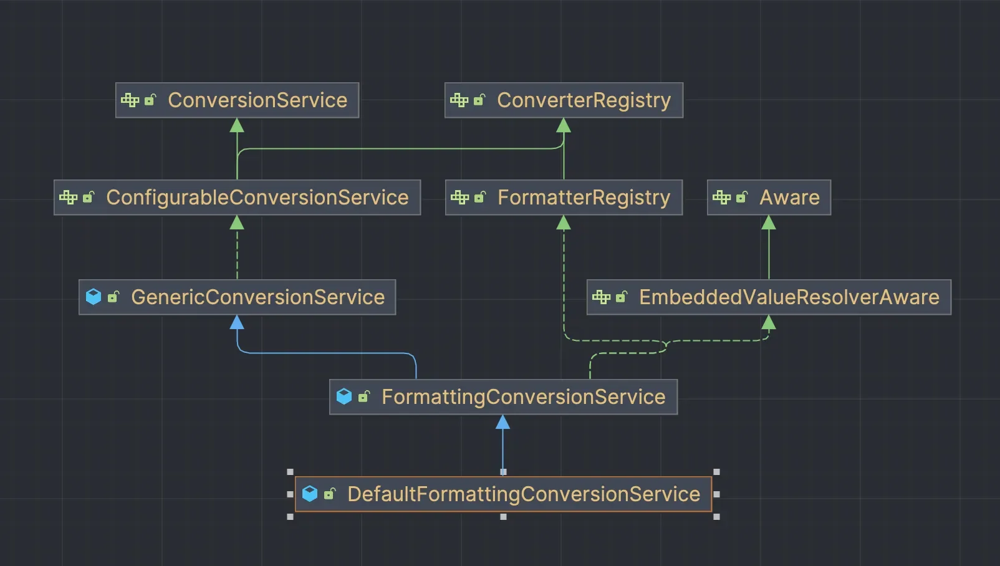

- <u>FormattingConversionService</u> &#43; <code>통화</code>, <code>숫자</code> 관련 <u>Formatter</u> 추가

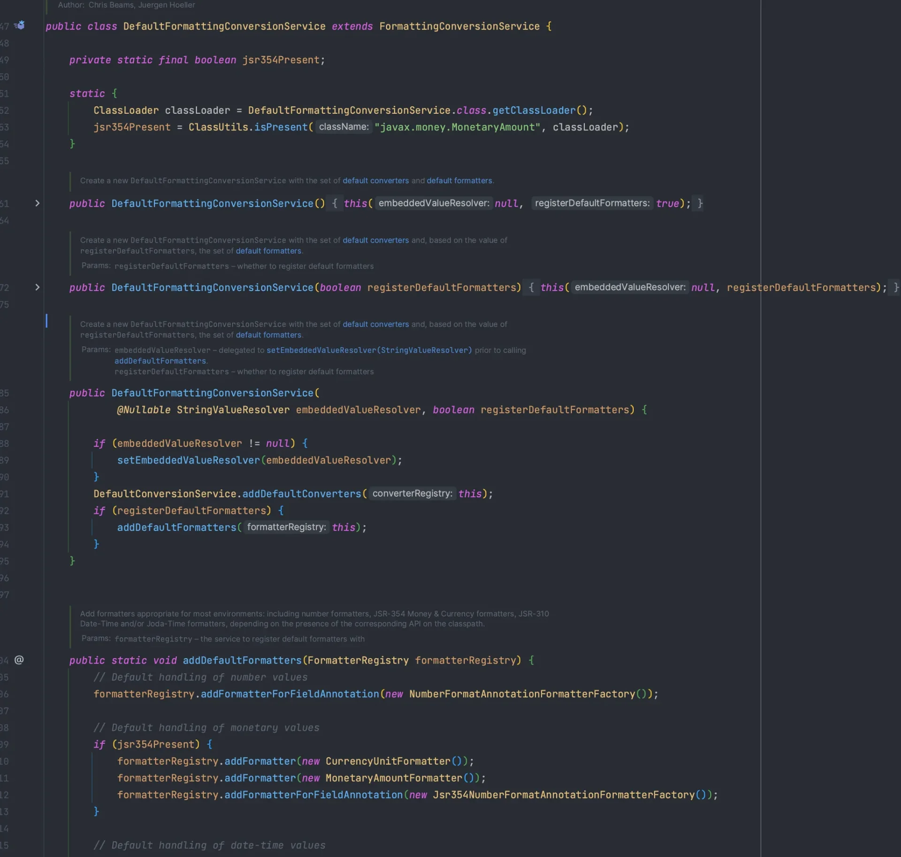

</details>

<details>
<summary>테스트</summary>

<a id="14aeda9b0fe180bb8342d700437c8052"></a>

```java
public class FormattingConversionServiceTest {

    @Test
    void formattingConversionService() {

        // given
        DefaultFormattingConversionService conversionService = new DefaultFormattingConversionService();

        // Converter 등록
        conversionService.addConverter(new StringToPersonConverter());
        conversionService.addConverter(new PersonToStringConverter());
        
        // Formatter 등록
        conversionService.addFormatter(new PriceFormatter());

        // when
        String result = conversionService.convert(10000, String.class);

        // then
        Assertions.assertThat(result).isEqualTo("10,000");
    }
}
```

- <code>ConversionService</code> 가 제공하는 <code>convert()</code> 사용

</details>

<details>
<summary>SpringBoot의 기능 &#45; <code>WebConversionService</code></summary>

> ✏️ 
> 
> <a id="338eda9b0fe18036bf16fb71505a5799"></a>
> 
> SpringBoot는 기본적으로 <code>WebConversionService</code>를 사용한다&#46;

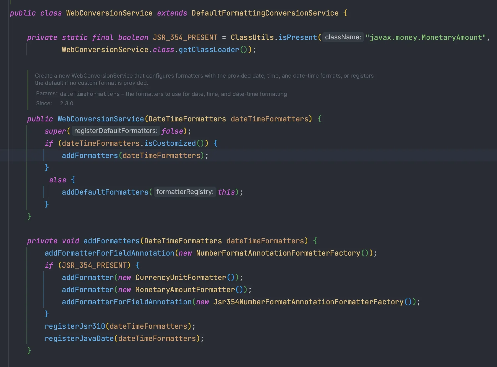

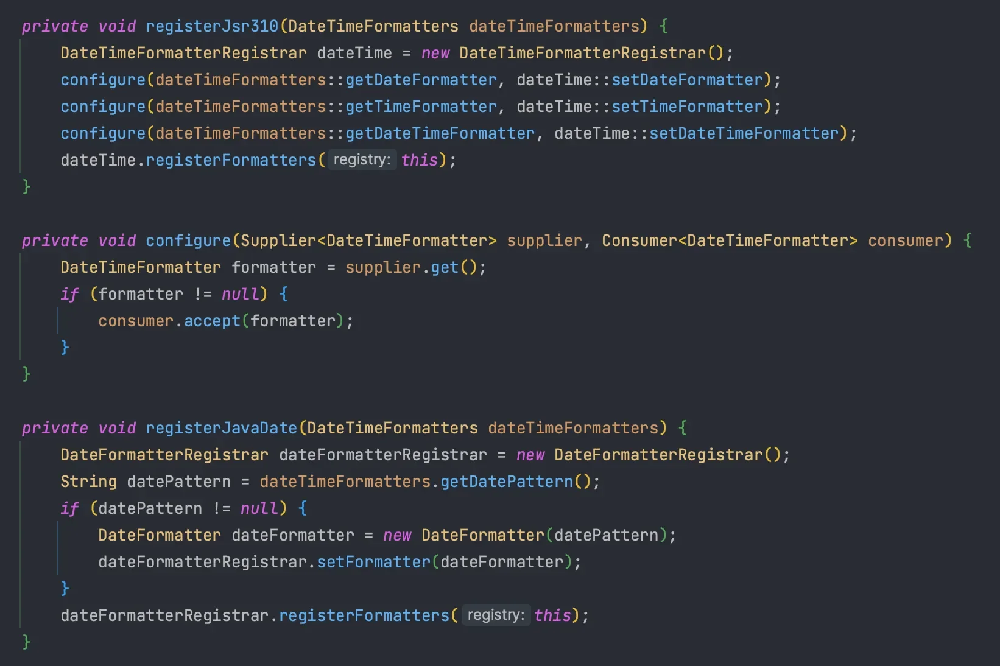

- <code>DefaultFormattingConversionService</code> 상속하여 구현

</details>

<a id="14aeda9b0fe180358d7fcc2d7076204b"></a>

## Spring이 제공하는 Formatter

---

> 📖 
> 
> <a id="4e65302e82cf445688eefe57c508383f"></a>
> 
> Spring은 Annotation 기반으로 원하는 형식의 Fomatter를 사용 가능

> ✏️ 
> 
> <a id="73283fd0cd354fceaaa98933521c2a3b"></a>
> 
> Spring은 Java에서는 기본적으로 제공하는 타입들에 대해 Formatter를 제공한다&#46; 
> 
> <a id="14aeda9b0fe180119313ee5d14ad3044"></a>
> 
> 하지만 기본 제공 Formatter는 기본 형식이 정해져 있어, <u>필드마다 다른 형식으로 지정하기 어렵다&#46; </u>

<details>
<summary>공식문서</summary>

[Spring Field Formatting &#58;&#58; Spring Framework]()

</details>

<details>
<summary>Annotation</summary>

> DTO 필드에 적용 가능

- <code>&#64;NumberFormat</code>
    - NumberFormatAnnotationFormatterFactory

- <code>&#64;DateTimeFormat</code>
    - 날짜 관련 지정 Formatter 사용
        - <code>Jsr310DateTimeFormatAnnotationFormatterFactory</code> 

</details>

<details>
<summary>코드 예시 </summary>

> ☝🏻 
> 
> <a id="bd0314903d004974b16588ee2b4afffe"></a>
> 
> <strong>예시라서 </strong><strong><u><code>&#64;Data</code></u></strong><strong>를 사용,</strong>
> 
> <a id="14aeda9b0fe180fa9f86f9b5a7b5584e"></a>
> 
> <u>운영 코드에서는 사용 ❌</u> ( <strong>테스트 코드에서는 가능 )</strong>

<a id="14aeda9b0fe180c2ba13dc9071738a1f"></a>

```java
@Data
public class FormatForm {

    @NumberFormat(pattern = "#,###.##")
    private BigDecimal price;

    @DateTimeFormat(pattern = "dd-MM-yyyy")
    private LocalDate orderDate;
}
```

<a id="14aeda9b0fe18004be10f6788c85d318"></a>

```java
@RestController
public class FormatController {

    @PostMapping("/format")
    public ResponseEntity<String> format(@ModelAttribute FormatForm form) {
        return new ResponseEntity<>(
                "form.getPrice() = " + form.getPrice() +
                        " form.getOrderDate() = " + form.getOrderDate(),
                HttpStatus.OK
        );
    }
}
```

- 포스트맨 테스트
    - 필드마다 정상적으로 타입이 변환되어 바인딩

    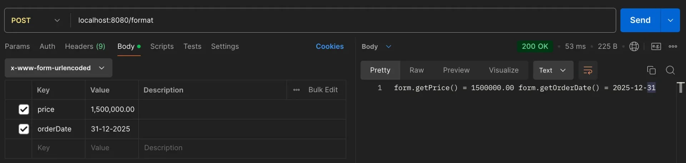

</details>

<details>
<summary>🤬 &#91; Error Case &#93; &#45; JSON</summary>

<a id="14aeda9b0fe180db8474c05d0d682ced"></a>

```java
@PostMapping("/json-format")
public ResponseEntity<String> jsonFormat(@RequestBody FormatForm form) {
    return new ResponseEntity<>(
            "form.getPrice() = " + form.getPrice() +
                    " form.getOrderDate() = " + form.getOrderDate(),
            HttpStatus.OK
    );
}
```

- postman &#45; <strong>400 Bad Request</strong>
    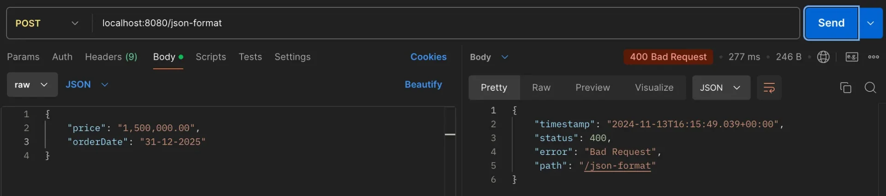

- 오류 메세지
    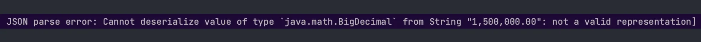

> ☝🏻 
> 
> <a id="ebb30b8b40d545ce873f3e0a237973f0"></a>
> 
> <code>&#64;NumberFormat</code>  과 <code>&#64;DateTimeFormat</code>은 <u>폼 데이터</u> 와 <u>URL 파미터</u>를 처리하는 <code>ConversionService</code>와 관련이 있다&#46;
> 
> - <u>Jackson의 직렬화/역직렬화 과정에는 기본적으로 영향을 미치지 않</u>는다&#46;
>     <a id="14aeda9b0fe180ce93c2d2f6227743a8"></a>
> 
>     ⇒  <u>JSON 처리</u> 시, <code>&#64;JsonFormat</code>, <u>커스텀 Deserializer</u> 사용

</details>

<details>
<summary>JSON 처리 1&#58;  <code>Deserializer</code></summary>

> ✏️ 
> 
> <a id="4720190e5f8e48f1827e017b65dda84d"></a>
> 
> <code>&#64;JsonDeserialize</code> 사용하여  JsonDeserializer 구현체 등록

<details>
<summary>&#91; 코드 &#93; JsonDeserializer</summary>

<a id="14aeda9b0fe180ee8763ecb80b006686"></a>

```java
public class CurrencyDeserializer extends JsonDeserializer<BigDecimal> {
    @Override
    public BigDecimal deserialize(JsonParser p, DeserializationContext ctxt) throws IOException, JacksonException {
        String value = p.getText().replaceAll("[^\\d.]", ""); // 숫자와 소수점만 남기기
        return new BigDecimal(value);
    }
}
```

<a id="14aeda9b0fe180a5b52dfdd648ac1450"></a>

```java
public class LocalDateDeserializer extends JsonDeserializer<LocalDate> {
    @Override
    public LocalDate deserialize(JsonParser p, DeserializationContext ctxt) throws IOException, JacksonException {
        return LocalDate.parse(p.getText(), DateTimeFormatter.ofPattern("dd-MM-yyyy"));
    }
}
```

</details>

<details>
<summary>테스트</summary>

- DTO
    > ☝🏻 
    > 
    > <a id="ae84f54d5a3c4152a10e4805ba5a6029"></a>
    > 
    > <strong>예시라서 </strong><strong><u><code>&#64;Data</code></u></strong><strong>를 사용 </strong>
    > 
    > <a id="90f18df9b9c54828b84b2d5e233f0f03"></a>
    > 
    > <u>운영 코드에서는 사용 ❌</u> ( <strong>테스트 코드에서는 가능 )</strong>

    <a id="14aeda9b0fe1806a866ec26bb60c28fc"></a>

    ```java
    @Data
    public class JsonFormatDto {
    	
        @JsonDeserialize(using = CurrencyDeserializer.class)
        private BigDecimal price;

        @JsonDeserialize(using = LocalDateDeserializer.class)
        private LocalDate orderDate;

    }
    ```

- Controller
    <a id="14aeda9b0fe180feb89bc851070e2972"></a>

    ```java
    @PostMapping("/json-format/deserialize")
    public ResponseEntity<String> jsonFormatDeserialize(@RequestBody JsonFormatDto dto) {
        return new ResponseEntity<>(
                "dto.getPrice() = " + dto.getPrice() +
                        " dto.getOrderDate() = " + dto.getOrderDate(),
                HttpStatus.OK
        );
    }
    ```

- postman 테스트 
    - 정상적으로 출력 및 변환됨

    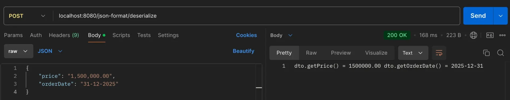

</details>

</details>

<details>
<summary>JSON 처리 2&#58; <code>&#64;JsonFormat</code></summary>

> ✏️ 
> 
> <a id="bb849f1a990d480caf12e6958982488f"></a>
> 
> <code>&#64;JsonFormat</code> 의 옵션에 구체적인 패턴 정의 
> 
> - <u>날짜 형식</u>이나, <u>숫자 포맷</u> 지정 가능

<details>
<summary>테스트</summary>

- DTO
    <a id="14aeda9b0fe1808498b7fb5e8b331997"></a>

    ```java
    @Data
    public class JsonFormatDtoV2 {

        @JsonDeserialize(using = CurrencyDeserializer.class)
        private BigDecimal price;

        @JsonFormat(shape = JsonFormat.Shape.STRING, pattern = "dd-MM-yyyy")
        private LocalDate orderDate;

    }
    ```

- Controller
    <a id="14aeda9b0fe180a4b1bcdcfc51bf4df4"></a>

    ```java
    @PostMapping("/json-format/annotation")
    public ResponseEntity<String> jsonFormatAnnotation(@RequestBody JsonFormatDtoV2 dto) {
        return new ResponseEntity<>(
                "dto.getPrice() = " + dto.getPrice() +
                        " dto.getOrderDate() = " + dto.getOrderDate(),
                HttpStatus.OK
        );
    }
    ```

- 포스트맨 테스트 
    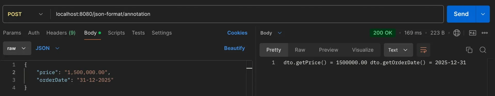

</details>

> ☝🏻 
> 
> - <code>&#64;JsonFormat</code>은 날짜 형식이나 숫자 포맷을 지정할 수 있다&#46;
> 
> - 콤마를 포함한 숫자는 Jackson이 자동으로 변환하지 않으므로 커스텀 처리가 필요하다&#46;
> 
> - 커스텀 데이터의 변환이 필요한 경우 <code>Deserialize</code> 사용

</details>
