<a id="748a59c80f224732b6a654339d0ed897"></a>

## HttpMessageConverter

---

> 📖 
> 
> <a id="0fc286582eef4211b84b958972ba6e5c"></a>
> 
> <strong>View를 응답하는 것이 아닌</strong>, REST API(HTTP API)로 <u>JSON</u>, TEXT, XML 등의 데이터를 <strong><u>Response</u></strong><u> Body에 담아 보</u>내는 경우 <strong><code>HttpMessageConverter</code></strong>를 사용한다&#46;

> ✏️ 
> 
> - <strong><code>SSR</code></strong>&#58; <code>&#64;Controller</code> &#43; <u>view template</u>
>     -  <u>서버 측</u>에서 화면을 동적으로 그린다&#46; 
> 
> - <strong><code>CSR</code></strong>&#58;  <code>&#64;RestController</code> &#43; Data( 보통 JSON )
>     - <u>클라이언트 측</u>에서 화면을 동적으로 그린다&#46;
> 
> <a id="14aeda9b0fe180d89673d2482802e49c"></a>
> 
> 실제로 두 가지 기술이 함께 사용 되는 경우가 많다&#46;

<details>
<summary>HttpMessageConverter 동작 순서</summary>

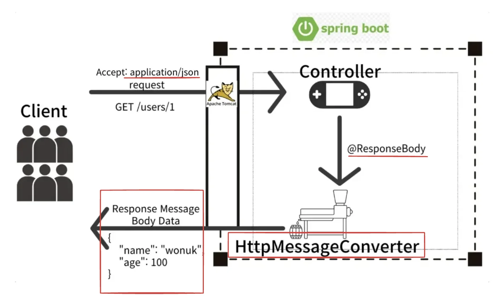

- HTTP 응답 메세지 Body에 데이터를 직접 입력 후 반환

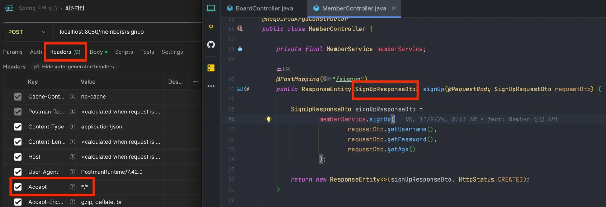

- 요청 Accept Header &#43; Controller 반환 타입

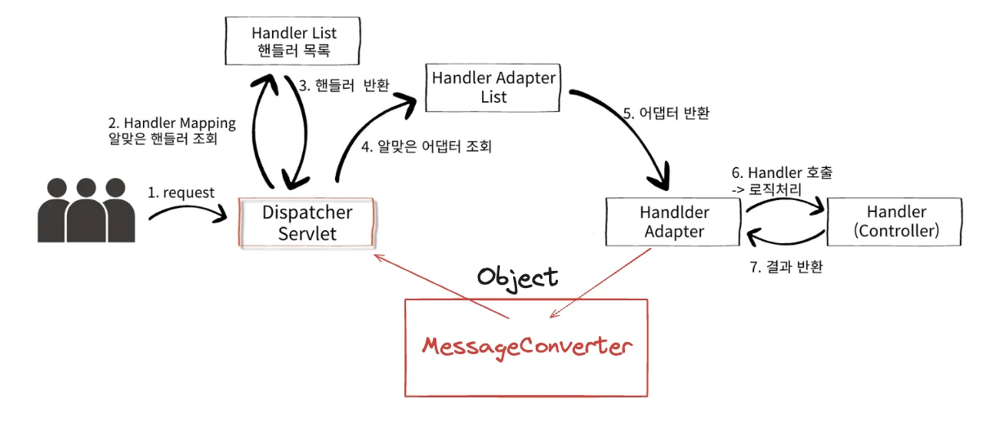

- ViewResolver가 아닌 HttpMessageConverter가 동작한다&#46;
    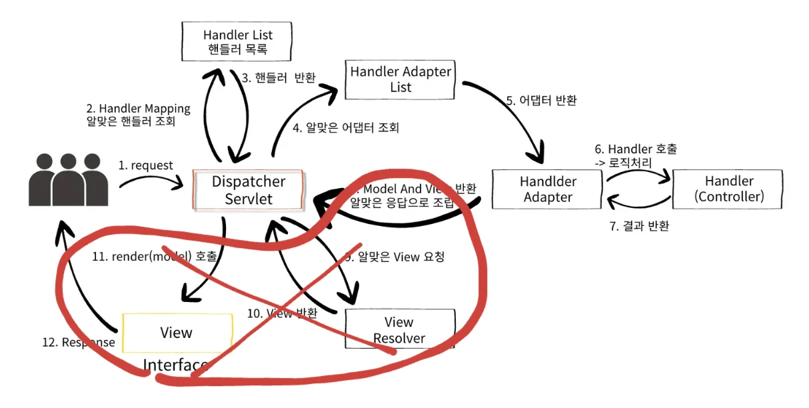

</details>

<details>
<summary>HttpMessageConverter가 적용되는 경우</summary>

> <code>&#64;RestController</code> = <code>&#64;Controller</code> &#43; <code>&#64;ResponseBody</code>

<details>
<summary>🧐 <code>ResponseEntity&#60;&#62;</code>, <code>RequestEntity</code>, <code>ResponseEntity</code>는 <code>HttpEntity</code> 상속받는 구현체이다&#46;</summary>

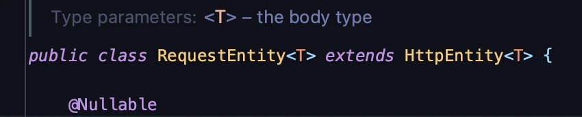

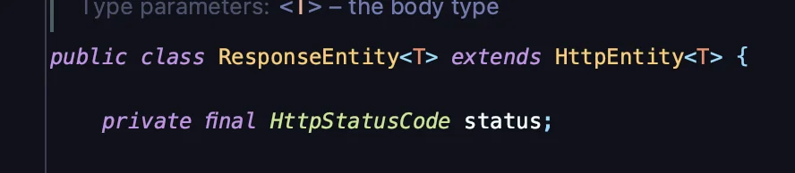

</details>

> ✏️ 
> 
> <a id="1f1eda9b0fe18010b2f0ea19c86948b7"></a>
> 
> <code>HttpMessageConverter</code>는 <u>요청과 응답 모두 사용</u>된다&#46;

- HTTP 요청&#58; <code>&#64;RequestBody</code>,  <code>HttpEntity&#60;&#62;</code>, <code>RequestEntity&#60;&#62;</code>

- HTTP 응답&#58; <code>&#64;ResponseBody</code>, <code>HttpEntity&#60;&#62;</code>, <code>ResponseEntity&#60;&#62;</code>


</details>

<details>
<summary><strong>HttpMessageConverter 내부구조</strong></summary>

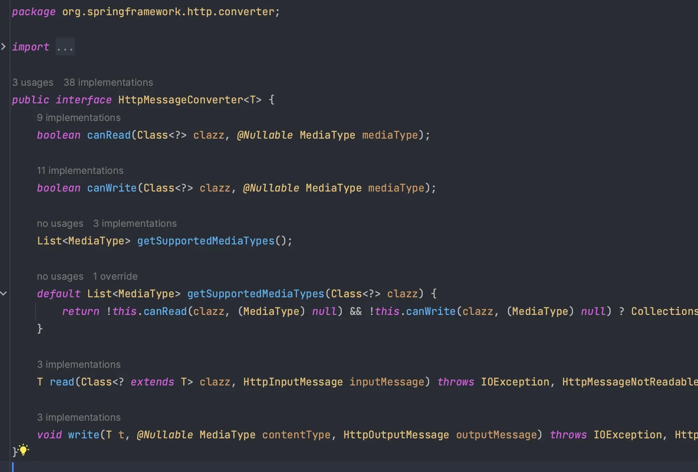

- <code>canRead()</code>, <code>canWrite()</code> 메서드로 Class, MediaType 지원여부를 확인
    <a id="14aeda9b0fe180deb914d4ef32ded491"></a>

    ```java
    boolean canRead(Class<?> clazz, @Nullable MediaType mediaType);
    boolean canWrite(Class<?> clazz, @Nullable MediaType mediaType);
    ```

- <code>read()</code>, <code>write()</code> 메서드로 HttpMessage 를 읽고 쓴다&#46;
    <a id="14aeda9b0fe1809097eadf6fdd4b449c"></a>

    ```java
    T read(
    				Class<? extends T> clazz, 
    				HttpInputMessage inputMessage
    ) throws IOException, HttpMessageNotReadableException;

    void write(
    						T t, 
    						@Nullable MediaType contentType, 
    						HttpOutputMessage outputMessage
    ) throws IOException, HttpMessageNotWritableException;
    ```

    - 양방향 Request ↔ Response 으로 동작한다&#46;

</details>

<a id="14aeda9b0fe1805d8f6be2e5a157df9f"></a>

## 우선순위

---

> 📖 
> 
> <a id="bfba0ceae2c3462e86171c38aa1bf8e8"></a>
> 
> Spring은 다양한 HttpMessageConverter를 제공하고 우선순위가 있다&#46;
> 
> <a id="14aeda9b0fe1804abe8cff19f0863f7e"></a>
> 
> 대상 Class 와 MediaType을 체크해서 어떤 Converter를 사용할지 결정한다&#46;

> ✏️ 
> 
> <a id="338eda9b0fe1805dabd0d1a234068377"></a>
> 
> <strong>대표적인 HttpMessageConverter</strong>
> 
> 1. 이진 데이터(<code>byte&#91;&#93;</code>) 
>     - <code>ByteArrayHttpMessageConverter</code> 
> 
> 1. String 
>     - <code>StringHttpMessageConverter</code>
> 
> 1. Json(Object, HashMap)
>     - <code>MappingJackson2HttpMessageConverter</code>

<details>
<summary><strong>대표적인 HttpMessageConverter</strong></summary>

<details>
<summary>1&#46; <code>ByteArrayHttpMessageConverter</code></summary>

- <code>byte&#91;&#93;</code> Data를처리한다&#46;

- 대상&#58; <code>byte&#91;&#93;</code>

- MediaType&#58; <code>&#42;/&#42;</code>

- 반환&#58; <code>application/octet&#45;stream</code>
    <details>
    <summary>🧐 <code>octet&#45;stream</code></summary>

    - <u>파일을 전송</u>할 때 사용하는 <u>MIME 타입(Content&#45;Type) </u>중 하나

    - <code>이진 데이터(binary data)</code>를 나타냄

    - MIME 타입은 전송하는 데이터의 형식을 명시적으로 알 수 없거나 특정 포맷이 정해져 있지 않을 때 주로 사용


    - 주요 특징
        - <strong>범용성</strong>
            - application/octet&#45;stream은 <u>모든 유형의 파일</u>(텍스트, 이미지, 오디오, 실행 파일 등)에 사용 가능하다&#46;

        - <strong>명확하지 않은 타입</strong>
            - <u>파일의 정확한 형식을 알 수 없</u>거나 <u>특정 타입으로 명시하기 어려울 때</u> 사용한다&#46;

        - <strong>다운로드 유도</strong>
            - <u>브라우저가 이 MIME 타입을 감지</u>하면 보통 데이터를 다운로드하도록 유도한다&#46;

    - 일반적인 사용 사례
        - <strong>파일 다운로드</strong>
            - <u>서버에서 파일을 사용자에게 전달</u>할 때, 브라우저가 자동으로 파일을 다운로드할 수 있도록 함

        - <strong>API에서 파일 전송</strong>
            - <u>REST API가 파일 데이터를 제공</u>할 때 데이터의 형식이 정해지지 않은 경우

        - <strong>데이터 스트리밍</strong>
            - 이진 데이터가 스트리밍될 때 사용<br>

    </details>

---

<details>
<summary>예시</summary>

<a id="14aeda9b0fe180c8ab47d5a4f1a19c99"></a>

```java
@Slf4j
@RestController // @Controller + @ResponseBody
public class MessageConverterController {

		// 요청 헤더 -> content-type: */*
		@PostMapping("/byte-array")
		// byte[] -> produces = "application/octext-stream"
		public byte[] byteArray(@RequestBody byte[] data) {
			log.info("byte-array logic");
			return data; // response
		}
		
}
```

</details>

</details>

<details>
<summary>2&#46; <code>StringHttpMessageConverter</code></summary>

- <code>String</code> Data를처리한다&#46;

- 대상&#58; <code>String</code>

- MediaType&#58; <code>&#42;/&#42;</code>

- 반환&#58; <code>text/plain</code>

---

<details>
<summary>예시</summary>

<a id="de0e66f9f3a2426491751c364e577430"></a>

```java
// 요청 헤더 -> content-type: text/plain
@PostMapping("/string")
// String -> produces = "text/plain"
public String string(@RequestBody String data) {
	log.info("string logic");
	return data;
}
```

</details>

</details>

<details>
<summary>3&#46; <code>MappingJackson2HttpMessageConverter</code></summary>

- <code>JSON</code> Data를처리한다&#46;

- 대상&#58; <code>Object</code>, <code>HashMap</code>

- MediaType&#58; <code>application/json</code>

- 반환&#58; <code>application/json</code>

---

<details>
<summary>예시</summary>

<a id="e345ef070a8a43dcbee62b9aacea2fd8"></a>

```java
// 요청 헤더 content-type: application/json
@PostMapping("/json")
// Data -> produces = "application/json"
public Data json(@RequestBody Data data) {
		log.info("json logic");
		return data;
}
```

</details>

</details>

<details>
<summary>4&#46; 기타</summary>

<a id="14aeda9b0fe18034ae1fdebbad21d77a"></a>

이외에도 기본적으로 제공되는 다양한 MessageConverter가 존재한다&#46; 

<a id="14aeda9b0fe180899559cbb9f6d45d9c"></a>

대부분의 경우 <u>위 세가지</u>로 해결이 가능하다&#46;

</details>

</details>

<a id="14aeda9b0fe180a7a51ad625228bfc65"></a>

## 동작 순서와 예시

---

> ✏️ 
> 
> <a id="f624039d240b436dad85ee97142caa6e"></a>
> 
> Controller에 produces 속성을 따로 설정하지 않으면 요청 헤더의 Accept가 Default 이다&#46;

<details>
<summary>요청 데이터 읽기</summary>

1. 요청 
    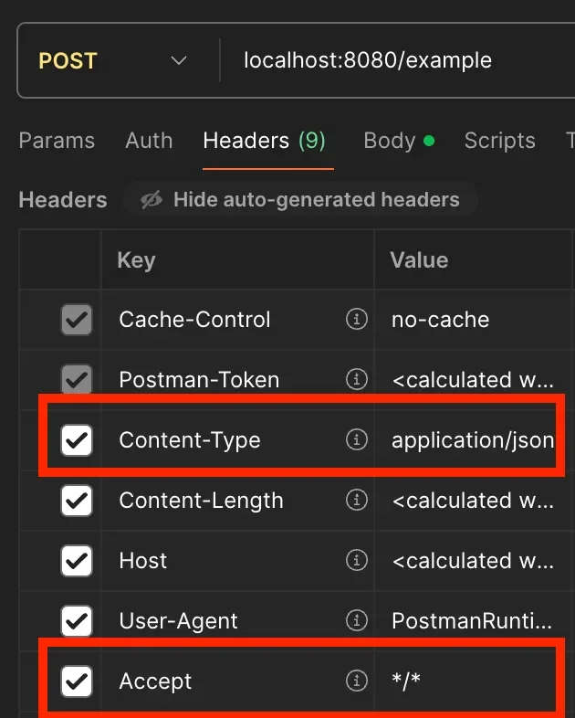

1. Controller에서 <code>&#64;RequestBody</code> 혹은 <code>HttpEntity&#60;&#62;</code>로 파라미터 바인딩한다&#46;
    <a id="14aeda9b0fe180309245c7bb783ef6cc"></a>

    ```java
    @RestController
    public class ExampleController {
    	// consumes
      @PostMapping(value = "/example", consumes = "application/json")
      public String example(@RequestBody RequestDto dto) {
          return dto;
      }
    }
    ```

1. <code>MessageConverter</code>는 <code>canRead()</code> 메서드로 읽기가능 여부를 조회한다&#46;
    <a id="14aeda9b0fe180109985c6eececc98b6"></a>

    ```java
    boolean canRead(Class<?> clazz, @Nullable MediaType mediaType);
    ```

    - 대상 클래스가<code>byte&#91;&#93;, String, Object</code> 인지 여부 확인

    - 요청 헤더의 <code>Content&#45;Type</code> Media Type 지원여부 확인(<code>consumes</code>)

1. <code>read()</code> 메서드를 호출하여 Object를 생성한다&#46;
    <a id="14aeda9b0fe18030a12eee8557d7fde6"></a>

    ```java
    T read(
    				Class<? extends T> clazz, 
    				HttpInputMessage inputMessage
    ) throws IOException, HttpMessageNotReadableException;
    ```

</details>

<details>
<summary>응답 데이터 쓰기</summary>

1. Controller에서 <code>&#64;ResponseBody</code> 혹은 <code>HttpEntity&#60;&#62;</code>로 응답이 반환된다&#46;
    <a id="14aeda9b0fe180199274f4b7623f2887"></a>

    ```java
    @RestController // @Controller + @ResponseBody
    public class ExampleController {
    	// produces
      @PostMapping(value = "/example", produces = "application/json")
      public ResponseDto example(@RequestBody RequestDto dto) {
    			ResponseDto responseDto = service.example(dto);
          return responseDto;
      }
    }
    ```

1. MessageConverter는 <code>canWrite()</code> 메서드로 사용가능 여부를 조회한다&#46;
    <a id="14aeda9b0fe180d695fdf151b3317c06"></a>

    ```java
    boolean canWrite(Class<?> clazz, @Nullable MediaType mediaType);
    ```

    1. 반환 클래스가 <code>byte&#91;&#93;, String, Object</code> 인지 여부 확인

    1. 요청 헤더 <code>Accept</code> 의 Media Type 지원여부 확인(<code>produces</code>)

1. <code>write()</code> 메서드를 호출하여 HTTP Response Message Body에 데이터를 입력한다
    <a id="14aeda9b0fe18066bfeaf8c1e88fcd03"></a>

    ```java
    void write(
    						T t, 
    						@Nullable MediaType contentType, 
    						HttpOutputMessage outputMessage
    ) throws IOException, HttpMessageNotWritableException;
    ```

</details>

<details>
<summary>실습</summary>

<details>
<summary>예시 1 ( 성공 )</summary>

<details>
<summary>🧐 왜 Json 요청인데, <u><code>Mappingjackson2</code></u><code>HttpMessageConverter</code>가동작되지 <u><code>String</code></u><code>HttpMessageConverter</code>가 동작하는가?</summary>

> ✏️ 
> 
> <a id="338eda9b0fe180a28017e203f2a5e4a8"></a>
> 
> <code>StringHttpMessageConverter</code>가 <code>Mappingjackson2HttpMessageConverter</code> 보다 우선순위가 더 높다 
> 
> <a id="338eda9b0fe1809ca75ed9510c1f2342"></a>
> 
> 따라서 String 타입 경우 <code>StringHttpMessageConverter</code>를 통해 convert 한다&#46;

- 강의에서는 MediaType &#58; <code>&#42;/&#42;</code>  이기 때문에 가능하다고 설명
    -   content&#45;type&#58;<code>applicatin/json</code> 으로 보낸 요청 데이터

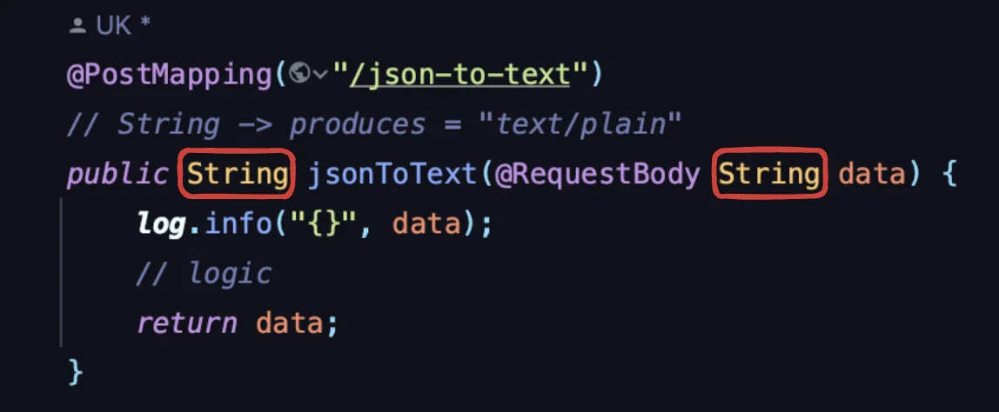

- 반환 타입이 String 이기 때문에, <code>text/plain</code>  MediaType 으로 반환된다&#46;

</details>

1. 요청 
    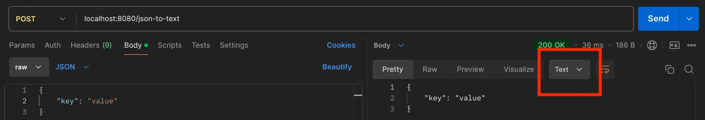

    - <code>content&#45;type</code>&#58; <code>application/json</code>

1. controller
    <a id="14aeda9b0fe180c6b2d8e749fa8b8b5d"></a>

    ```java
    @PostMapping("/json-to-text")
    // String -> produces = "text/plain"
    public String jsonToText(@RequestBody String data) {
    	// logic
    	return data;
    }
    ```

    1. <code>ByteArrayHttpMessageConverter</code> 의 <code>canRead()</code> 메서드 호출 &#58; false

    1. <code>StringHttpMessageConverter</code> 의 <code>canRead()</code> 메서드 호출 &#58; <strong><u>true</u></strong>
        - 대상 &#58; <code>String</code>

        - MediaType &#58; <code>&#42;/&#42;</code>

        - 반환 &#58; <code>text/plain</code>

</details>

<details>
<summary>예시 2 ( 성공 ) </summary>

1. 요청
    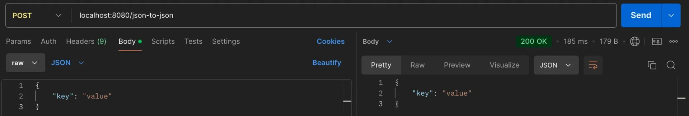

    - <code>content&#45;type</code> &#58; <code>applicatin/json</code>

    - <code>&#64;RequestBody</code> &#58; <code>Object</code>

1. controller
    <a id="14aeda9b0fe1804991a5d8084cdc28a0"></a>

    ```java
    @Data
    public class DataDto {
        private final String key;
    }

    @PostMapping("/json-to-json")
    // Object -> produces = "application/json"
    public DataDto jsonToJson(@RequestBody DataDto dto) {
    	// logic
    	return dto;
    }
    ```

    1. <code>ByteArrayHttpMessageConverter</code> 의 <code>canRead()</code> 메서드 호출 &#58; false

    1. <code>StringHttpMessageConverter</code> 의 <code>canRead()</code> 메서드 호출 &#58; false
        - 대상 &#58; <code>String</code>

        - MediaType &#58; <code>&#42;/&#42;</code>

        - 반환 &#58; <code>text/plain</code>

    1. <code>MappingJackson2HttpMessageConverter</code> 의 <code>canRead()</code> 메서드를 호출 &#58; <strong><u>true</u></strong>
        - 대상 &#58; <code>Object</code>, <code>HashMap</code>

        - MediaType &#58; <code>application/json</code>

        - 반환 &#58; <code>application/json</code>

</details>

<details>
<summary>예시3 ( 실패 ) </summary>

1. 요청
    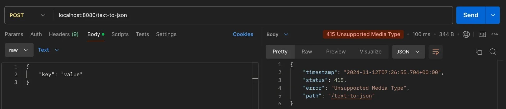

    - content&#45;type &#58; <code>text/plain</code>
        - Object 타입(<code>application/json</code>)이지만, <strong><u>text로 잘못된 content&#45;type 값을 할당</u></strong>했다 &#46;

        - 따라서 <code>415 Unsupported Media Type</code>  오류가 발생된다&#46; 

1. controller&#58; Request Body &#45; <code>Object</code>
    <a id="14aeda9b0fe180ed914be51f833904e9"></a>

    ```java
    // "{\"key\": \"value\"}"
    @PostMapping("/text-to-json")
    // Object -> produces = "application/json"
    public DataDto textToJson(@RequestBody DataDto dto) {
    	// logic
    	return dto;

    ```

    1. <code>ByteArrayHttpMessageConverter</code> 의 <code>canRead()</code> 메서드 호출 &#58; false

    1. <code>StringHttpMessageConverter</code> 의 <code>canRead()</code> 메서드 호출 &#58; false
        - 대상 &#58; <code>String</code>

        - MediaType &#58; <code>&#42;/&#42;</code>

        - 반환 &#58; <code>text/plain</code>

    1. <code>MappingJackson2HttpMessageConverter</code> 의 <code>canRead()</code> 메서드 호출 &#58; false
        - 대상 &#58; <code>Object</code>, <code>HashMap</code>

        - MediaType &#58; <code>application/json</code>

        - 반환 &#58; <code>application/json</code>

    - 모든 MessageConverter가 동작하지 못한다&#46;
        - 잘못된 Content&#45;Type 값이 할당되어 모든 convert에서 동작하지 못하고 415 오류가 발생된다&#46;

</details>

</details>
