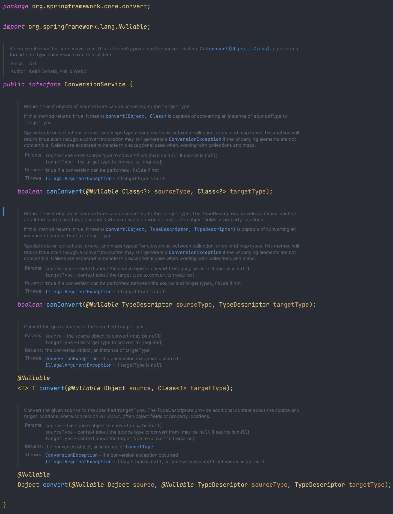
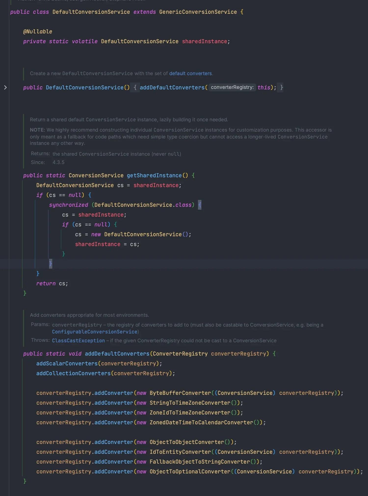
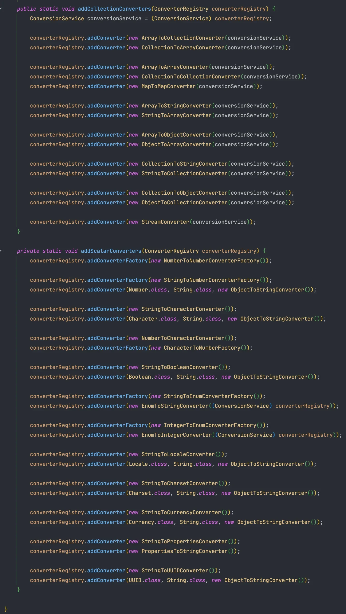
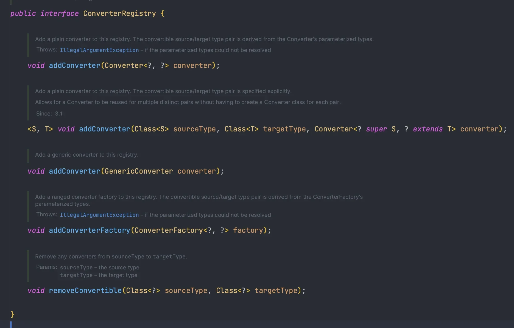
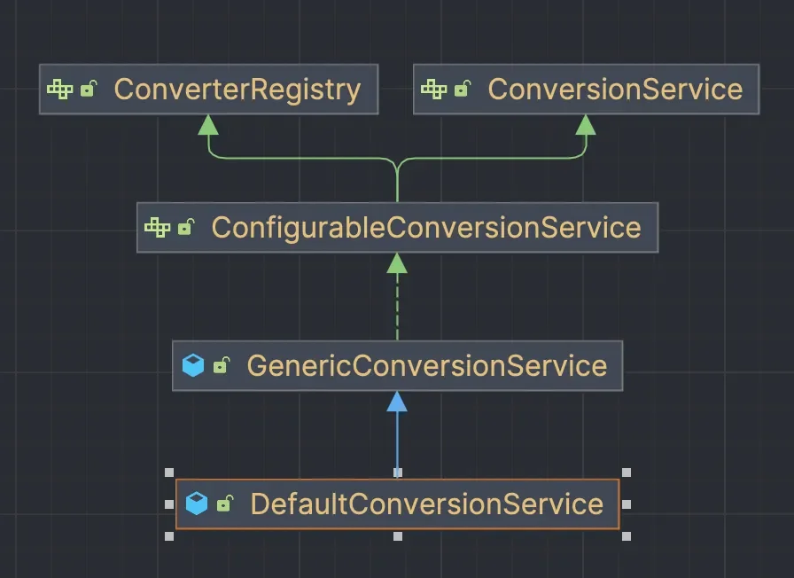

<a id="14aeda9b0fe1809ca387c7c4d09318ea"></a>

## ConversionService

---

> 📖 
> 
> <a id="1f2c684abda244759348c3d3f47e2782"></a>
> 
> Spring에서 <code>ConversionService</code> 제공하는 인터페이스
> 
> <a id="14aeda9b0fe180fb9aaed44fd3757cdf"></a>
> 
> <code>Converter</code>를<u> 모아서 편하게 관리</u>하고 사용 가능하게 함
> 
> - 구현체( <code>inplements</code> )는 아래 참조 

<details>
<summary>ConversionService 인터페이스</summary>

- <code>canConvert()</code>
    - Convert 가능 여부 확인 

- <code>convert()</code>
    - 실제 변환 가능



</details>

<a id="14aeda9b0fe180d991daf3aa7247abdf"></a>

## DefaultConversionService

---

> 📖 
> 
> <a id="ef9eb3cf83cf4d83b4e293fadbcd8487"></a>
> 
> Spring의 표준 <code>ConversionService</code>로 기본 제공 <code>Converter</code>와 확장 가능성을 통해 다양한 타입 변환을 유현하게 처리할 수 있도록 지원

<details>
<summary><strong>DefaultConversionService</strong></summary>

- ConversionService  구현체





- <code>ConvertRegistry</code>에 다양한 Converter를 등록한다&#46;

</details>

<details>
<summary><strong>ConverterRegistry</strong></summary>

- <code>Converter</code>를 등록하고 관리하는 기능을 제공
    

</details>

<details>
<summary>코드 에시 </summary>

<a id="14aeda9b0fe18091a136fd59ea3a0d98"></a>

```java
import static org.assertj.core.api.Assertions.*;

public class ConversionServiceTest {

    @Test
    void defaultConversionService() {
        // given
        DefaultConversionService dcs = new DefaultConversionService();
        dcs.addConverter(new StringToPersonConverter());
        Person wonuk = new Person("wonuk", 100);
        
				// when
        Person stringToPerson = dcs.convert("wonuk:1200", Person.class);
        
				// then
        assertThat(stringToPerson.getName()).isEqualTo(wonuk.getName());
        assertThat(stringToPerson.getAge()).isEqualTo(wonuk.getAge());
    }

}
```

<a id="14aeda9b0fe180828962e09fc7a44fa8"></a>

 

> 🧐 
> 
> <a id="debf28b27ea74be1aaf1939631ab3378"></a>
> 
> 컨버터를 사용할 때는 종류를 몰라도 된다&#46;
> 
> <a id="14aeda9b0fe180639684dcb5e1a50105"></a>
> 
> 컨버터는  ConversionService 내부에 숨겨진 채 제공된다&#46;
> 
> - 반환 타입, 파라미터 타입, 제네릭 등으로 ConversionService가 컨버터를 찾는다&#46; 
>     > Converter 종류 → <a href="#/post/14aeda9b-0fe1-80c3-b702-ca041ee56bd6">페이지</a> 
> 
> - 즉, 클라이언트는 ConversionService 인터페이스만 의존하면 된다&#46; 
>     - 컨버터 등록 과 사용을 분리 

</details>

<a id="14aeda9b0fe180c6abdef750eed61610"></a>

## ISP( 인터페이스 분리 원칙, Interface Segregation Principal )

---

> 📖 
> 
> <a id="a24aea3f095f44e09a9dc8b4bb59177d"></a>
> 
> <u>클라이언트</u>가 <u>자신이 사용하지 않는 메서드에 의존하지 않</u>도록 <u>인터페이스를 분리</u>하는 원칙 

<details>
<summary>인터페이스 분리 원칙 ( ISP )</summary>



<a id="14aeda9b0fe1804d9f2af7cc4e41cb31"></a>

ConverterRegistry ( 컨버터 등록 ), ConversionService ( 컨버터 사용 )

<a id="14aeda9b0fe18084ad5eedd7ec8bf3bd"></a>

← ConfigurableConversionSerice

<a id="14aeda9b0fe18092b7a3fe8db46e91e8"></a>

← GenericConversionService

<a id="14aeda9b0fe180dd9f56cf36f59bde03"></a>

←<u> DefaultConversionService</u>

- DefaultConvertionService
    1. <code>ConversionRegistry</code>&#58; 컨버터 등록

    1. <code>ConversionService</code>&#58;  컨버터 사용

<a id="14aeda9b0fe18032b3c6fd1432ece8ad"></a>

인터페이스를 분리하면 <u>컨버터를 사용하는 클라이언트</u>는 <u>필요한 메서드만 알면 된</u>다&#46; 

<a id="14aeda9b0fe18024b548ed96b470b26f"></a>

ConversionRegistry ( 등록된 컨버터 ) 가 변경되어도 ConversionService와 연관이 없다&#46; 

> ☝🏻 
> 
> <a id="00894e9123374bd1adecd35b4e1eb481"></a>
> 
> Spring은 내부적으로 ConversionService를 사용해 타입을 변환한다&#46; 대표적으로 <code>&#64;RequestParam</code>, <code>&#64;PathVariable</code>, <code>&#64;ModelAttribute</code> 등이 해당 기능을 사용한다&#46; 

</details>
