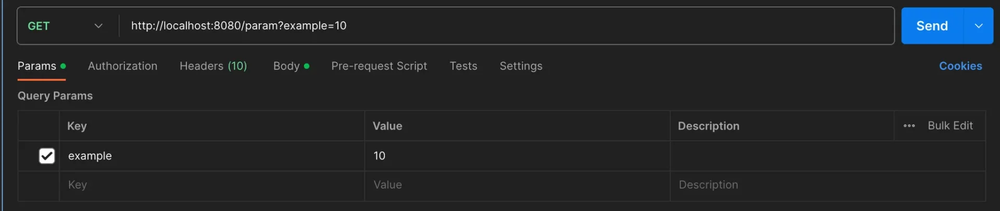
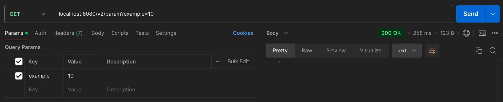
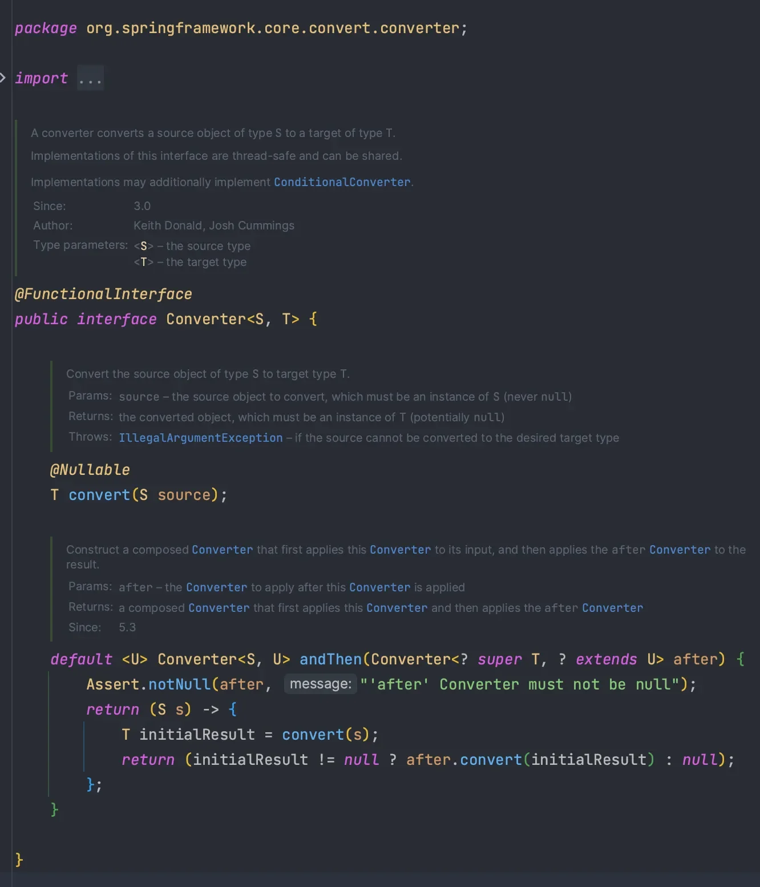

<a id="14aeda9b0fe1810ca22ee57776c783ab"></a>

##  타입 변환

---

> 📖 
> 
> <a id="14aeda9b0fe181458862c8569346ba83"></a>
> 
> Spring에서 객체의 타입을 서로 변환하는데 사용되는 인터페이스
> 
> <a id="14aeda9b0fe180b6ae6add2bc24a1b9d"></a>
> 
> Spring의 데이터 바인딩 과정에서 문자열을 특정 객체로 변환하거나 하나의 객체 타입을 다른 타입으로 변환할 때 사용된다&#46; 

> ☝🏻 
> 
> <a id="f857624fe088479cb488fd6d97342549"></a>
> 
> 문자를 숫자로, 숫자를 문자로 변환하는 등 Web Application을 만들다보면 Type을 변환해야 하는 경우가 많이 발생한다&#46;

<details>
<summary>문자열 → 숫자</summary>

<details>
<summary>HttpServletRequest</summary>

<a id="14aeda9b0fe1803fa3dad6472cbdae4f"></a>

```java
@Slf4j
@RestController
public class TypeConverterController {

    @GetMapping("/param")
    public void param(HttpServletRequest request) {

        // 조회시 : String
        String stringExample = request.getParameter("example");

        // Integer로 Type 변환
        Integer integerExample = Integer.valueOf(stringExample);
        log.info("integerExample = {}", integerExample);

    }


}
```



1. 요청 파라미터는 문자열로 처리된다&#46; 

1. 다른 타입으로 변환해서 사용하고 한다면 위와같이 검증 및 변환하는 과정이 필요하다&#46; 

</details>

<details>
<summary><code>&#64;RequestParam</code></summary>

<a id="14aeda9b0fe180ee9978c384ca80e860"></a>

```java
@GetMapping("/v2/param")
public void paramV2(@RequestParam Integer example) {
		// Integer 타입으로 바인딩
    log.info("example = {}", example);
}
```



- 추가적인 변환 작업을 거치지 않고 <code>Integer</code> 타입으로 바인딩된다&#46;

</details>

> ✏️ 
> 
> <a id="e41a892baf7943148b64dfda6d16c03a"></a>
> 
> 결론 
> 
> 1. <u>요청 파라미터로 전달</u>하는 <code>10 </code>값은 실제로 <u>문자열</u>이다&#46; 
> 
> 1. &#64;RequestParam 사용 시, 문자 10을 Interger 타입 숫자로 내부에서 변환해준다&#46; 
> 
> 1. <code>&#64;ModelAtrribute</code>, <code>&#64;PathVariable</code> 에서도 타입 변환을 확인할 수 있다&#46; 
>     - Spring 내부에서 <u>누군가가 타입을 자동으로 변환</u>한다&#46; 
> 
>     <a id="265866e23e674d18a644d1ace863f98b"></a>
> 
>     → 아래 내용 참조

</details>

<a id="14aeda9b0fe18071a742d022185c230e"></a>

## Converter Interface

---

> 📖 
> 
> <a id="70a91de05d8140bab01ed58431827526"></a>
> 
> Spring에서 특정 타입을 다른 타입으로 변환할 때 사용하는 인터페이스
> 
> <a id="14aeda9b0fe180cc83ede3e9a340d150"></a>
> 
> 타입 변환 로직을 캡슐화하여 코드의 재사용성을 높이고 다양한 곳에서 타입 변환이 일관되게 수행되도록 도움

<details>
<summary>새로운 타입 반환</summary>

- <code>localhost&#58;8080/type&#45;converter?person=wonuk&#58;120</code> 

- 입력받은 문자열 메이터를 <code>Person</code> 객체로 변환
    <a id="14aeda9b0fe18030ac4dcdc52d3db62a"></a>

    ```java
    public class Person {
    		private String name;
    		private String age;
    }		
    ```

    - <code>wonuk&#58;120</code> → <u>TypeConverter</u> → name&#58; <code>wonuk</code>, age&#58; <code>10</code>

</details>

<details>
<summary>Converter Interface</summary>

- Spring이 제공하는 인터페이스
    - inplements 하여 Converter로 등록한다&#46; 

    - Converter는 모든 타입(T)에 적용할 수 있다&#46; 

- 개발자가 새로운 Type을 만들어서 사용할 수 있도록 만든다&#46;
    - 변환하고자 하는 타입에 맞춰서 Type Converter를 구현하고 등록하면 된다&#46; 



</details>
