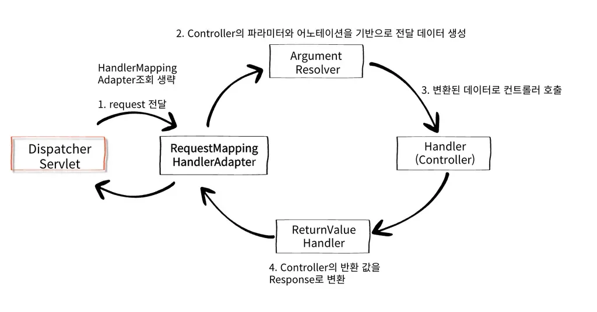
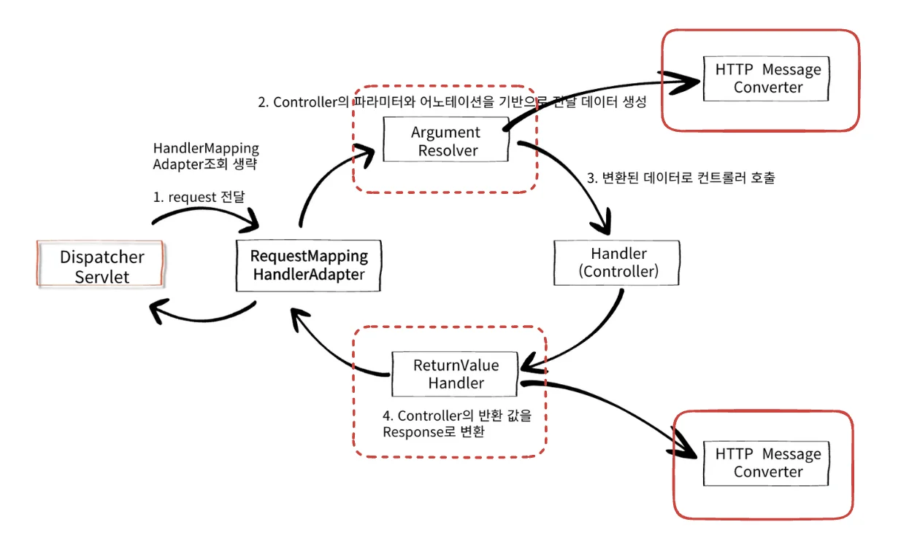
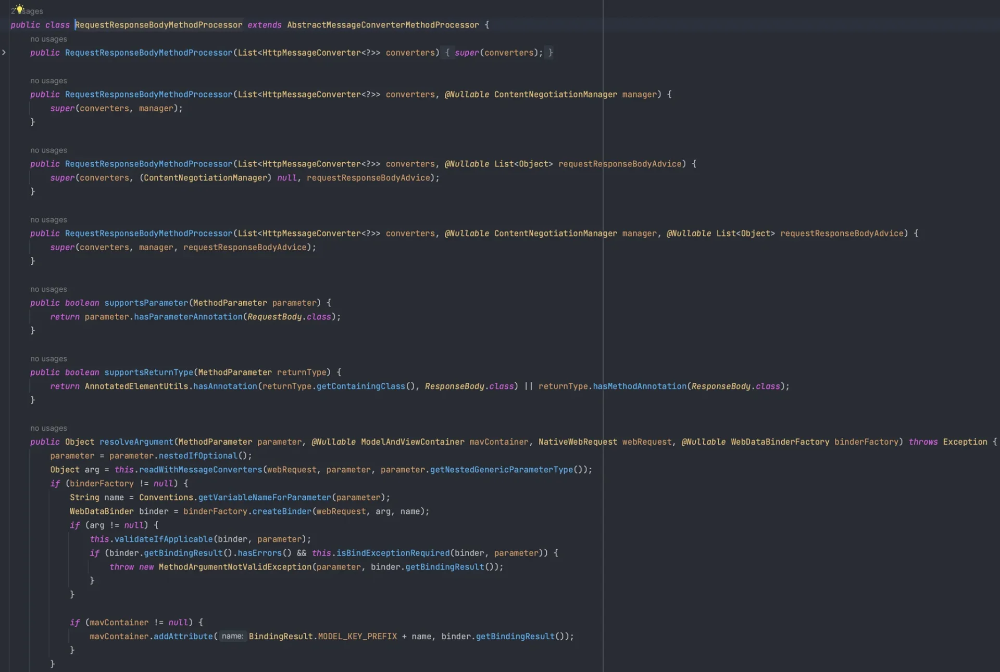
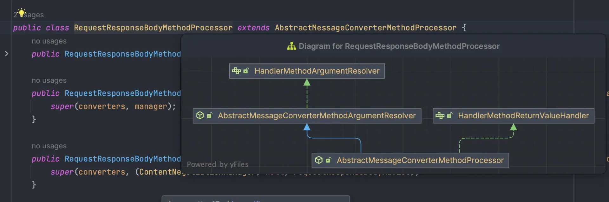
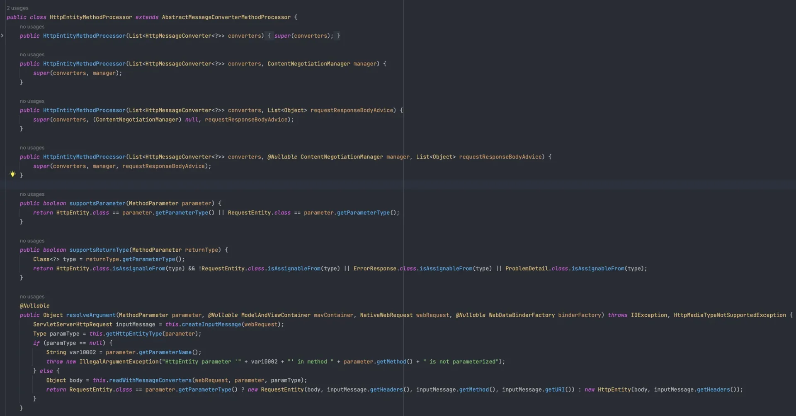
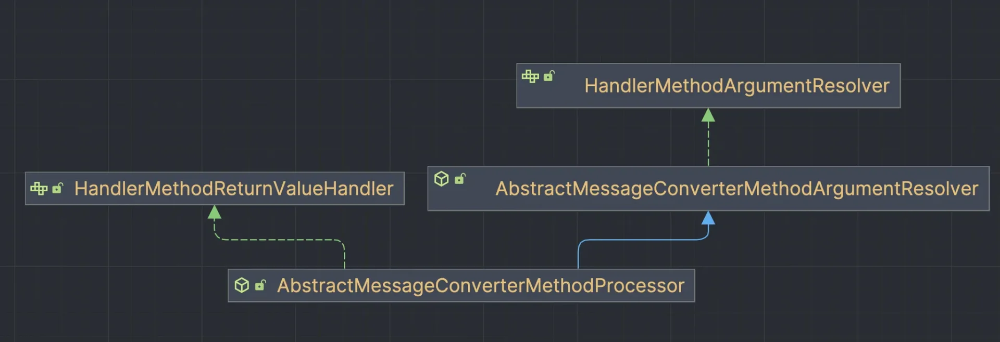
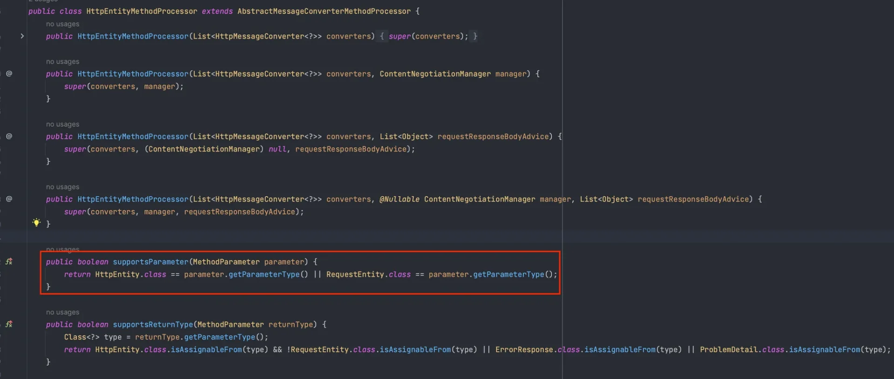
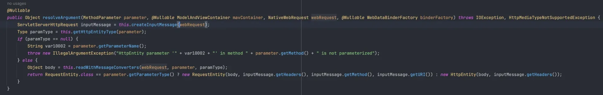
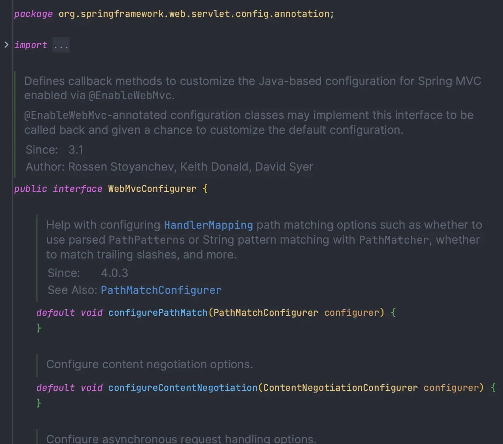
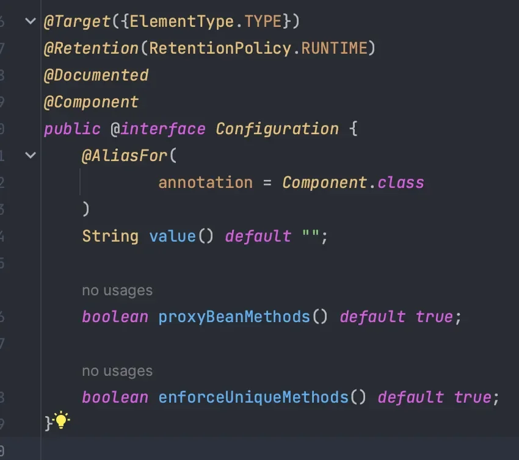

<a id="14aeda9b0fe1800daaccfa870abbb539"></a>

## HttpMessageConverter 구조

---

> 📖 
> 
> <a id="14aeda9b0fe18005b787d1a676a81034"></a>
> 
> <strong><code>HttpMessageConverter</code></strong>를 주로 사용하는 어노테이션 
> 
> - <strong><code>&#64;RequestBody</code></strong>
> 
> - <strong><code>&#64;ResponseBody</code></strong>

<details>
<summary>&#91;복습 &#93; HttpMessageConverter 는 어디에서 동작하는가?</summary>

- <strong>RequestMappingHandlerAdapter 구조</strong>
    

</details>

<details>
<summary>HttpMessageConverter를 사용하는 요청(ArgumentResolver), 응답(ReturnValueHandler)</summary>



<details>
<summary><strong>🧐 직렬화(Serialization), 역직렬화(Deserialization)</strong></summary>

> ✏️ 
> 
> <a id="338eda9b0fe180479710f9d72b272b2c"></a>
> 
> 객체는 메모리 안에서만 의미가 있다&#46; 즉, 외부로 보내려면 변환 필요하다&#46;
> 
> <a id="338eda9b0fe180779cfbd02311a18415"></a>
> 
> 쉽게 말해, <strong><u>객체를 다른 시스템에서도 이해할 수 있는 형태로 바꾸는 과정</u></strong>을 말한다
> 
> - <strong><code>직렬화</code></strong>&#58; 객체 → 문자열/바이트
> 
> - <strong><code>역직렬화</code></strong>&#58; 문자열/바이트 → 객체&#46; 

- 대표적인 예시 
    - REST API (JSON)

    - Redis / Kafka / DB 저장

    - 파일 저장 (로그, 스냅샷)

<a id="338eda9b0fe180aea724fb16eca8a1f8"></a>

### 직렬화

<a id="338eda9b0fe180fb8adec8f6492456af"></a>

```java
[객체] → (직렬화) → [JSON / XML / 바이너리] → 전송 or 저장
```

<details>
<summary>직렬화 예시 </summary>

1. Java 객체
    <a id="338eda9b0fe18035a3a7e7b711ee3599"></a>

    ```java
    class User {
        String name;
        int age;
    }
    ```

- JSON으로 직렬화
    <a id="338eda9b0fe180cda919ffdb1aa026f6"></a>

    ```java
    {
      "name": "Lee",
      "age": 30
    }
    ```

</details>

<a id="338eda9b0fe1802e96f9f1e0328a1665"></a>

### 역직렬화

<a id="338eda9b0fe180fa9e85ffa10e9eb8a1"></a>

```java
[JSON / 바이너리] → (역직렬화) → [객체]
```

<details>
<summary>역직렬화 예시</summary>

<a id="338eda9b0fe18063a819f4703156a6f2"></a>

```java
String json = "{\"name\":\"Lee\",\"age\":30}";

User user = mapper.readValue(json, User.class);
System.out.println(user.getName());
```

</details>

</details>

> ✏️ 
> 
> - <strong>요청&#58;</strong> <code>ArgumentResolver</code>가 사용
>     - 역직렬화 
> 
> - <strong>응답&#58;</strong> <code>ReturnValueHandler</code>가 사용
>     - 직렬화

- 사용 예시 &#45; 요청, 응답
    <details>
    <summary><strong>전체 흐름 (Spring MVC)</strong></summary>

    <a id="338eda9b0fe180cab390c027a19def78"></a>

    ```java
    [클라이언트 JSON 요청]
           ↓
    ArgumentResolver
           ↓
    HttpMessageConverter (역직렬화)
           ↓
    Controller (@RequestBody)
           ↓
    비즈니스 로직
           ↓
    Controller 반환 객체
           ↓
    ReturnValueHandler
           ↓
    HttpMessageConverter (직렬화)
           ↓
    [JSON 응답]
    ```

    </details>

    - HTTP 요청
        - 를 처리하는 <code>ArgumentResolver</code> 가 <code>&#64;RequestBody</code>, <code>HttpEntity</code> 를 처리한다&#46; 

        - 다양한 <code>ArgumentResolver</code>들이 <strong><u>HttpMessageConverter를 호출</u></strong>하여 필요한 Object를 반환핟다
            - 역직렬화&#58; JSON → Object

    - HTTP 응답
        - <code>ReturnValueHandler</code>가 <code>&#64;ResponseBody</code>, <code>HttpEntity</code>를 처리한다&#46; 

        - 다양한 <code>ReturnValueHandler</code>들이 <strong><u>HttpMessageConverter를 호출</u></strong>하여 필요한 응답을 입력한다&#46; 
            - 직렬화&#58; Object → JSON

</details>

<details>
<summary>대표적인 ArgumentResolver, ReturnValueHandler</summary>

1. <code>RequestResponseBodyMethodProcessor</code>
    

    - <code>&#64;RequestBody</code>, <code>&#64;ResponseBody</code>

    - 클래스 다이어그램
        

        - <code>HandlerMethodArgumentResolver</code> 상속

        - <code>HandlerMethodReturnValueHandler</code> 상속
            - <code>HttpEntity&#60;&#62;</code>를 상속받는 <code>RequestEntity&#60;&#62;</code>, <code>ResponseEntity&#60;&#62;</code> 모두 처리

1. <code>HttpEntityMethodProcessor</code>
    - <code>HttpEntity&#60;&#62;</code> 
        

    - 클래스 다이어그램
        

        - <code>HandlerMethodArgumentResolver</code> 상속

        - <code>HandlerMethodReturnValueHandler</code> 상속 
            - <code>HttpEntity&#60;&#62;</code> 를 상속받은 <code>RequestEntity&#60;&#62;</code>, <code>ResponseEntity&#60;&#62;</code> 모두 처리

    - <code>HttpEntityMethodProcessor&#46;supportParameter()</code>
        

        - <code>HttpEntity&#60;&#62;</code> 혹은 <code>HttpEntity</code>를 상속받은 객체 여부 확인

    - <code>HttpEntityMethodProcessor&#46;resolveArgument()</code>
        

        - 실제 Object로 만들어주는 메서드

        - <code>readWithMessageConverters(webRequest, parameter, paramType);</code>

        - 위 코드를 실행하여 코드 내부에서 <code>MessageConverter</code> 호출하여 값을 처리한다&#46;

</details>

<a id="14aeda9b0fe180079a1bc8e897e82873"></a>

## WebMvcConfigurer

---

> 📖 
> 
> <a id="f1a386a0b7bf48ecb3edf64077ad0c6c"></a>
> 
> Spring MVC의 <u>설정을 사용자 정의</u>할 수 있도록 제공되는 <u>인터페이스</u>
> 
> <a id="14aeda9b0fe180fbabefd470bb3d706c"></a>
> 
> <code>implements</code>하여 <u>설정을 확장하거나 커스터마이징</u>하여 사용

<details>
<summary>주요 인터페이스</summary>

1. HandlerMethodArgumentResolver

1. HandlerMethodReturnValueHandler

1. HttpMessageConverter

- 모두 인터페이스로 구현되어 있으며 대부분 구현되어 있다&#46; 
    - Spring 에서 기본적으로 제공하고 있다&#46; 
        <a id="14aeda9b0fe180a2a190dd1c2bdfce52"></a>

        ( 개발자는 잘 사용하면 됨 )

</details>

<details>
<summary><strong>WebMvcConfigurer</strong></summary>



- 기능확장
    <details>
    <summary>WebMvcConfigurer를 상속받고 Spring Bean으로 등록</summary>

    <a id="14aeda9b0fe180f28047dc07b2e3e7c6"></a>

    ```java
    public interface WebMvcConfigurer {
        default void configurePathMatch(PathMatchConfigurer configurer) {
        }

        default void configureContentNegotiation(ContentNegotiationConfigurer configurer) {
        }

        default void configureAsyncSupport(AsyncSupportConfigurer configurer) {
        }

        default void configureDefaultServletHandling(DefaultServletHandlerConfigurer configurer) {
        }

        default void addFormatters(FormatterRegistry registry) {
        }

        default void addInterceptors(InterceptorRegistry registry) {
        }

        default void addResourceHandlers(ResourceHandlerRegistry registry) {
        }

        default void addCorsMappings(CorsRegistry registry) {
        }

        default void addViewControllers(ViewControllerRegistry registry) {
        }

        default void configureViewResolvers(ViewResolverRegistry registry) {
        }

        default void addArgumentResolvers(List<HandlerMethodArgumentResolver> resolvers) {
        }

        default void addReturnValueHandlers(List<HandlerMethodReturnValueHandler> handlers) {
        }

        default void configureMessageConverters(List<HttpMessageConverter<?>> converters) {
        }

        default void extendMessageConverters(List<HttpMessageConverter<?>> converters) {
        }

        default void configureHandlerExceptionResolvers(List<HandlerExceptionResolver> resolvers) {
        }

        default void extendHandlerExceptionResolvers(List<HandlerExceptionResolver> resolvers) {
        }

        @Nullable
        default Validator getValidator() {
            return null;
        }

        @Nullable
        default MessageCodesResolver getMessageCodesResolver() {
            return null;
        }
    }
    ```

    - <code>addArgumentResolvers()</code>

    - <code>addReturenValueHandlers()</code>

    - <code>extendMessageConverters()</code>

    </details>

</details>

<details>
<summary><code>&#64;Configuration</code></summary>



- <code>&#64;Component</code>  를 포함하고 있다 
    <a id="338eda9b0fe180b49a8bc01843b3ea73"></a>

    즉, 컴포넌트 스캔을 통해 자동으로 Spring Bean으로 등록된다&#46;

</details>
