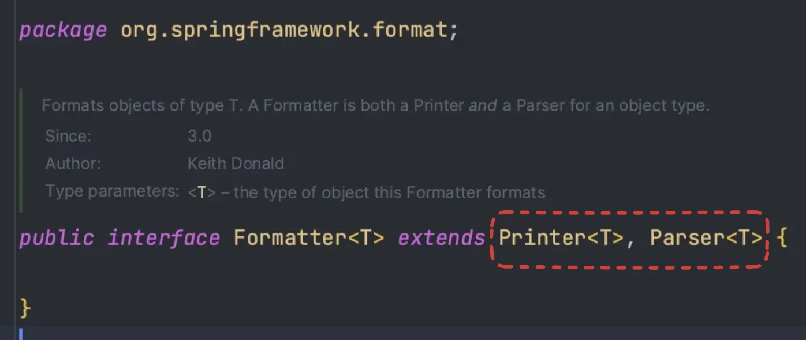
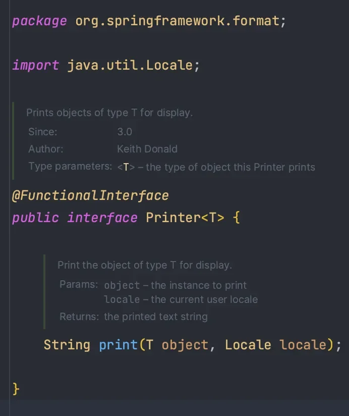
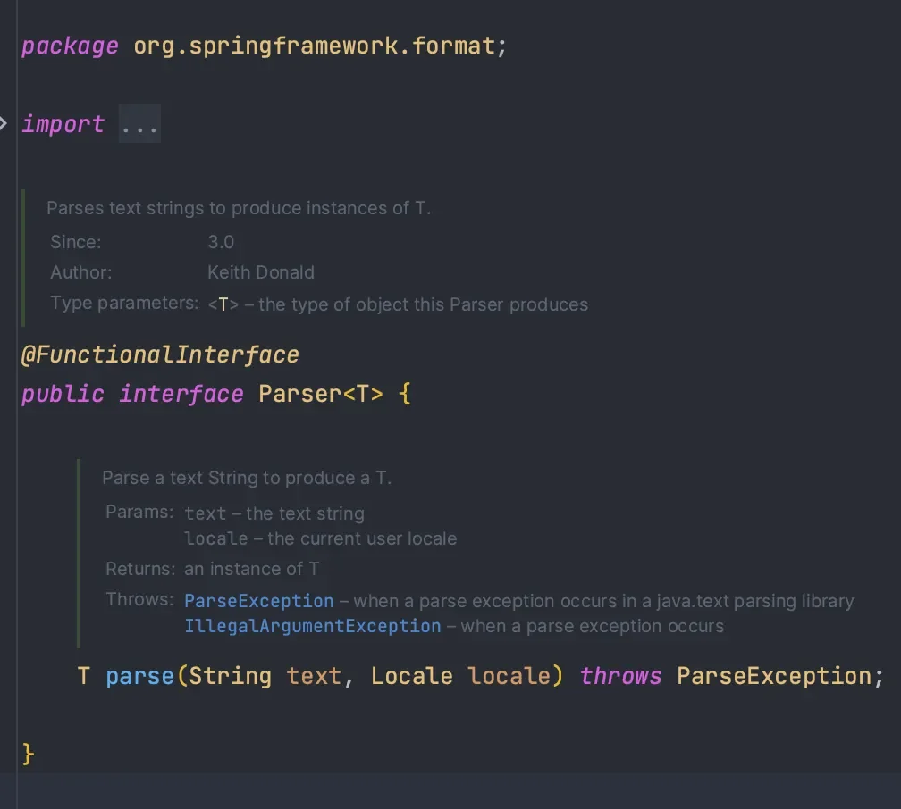
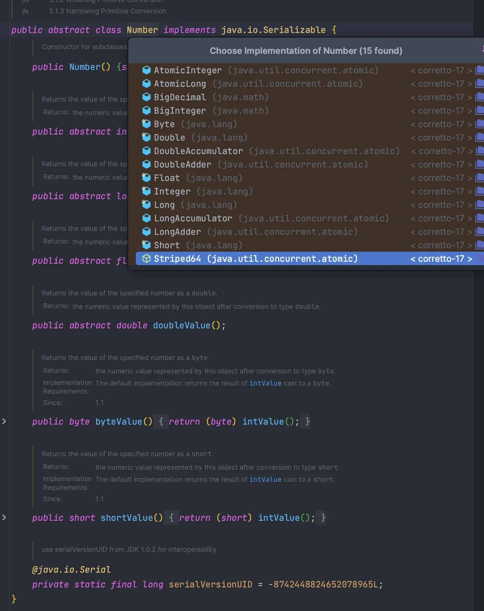
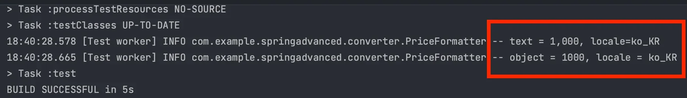

<a id="14aeda9b0fe1818d8dc7f73967fb90d5"></a>

## Formatter

---

> 📖 
> 
> <a id="14aeda9b0fe181019701f4567ea2fb4a"></a>
> 
> 주로 <u>사용자 지정</u><u> 포맷</u><u>을 적용</u>해 <u>데이터 변환을 처리</u>할 때 사용
> 
> <a id="14aeda9b0fe180a88d81c820680be291"></a>
> 
> <code>Formatter</code>는 ConversionService 와 비슷한 목적을 가지지만, 
> 
> <a id="14aeda9b0fe180268d0ef4d43eb16404"></a>
> 
> &#91; 문자열 ↔ 객체 &#93;  변환하는 과정에서  <u>포맷팅을 사용</u>하여 세밀한 제어가 가능함

> ✏️ 
> 
> <a id="e81a95ca4b6544da8d78482873bb9c65"></a>
> 
> 객체를 특정한 포맷에 맞춰 문자로 출력하는 기능에 특화된 것이 <code>Fomatter</code>이다&#46;
> 
> - <code>Converter</code> 보다 조금 더 세부적인 기능이라고 생각하면 된다&#46; 

<details>
<summary>공식 문서 </summary>

[Spring Field Formatting &#58;&#58; Spring Framework]()

</details>

<details>
<summary>Locale</summary>

> ✏️ 
> 
> <a id="e230cfe16d394a7c9caabf45636ae4e5"></a>
> 
> 특정 지역 및 언어에 대한 정보를 제공하여 국제화 및 지역화 기능 지원함
> 
> - 국제화
>     - <u>Locale 정보</u>에 따라서 <code>한글</code>, <code>영문</code> 언어 선택 가능

- 지역 및 언어 정보를 나타내는 객체
    - 언어코드 <code>en</code>, <code>ko</code>

    - 국가코드 <code>US</code>, <code>KR</code>

</details>

<details>
<summary>Formatter Interface</summary>



- Pinter, Parser 상속
    - 객체 ↔ 문자 변환 가능
        <details>
        <summary>Printer<code>&#46;print()</code>&#58;  Object → String, locale(국제화)</summary>

        

        </details>

        <details>
        <summary>Parser<code>&#46;parse()</code>&#58;  String → Object,  locale(국제화)</summary>

        

        </details>

</details>

<a id="14aeda9b0fe180e7943ade2596a7e0e6"></a>

## Formatter 적용

---

> 📖 
> 
> <a id="07d16379afb5469d99d9801b64b8deef"></a>
> 
> Fomatter 실습 ( 숫자, 국제화(KR )  및 테스트

<details>
<summary>예시 &#45; 숫자(<code>10000</code>)를 금액 형태(<code>10,000</code>)로 변환하는 <code>Formatter</code> </summary>

<details>
<summary>&#91; 코드 &#93;</summary>

<details>
<summary>Number</summary>

- <code>Integer</code>, <code>Long</code>, <code>Double</code> 등의 부모 클래스 
    

</details>

<a id="14aeda9b0fe1806487f8cc23d9538aa8"></a>

```java
@Slf4j
public class PriceFormatter implements Formatter<Number> {
	
		@Override
	  public Number parse(String text, Locale locale) throws ParseException {
	    log.info("text = {}, locale={}", text, locale);
			
			// 변환 로직
			// NumberFormat이 제공하는 기능
			NumberFormat format = NumberFormat.getInstance(locale);
			// "10,000" -> 10000L
			return format.parse(text);
	  }
	
	  @Override
	  public String print(Number object, Locale locale) {
				log.info("object = {}, locale = {}", object, locale);
				// 10000L -> "10,000"
	      return NumberFormat.getInstance(locale).format(object);
	  }
}
```

</details>

<details>
<summary>테스트 </summary>

<a id="14aeda9b0fe180ac8342dfae8cb8d8d0"></a>

```java
class PriceFormatterTest {

		PriceFormatter formatter = new PriceFormatter();

    @Test
    void parse() throws ParseException {
        // given, when
        Number result = formatter.parse("1,000", Locale.KOREA);

        // then
        // parse 결과는 Long
        Assertions.assertThat(result).isEqualTo(1000L);
    }

    @Test
    void print() {
        // given, when
        String result = formatter.print(1000, Locale.KOREA);

        // then
        Assertions.assertThat(result).isEqualTo("1,000");
    }
}
```

- 실행 결과 
    

</details>

</details>
