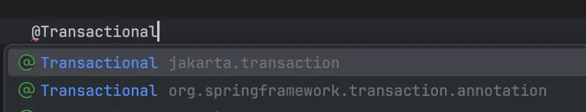
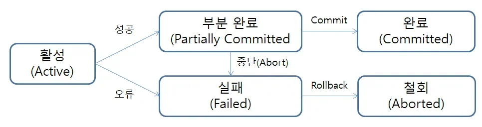
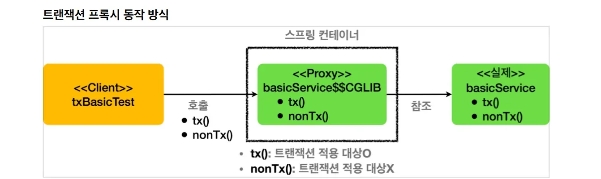

> 📌 
> 
> - 특강 (스탠다드 반)&#58;  트랜잭션
> 
> - 기간&#58; 24&#46;11&#46;26
> 
> <details>
> <summary>reference</summary>
> 
> <a id="14aeda9b0fe18054bd81d820aa295b29"></a>
> 
> ‣<br><a href="https://beautiful-college-c84.notion.site/f5c54a7125d24501907a5e18ec2b6d91">페이지</a> 
> 
> </details>

> 
> 
> <a id="2f1eda9b0fe180fda1c1dac51b928be7"></a>
> 
> <strong>목차</strong>
> 
> - [트랜잭션](#14aeda9b0fe180eeacead1cbf8d79deb)
> - [ACID](#14aeda9b0fe18034bfe6f78cd6e4b819)
> - [전파 속성 ( Propagation )](#14aeda9b0fe1809c85a8c5d63298fe4f)
> - [격리 수준 ( Isolation )](#14aeda9b0fe1809e97f1e7508702d643)
> - [문제 상황에 따른 정리](#2f1eda9b0fe180579c8bca84f8d8addb)
> - [예제 코드](#14aeda9b0fe18073b354f03ecfeecb48)
> - [스프링 트랜잭션 어노테이션](#14aeda9b0fe180fca004f8ce1fff405b)
> - [스프링의 @Transactional 옵션](#2f2eda9b0fe1804793b3d28766ff9400)
> - [트랜잭션 상태](#2f2eda9b0fe18089afccdfc2ba09bb3e)
> - [스프링 롤백](#2f2eda9b0fe18095b9c7d9b67bfd2dfc)
> - [스프링의 롤백 기본 동작](#2f2eda9b0fe18026b587ddfd9e8fdcce)
> - [예제 - 트랜잭션 내부 호출 문제](#14aeda9b0fe18027a951d30a27a42c33)
> - [질문](#14aeda9b0fe180fea1a6df93d4cd74fc)
> - [의문점 질문](#2f2eda9b0fe1800a8965f8e3b06f7c98)
> - [생각 해볼만한 내용](#14aeda9b0fe180298d7cdc726c1c4617)

> ✅ 
> 
> <a id="2f2eda9b0fe180b0a931d5c5b3550dc2"></a>
> 
> <strong>학습 목표</strong>
> 
> - 트랜잭션이란 무엇인지 알아본다&#46;
> 
> - 트랜잭션의 상태를 알아본다&#46;
> 
> - 트랜잭션 전파를 알아본다&#46;
> 
> - 트랜잭션을 제대로 쓰는 것은 복잡하고 어렵다는 것을 깨닫는다&#46;

<a id="14aeda9b0fe180eeacead1cbf8d79deb"></a>

## 트랜잭션

---

> ✏️ 
> 
> <a id="2f1eda9b0fe1802f9c11ddbecb1adb13"></a>
> 
> 트랜잭션을 <strong><u>특정 작업의 흐름에 대한 데이터를 보장</u></strong>하기 위한 제어 방법론이다&#46; <br>이는 데이터의 무결성을 지키기 위함이다&#46; 
> 
> - ex) 
>     - 사용자 물건 구매 → 결제 → <strong>&#91;오류&#93; 재고 없음</strong> → 롤백&#58; 결제 취소 

<a id="14aeda9b0fe1802d8afcf132f3816c35"></a>

Trans &#43; Action 의 합성어

<a id="14aeda9b0fe1804fb25de0dda584b446"></a>

교환을 하는 행동을 말하는 것으로 물물교환을 의미한다&#46;

<a id="14aeda9b0fe1802ca27ef442b145d7ba"></a>

이미 15세기 때부터 프랜잭셔이란 개념은 존재했다&#46; 1960년대 초 IBM은 컴퓨터 업계에서 트랜잭션이라는 개념을 정리하고 발전 시켰다&#46;

<a id="14aeda9b0fe18059b52dc665c99cd164"></a>

지금의 DB와 프로그래밍 언어에 쓰이는 트랜잭션도 그 뿌리는 IBM이 정립한 트랜잭션의 개념에 두고 있다&#46;

<a id="14aeda9b0fe18034bfe6f78cd6e4b819"></a>

## ACID

---

> ✏️ 
> 
> <a id="2f1eda9b0fe18063bd76c8c5f2247614"></a>
> 
> <strong><code>ACID</code></strong>는 <u>데이터베이스 트랜잭션이 지켜야 할 </u><strong><u>신뢰성 보장 규약</u></strong>을 말한다&#46;<strong> </strong>
> 
> <a id="2f1eda9b0fe1804eb1e2de527017934b"></a>
> 
> 즉, 하나의 트랜잭션이 발생했을 때 안정성을 보장하기 위해 고려해야할 4가지 요소이다&#46;
> 
> - <code>원자성</code>(Atomicity)&#58; 모든 작업이 성공하거나 아무 작업도 일어나지 않는다&#46;  
> 
> - <code>일관성</code>(Consistency)&#58; 하나의 트랜잭션이 끝난 뒤, 모든 상태는 이전과 같이 유효하다&#46;
> 
> - <code>격리성</code>(Isolation)&#58; 모든 트랜잭션은 다른 트랜잭션으로부터 독립적이다&#46;
> 
> - <code>지속성</code>(Durability)&#58; 하나의 트랜잭션이 완료되었다면 영구적으로 저장된다&#46; 

<a id="14aeda9b0fe180a7933dfd2457091fbb"></a>

이 개념은 1970년대 말, 짐 그레이(Jim Gray)가 신뢰할 수 있는 트랜잭션 시스템의 이러한 특성을 정의했고, 자동으로 이들을 수행하는 기술을 개발했다&#46;

- IT 노벨상 &#45; 튜링상 수상, 짐 그레이(Jim Gray)
    - 앨런 튜링 &#45; 현대의 컴퓨터 시스템을 만들었음

<a id="14aeda9b0fe1809c85a8c5d63298fe4f"></a>

## 전파 속성 ( Propagation )

---

> ✏️ 
> 
> <a id="2f1eda9b0fe180a39ac0e6fa3adf9bd3"></a>
> 
> 트랜잭션에서 전파 속성은 하나의 트랜잭션이 시작된 상태에서, 또 다른 트랜잭션이 시작되었을 때 이를 어떻게 처리할 지를 정의하는 것이다&#46;
> 
> - 기존 트랜잭션 유무를 고려해야 한다&#46;

| <strong>종류</strong> | <strong>기존 트랜잭션 X</strong> | <strong>기존 트랜잭션 O</strong> | 적용 사례 |
| --- | --- | --- | --- |
| <strong><code>REQUIRED</code></strong> | 새 트랜잭션 생성 | 기존 트랜잭션에 참여 | 기본값&#46; 대부분의 비지니스 로직 |
| <strong><code>REQUIRES&#95;NEW</code></strong> | 새 트랜잭션 생성 | 기존 트랜잭션 일시중단, <br>새로운 트랜잭션 생성 | 독립적인 작업 처리 |
| <strong><code>SUPPORTS</code></strong> | 트랜잭션 없이 진행 | 기존 트랜잭션 참여 | 트랜잭션이 필수가 아닌 작업 |
| <strong><code>NOT&#95;SUPPORTED</code></strong> | 트랜잭션 없이 진행 | 기존 트랜잭션 일시중단, <br>트랜잭션 없이 진행 | 로그 저장 등 트랜잭션과 독집적인 작업 |
| <strong><code>MANDATORY</code></strong> | <code>IllegalTransactionStateException</code> 발생 | 기존 트랜잭션 참여 | 트랜잭션 내부에서만 호출 가능한 메소드 |
| <strong><code>NEVER</code></strong> | 트랜잭션 없이 진행 | <code>IllegalTransactionStateException</code> 발생 | 외부 시스템 호출시 |
| <strong><code>NESTED</code></strong> | 새 트랜잭션 생성 | 중첩 트랜잭션 생성 | 부분적으로 롤백 가능한 작업 |

<a id="14aeda9b0fe1809e97f1e7508702d643"></a>

## 격리 수준 ( Isolation )

---

> ✏️ 
> 
> <a id="2f1eda9b0fe18079adb4da196194e357"></a>
> 
> <code>트랜잭션 격리 수준</code>은 <strong><u>여러 트랜잭션이 동시 발생</u></strong>할 때, <strong><u>어떻게 데이터 일관성을 보장</u></strong>할지를 정의한다&#46;

> ☝🏻 
> 
> <a id="2f1eda9b0fe180519cd5e73bc7b87302"></a>
> 
> 격리 수준과 성능(시간)은 반비례 관계를 가진다&#46; <br>즉,격리 수준이 높은 엄격한 동작일 수록 처리 속도가 느리다&#46;

| <strong>Isolation Level</strong> | <strong>설명</strong> | <strong>방지되는 문제</strong> | <strong>적용 사례</strong> |
| --- | --- | --- | --- |
| <strong><code>READ&#95;UNCOMMITTED</code></strong> | 커밋되지 않은 데이터도 읽을 수 있음 | 없음 | 데이터 정확성보다 성능이 중요한 경우 |
| <strong><code>READ&#95;COMMITTED</code></strong> | 커밋된 데이터만 읽을 수 있음 | <code>Dirty Read</code> | 대부분의 애플리케이션 기본 설정 |
| <strong><code>REPEATABLE&#95;READ</code></strong> | 같은 트랜잭션 내에서 읽은 데이터가 변경되지 않음 | <code>Dirty Read</code>, <br><code>Non&#45;repeatable Read</code> | 은행 계좌 조회와 같은 데이터 무결성 요구 |
| <strong><code>SERIALIZABLE</code></strong> | 트랜잭션이 순차적으로 실행, 가장 엄격한 격리 수준 | <code>Dirty Read</code>, <br><code>Non&#45;repeatable Read</code>, <br><code>Phantom Read</code> | 금융 시스템의 이체 작업 등 높은 신뢰성이 필요한 경우 |

<a id="2f1eda9b0fe180579c8bca84f8d8addb"></a>

### 문제 상황에 따른 정리

| <strong>수준</strong> | <strong>Dirty Read</strong> | <strong>Non&#45;repeatable Read</strong> | <strong>Phantom Read</strong> |
| --- | --- | --- | --- |
| <strong><code>READ&#95;UNCOMMITTED</code></strong> | O | O | O |
| <strong><code>READ&#95;COMMITTED</code></strong> | X | O | O |
| <strong><code>REPEATABLE&#95;READ</code></strong> | X | X | O |
| <strong><code>SERIALIZABLE</code></strong> | X | X | X |

<a id="14aeda9b0fe18073b354f03ecfeecb48"></a>

### 예제 코드

<details>
<summary><strong>READ UNCOMMITTED</strong></summary>

<a id="2f2eda9b0fe180e09539e83f3b3ae1df"></a>

```java
@Service
public class ReadUncommittedExample {

    @Transactional(isolation = Isolation.READ_UNCOMMITTED)
    public void transactionA(UserRepository userRepository) {
        User user = userRepository.findById(1L).orElseThrow();
        user.setBalance(500); // 커밋하지 않고 값만 변경
        try { Thread.sleep(5000); } 
          catch (InterruptedException e) { e.printStackTrace(); }
    }

    @Transactional(isolation = Isolation.READ_UNCOMMITTED)
    public void transactionB(UserRepository userRepository) {
        User user = userRepository.findById(1L).orElseThrow();
        System.out.println("Tx2 Read balance: " + user.getBalance());
        // 결과: Transaction 1에서 커밋되지 않은 500 출력 (Dirty Read 발생)
    }
}
```

</details>

<details>
<summary><strong>READ COMMITTED</strong></summary>

<a id="2f2eda9b0fe180b4866de0ed2ed6a84e"></a>

```java
@Service
public class ReadCommittedExample {

    @Transactional(isolation = Isolation.READ_COMMITTED)
    public void transactionA(UserRepository userRepository) {
        User user = userRepository.findById(1L).orElseThrow();
        user.setBalance(500); // 커밋하지 않고 값만 변경
        try { Thread.sleep(5000); }
	        catch (InterruptedException e) { e.printStackTrace(); }
    }

    @Transactional(isolation = Isolation.READ_COMMITTED)
    public void transactionB(UserRepository userRepository) {
        User user = userRepository.findById(1L).orElseThrow();
        System.out.println("Tx2 Read balance: " + user.getBalance());
        // 결과: Transaction 1에서 커밋되지 않은 상태에서는 변경 전 값 출력
    }
}
```

</details>

<details>
<summary><strong>SERIALIZABLE</strong></summary>

<a id="2f2eda9b0fe180eaa593f150a6258a16"></a>

```java
@Service
public class ReadCommittedExample {

    @Transactional(isolation = Isolation.SERIALIZABLE)
    public void transactionA(UserRepository userRepository) {
        List<User> users = userRepository.findAll();
        System.out.println("Tx1 Users: " + users.size());

        try { Thread.sleep(5000); }
	        catch (InterruptedException e) { e.printStackTrace(); }
    }

    @Transactional(isolation = Isolation.SERIALIZABLE)
   public void transactionB(UserRepository userRepository) {
        User newUser = new User("New User", 1000);
        userRepository.save(newUser); // Transaction 1 종료 전까지 삽입 대기
    }
}
```

</details>

<a id="14aeda9b0fe180fca004f8ce1fff405b"></a>

## 스프링 트랜잭션 어노테이션

---

> ✏️ 
> 
> <a id="2f2eda9b0fe18032a4bbc8715a9da734"></a>
> 
> 스프링에는 2가지 <code>&#64;Transactional</code> 어노테이션이 존재한다&#46; 
> 
> <a id="2f2eda9b0fe180f8b05bec9646609ce5"></a>
> 
> 트랜잭션의 기본 기능은 모두 동일하게 지원하지만, <strong><u>스프링의 어노테이션이 더 많은 기능을 지원</u></strong>하고 있기 때문에 jakara 보다는 <strong><u>Spring의 어노테이션을 사용</u></strong>하는 것이 더 좋다&#46;
> 
> 
> 
> 1. <code>Java(jakarta)</code> 지원
> 
> 1. <code>Spring</code> 지원

<a id="2f2eda9b0fe1804793b3d28766ff9400"></a>

### <strong>스프링의 </strong><strong><code>&#64;Transactional</code></strong><strong> 옵션</strong>

| <strong>옵션</strong> | <strong>설명</strong> |
| --- | --- |
| isolation | Transaction의 Isolation level 설정 |
| label | Transaction label 설정 |
| noRollbackFor | transaction rollback 처리가 되지 않아야 할 예외 클래스 명시 |
| noRollbackForClassName | transaction rollback 처리가 되지 않아야 할 예외 클래스 이름 명시 |
| propagation | Transaction Propagation 타입 설정 |
| readOnly | Transaction을 readOnly로 설정 |
| rollbackFor | transaction rollback이 되어야하는 예외 클래스 명시 |
| rollbackForClassName | transaction rollback이 되어야하는 예외 클래스 이름 명시 |
| timeout | Transaction의 Timeout 설정 (단위 &#58; 초,seconds) |
| timeoutString | Transaction의 Timeout 설정 (단위 &#58; 초,seconds) |
| transactionManager | 특정 Transaction의 qualifier value 설정 |
| value | transactionManager의 alias(별칭) 설정 |

<a id="2f2eda9b0fe18089afccdfc2ba09bb3e"></a>

## 트랜잭션 상태

---



- <code>활동 상태 (active) </code>&#58; 초기 상태, 트랜잭션이 실행 중일 때 가지는 상태

- <code>부분 완료 상태 (partically committed)</code> &#58; 마지막 명령문이 실행된 후에 가지는 상태

- <code>완료 상태 (committed)</code> &#58; 트랜잭션이 성공적으로 완료된 후 가지는 상태

- <code>실패 상태 (failed)</code> &#58; 정상적인 실행이 더 이상 진행될 수 없을 때 가지는 상태

- <code>철회 상태 (aborted)</code> &#58; 트랜잭션이 취소되고 데이터베이스가 트랜잭션 시작 전 상태로 환원된 상태

> 💬 
> 
> <a id="2f2eda9b0fe180abae07f021ac941b44"></a>
> 
> 항상 실패가 문제다&#46;
> 
> - 면접 질문도 항상 실패, 단점, 문제점 집중해서 우선순위 높게 봐야한다&#46;
> 
> - 물론 장점도 중요하다&#46; 

<a id="2f2eda9b0fe18095b9c7d9b67bfd2dfc"></a>

## 스프링 롤백

---

> ✏️ 
> 
> <a id="2f2eda9b0fe1806f971fdc362a84d88f"></a>
> 
> 앞선 트랜잭션의 ACID 중 <code>Atomicity(원자성)</code> 을 학습했다&#46; 
> 
> - <code>Atomicity</code>&#58; 모든 작업이 성공하거나 아무 작업도 일어나면 안된다 &#46;
> 
> <a id="2f2eda9b0fe18040967ee19b619cf9c9"></a>
> 
> 해당 속성에 근거하여 <strong><u>트랜잭션 중 실패</u></strong>가 발생되면 <strong><u>아무 작업도 일어나면 안</u></strong>된다&#46; 
> 
> <a id="2f2eda9b0fe18054b85efeb30d03a499"></a>
> 
> 즉, <strong><u>하나의 트랜잭션 안</u></strong><strong>에서 </strong><strong><u>단 하나의 실패라도 발생</u></strong><strong> 시 </strong><strong><u>기존에 완료된 작업들이 RollBack</u></strong> 되어야 한다&#46; 
> 
> > 
> > 
> > <a id="2f2eda9b0fe180d49a74cefa760bb24e"></a>
> > 
> > <code>Tx 내부에서 Exception 발생</code> → <code>Atomicity 보장 필요</code> → <code>Rollback</code>
> 
> <a id="2f2eda9b0fe1803b97aff79196e60e85"></a>
> 
> 여기서 <strong><u>실패는 Exception 상황</u></strong>을 말한다&#46;
> 
> <a id="2f2eda9b0fe18013914ce8c728b8ca92"></a>
> 
> 또한 Exception은 <code>Checked Exception</code>과 <code>Unchecked Exception</code>가 존재한다&#46; 
> 
> <a id="2f2eda9b0fe180558b07ce51882da32f"></a>
> 
> 즉, <code>Unchecked/Checked Exception</code>에 따라 <strong><u>각각 다르게 처리</u></strong>해줘야 한다&#46; 
> 
> - <strong><code>Checked Exception</code></strong> &#58; 반드시 try&#45;catch를 사용하여 예외를 강제 처리해야 함
> 
> - <strong><code>Unchecked Exception</code></strong> &#58; 예외처리를 해도되고 하지 않아도 됨

<a id="2f2eda9b0fe18026b587ddfd9e8fdcce"></a>

### 스프링의 롤백 기본 동작

| <strong>조건</strong> | <strong>롤백 여부</strong> | <strong>설명</strong> |
| --- | --- | --- |
| <code>Unchecked Exception</code><br>(RuntimeException 또는 Error 계열) | O | 기본적으로 스프링 트랜잭션은 RuntimeException 또는 Error 발생 시 롤백 처리 |
| <code>Checked Exception</code><br>(Exception을 상속하고RuntimeException이 아닌 예외) | X | Checked Exception은 기본적으로 롤백 트리거가 아님 (명시적으로 설정해야 롤백 가능) |
| &#64;Transactional의 rollbackFor 설정에 포함된 <code>Checked Exception</code> 발생 | O | rollbackFor 속성에 지정된 Checked Exception은 롤백 트리거로 작동 |
| try&#45;catch로 <code>RuntimeException</code>을 처리한 경우 | O | RuntimeException 발생 시 이미 롤백 상태로 마킹되므로 catch 처리 여부와 무관하게 롤백 |
| try&#45;catch로 <code>Checked Exception</code>을 처리한 경우 | X | Checked Exception은 기본적으로 롤백되지 않으며 catch로 처리 시 트랜잭션 상태 유지 |
| <code>&#64;Transactional</code>의 noRollbackFor 설정에 포함된 Exception 발생 | X | noRollbackFor 속성에 지정된 Exception은 롤백하지 않음 |
| Transactional 내부에서 catch 후 TransactionAspectSupport&#46;currentTransactionStatus()&#46;setRollbackOnly(false) 호출 | X | catch 이후 롤백 플래그를 false로 명시적으로 변경 시 롤백 방지 |
| Transaction이 외부 트랜잭션에서 관리되는 경우 (Propagation&#46;REQUIRED) | 외부 트랜잭션에 따름 | 내부 트랜잭션에서 롤백 마킹이 되어도 외부 트랜잭션의 최종 상태에 의존 |
| Transaction이 새 트랜잭션 (Propagation&#46;REQUIRES&#95;NEW)인 경우 | 내부 트랜잭션에 따름 | 내부 트랜잭션의 롤백은 외부 트랜잭션에 영향을 주지 않음 |

<details>
<summary>예제 &#45; try&#45;catch로 <code>RuntimeException</code>을 처리한 경우</summary>

[응? 이게 왜 롤백되는거지? &#124; 우아한형제들 기술블로그]()

</details>

<a id="14aeda9b0fe18027a951d30a27a42c33"></a>

### 예제 &#45; 트랜잭션 내부 호출 문제

> ‣

<a id="2f2eda9b0fe180138014dbc5814da75a"></a>

```java
@Service
public class PostService {

    private final PostRepository postRepository;

    public PostService(PostRepository postRepository) {
        this.postRepository = postRepository;
    }

    @Transactional
    public void saveWithTx() {
        postRepository.save(new Post("Outer method"));
        saveInnerPost(); // 내부 호출로 트랜잭션 적용 실패
    }

    public void saveInnerPost() {
        postRepository.save(new Post("Inner method - no transaction"));
        throw new RuntimeException("Exception in saveInnerPost"); // 롤백 안됨
    }
}

@SpringBootTest
public class TransactionTest {

    private final PostService postService;
    
    public TransactionTest(PostService postService) {
	    this.postService = postService;
    }

    @Test
    public void testInternalTransactionIssue() {
        try {
            postService.saveWithTx();
        } catch (RuntimeException ex) {
            System.out.println("Caught exception: " + ex.getMessage());
        }

        // 데이터베이스 상태를 확인
        // "Outer method"는 저장되며, "Inner method - no transaction"은 저장된 후 롤백되지 않음
    }
}
```

- <code>saveWithTx()</code>는 <strong><u><code>&#64;Tx</code></u></strong><strong><u>가 적용</u></strong>되어 있으므로  트랜잭션 전파에 의해서 내부 호출 메서드인  <code>saveInnerPost()</code> 또한 <code>&#64;Tx</code>가 적용 될 것이라 생각하지만 <strong><u>그렇지 않</u></strong>다&#46;
    - <code>saveWithTx()</code> 안에서 <code>saveInnerPost()</code>를 호출하고 있다&#46;

- <strong><code>saveInnerPost()</code></strong><strong>는</strong><strong> </strong><strong><u>&#64;Tx가 적용되지 않</u></strong>는다&#46;
    

    <a id="2f2eda9b0fe1809b8e19e440de0b569a"></a>

    스프링은 트랜잭션을 적용하기 위해서 반드시 프록시 객체를 통해야 한다&#46; 

    - 프록시 객체는 <code>&#64;Contoller</code>, <code>&#64;Service</code>, <code>&#64;Repository</code>와 같은 어노테이션 사용 시 적용된다&#46; 

    <a id="2f2eda9b0fe180978a83ffef35f80995"></a>

    이 프록시 객체를 통해 메소드 호출이 일어나면 메소드가 호출 되는 시점, 종료되는 시점에 각각 트랜잭션 처리가 된다&#46; 

    <a id="2f2eda9b0fe18038921cf31829c5235e"></a>

    하지만 <strong>Service 내부에서 메소드를 호출</strong>하는 경우는 프록시 객체가 아닌 <strong><u>실체 객체의 메소드를 호출</u></strong>하므로  <strong><u>스프링 입장에서는 메소드가 호출되고 종료되는 시점을 알 수 없</u></strong>다&#46; <br>따라서 <strong><u>위 예제는 트랜잭션이 적용되지 않</u></strong>는다&#46; 

    - <code>&#64;Transcation</code>을 사용 시 프록시 객체를 통해 래핑하는 객체를 동적으로 만들어 트랜잭션 처리를 한다&#46; 그러나 내부에서 직접 호출되는 메서드는 &#64;Transaction 애노테이션의 프록시 생성에 영향을 받지 못하기 때문에 트랜잭션 적용이 되지 않는다&#46;

<a id="14aeda9b0fe180fea1a6df93d4cd74fc"></a>

## 질문

---

<a id="2f2eda9b0fe1800a8965f8e3b06f7c98"></a>

### 의문점 질문

<a id="14aeda9b0fe1809bb64bd3a1f32e9c46"></a>

스프링에서는 싱글톤으로 하나의 인스턴스로 빈을 관리한다고 이해를 했는데, <br>빈 주입 시마다 프록시 객체를 생성한다는 말씀은 하나의 인스턴스가 아니지 않나요? <br>이 부분에 대해서 의문점이 듭니다&#46;

- 프록시 객체 대행자, 별개이다, 실체가 아니라 껍대기만 있다&#46; 

- 접근하기 위한 가짜 객체

- <a href="#/post/1c3eda9b-0fe1-8113-8acd-edf688f2426d">페이지</a>, <a href="#/post/1c3eda9b-0fe1-812d-ae2c-f9ae94817b70">페이지</a> 

<a id="14aeda9b0fe180298d7cdc726c1c4617"></a>

### 생각 해볼만한 내용

- msa 트랜잭션 처리
    -  도메인 마다 서버 따로

    - 그럼 물리적으로 다른 여러개의 서버를 하나의 트랜잭션으로 어떻게 처리하는가?
