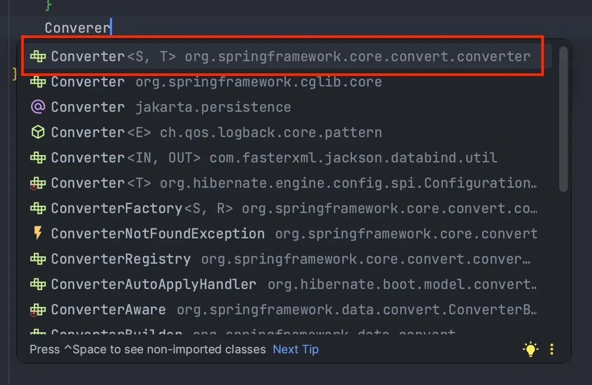
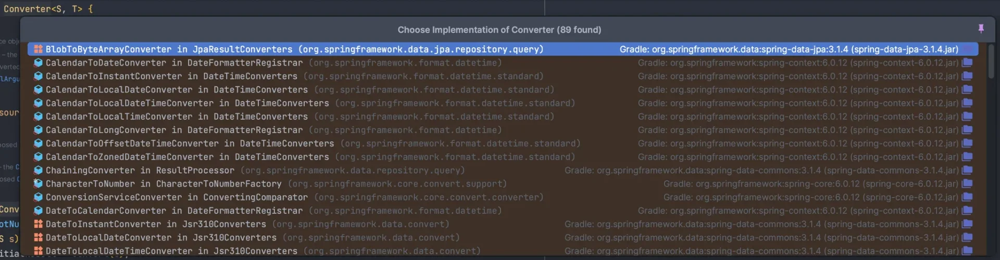
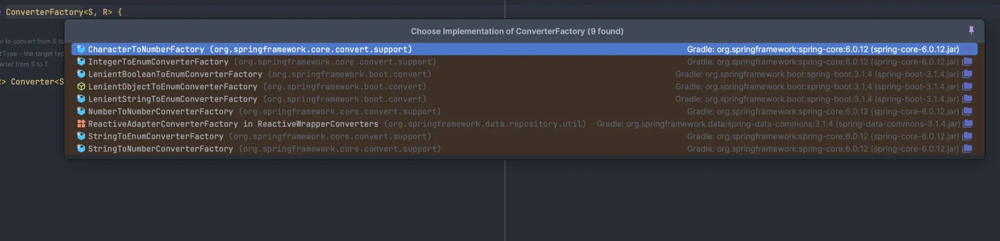
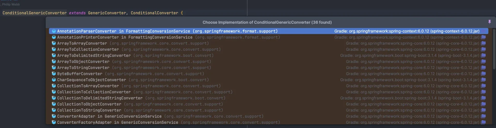

<a id="14aeda9b0fe180a5b85dc0fbe77b23ca"></a>

## Converter 구현

---

> 📖 
> 
> <a id="6412e54e5ee04893802bfe57fd158026"></a>
> 
> 데이터 유형 간 변환을 담당하는 매커니즘
> 
> - 주로 웹 요청 파라미터를 <strong><u>자바 객체로 변환(역직렬화)</u></strong> or <strong><u>그 반대로 변환(직렬화)</u></strong>할 때 사용
> 
> - 커스텀  변환 로직을 정의 가능

<details>
<summary>주의점</summary>



- <code>org&#46;springframwork&#46;core&#46;convert&#46;converter</code>

- Spring의 Converter와 같은 이름을 가진 Interface가 많으니 주의해야 한다&#46; 

</details>

<details>
<summary>코드 예시  &#45; 컨버터 구현 (TypeConvert)</summary>

> ✏️ 
> 
> - <code>Converter</code> 인터페이스를 상속하며 convert 메서드를 오버라이드하여 적절한 타입으로 변환한다 &#46;
>     - <code>implements Convert(S, T)</code>
> 
> - 제네릭을 통해 유연한 타입 변환이 가능하다&#46; 
>     - <code>Converter&#60;S, T&#62; </code>
>         - <code>S</code>&#58; <u>받아오는 인자 타입</u> 
> 
>         - <code>T</code>&#58; 변환되는 반환 타입

<details>
<summary>예시 1&#46; <code>String</code> → <code>Integer</code></summary>

<a id="14aeda9b0fe1800cac66ed262a550ce0"></a>

```java
@Slf4j
public class StringToIntegerConverter implements Converter<String, Integer> {
	
		@Override
		public Integer convert(String source) {
			log.info("source = {}", source);
			// 검증
			return Integer.valueOf(source);
		}
}
```

- 파라미터로 돌아온 source가 Interger로 변환한다&#46;

</details>

<details>
<summary>예시 2&#46; <code>Integer</code> → <code>String</code></summary>

<a id="14aeda9b0fe180fdb48de6e844d08be2"></a>

```java
@Slf4j
public class IntegerToStringConverter implements Converter<Integer, String> {
	
		@Override
		public String convert(Integer source) {
			log.info("source = {}", source);
			return String.valueOf(source);
		}
}
```

- 파라미터로 들어온 Source를 String 으로 변환

</details>

<details>
<summary>예시 3&#46; <code>String</code> ↔ <code>Person</code></summary>

<details>
<summary>&#91; 코드 &#93; Person</summary>

<a id="14aeda9b0fe180aea3f6fa6593575cf7"></a>

```java
@Getter
public class Person {
	
		// 이름
		private String name;
		// 나이
		private int age;
	
		public Person(String name, int age) {
			this.name = name;
			this.age = age;
		}
	
}
```

</details>

<details>
<summary>요청 예시</summary>

- <code>localhost&#58;8080/type&#45;converter?person=wonuk&#58;1200</code>

- String → Person
    <a id="14aeda9b0fe1806984bed43c3e0b317e"></a>

    ```java
    public class StringToPersonConverter 
    		implements Converter<String, Person> {

    		@Override
    		public Person convert(String source) {
    			// ':' 를 구분자로 나누어 배열로 만든다.
    			String[] parts = source.split(":");
    	
    			// 첫번째 배열은 이름이다. -> wonuk
    	    String name = parts[0];
    	    // 두번째 배열은 개월수이다. -> 1200
    	    int months = Integer.parseInt(parts[1]);
    	    
    			// 개월수 나누기 12로 나이를 구하는 로직 (12개월 단위만 고려)
    			int age = months / 12;
    	
    			return new Person(name, age);
    		}
    }
    ```

- Person → String
    <a id="14aeda9b0fe1805db6c6f7926873da1a"></a>

    ```java
    public class PersonToStringConverter 
    		implements Converter<Person, String> {
    		
    		@Override
    		public String convert(Person source) {
    				// 이름
    				String name = source.getName();
    				// 개월수
    				int months = source.getAge * 12;
    				// "wonuk:1200"
    				return name + ":" + months;
    		}
    	
    }
    ```

</details>

</details>

</details>

<details>
<summary>장점, 단점</summary>

- 장점
    <details>
    <summary>구현 <u>단순하게 직접 메서드를 구현</u>하여 <u>모듈화</u> 하면 됨</summary>

    <a id="14aeda9b0fe1803c9df4c725981e51ae"></a>

    ```java
    PersonToStringConverter converter = new PersonToStringConverter();
    String source = "wonuk:1200";
    converter.convert(source);
    ```

    </details>

    - <code>TypeConverter</code>를 생성하여 직접 사용하면 컨트롤러에서 변환하는 방식과 큰 차이가 없음

- 단점
    - Converter를 편리하게 등록하고 사용할 수 있도록 만들어주는 기능이 필요

</details>

<details>
<summary>기본 제공 convert (상세 내용은 아래 확인)</summary>

> ✏️ 
> 
> <a id="338eda9b0fe18015b651c97db27eb438"></a>
> 
> Spring은 <code>String</code>, <code>Integer</code>, <code>Enum</code>등 자주 사용되는 타입에 대한 컨버터를 제공하고 사용할 수 있도록 등록되어 있다&#46;

- 기본 제공 컨버터 예시
    

    

    

</details>

<a id="14aeda9b0fe18069b93de16a46154c1e"></a>

## Spring의 다양한 Converter

---

> 📖 
> 
> <a id="2727ea71b43d4b8e81c0a1c1203c7357"></a>
> 
> Spring에서 제공하는 <u>다양한 Converter 인터페이스가 존재</u>한다&#46; 
> 
> <a id="14aeda9b0fe18059a37ee66255eb286f"></a>
> 
> 이들을 Spring의 <u>데이터 바인딩</u>, <u>요청/응답 처리</u>, <u>속성 값 주입 </u>등에 사용되고 <code>ConversionService</code>를 통해 <u>등록 및 관리</u>된다&#46;

<details>
<summary>공식 문서</summary>

[Spring Type Conversion &#58;&#58; Spring Framework]()

</details>

<details>
<summary>1&#46; Converter</summary>

- 기본적인 변환을 담당하는 인터페이스

- <code>단일 타입 &#60;&#45;&#62; 단일 타입</code> 변환 시 사용
    - <code>Converter&#60;Source, Type&#62;</code>

</details>

<details>
<summary>2&#46; ConverterFactory</summary>

- 클래스 계층 구조가 복잡한 경우 사용

- <code>기본 타입과 &#60;&#45;&#62; 다양한 서브 타입</code> 간의 변환 지원

</details>

<details>
<summary>3&#46; GenericConverter</summary>

- 다양한 타입 간의 유연한 변환을 지원 

- <code>복잡한 타입 </code><u>변환 로직을 구현</u>할 때 유리

</details>

<details>
<summary>4&#46; ConditionalGenericConverter</summary>

- <code>GenericConverter</code>의 확장형으로 특정 조건에서만 타입 변환 수행

- 추가적으로 <code>matches()</code>를 통해 변환 가능 여부 판단 가능

</details>
