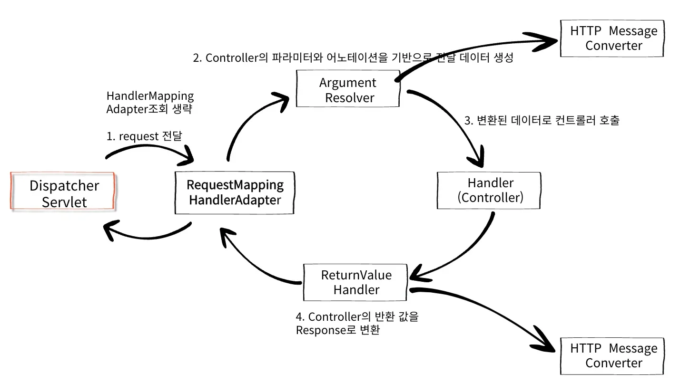

### 이것만은 꼭 기억하기

---

HttpMessageConverter

- 사용처
    - HTTP 요청 &#58; <code>&#64;RequestBody</code>, <code>HttpEntity&#60;&#62;</code>,  <code>RequestEntity&#60;&#62;</code> 

    - HTTP 응답 &#58; <code>&#64;ResponseBody</code>, <code>HttpEntity&#60;&#62;</code>, <code>ResponseEntity&#60;&#62;</code>

- 우선순위
    1. <code>byte&#91;&#93;</code>

    1. <code>String</code>

    1. <code>JSON</code>

Spring 내부 구조

- View가 있을 시 ( <code>&#64;Controller</code> )
    

- 데이터만 있을 시,  HttpMessageConverter ( <code>&#64;RestController</code> )
    

    - <strong>ArgumentResolver</strong>
        - HTTP 요청이 컨트롤러 메서드에 전달될 때, 각 파라미터를 알맞은 객체로 변환하는 인터페이스

    - ReturnValueHandler
        - 컨트롤러 메서드가 반환하는 값을 처리하여 HTTP 응답에 맞게 변환하는 인터페이스

Converter, Formatter

- Converter
    - 특정 타입을 다른 타입으로 변환할 때 사용하는 인터페이스

- Formatter
    - 사용자 지정 포맷을 적용해 데이터 변환을 처리할 때 사용하는 인터페이스

- WebMvcConfigurer
    - 설정을 통해 Converter, Formatter를 추가할 수 있다&#46;

- ConversionService
    - 어댑터 패턴

    - <code>Converter</code>, <code>Formatter</code> 일관성 있게 사용할 수 있다&#46;

- HttpMessageConverter
    - <code>ConversionService</code>가 적용되지 않는다&#46;

    - 역할
        1. 요청 메세지 본문(RequestBody)을 객체로 변환하거나

        1. 객체를 응답 본문(ResponseBody)에 입력하는 것

    - JSON을 객체로 변환하는데는 <code>Jackson 라이브러리</code>를 사용한다&#46;
        - <code>&#64;JsonFormat</code>, <code>Deserializer</code> 사용

- <code>ConversionService</code>는 대표적으로 <code>&#64;RequestParam</code>, <code>&#64;ModelAttribute</code>, <code>&#64;PathVariable </code>등에서 사용한다&#46;

- <code>Converter</code>, <code>Fommatter</code>를 직접 구현하고, <code>ConversionService</code>에 등록해서 사용할 수 있다&#46;

<strong>핵심</strong>

- Spring에서 제공하는 대부분의 기능은 인터페이스로 만들어져 있다&#46;

- 기본적으로 제공하는 구현체들이 다양하다&#46; 

- 개발자는 만들어진 기능을 잘 사용하면된다&#46;

- 만약 확장하고자 하는 영역이 있다면 그 부분을 확장시켜 프로젝트에 적용하면 된다&#46;
    - 확장을 위해 반드시 내부 구조를 알아야한다&#33;

