

## RequestMappingHandlerAdapter

---

> 📖 
> 
> 
> 
> Spring MVC에서 <strong>HTTP 요청을 컨트롤러 메서드에 매핑하고 실행</strong>하는 핵심 구성요소이다&#46;
> 
> -  <strong><u>클라이언트 요청</u></strong>을 적절한 컨트롤러 메서드와 연결한 후, <strong>메서드를 호출하여 결과로 반환</strong>하는 역할을 수행한다&#46;

Spring MVC 구조

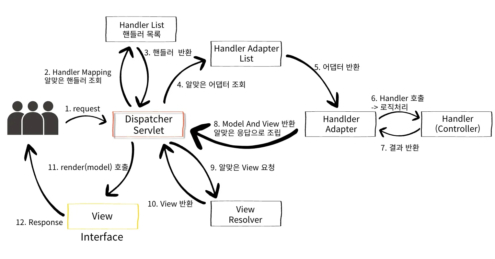

- 요청 데이터 변환  &#45; <code>HttpMessageConverter</code>

<strong><code>RequestMappingHandlerAdapter</code></strong>

> ✏️ 
> 
> 
> 
> <code>&#64;RequestMapping</code> 을 처리하는 <code>HandlerAdapter</code>의 구현체 이다&#46; 
> 
> - 아래 모두 <code>&#64;RequestMapping</code>의 일종이다&#46;
>     - <code>&#64;PostMapping</code>
> 
>     -  <code>&#64;GetMapping</code>
> 
>     - <code>&#64;PutMapping</code>
> 
>     - <code>&#64;PatchMapping</code>
> 
>     - <code>&#64;DeleteMapping</code>

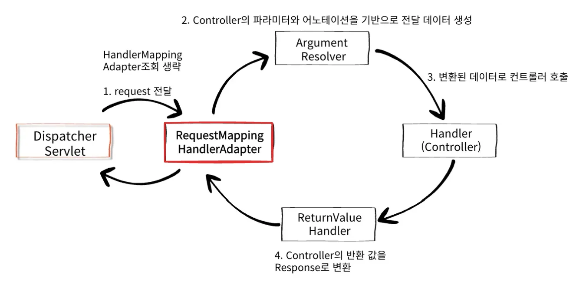

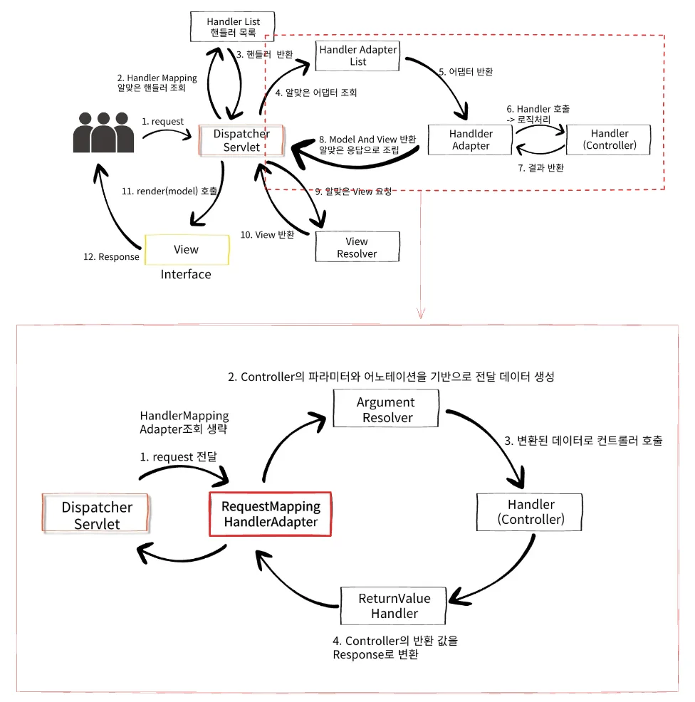

<strong><code>ArgumentResolver</code></strong>

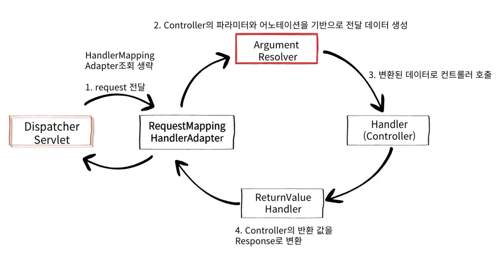

- <code>RequestMappingHandlerAdapter</code>는 <code>ArgumentResolver</code>를 호출하여 Controller가 필요한 다양한 파라미터의 값을 생성한다&#46;
    - 이를 통해 <strong><code>HttpServletRequest</code></strong>, <strong><code>Model</code></strong>, <strong><code>HttpEntity</code></strong>,<strong><code>&#64;ModelAttribute</code></strong>, <strong><code>&#64;RequestBody</code></strong>, <strong><code>&#64;RequestParam</code></strong> 등 <strong><u>다양한 파라미터 바인딩</u></strong>을 할 수 있다&#46;

- <code>ArgumentResolver</code>를 통하여 값이 준비되면 해당값을 가지고 실제 Controller를 호출한다&#46; 

## <strong>ArgumentResolver</strong>

---

> 📖 
> 
> 
> 
> Spring MVC에서 <strong>컨트롤러 메서드의 파라미터를 자동으로 바인딩</strong>하는 역할을 하는 <strong>인터페이스</strong>로 <strong><u>컨트롤러 메서드에 전달</u></strong>될 때, <strong><u>각 파라미터를 적절한 객체로 변환하여 주입</u></strong>하는 것을 담당한다&#46;

ArgumentResolver 종류

> ✏️ 
> 
> 
> 
> 스프링에서 다양한 Argument Resolver들을 기본적으로 제공한다&#46;

1. <code>&#64;RequestBody</code>  → <code>RequestBodyArgumentResolver</code> 
    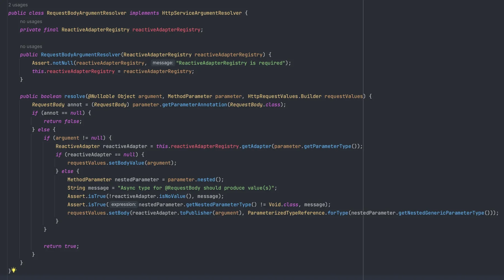

1. <code>&#64;RequestHeader</code> &#45;&#62; <code>RequestHeaderArgumentResolver</code>
    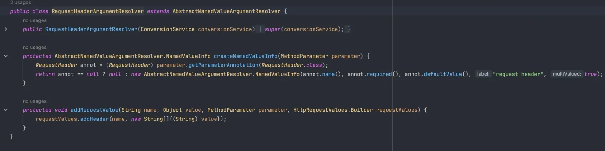

<strong><code>HandlerMethodArgumentResolver</code></strong>

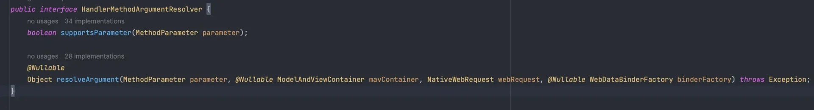

- <code>ArgumentResolver</code>의 실제 이름
    - 인터페이스 로 구성

    - implements 하여 커스텀하게 파라미터를 만들 수 있다 &#46; ( 확장 가능)

- <code>supportsParameter( MethodParameter parameter );</code>
    - 컨트롤러가 필요로하는 메서드의 파라미터를 지원하는지 여부를 검사

- 지원하다면 <code>resolverArgument()</code> 메서드 통해, Object(객체)로 생성
    - 만들어진 Object(객체)가 Controller 호출시 메서드의 파라미터로 전달된다&#46;

- <code>supportsParameter()</code> 를 사용하는 다양한 <code>ArgumentResolver</code> 구현체
    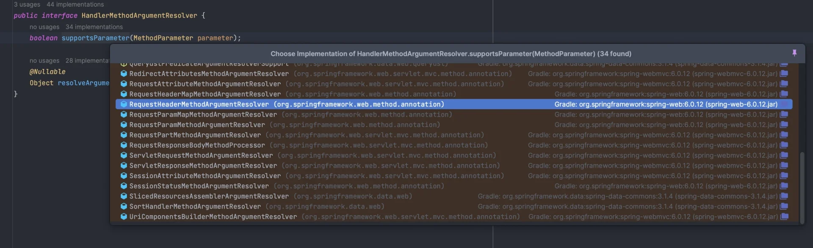

사용 가능한 파라미터 목록  &#45; 공식 문서

[Method Arguments &#58;&#58; Spring Framework]()

- 사용 가능한 파라미터 목록

## ReturnValueHandler

---

> 📖 
> 
> 
> 
> Spring MVC에서<strong> </strong><strong>컨트롤러 메서드가 반환하는 값을 처리하여 HTTP 응답에 맞게 변환하는 역할</strong>을 하는 <strong>인터페이스</strong>로 <strong><u>컨트롤러 메서드가 실행된 후 그 반환값을 HTTP 응답의 본문에 적절히 담아 전송</u></strong>할 수 있도록 도와준다&#46; 

<strong>ReturnValueHandler</strong>

1. <code>ModelAndView</code>, <code>&#64;ResponseBody</code>, <code>HttpEntity&#60;&#62;</code> 등이 있으면 응답에 필요한 값으로 변환
    - Controller에서 Stirng 으로 <code>ViewName</code>을  반환하여도 View가 동작하는 이유

1. Spring은 다양한 ReturnValueHandler를 기본적으로 제공한다&#46; 
    - ModelAndViewMethodReturnValueHandler( ModelAndView 객체 반환 )
        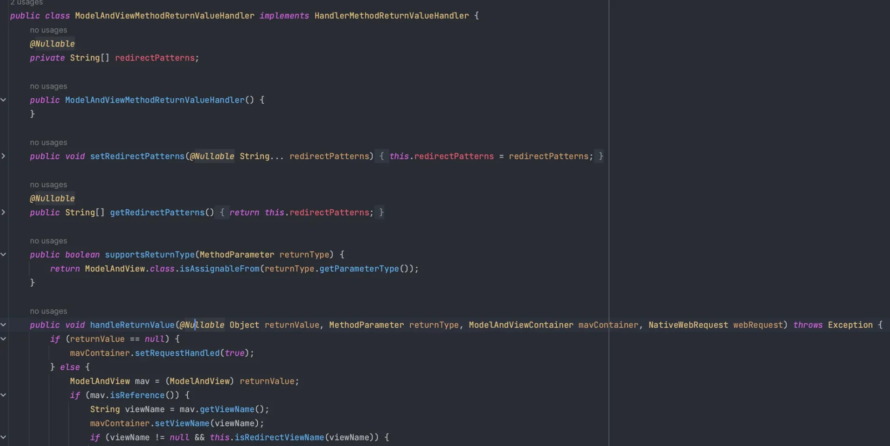

    - HttpEntityMethodProcessor( HttpEntity 객체 변환 )
        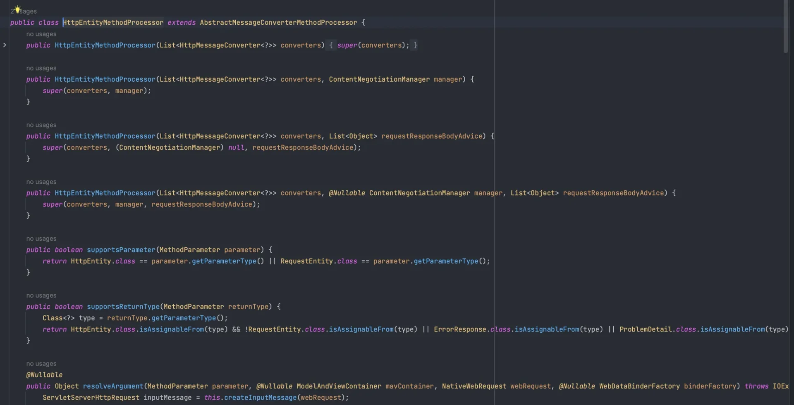

<strong>HandlerMethodReturnValueHandler</strong>

> <code>ReturnValueHandler</code>의 실제 이름

- 인터페이스로 구성되어 있다&#46; 즉, 확장이 가능하다&#46;
    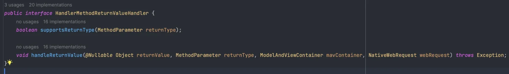

- 다양한 ReturnValueHandler 구현체
    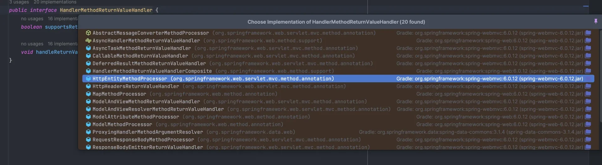

