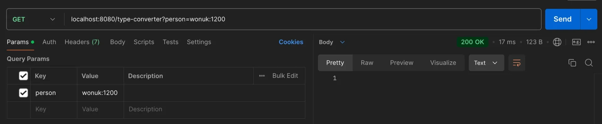
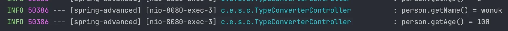

<a id="14aeda9b0fe1815c8bb2c249532e946d"></a>

## Converter 적용 실습

---

> 📖 
> 
> <a id="14aeda9b0fe181649185ed842e08da73"></a>
> 
> Converter 적용
> 
> - Spring에서 내부적으로 <code>ConversionService</code>가 제공됨
> 
> - <code>WebMvcConfigurer</code> 가 제공하는 <code>addFomatters()</code>를 사용하여 Converter를 등록
> 
> - 클라이언트 측에서 <code>ConversionService</code>만 의존하여 컨버터 사용 가능

> ☝🏻 
> 
> <a id="b3048a07c46d42029ec1bab5dda66bd4"></a>
> 
> <code>SpringToIntegerConverte</code>r와 같이 Spring이 기본적으로 제공하는 컨버터들이 존재하지만, <u>컨버터를 커스텀</u><u>하게 구현</u> 후, <u>추가(</u><code>WebMvcConfigurer&#46;addFomatters()</code>)하면 <u>기본 제공 컨버터보다</u> 더 높은 우선순위를 갖는다&#46; 
> 
> - 우선순위&#58;  커스텀 컨버터 &#62; 기본 컨버터 

<details>
<summary>WebConfig</summary>

<a id="14aeda9b0fe1803fa933cd398d1ef047"></a>

```java
@Configuration
public class WebConfig implements WebMvcConfigurer {
	
		@Override
		public void addFomatters(FormatterRegistry registry) {
			// registry.addConverter(new "${등록할 Converter}");
			registry.addConverter(new StringToPersonConverter());
			registry.addConverter(new PersonToStringConverter());
		}
}
```

</details>

<details>
<summary>TypeConverterController</summary>

<a id="14aeda9b0fe180f18b8ffd2956b4e577"></a>

```java
@Slf4j
@RestController
public class TypeConverterController {

    @GetMapping("/type-converter")
    public void typeConverter(@RequestParam Person person) {
        log.info("person.getName() = {}", person.getName());
        log.info("person.getAge() = {}", person.getAge());
    }
}
```

</details>

<details>
<summary>postman 테스트</summary>

- <code>GET</code> <code>localhost&#58;8080/type&#45;converter?person=wonuk&#58;1200</code>
    

- 출력 결과
    

    - 정상적으로 타입이 변환이 되어 출력되는 것을 

</details>

<details>
<summary><strong>ArgumentResolver</strong></summary>


- <code>&#64;RqeustParam</code>을 처리하는 <code>RqeustParamMethodArgumentResolver</code> 에서 <code>ConversionService</code>를 사용하여 타입 변환
    - 내부적으로 굉장히 복잡한 메서들이 호출된다&#46; 

> 📌 
> 
> <a id="9a84310d5a3f42428b0c4d85643bf619"></a>
> 
> Thymeleaf와 같은 <u>ViewTemplate</u>에서도 이러한<u> TypeConverter 기능을 제공</u>한다&#46;

</details>
