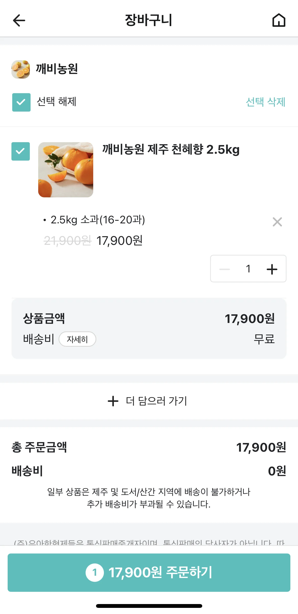
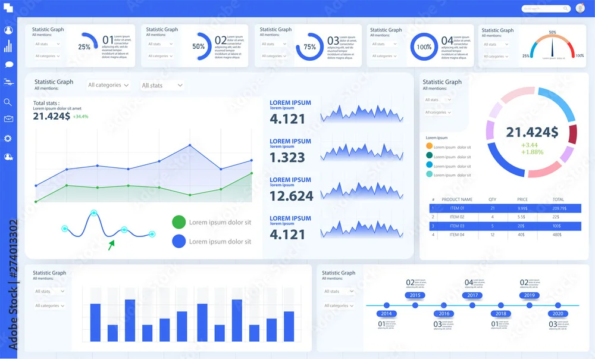
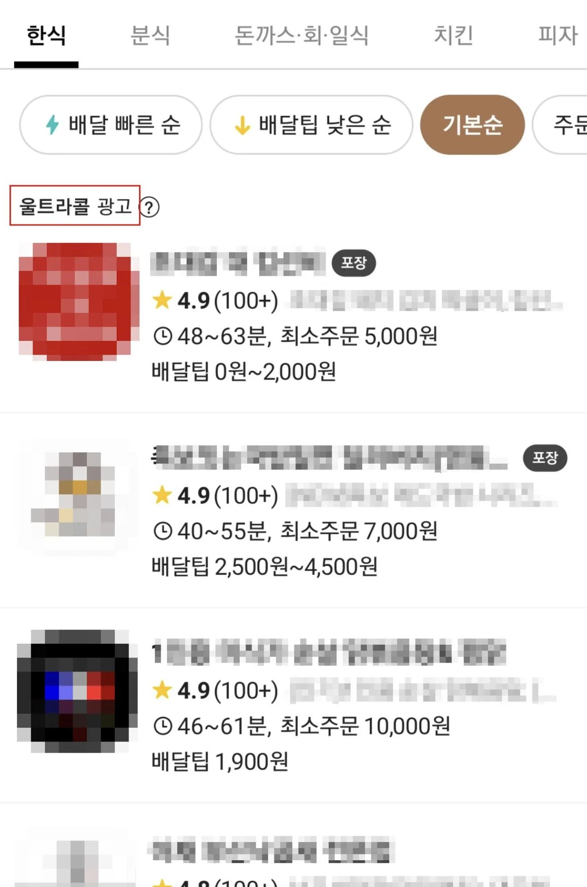
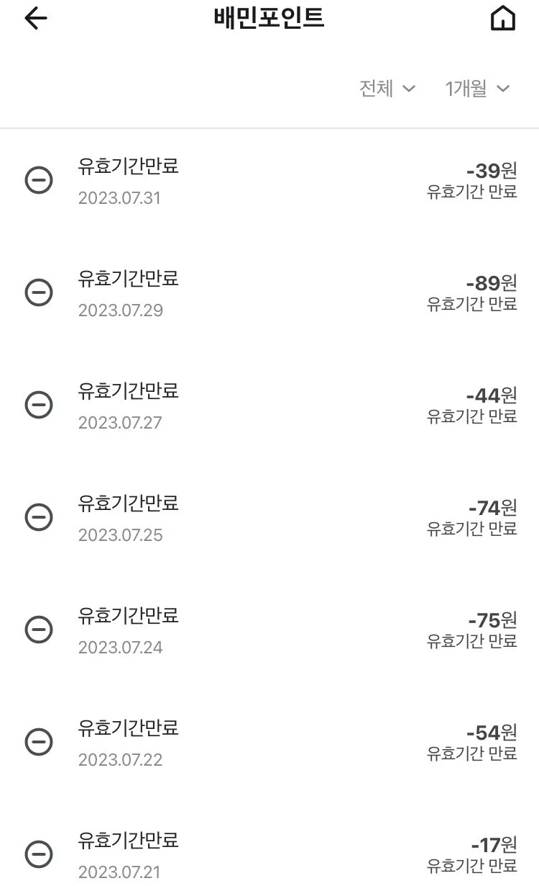
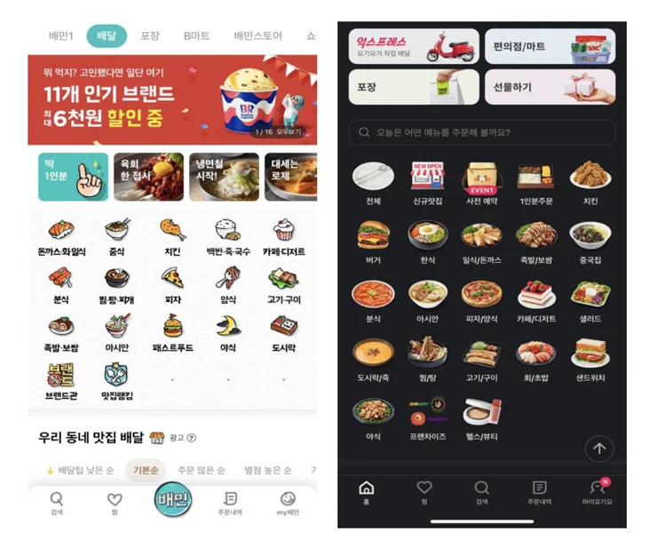
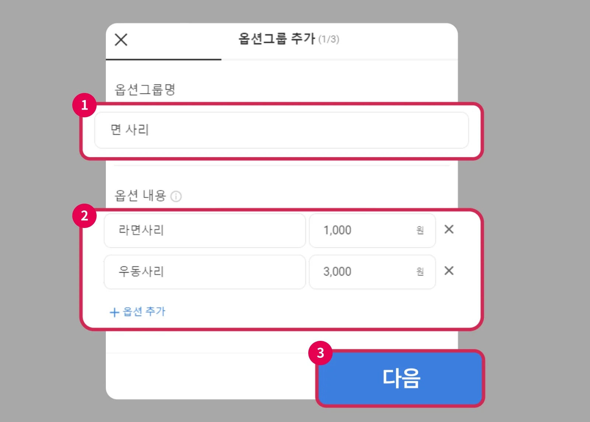
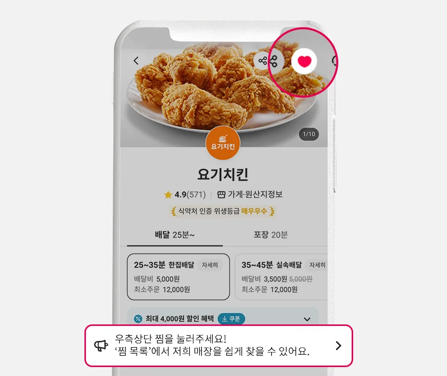
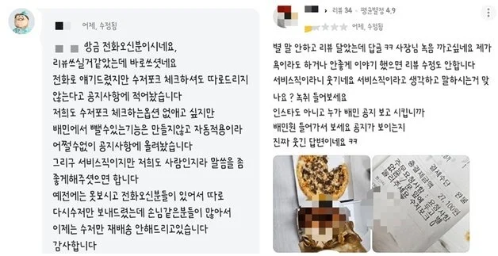
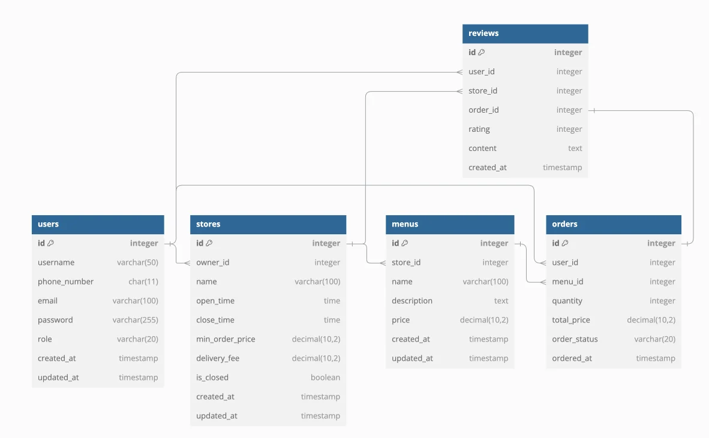
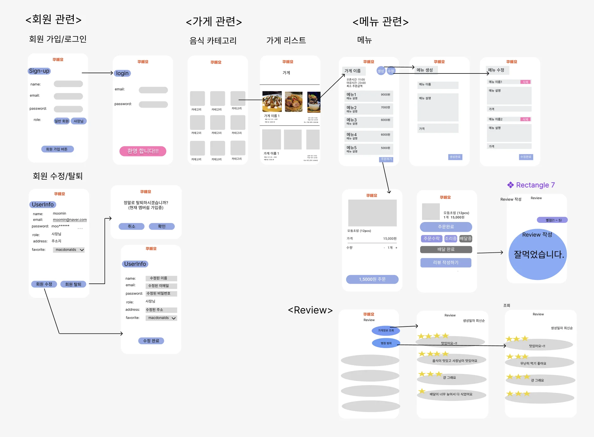

> 📌 
> 
> <a id="9c9b93c9dac24f199adc7718e31fa3cf"></a>
> 
> 내일배움캠프&#95;스프링 7기  &#45; 7주차 개인 프로젝트
> 
> > 기간&#58; 24년 12월 3일 &#126; 12월 9일   
> 
> - 팀노션&#58;  <a href="https://beautiful-college-c84.notion.site/1492dc3ef51481dd8279d1535036abfb">페이지</a>
> 
> - 발제&#58; <a href="https://beautiful-college-c84.notion.site/1512dc3ef51480ab83d3c5ba3a96ba56">페이지</a> 

<a id="1c3eda9b0fe180459517d0093d43091f"></a>

### 요구사항

<a id="1c3eda9b0fe180f59f81f31cdddc7111"></a>

## 3️⃣ 필수 기능 가이드

> ✨ <strong>배달 어플의 다양한 기능 중 아래 기능은 필수로 개발해주세요&#33;</strong>

<a id="1c3eda9b0fe180f5a9b3e171e7b250fd"></a>

### <strong>1&#46; 회원가입/로그인</strong>

- 회원가입
    - 사용자 아이디
        - 사용자 아이디는 이메일 형식이어야 합니다&#46;

    - 비밀번호
        - <code>Bcrypt</code>로 인코딩합니다&#46;
            - 암호화를 위한 <code>PasswordEncoder</code>를 직접 만들어 사용합니다&#46;
                <details>
                <summary>참고 코드</summary>

                1. <code>build&#46;gradle</code> 에 아래의 의존성을 추가해주세요&#46;
                    <a id="1c3eda9b0fe1803298b4e537a1be1b97"></a>

                    ```java
                    implementation 'at.favre.lib:bcrypt:0.10.2'
                    ```

                1. <code>config</code> 패키지가 없다면 추가하고, 아래의 클래스를 추가해주세요&#46;
                    <a id="1c3eda9b0fe18012be82df67b8ae7350"></a>

                    ```java
                    import at.favre.lib.crypto.bcrypt.BCrypt;
                    import org.springframework.stereotype.Component;

                    @Component
                    public class PasswordEncoder {

                        public String encode(String rawPassword) {
                            return BCrypt.withDefaults().hashToString(BCrypt.MIN_COST, rawPassword.toCharArray());
                        }

                        public boolean matches(String rawPassword, String encodedPassword) {
                            BCrypt.Result result = BCrypt.verifyer().verify(rawPassword.toCharArray(), encodedPassword);
                            return result.verified;
                        }
                    }
                    ```

                </details>

        - 대소문자 포함 영문 &#43; 숫자 &#43; 특수문자를 최소 1글자씩 포함합니다&#46; 

        - 비밀번호는 최소 8글자 이상이어야 합니다&#46;

    - 권한
        - 회원가입시 일반 유저(USER) 또는 사장님(OWNER)으로 가입할 수 있습니다&#46;

        - 권한에 따라 사용할 수 있는 기능이 나뉘어집니다&#46;

    > 
    > 
    > <a id="1c3eda9b0fe18011b84af2325af4ad2b"></a>
    > 
    > <strong>⚠️ 예외처리</strong>
    > 
    > - 중복된 <code>사용자 아이디</code>로 가입하는 경우
    > 
    > - <code>사용자 아이디</code> 이메일과 비밀번호 형식이 올바르지 않은 경우

- 회원탈퇴
    <a id="1c3eda9b0fe180ec8489f032c12bb545"></a>

    회원탈퇴 방식을 어떻게 처리할지 고민해보세요&#46;

    - 조건
        - 탈퇴 처리 시 <code>비밀번호</code>를 확인한 후 일치할 때 탈퇴 처리합니다&#46;

        - 탈퇴한 사용자의 아이디는 재사용할 수 없고, 복구할 수 없습니다&#46;

    > 
    > 
    > <a id="1c3eda9b0fe18054a574e808833a6f40"></a>
    > 
    > <strong>⚠️ 예외처리</strong>
    > 
    > - <code>사용자 아이디</code>와 <code>비밀번호</code>가 일치하지 않는 경우
    > 
    > - 이미 탈퇴한 <code>사용자 아이디</code>인 경우

- 로그인
    - 가입한 아이디와 비밀번호로 로그인 합니다&#46;

<a id="1c3eda9b0fe18084a49ed7cb388432a5"></a>

### <strong>2&#46; 가게</strong>

- 가게 생성/수정
    - 가게는 오픈 및 마감 시간이 있습니다&#46;

    - 가게는 최소 주문 금액이 있습니다&#46;

    > 
    > 
    > <a id="1c3eda9b0fe180988448ce3199c7a4ce"></a>
    > 
    > <strong>⚠️ 예외처리</strong>
    > 
    > - 사장님 권한을 가진 유저만 가게를 만들 수 있습니다&#46;
    > 
    > - 사장님은 폐업 상태가 아닌 가게를 최대 3개까지만 운영할 수 있습니다&#46;

- 가게 조회
    - 고객은 가게명으로 가게를 여러 건 찾아볼 수 있습니다&#46;
        - 가게 다건 조회시에는 메뉴 목록을 함께 볼 수 없습니다&#46;

    - 가게 단건 조회 시 등록된 메뉴 목록도 함께 볼 수 있습니다&#46;

- 가게 폐업
    - 폐업시, 가게의 상태만 폐업 상태로 변경됩니다&#46;
        - 일반 유저는 폐업된 가게를 조회할 수 없습니다&#46;

        - 사장님은 가게를 추가로 등록할 수 있게 됩니다&#46;

<a id="1c3eda9b0fe180abb8f8e704d1d62092"></a>

### <strong>3&#46;  메뉴</strong>

- 메뉴 생성/수정
    - 메뉴 생성, 수정은 사장님만 할 수 있습니다&#46;

    - 사장님은 본인 가게에만 메뉴를 등록할 수 있습니다&#46;

- 메뉴를 단독으로 조회할 수는 없으며, 가게 조회 시 함께 조회됩니다&#46;

- 메뉴 삭제
    - 본인 가게의 메뉴만 삭제할 수 있습니다&#46;

    - 삭제 시, 메뉴의 상태만 삭제 상태로 변경됩니다&#46;
        - 가게 메뉴 조회 시 삭제된 메뉴는 나타나지 않습니다&#46;

        - 주문 내역 조회 시에는 삭제된 메뉴의 정보도 나타납니다&#46;

<a id="1c3eda9b0fe1805b92c3f1e2f8f96734"></a>

### <strong>4&#46;  주문</strong>

- 고객은 메뉴를 주문할 수 있습니다&#46;
    - 각 주문에는 하나의 메뉴만 주문할 수 있습니다&#46;
        > ❗ 
        > 
        > <a id="1c3eda9b0fe180caae25eaeb27d9719d"></a>
        > 
        > 장바구니는 <strong>도전 기능</strong>입니다&#46;

- 사장님은 주문을 수락할 수 있으며, 배달이 완료될 때까지의 모든 상태를 순서대로 변경 합니다&#46;
    - 주문 완료 → 주문 수락 → 조리 중 → 조리 완료 → 배달 중 → 배달 완료

    > ❗ 
    > 
    > <a id="1c3eda9b0fe18027a78afee34bdb01bc"></a>
    > 
    > 주문 거절은 <strong>도전 기능</strong>입니다&#46;

> 
> 
> <a id="1c3eda9b0fe180b2baa2dea7a0d650b8"></a>
> 
> <strong>⚠️ 예외처리</strong>
> 
> - 가게에서 설정한 최소 주문 금액을 만족해야 주문이 가능합니다&#46;
> 
> - 가게의 오픈/마감 시간이 지나면 주문할 수 없습니다&#46;

<a id="1c3eda9b0fe1802bbcaaf04f5c5d3944"></a>

### <strong>5&#46;  리뷰</strong>

- 리뷰 생성
    - 고객은 주문 건에 대해 리뷰를 작성할 수 있습니다&#46;

    - 리뷰는 별점을 부여합니다&#46; (1&#126;5점)

    > 
    > 
    > <a id="1c3eda9b0fe1806c917cc7becb21116c"></a>
    > 
    > <strong>⚠️ 예외처리</strong>
    > 
    > - <code>배달 완료</code> 되지 않은 주문은 리뷰를 작성할 수 없습니다&#46;

- 리뷰 조회
    - 리뷰는 단건 조회할 수 없습니다&#46;

    - 리뷰는 가게 정보를 기준으로 다건 조회 가능합니다&#46;
        - 생성일자 기준 최신순으로 정렬합니다&#46;

        - 본인이 작성한 리뷰는 보이지 않습니다&#46;

        - 리뷰를 별점 범위에 따라 조회할 수 있습니다&#46;
            - ex) 3&#126;5점

<a id="1c3eda9b0fe180a0a555ce286e256909"></a>

## 4️⃣ 도전 기능 가이드

> 🛠 여러분들의 능력을 한 단계 상승시킬 배달 어플의 기능들을 많이 많이 가져왔어요&#46; 
> 
> <a id="1c3eda9b0fe1808b8a81d78f6c548008"></a>
> 
> 각 팀에서 상상하는 배달 어플에 필요한 기능을 선택해서 차례대로 도전 해보세요&#33; 💪

<a id="1c3eda9b0fe180c09530e1a7f5a90c8c"></a>

### <strong>1&#46; 장바구니</strong>

- 한 가게의 메뉴만 담을 수 있으며, 가게가 변경될 시 장바구니는 초기화 됩니다&#46;

- 장바구니는 마지막 업데이트 시점으로부터 최대 하루만 유지 됩니다&#46;
    - 쿠키를 활용하여 데이터를 저장합니다&#46;
        - 만료일자를 설정합니다&#46;



<a id="1c3eda9b0fe180ee9385fe83008adfee"></a>

### <strong>2&#46; 관리자</strong>

- ADMIN(관리자) ROLE를 추가하고, 관리자가 처리할 수 있는 기능들을 만들어보세요&#46;

- 대시보드
    - 배달 어플 전체 통계
        - 일간/월간 주문 수

        - 일간/월간 주문 총액

        - 조건&#58; 기간별, 가게별, 카테고리별 등

    

- 광고
    

    - 사장님은 본인 가게에 대한 광고를 신청할 수 있다&#46;
        - 광고를 신청할 때 입찰가를 작성해야한다&#46;

    - 관리자는 광고 신청 목록에서 승인하거나 거절할 수 있다&#46;
        - 거절시에는 사유를 작성해야 한다&#46;

        - 사유는 사장님이 볼 수 있다&#46;

    - 검색 시 최상단 노출되는 기준
        - 사장님이 광고를 신청할 때 작성한 입찰가가 높은 순

        - 사장님이 광고를 신청할 때 작성한 입찰가가 동일한 경우에는 추가 기준으로 무엇을 적용할지 팀에서 논의 필요합니다&#46;

<a id="1c3eda9b0fe1804f8c9ef5f429ebcd05"></a>

### <strong>3&#46; 포인트 및 쿠폰</strong>

- 포인트 적립 및 사용
    - 포인트는 배달 완료 시 3% 적립됩니다&#46;

    - 포인트는 주문 시 사용할 수 있습니다&#46;

    - 포인트 사용시 최소 주문 금액을 넘지 않으면 주문할 수 없습니다&#46;

    - 유효기간이 만료되면 자동적으로 가지고 있는 포인트에서 차감됩니다&#46;

    

- 할인 쿠폰
    - 쿠폰은 주문 시 사용할 수 있습니다&#46;

    - 쿠폰의 종류는 정률(%) / 정액(금액)이 있습니다&#46;
        - 정률 쿠폰은 최대 할인 금액이 있습니다&#46;

    - 쿠폰은 발급 시 만료 일자가 존재합니다&#46;

    - 쿠폰에는 총 발급 개수가 있습니다&#46;

    - 쿠폰에 하루마다 발급할 개수를 제한하기 위해 설정할 수 있습니다&#46;
        - 예시&#58; 11/27 (수) &#126; 11/29 (금) 동안 매일 네네치킨 30% 할인 쿠폰 선착순 100명 지급

    

<a id="1c3eda9b0fe180aa822ccf6b0d80b9e5"></a>

### <strong>4&#46; 소셜 로그인</strong>

- <a href="https://developers.naver.com/docs/login/devguide/devguide.md">네이버 로그인 개발가이드</a>를 참고하여 네이버 로그인을 구현해보세요&#46;
    [네이버 로그인 API 명세 &#45; LOGIN]()

- <a href="https://developers.kakao.com/docs/latest/ko/kakaologin/common">카카오 로그인 개발가이드</a>를 참고하여 카카오 로그인을 구현해보세요&#46;
    [Kakao Developers]()

<a id="1c3eda9b0fe18083ae15cf97553e7c4a"></a>

### 5&#46; 이미지 저장


- 가게, 메뉴, 프로필 등에 필요한 이미지를 업로드할 수 있습니다&#46;

- 이미지는 AWS S3와 같은 클라우드 저장소에 저장됩니다&#46;

- 지원되는 이미지 파일 형식은 <code>jpg</code>, <code>png</code>, <code>jpeg</code>을 지원합니다&#46;

- <strong>⚠️ 예외처리</strong>
    - 허용되지 않는 파일 형식은 업로드할 수 없습니다&#46;

    - 파일 크기가 설정된 제한을 초과할 경우 업로드가 불가합니다&#46;

<a id="1c3eda9b0fe1805a81f8e82a43904028"></a>

### <strong>6&#46; 주문 강화</strong>

- 주문 거절
    - 사장님은 주문을 거절할 수 있습니다&#46;

    - 주문 거절 상태 이후로 다른 상태로 변경할 수 없습니다&#46;

    - 주문을 거절할때는 사유를 필수로 작성해야 합니다&#46;

- 주문 횟수
    - 사장님은 주문을 받을 때 해당 사용자가 본인 매장에 몇번 주문했는지 볼 수 있습니다&#46;

<a id="1c3eda9b0fe180daaa3cfabcbb5207d6"></a>

### <strong>7&#46; 메뉴 강화</strong>

- 카테고리 적용
    - 사용자는 카테고리별로 검색할 수 있습니다&#46;

    - 카테고리 내 가게를 조회할 때 리뷰 개수, 별점, 최근 개업 일자 등 필터를 적용할 수 있습니다&#46;

    

- 메뉴 옵션(메뉴의 추가 사항)
    

<a id="1c3eda9b0fe18095a65bd7482ddaf483"></a>

### <strong>8&#46; 가게 강화</strong>

- 즐겨찾기
    - 사용자는 즐겨찾기 한 가게를 모아서 조회할 수 있습니다&#46;

    - Optional&#58; 사장님은 주문을 받을 때 해당 사용자가 본인 매장에 즐겨찾기를 한 상태인지 확인할 수 있습니다&#46;

    - 가게를 검색할 때 즐겨찾기 많이 누른 순 필터를 적용할 수 있습니다&#46;
        

- 리뷰 사장님 댓글
    

> 💡 
> 
> <a id="1c3eda9b0fe1805a88f8e0f49f3501b0"></a>
> 
> 선택지로 주어진 도전 기능들을 모두 구현했다면 이후 여러분들의 상상력을 마음껏 펼쳐봐도 좋습니다&#33; 😁

<a id="46f0ba6cfce64f3cab0dc89188a6a5e5"></a>

### 설계

<a id="21e764ef752740638947a0ec047166b3"></a>

### ERD 설계

---

[A Free Database Designer for Developers and Analysts]()



<a id="d8fc6f1d4bb5463686b24d1ddf857ef0"></a>

### API 명세서

[회원가입](#/post/1c3eda9b-0fe1-8139-a1b0-f222014bbdd6)

[로그인](#/post/1c3eda9b-0fe1-8190-9d48-ecf28bbed9c1)

[로그아웃](#/post/1c3eda9b-0fe1-8111-afdc-f26bfdaf7478)

[회원 탈퇴](#/post/1c3eda9b-0fe1-817e-959d-e1fe4ce7502e)

[제목 없음](#/post/1c3eda9b-0fe1-8172-a7fc-e398df2f91f3)

[가게 오픈](#/post/1c3eda9b-0fe1-81fe-8b28-dc4769165fb0)

[가게 목록 조회](#/post/1c3eda9b-0fe1-8119-be24-cbf8f219e6dd)

[가게 단건 조회](#/post/1c3eda9b-0fe1-81da-8406-c58fff3c1ae8)

[가게 리모델링](#/post/1c3eda9b-0fe1-81ba-a5f2-e9c63a8ac769)

[가게 폐업](#/post/1c3eda9b-0fe1-81bd-b5b0-de2448f7af72)

[제목 없음](#/post/1c3eda9b-0fe1-8196-a4b9-f624a8624272)

[메뉴 등록](#/post/1c3eda9b-0fe1-81a8-b46d-d8dbf99a39a8)

[메뉴 수정](#/post/1c3eda9b-0fe1-81ce-b2de-ffb7323cf2b8)

[메뉴 삭제](#/post/1c3eda9b-0fe1-81ec-a6c2-d0f959cd7ad0)

[제목 없음](#/post/1c3eda9b-0fe1-81b0-9260-e0f7951794ff)

[주문 생성](#/post/1c3eda9b-0fe1-810c-a69d-cbcb1a660ed9)

[주문 상태변경](#/post/1c3eda9b-0fe1-8148-b93d-c77e1d5e6109)

[주문 목록조회](#/post/1c3eda9b-0fe1-81d5-a9d0-cb3df1a9e7df)

[주문 목록 단건 조회](#/post/1c3eda9b-0fe1-8183-9183-cd8e217f2722)

[제목 없음](#/post/1c3eda9b-0fe1-8145-9099-fea43f2b3504)

[리뷰 생성](#/post/1c3eda9b-0fe1-8120-91aa-fa4bbd05687f)

[리뷰 조회(생성일자 최신순)](#/post/1c3eda9b-0fe1-8108-b51e-e63bc9e11d07)

[리뷰 조회(별점별)](#/post/1c3eda9b-0fe1-810d-9163-f2202f99098a)

[제목 없음](#/post/1c3eda9b-0fe1-818a-bd52-cd103d422d71)

<a id="151eda9b0fe18055b5aac9183e57f5fd"></a>

### 와이어프레임 설계



<a id="ce6c951e0ffd4de290955b2c171bbd6b"></a>

### Github

[KooBaeYo](https://github.com/Fangsangik/KooBaeYo)

<a id="83a983bef1b147fa8e46857dd3bc8630"></a>

###  피드백

[아웃소싱 프로젝트 - 피드백 정리](#/post/1c3eda9b-0fe1-8003-a026-eac04e74a5d6)

<a id="6796679bb7844d438007c4f8de2a55f6"></a>

### 학습 및 정리 내용

[예외처리 - 각 레이어에서 분리해서 관리하기 및 enum 값으로 각 단일 클래스에서 공통으로 처리하기](#/post/152eda9b-0fe1-802c-8efc-de91dbcf258a)
