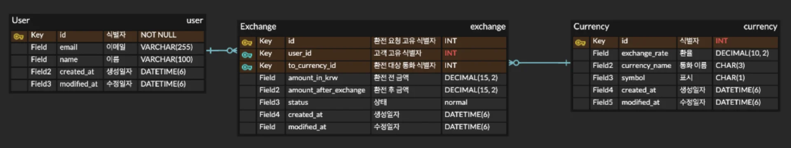
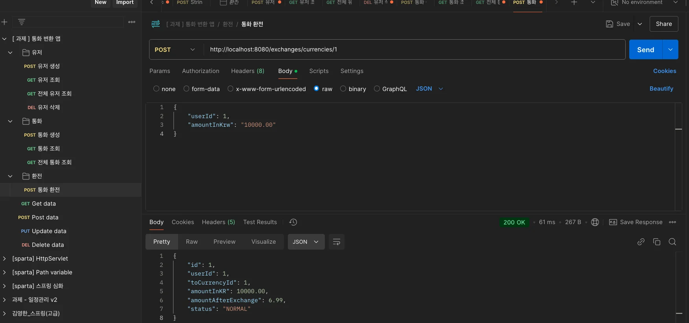
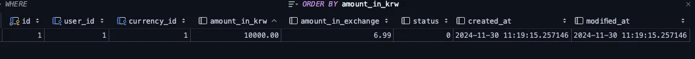
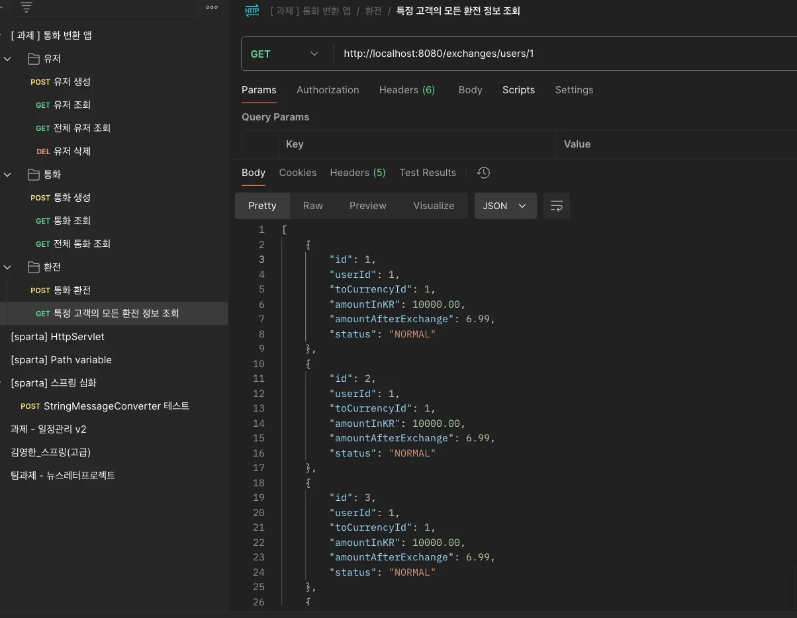
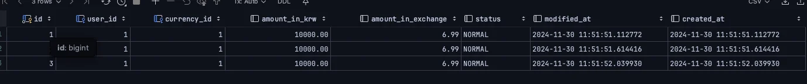
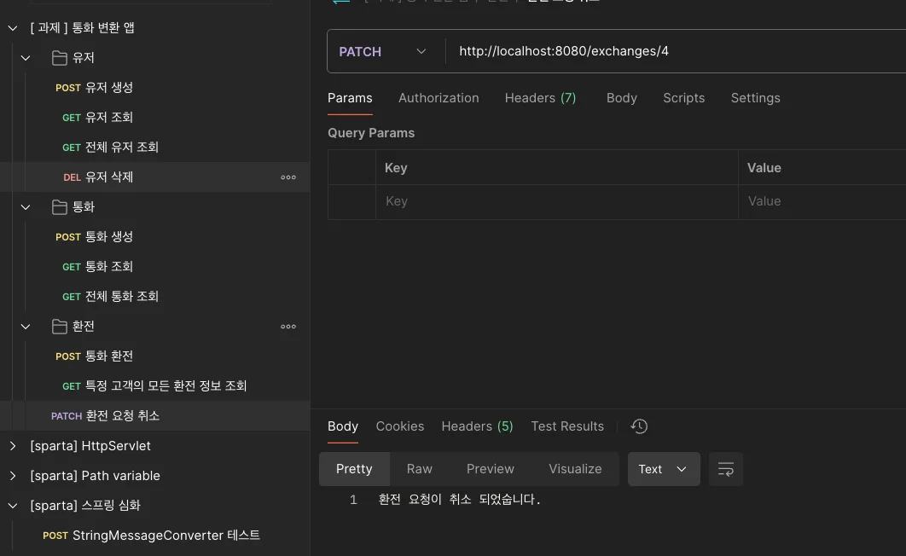
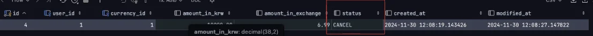
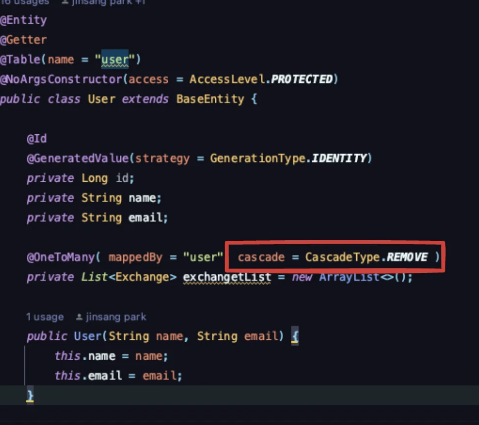
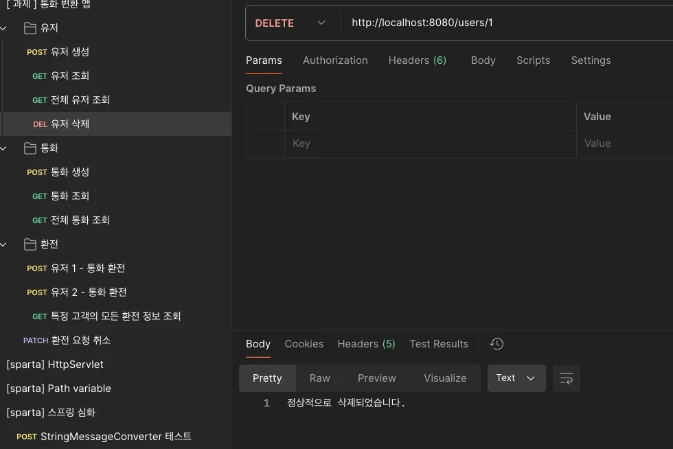
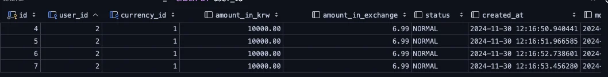

> 📌 
> 
> <a id="14aeda9b0fe181fab60efd9e4bbb93b6"></a>
> 
> 내일배움캠프&#95;스프링 7기  &#45; 9주차 개인 프로젝트
> 
> > 기간&#58; 24년 11월 26일 &#126; 11월 29일
> 
> - 팀 노션&#58; <a href="https://beautiful-college-c84.notion.site/1492dc3ef51481dd8279d1535036abfb">페이지</a> 
> 
> - 발제&#58; <a href="https://beautiful-college-c84.notion.site/1492dc3ef514809fa88beb543cd92ee8">페이지</a> 

<a id="14aeda9b0fe181b08efaca26e422882d"></a>

### 학습 및 정리 내용

<details>
<summary>강의</summary>

<a id="14aeda9b0fe18018a317ceb525e5139c"></a>

<a href="#/post/149eda9b-0fe1-8010-9b0f-dc35331888ed">페이지</a>

</details>

<details>
<summary>질문</summary>

[RESTful api 설계 시 주의점](#/post/14deda9b-0fe1-80d1-9901-d886795af2b2)

[create 요청 시, Body에 내용이 없는데도 post로 method를 명시하는 것이 맞는가?](#/post/14deda9b-0fe1-8036-9066-e1a89fcc23e3)

[BigDecimal 타입  ( 정리 전 )](#/post/14deda9b-0fe1-8079-827e-d3c060450f32)

</details>

<details>
<summary>데일리스크럼</summary>

<a id="14deda9b0fe18052b131fd3d7b15bc23"></a>

<a href="#/post/149eda9b-0fe1-8009-a55b-cb50f65d61b0">페이지</a> 

<a id="14deda9b0fe180eba1c9e80b042804e7"></a>

<a href="#/post/14aeda9b-0fe1-80cf-b714-e1fc9694ee2d">페이지</a> 

<a id="14deda9b0fe180f2b053e154b0386ad0"></a>

<a href="#/post/14beda9b-0fe1-8011-b73a-fb4f3f2f1cac">페이지</a> 

<a id="14deda9b0fe180e8af5afa69fb11e6d0"></a>

<a href="#/post/14beda9b-0fe1-80a4-b5a0-d219221a5193">페이지</a> 

<a id="14deda9b0fe18036a5e5c35dad312661"></a>

<a href="#/post/14deda9b-0fe1-80c5-91dc-c8796100cebf">페이지</a> 

<a id="150eda9b0fe180eba53fc3614e7fa823"></a>

<a href="#/post/150eda9b-0fe1-80fe-bb89-e0f91e13ce8f">페이지</a> 

</details>

<details>
<summary>TIL</summary>

<a id="14deda9b0fe180b1b259f0f88fc83cab"></a>

<a href="#/post/14aeda9b-0fe1-8083-bcb2-cd8535384a2c">페이지</a> 

<a id="14deda9b0fe180438374c47107980633"></a>

<a href="#/post/14beda9b-0fe1-8001-8a13-e93812755146">페이지</a> 

<a id="14deda9b0fe180909529dc0e4e5e143b"></a>

<a href="#/post/14beda9b-0fe1-80ce-8291-f0909234ed06">페이지</a> 

</details>

<details>
<summary>해설영상</summary>

<a id="14deda9b0fe180a59d53d8cb325c9eec"></a>

<a href="https://beautiful-college-c84.notion.site/24078a86ef044492af65266109ac61f5">페이지</a> 

</details>

<a id="14aeda9b0fe181729293cdb2280cd09d"></a>

###  피드백

[과제 피드백 정리](#/post/14feda9b-0fe1-80ab-be22-e55af40e86b3)

<a id="14aeda9b0fe1812e853ac08ce1c3f0e0"></a>

### 이번 주 회고 

<a id="14aeda9b0fe1819d9dd5d2f1ced9c717"></a>

<a href="#/post/150eda9b-0fe1-802e-a240-cbb0e48d3da4">페이지</a> 

---

<a id="14beda9b0fe180be9fd6d59489422671"></a>

### 계획 

> ✏️ 
> 
> <a id="4bd96fd50ec446a9b46ce2e1a0ca87dd"></a>
> 
> 쓸수 있는 리소스(시간) 파악, 목표 정의, task 나누기, 각 기능 별 가용 시간 확인<br>해당 시간이 지나면, 도움 받기 ( 튜터님 or 팀원 )

- 목요일 오후 5시부터 시작 
    - [ ] <del>1차 목표 &#45; 목요일 완료, 금요일 튜터님 피드백</del>
        - 요구사항이 이해가 잘 안됨

    - [ ] <del>2차 목표 &#45; 금요일 오전 완료</del>

    - [x] 3차 목표 &#45; 주말 완료

<a id="14aeda9b0fe1814da902d46da4dcc693"></a>

### 요구사항 

<details>
<summary><code>필수</code> 기능</summary>

<details>
<summary><del>Lv 0&#46; API 명세 및 ERD 작성</del></summary>

- [x] <strong><u>API 명세서 작성하기</u></strong>

- [x] <strong><u>ERD 작성하기</u></strong>

- [x] <strong><u>SQL 작성하기</u></strong>


</details>

<details>
<summary><del>Lv 1&#46; 고객(User)과 통화(Currency) 복잡한 연관관계</del></summary>

- [x] <strong>환전 요청 중간 테이블 생성</strong>
    - [x] 필드&#58; <code>고객 고유 식별자</code>, <code>환전 대상 통화 식별자</code>, <code>환전 전 금액</code>, <code>환전 후 금액</code>, <code>상태</code>

    <details>
    <summary>예시</summary>

    | 컬럼명 | 설명 | 예시 |
    | --- | --- | --- |
    | id | 환전 요청<strong> </strong>고유 식별자 | 1 |
    | user&#95;id | 고객 고유 식별자<br>(User 테이블 ID) | 1 |
    | to&#95;currency&#95;id | 환전 대상 통화 식별자<br>(Currency 테이블 ID) | 1 |
    | amount&#95;in&#95;krw | 환전 전 금액<br>(원화 기준) | 10000 |
    | amount&#95;after&#95;exchange | 환전 후 금액 | 6&#46;99 |
    | status | 상태 | normal |
    | created&#95;at | 생성일자 | 2024&#45;11&#45;18 16&#58;42&#58;03&#46;000000 |
    | modified&#95;at | 수정일자 | 2024&#45;11&#45;18 16&#58;42&#58;03&#46;000000 |

    </details>

- [x] <strong>고객과 통화 테이블 간 연관관계</strong>
    - [x] 한 고객이 여러 통화로 환전할 수 있고 한 통화는 여러 고객들에 의해 환전될 수 있습니다&#46;

    - [x] <code>환전 요청 테이블</code>은 중간 테이블이고 <code>User</code>와 <code>Currency</code> 간 관계를 관리합니다&#46;

</details>

<details>
<summary><del>Lv 2&#46; 환전 요청 CRUD</del></summary>

- [x] C&#58; 환전 요청 수행
    - [x] <code>환전 대상 통화 식별자</code>가 <code>Currency</code> 테이블에 가지고 있는 환율을 기준으로 환전을 수행합니다&#46;

    - [x] 환전 후 금액은 환전 전 금액을 환율로 나눈 결과입니다&#46;
        <details>
        <summary><code>환전 후 금액</code> 계산식 (참고)</summary>

        - [x] <code>환전 후 금액 = 환전 전 금액 / 환율</code>

        </details>

        <details>
        <summary>예시</summary>

        <a id="6cb04d55ed5841848d2cbbf3c5ee773b"></a>

        ```java
        환전 전 금액이 10,000원이고, 환율이 900원/1달러인 경우

        환전 후 금액: 10,000원 / 900원 = 11.11
        ```

        </details>

    - [x] <code>환전 후 금액</code>에 대해 소수점 두번째 반올림 수행

---

- [x] R&#58; <code>고객 고유 식별자</code>를 기반으로 특정 고객이 수행한 환전 요청 조회
    - [x] 조건
        - [x] <code>고객 고유 식별자</code>&#58; 환전 요청 테이블에 있는 User ID

---

- [x] U&#58; 특정 환전 요청 상태를 취소로 변경
    - [x] 상태 값은 <code>normal</code>, <code>cancelled</code>

---

- [x] D&#58; 고객이 삭제될 때 해당 고객이 수행한 모든 환전 요청도 삭제
    - [x] 키워드
        - [x] <code>영속성 전이</code>, <code>cascade</code>

    - [x] 필드&#58; <code>고객 고유 식별자</code>, <code>환전 대상 통화 식별자</code>, <code>환전 전 금액</code>, <code>환전 후 금액</code>, <code>상태</code>

    <details>
    <summary>예시</summary>

    | 컬럼명 | 설명 | 예시 |
    | --- | --- | --- |
    | id | 환전 요청<strong> </strong>고유 식별자 | 1 |
    | user&#95;id | 고객 고유 식별자<br>(User 테이블 ID) | 1 |
    | to&#95;currency&#95;id | 환전 대상 통화 식별자<br>(Currency 테이블 ID) | 1 |
    | amount&#95;in&#95;krw | 환전 전 금액<br>(원화 기준) | 10000 |
    | amount&#95;after&#95;exchange | 환전 후 금액 | 6&#46;99 |
    | status | 상태 | normal |
    | created&#95;at | 생성일자 | 2024&#45;11&#45;18 16&#58;42&#58;03&#46;000000 |
    | modified&#95;at | 수정일자 | 2024&#45;11&#45;18 16&#58;42&#58;03&#46;000000 |

    </details>

</details>

<details>
<summary><del>Lv 3&#46; 예외 처리</del><del> </del></summary>

- 모든 상황에 대해 유효성 검사와 예외 처리를 구현하지 않아도 됩니다&#46; 핵심적으로 중요하다고 생각하는 1&#126;2가지 항목에 대해 수행하면 충분합니다&#46;

- [x] <strong>유효성 검사 추가</strong>&#58; 입력 값에 대한 유효성 검사를 추가하여 정책에 맞는 데이터만 취합
    - [x] <code>3&#45;Layered Architecture</code> 에서 유효성 검사가 어떤 계층의 책임인지 고민해보세요&#33;

    - [x] 이메일, 일자 데이터, 길이 등

    - [x] 키워드
        - [x] <code>Validation</code>

- [x] <strong>예외 처리 강화</strong>&#58; 적절한 예외 처리 로직을 추가하여 오류 발생 시 사용자에게 명확한 피드백 제공
    - [x] API 예외처리
        - [x] 키워드
            - [x] <code>GlobalExceptionHandler</code>

    - [x] 단순히 400, 500 에러코드만 보내지 않고 더 많은 정보를 포함하여 에러 메세지를 전달
        - [ ] 아래는 예시 형식입니다&#46;
            <a id="fbbe84d8a34c4ddfbf514a786adbc16a"></a>

            ```javascript
            {
                "errorCode": "ERR001",
                "errorMessage": "요청값의 형식이 맞지 않습니다."
            }
            ```

            - [ ] 요청값의 형식이 맞지 않습니다&#46; 

            - [ ] 네트워크 요청에 실패했습니다&#46; 다시 시도해주시기 바랍니다&#46;

            - [ ] 코드 형태를 고민해봐도 좋겠습니다&#46;

</details>

</details>

<details>
<summary><del><code>도전</code></del><del> 기능 ( 구현 X ) </del></summary>

<details>
<summary>Lv 4&#46; PostConstruct 적용</summary>

- [ ] 조건
    - [ ] 스프링이 구동될 때 통화 테이블에 있는 환율이 0이거나 음수이거나 지정된 범위를 벗어나는 경우

- [ ] 유효하지 않은 값으로 간주하고 로그를 기록하세요&#46;

- [ ] 키워드
    - [ ] <code>&#64;Component</code>, <code>&#64;Slf4j</code>

</details>

<details>
<summary> Lv 5&#46; JPQL </summary>

- [ ] 고객의 모든 환전 요청을 그룹화하여 조회

- [ ] 반환해야하는 컬럼
    - [ ] 해당 고객이 수행한 환전 요청 데이터들의 총 row 수

    - [ ] 해당 고객이 환전을 요청한 총 금액

    - [ ] 예시
        <a id="b32edb789d69444f8d3c7d4fe1d36c15"></a>

        ```
        [
            {
                "count": 3,
                "totalAmountInKrw": 50000.00
            }
        ]
        ```

- [ ] 키워드
    - [ ] <code>&#64;Query</code>, <code>Group By</code>, <code>SUM</code>, <code>COUNT</code>

</details>

<details>
<summary>Lv 6&#46; 달러 이외 통화를 환전할 수 있도록 수정 <code>도전</code></summary>

- [ ] <code>Currency</code> 테이블에 다른 통화에 대한 데이터를 추가합니다&#46;

- [ ] 현재는 달러를 기준으로 개발하였습니다&#46; 그래서 다른 통화로 환전하면 자리수가 맞지 않는 경우가 존재합니다&#46;
    - [ ] 각 통화마다 다른 자리수를 적용하도록 개발합니다&#46;

    - [ ] 예시
        <a id="14ceda9b0fe180f4ad3dedc8f4be0de9"></a>

        ```java
        환전 후 금액 = 환전 전 금액 / 환율

        10000원에 대해 900원 환율을 적용해서 엔화로 바꾸면 1111円이 나와야 하지만
        현재 구조에서는 11.11로 출력됩니다.

        달러인 경우 그대로 11.11$ 출력하고 엔화인 경우에는 1111円 형식으로 출력되어야 합니다. 
        ```

</details>

</details>

<a id="14aeda9b0fe1808bae9eeebf9c9e3f4d"></a>

### 설계

<details>
<summary>ERD 설계</summary>

<a id="14deda9b0fe1809e9c9bec6731cc85ae"></a>

‣



<details>
<summary>SQL</summary>

<a id="2580a19f1917499ca3a34be5e315b6fb"></a>

```sql
// user
CREATE TABLE user (
                          id INT PRIMARY KEY AUTO_INCREMENT COMMENT '고객 고유 식별자',
                          email VARCHAR(255) NOT NULL COMMENT '고객 이메일',
                          name VARCHAR(100) NOT NULL COMMENT '고객 이름',
                          created_at DATETIME(6) NOT NULL COMMENT '생성일자',
                          modified_at DATETIME(6) NOT NULL COMMENT '수정일자'
);

// 고객 데이터 삽입
INSERT INTO user (id, email, name, created_at, modified_at)
VALUES (1, 'test@naver.com', 'park', '2024-11-18 16:42:03.000000', '2024-11-18 16:42:03.000000');


// currency
CREATE TABLE currency (
                          id INT PRIMARY KEY AUTO_INCREMENT COMMENT '통화 고유 식별자',
                          exchange_rate DECIMAL(10, 2) NOT NULL COMMENT '환율',
                          currency_name CHAR(3) NOT NULL COMMENT '통화 이름', -- 수정된 부분
                          symbol CHAR(1) NOT NULL COMMENT '표시',
                          created_at DATETIME(6) NOT NULL COMMENT '생성일자',
                          modified_at DATETIME(6) NOT NULL COMMENT '수정일자'
);


// 통화 데이터 삽입
INSERT INTO currency (id, exchange_rate, currency_name, symbol, created_at, modified_at)
VALUES (1, 1430.00, 'USD', '$', '2024-11-18 16:42:03.000000','2024-11-18 16:42:03.000000');


// 중간 테이블
CREATE TABLE user_currency (
                                  id INT PRIMARY KEY AUTO_INCREMENT COMMENT '환전 요청 고유 식별자',
                                  user_id INT NOT NULL COMMENT '고객 고유 식별자 (User 테이블 ID)',
                                  to_currency_id INT NOT NULL COMMENT '환전 대상 통화 식별자 (Currency 테이블 ID)',
                                  amount_in_krw DECIMAL(15, 2) NOT NULL COMMENT '환전 전 금액 (원화 기준)',
                                  amount_after_exchange DECIMAL(15, 2) NOT NULL COMMENT '환전 후 금액',
                                  status VARCHAR(20) DEFAULT 'normal' COMMENT '상태',
                                  created_at DATETIME(6) NOT NULL COMMENT '생성일자',
                                  modified_at DATETIME(6) NOT NULL COMMENT '수정일자',
                                  FOREIGN KEY (user_id) REFERENCES user(id),
                                  FOREIGN KEY (to_currency_id) REFERENCES currency(id)
);


```

</details>

</details>

<details>
<summary>API 명세서</summary>

[전체 고객 조회](#/post/14deda9b-0fe1-813c-82f3-fff275aba056)

[특정 고객 조회](#/post/14deda9b-0fe1-815c-b255-dd067b614be7)

[고객 생성](#/post/14deda9b-0fe1-81ec-b9de-fd3729bf28a8)

[고객 삭제](#/post/14deda9b-0fe1-815d-850a-d301217e481b)

[전체 통화 조회](#/post/14deda9b-0fe1-80b0-b40f-cd4adf0bf895)

[특정 통화 조회](#/post/14deda9b-0fe1-8059-b89f-d15d2f06a0c9)

[통화 생성](#/post/14deda9b-0fe1-80a9-aeae-fa8de01b1dff)

[통화 삭제](#/post/14deda9b-0fe1-8066-9614-fea9c142b114)

[환전](#/post/14deda9b-0fe1-80b8-ba11-dbab514e8eed)

[고객 환전 정보 조회](#/post/14deda9b-0fe1-80b6-b888-ef1b2cb067f7)

[환전 상태 변경](#/post/14deda9b-0fe1-8016-8e5c-f8631ccede7c)

[환전 정보 삭제](#/post/14deda9b-0fe1-8096-b416-d15cb66a3d01)

<details>
<summary>고객</summary>

<details>
<summary>요청 &#45; <code>UserRequestDto</code></summary>

<a id="14deda9b0fe180cc8cbfeaa60b9a8eb0"></a>

```json
{
    “name” String,
    “email” String
}
```

<details>
<summary>예시</summary>

<a id="14eeda9b0fe180e38062e27aaaba7995"></a>

```json
{
    "name" : "test",
    "email": "test@ooo.com"
}
```

</details>

</details>

<details>
<summary>응답 &#45; <code>UserResponseDto</code></summary>

<a id="14deda9b0fe180408b43eb7de4deb992"></a>

```json
{
		"id" Long,
    “name" String,
    “email” String
}
```

<details>
<summary>예시</summary>

<a id="14eeda9b0fe18071a51ad50865de7653"></a>

```json
{
    "id": 5,
    "name": "test",
    "email": "test@ooo.com"
}
```

</details>

</details>

</details>

<details>
<summary>통화</summary>

<details>
<summary>요청 &#45; <code>CurrencyRequestDto</code></summary>

<a id="14deda9b0fe1803fbda6d140988caa31"></a>

```json
{
      "currencyName" String,
      "exchangeRate" BigDecimal,
      "symbol" String
}
```

<details>
<summary>예시</summary>

<a id="14eeda9b0fe180d6a980cd92c680702f"></a>

```json
{
      "currencyName":"USD",
      "exchangeRate":"1430.00",
      "symbol":"$"
}
```

</details>

</details>

<details>
<summary>응답 &#45; <code>CurrencyResponseDto</code></summary>

<a id="14deda9b0fe180ffb202cfcc757a8c30"></a>

```json
{
         "id" Long,  // 통화 id
         "currencyName" String, // 통화 이름  ex. USD, JP ...
         "exchangeRate" BigDecimal,  // 각 통화마다 환율
         "symbol" String
}
```

<details>
<summary>예시 </summary>

<a id="14eeda9b0fe180beaef9dbe6f38b7266"></a>

```json
{
    "id": 1,
    "currencyName": "USD",
    "exchangeRate": 1430.00,
    "symbol": "$"
}
```

</details>

<details>
<summary>List&#60;CurrencyResponseDto&#62;</summary>

<a id="14deda9b0fe180c9b70cf817610b8784"></a>

```json
{
	0:{
         "id" Long,
         "currencyName" String,
         "exchangeRate" BigDecimal,
         "symbol" String
		},
	1:{
         "id" Long,
         "currencyName" String,
         "exchangeRate" BigDecimal,
         "symbol" String
		}...
}
```

</details>

</details>

</details>

<details>
<summary>통화 변환</summary>

<details>
<summary>요청 &#45; <code>RequestExchangeDto</code></summary>

- path variable&#58; 환전 요청 <code>id</code>

<a id="14deda9b0fe180b3b6ebdae5f5c543b5"></a>

```json
{
		"userId" Long,  // 요청한 유저 id
		"amountInKrw" BigDecimal   // 환전 요청 금액
}
```

<details>
<summary>예시</summary>

<a id="14eeda9b0fe18051b840c70a4068f6d8"></a>

```json
{
    "userId": 1,
    "amountInKrw": "10000.00"
}
```

</details>

</details>

<details>
<summary>응답 &#45; <code>ResponseExchangeDto</code></summary>

<a id="14deda9b0fe1805c8401db433bfffbee"></a>

```json
{
		"userId" Long,		  // 유저 id
	  "currencyId" Long,	// 통화 id
	  "requestExchangeId" Long,	 // 환전 요청 id
		"amountInKrw" BigDecimal,  // 환전 전 금액
		"amountInExchange" BigDecimal, // 환전 후 금액
		"status" Enum( RequestExchangeStatus ), // 상태 
}
```

<details>
<summary>예시</summary>

<a id="63559306ab044ae4ac8dec362f38bc82"></a>

```json
{
    "id": 1,
    "userId": 1,
    "toCurrencyId": 1,
    "amountInKR": 10000.00,
    "amountAfterExchange": 6.99,
    "status": "NORMAL"
}
```

</details>

<details>
<summary><code>List&#60;ResponseExchangeDto</code></summary>

<a id="14eeda9b0fe18014ab5ad99839b104cf"></a>

```json
[
    {
        "id": 1,
        "userId": 1,
        "toCurrencyId": 1,
        "amountInKR": 10000.00,
        "amountAfterExchange": 6.99,
        "status": "NORMAL"
    },
    {
        "id": 2,
        "userId": 1,
        "toCurrencyId": 1,
        "amountInKR": 10000.00,
        "amountAfterExchange": 6.99,
        "status": "NORMAL"
    },
    {
        "id": 3,
        "userId": 1,
        "toCurrencyId": 1,
        "amountInKR": 10000.00,
        "amountAfterExchange": 6.99,
        "status": "NORMAL"
    }
]
```

</details>

</details>

</details>

- [x] 포스트맨 테스트 및 예시 추가
    <details>
    <summary>환전 요청 </summary>

    

    

    </details>

    <details>
    <summary>특정 고객의 모든 환전 정보 조회</summary>

    

    

    </details>

    <details>
    <summary>환전 요청 취소</summary>

    

    

    </details>

    <details>
    <summary>유저 삭제 시 해당 유저의 모든 환전 정보 삭제</summary>

    - 유저 엔티티의 환전 정보 참조 필드(exchangeList)에 영속성 전이 적용 ( CasecadeType&#46;REMOVE )

    

    - 유저 1 삭제
        

    - 유저 1에 대한 모든 환전 정보가 삭제됨
        

    </details>

- [x] validation 추가
    - [ ] 중복된 값 검증하기 

- [ ] 유저 세션 인증/인가 추가

</details>

<a id="14aeda9b0fe1815cb271f415e4e80fd9"></a>

### 구현 ( Github )

[sample_user_currency](https://github.com/gyungsubLee/sample_user_currency)
