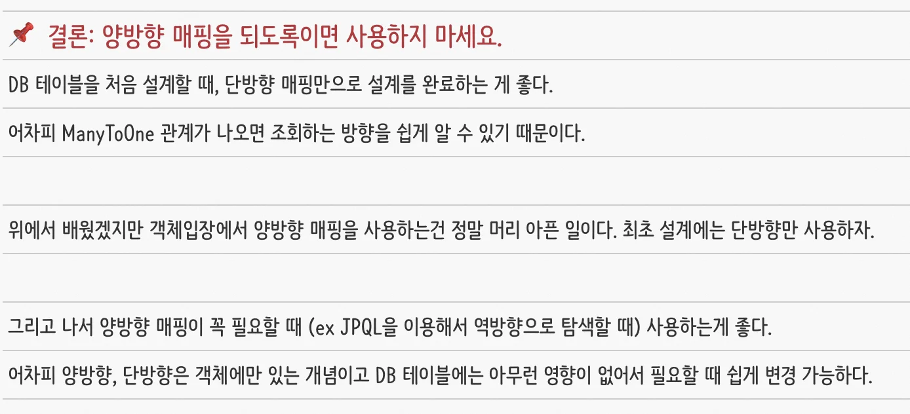
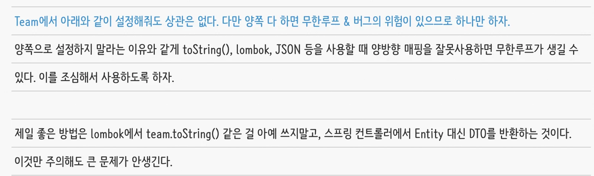
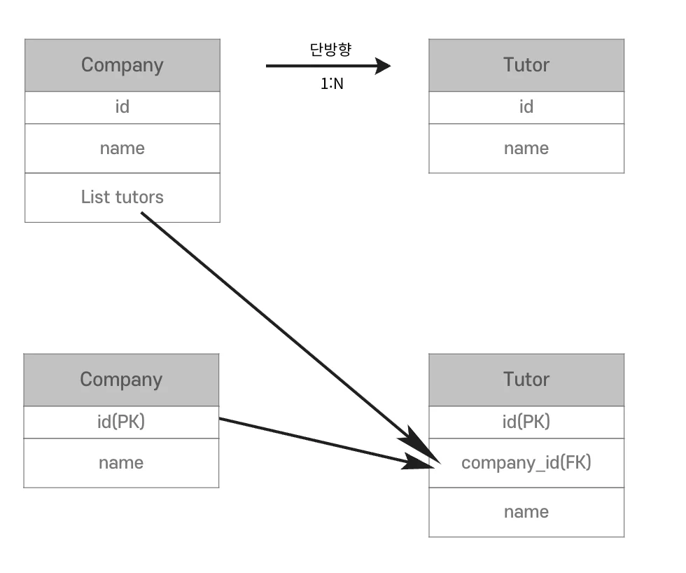
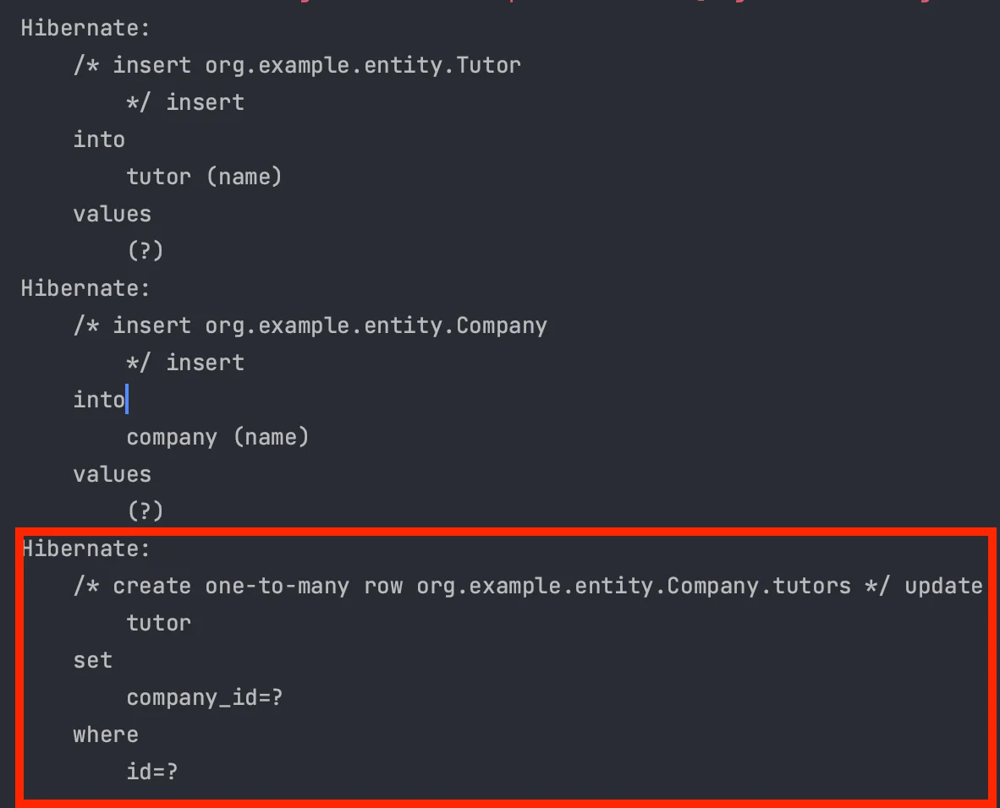
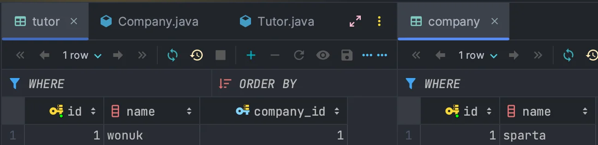
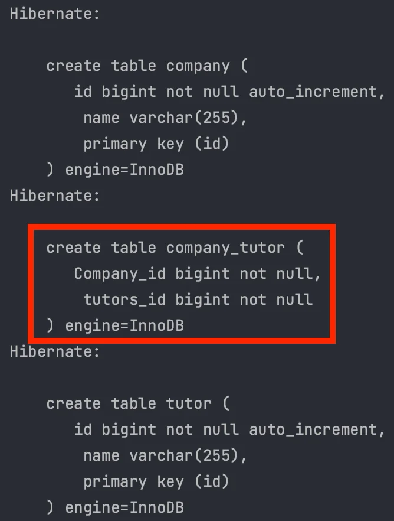
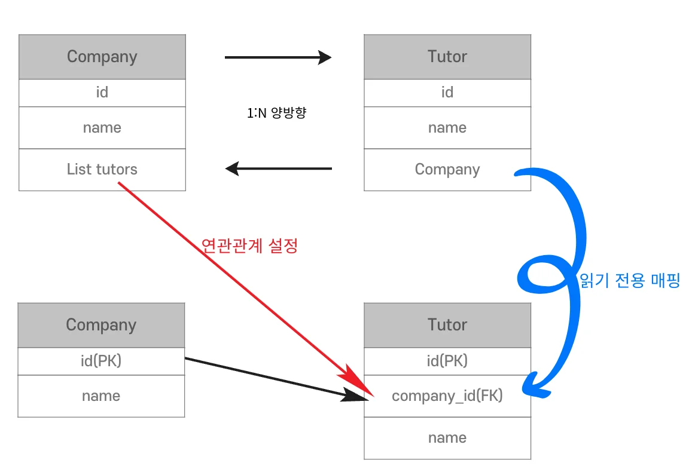

<a id="14beda9b0fe1818e9799e3a15f49d7ad"></a>

## 연관관계 매핑

---

> 📖 
> 
> <a id="14beda9b0fe181bcbdafe1c5f6e514c2"></a>
> 
> JPA 연관관계 매핑을 통해 <u>데이터베이스 테이블 간의 관계</u>를 객체 지향적으로 표현하여 엔티티 클래스들 간의 관계 설정한다&#46;
> 
> <a id="14beda9b0fe1802d9b50f2247ed11e62"></a>
> 
> <u>JPA를 통해 연관관계를 매핑</u>하면 <u>SQL을 직접 작성하지 않</u>고 <u>객체 간의 관계를 활용</u>하여 쉽게 데이터를 조회하고 조작할 수 있다&#46; 

<details>
<summary>연관관계 매핑</summary>

- <code>N&#58;1</code>, <code>1&#58;N</code>, <code>1&#58;1</code>, <code>N&#58;M</code> 연관관계

- 단방향, 양방향 연관관계

- 연관관계의 주인

</details>

<details>
<summary>연관관계 설정 Annotation</summary>

- <code>N&#58;1</code>&#58; <code>&#64;ManyToOne</code>
    - 가장 많이 사용

- <code>1&#58;N</code>&#58; <code>&#64;OneToMany</code>

- <code>1&#58;1</code>&#58; <code>&#64;OneToOne</code>

- <code>N&#58;M</code>&#58; <code>&#64;ManyToMany</code>
    - 조심해서 사용 

</details>

<details>
<summary>단방향, 양방향</summary>

- 테이블
    - 외래 키(FK) 하나로 모든 테이블 JOIN이 가능

- 객체
    - 외래키가 있는 객체만 참조 가능
        - 단방향

    - 참조용 필드가 양쪽에 있는 경우 양방향
        - 단방향 2개

        - 역방향의 경우, JPA에서만 객체지향적으로 참조하기 쉽게 설정하는 값이다&#46; 
            <a id="14beda9b0fe1803b9eebc3c35695256a"></a>

            실제 DB에서는 FK, 단방향만 적용된다&#46; 

        - 양방향
            <a id="14beda9b0fe180019e7be13b76b56c4e"></a>

            양쪽 다 하면 무한루프 &#38; 버그의 위험이 있으므로 하나만 하자&#46;

            <a id="14beda9b0fe18057925cf4a4e5d77f62"></a>

            양쪽으로 설정하지 말라는 이유와 같게 toString(), lombok, JSON 등을 사용할 때 양방향 매핑을 잘못사용하면 무한루프가 생길 수 있다&#46; 이를 조심해서 사용하도록 하자&#46;

</details>

<details>
<summary>연관관계의 주인</summary>

- 외래 키(FK)를 관리하는 객체

- 주인이 아닌 경우 조회만 가능하다&#46; 

- <code>&#64;ManyToOne</code> 으로 설정한 id 값을 pk 값으로 사용한다&#46; 

</details>

<details>
<summary>추가) 학습1</summary>

> ‣

- 연관관계 잘 안건다&#46; 

- id 매핑, FK는 잘 안쓴다&#46; 

- 양방형 걸지 않는다&#46;  → 무한 회귀?

- 단방향만 건다&#46;
    -  oneToMany 왠만하면 안건다&#46; 

    - oneToOne 안건다&#46;

- 단방향을 거는 경우
    - <u>라이프사이클(생명주기) 가 완전히 같</u>다면 ‘고민’한다&#46; 
        - 고민 후 단방향 manyToOne 건다&#46;

    - ‘id’ 로 만 걸어놓으면 그 다음 전략을 선택하기는 쉽다&#46; 

    - r&#46;m을 떡칠핸 놓으면 답이 없다&#46; 

    - 양방향 지옥
        - 양방향 &#43; Entity 도메인으로 사용 
            <a id="14beda9b0fe180e6b355ccf8a0637981"></a>

            → 이 조합의 최악 수, 끔직하다&#46;

> ☝🏻 
> 
> <a id="902bf83aa6854d888a8522762f7bb198"></a>
> 
> 물로 절대적이진 않다&#46; 팀마다 회사마다 case by case 이다&#46; 

- reviewEntity

- reviewImage

</details>

<details>
<summary>추가) 학습2</summary>

<a id="14beda9b0fe18002b583c65c39e89aad"></a>

‣





</details>

<a id="14beda9b0fe18038a81dd2f67ae0ed08"></a>

## 1 &#58; N 단방향

---

> 📖 
> 
> <a id="338eda9b0fe180279947df4b968810c4"></a>
> 
> 한 엔티티가 <code>&#64;OneToMany</code>를 통해 여러 엔티티와 관계를 맺는 경우를 말한다&#46; 이 경우 연관관계의 주인은 1에서 가지고 있다

<details>
<summary><strong>1&#58;N 단방향</strong></summary>



- 1의 Entity가 외래 키(FK)를 관리한다&#46; (연관관계의 주인)

- DB 입장에서는 항상 외래 키가 N 쪽에 위치해야 한다&#46; (설계상 불가)
    - 1(Company)이 N(Tutor)의 외래 키를 수정해야 한다&#46;

</details>

<details>
<summary>실습</summary>

- 코드 예시 
    <details>
    <summary>&#91;코드&#93; Tutor</summary>

    <a id="338eda9b0fe180ab93e0fce020304f76"></a>

    ```java
    @Entity
    @Table(name = "tutor")
    public class Tutor {

        @Id
        @GeneratedValue(strategy = GenerationType.IDENTITY)
        private Long id;

        private String name;

        public Tutor() {
        }

        public Tutor(String name) {
            this.name = name;
        }

    }
    ```

    </details>

    <details>
    <summary>&#91;코드&#93; Company</summary>

    <a id="338eda9b0fe180a39b43d70f84a67854"></a>

    ```java
    @Entity
    @Table(name = "company")
    public class Company {

        @Id
        @GeneratedValue(strategy = GenerationType.IDENTITY)
        private Long id;

        private String name;

        @OneToMany
        @JoinColumn(name = "company_id")
        private List<Tutor> tutors = new ArrayList<>();

        public Company() {
        }

        public Company(String name) {
            this.name = name;
        }

        public List<Tutor> getTutors() {
            return tutors;
        }
    }
    ```

    </details>

    <details>
    <summary>&#91;코드&#93; Main</summary>

    <a id="338eda9b0fe180dca17dc6d25b8ccee7"></a>

    ```java
    public class Main {
        public static void main(String[] args) {
            EntityManagerFactory emf = Persistence.createEntityManagerFactory("entity");

            EntityManager em = emf.createEntityManager();

            EntityTransaction transaction = em.getTransaction();

            transaction.begin();

            try {
    						// Tutor 생성 및 persist
                Tutor tutor = new Tutor("wonuk" );
                em.persist(tutor);
    						
    						// Company 생성 및 persist
                Company company = new Company("sparta");
                // Tutor 테이블에 추가
                company.getTutors().add(tutor);
                em.persist(company);

                transaction.commit();
            } catch (Exception e) {
                transaction.rollback();
            } finally {
                em.close();
            }

            emf.close();
        }
    }
    ```

    </details>

<details>
<summary>실행결과</summary>

- 기존 테이블 삭제 후 실행(충돌 방지)





- 마지막에 update SQL이 추가적으로 실행되어야 한다&#46;
    - 성능상 단점이 있다&#46;

- <code>Company</code> Entity를 수정(add) 했음에도 <code>Tutor</code> 테이블이 수정된다&#46;
    - 객체와 테이블의 차이점으로 생기는 어색한 구조이다&#46;

- 유지보수성을 고려하여 <code>N&#58;1</code> 양방향으로 풀어내면 된다&#46;

</details>

<details>
<summary><strong>&#64;JoinColumn 미사용</strong></summary>

<a id="338eda9b0fe180a89e80d69568261284"></a>

```java
@Entity
@Table(name = "company")
public class Company {

    @Id
    @GeneratedValue(strategy = GenerationType.IDENTITY)
    private Long id;

    private String name;

    @OneToMany
//    @JoinColumn(name = "company_id") 주석처리
    private List<Tutor> tutors = new ArrayList<>();

    public Company() {
    }

    public Company(String name) {
        this.name = name;
    }

    public Long getId() {
        return id;
    }

    public String getName() {
        return name;
    }

    public List<Tutor> getTutors() {
        return tutors;
    }
}
```

- 실행결과
    - 기존 테이블 삭제 후 실행(충돌 방지)

    

    - <code>&#64;JoinColumn</code> 을 사용하지 않으면 중간 테이블 방식을 사용한다&#46;
        - 사용 필수

</details>

</details>

<a id="14beda9b0fe18075829ac295279c454d"></a>

## 1 &#58; N 양방향

---

> 📖 
> 
> <a id="338eda9b0fe1800abef3e03f2d28d1c9"></a>
> 
> 양방향 연관 관계는 하나의 엔티티가 다른 엔티티와 관계를 맺고 그 반대 방향에서도 서로 참조가 가능하도록 설정한 관계이다&#46;
> 
> - 실제 DB에서는 단방향으로 연관관계를 형성한다&#46; (역방향은 성립 X)

<details>
<summary><strong>1&#58;N 양방향</strong></summary>



- <code>Tutor</code>의 참조용 객체 <code>Company</code>는 읽기 전용 매핑이어야 한다&#46;

- 만약, 양쪽에서 수정이 가능하면 예측이 불가능해진다&#46;

- <code>1&#58;N</code> 양방향 연관관계의 주인은 <code>Company</code> 이다&#46;

</details>

<details>
<summary><strong>코드 예시</strong></summary>

<a id="338eda9b0fe180e38f47f6219e99520b"></a>

```java
@Entity
@Table(name = "tutor")
public class Tutor {

    @Id
    @GeneratedValue(strategy = GenerationType.IDENTITY)
    private Long id;

    private String name;

    @ManyToOne
    @JoinColumn(name = "company_id", insertable = false, updatable = false)
    private Company company;

    public Tutor() {
    }

    public Tutor(String name) {
        this.name = name;
    }

    public Long getId() {
        return id;
    }

    public String getName() {
        return name;
    }
}

```

- 연관관계의 주인이 되지 않도록 <code>insertable = false, updatable = false</code> 설정

- <code>1&#58;N</code> 단방향과 같은 이유로 <code>N&#58;1</code> 양방향을 쓰면된다&#46;

</details>
