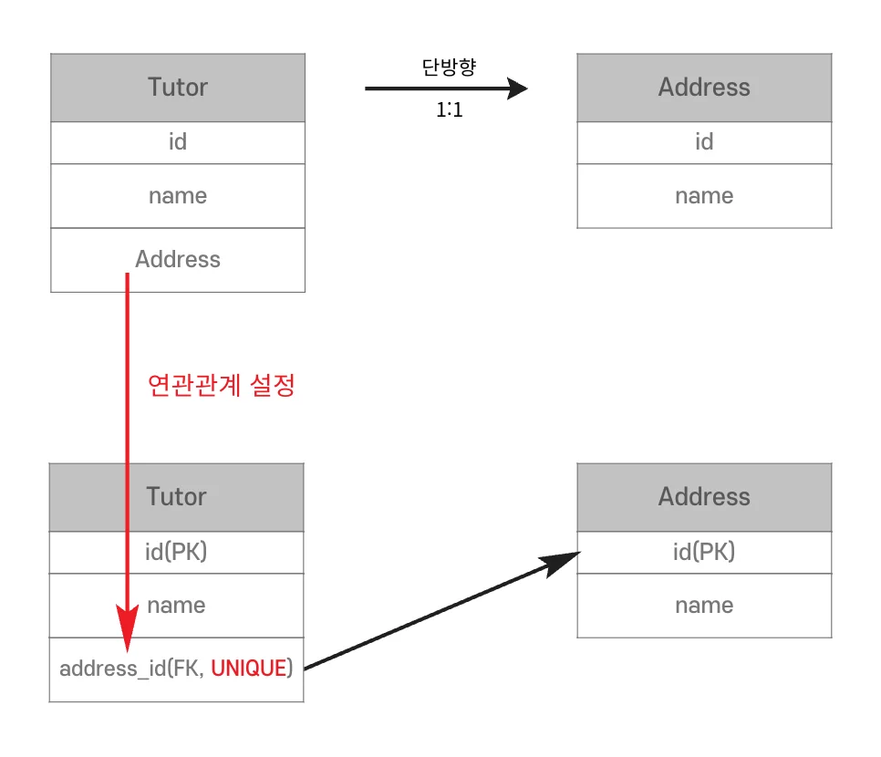
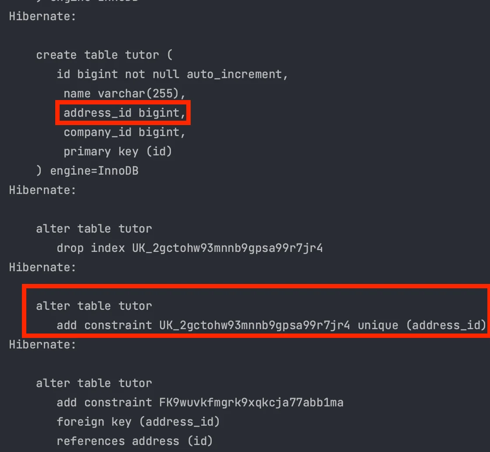
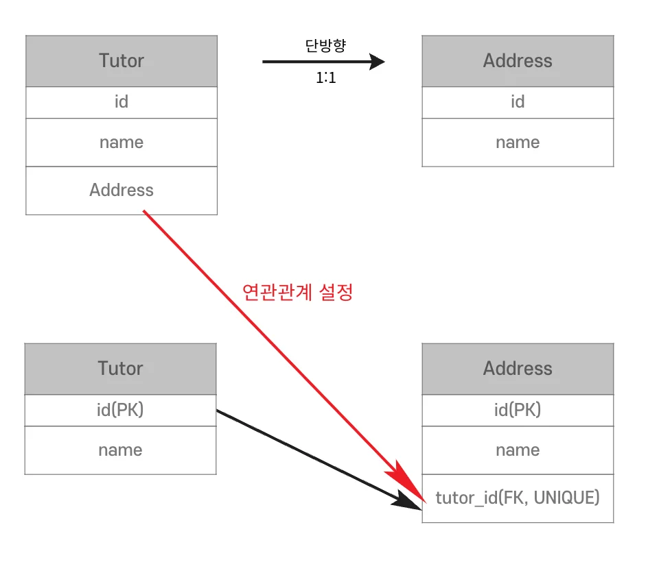
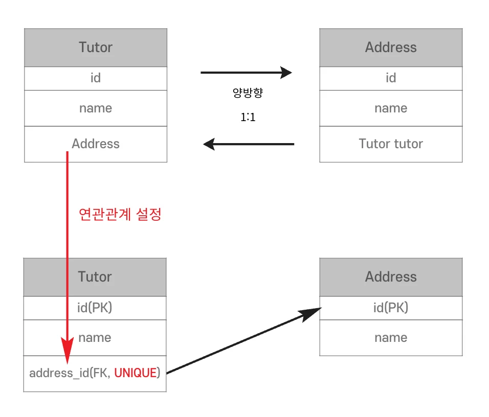
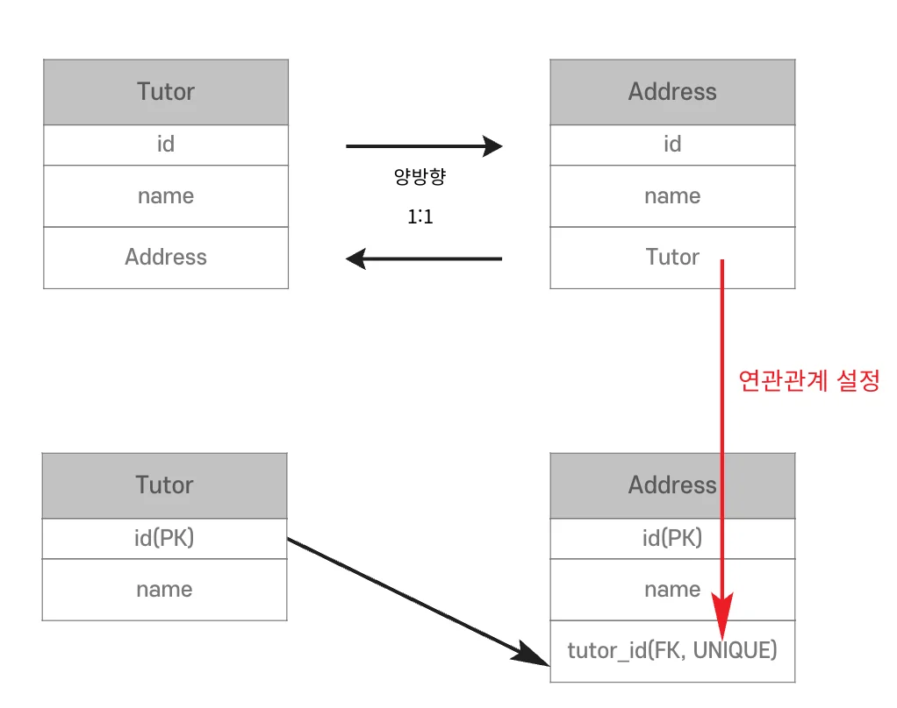
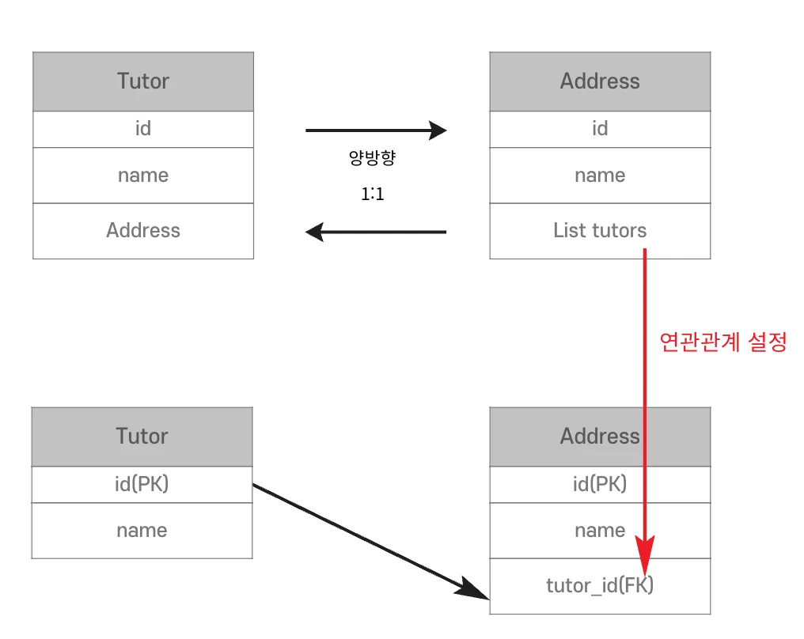
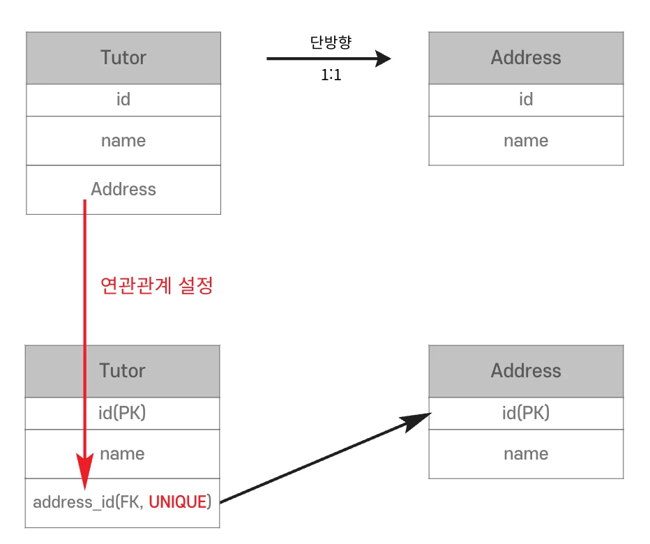

<a id="14beda9b0fe181b3b925c5d5ebb81f1d"></a>

## 1 &#58; 1 단방향

---

> 📖 
> 
> <a id="338eda9b0fe180d7b8aae496aece8924"></a>
> 
> 두 Entity가 <code>&#64;OneToOne</code> 을 통해 서로 단방향 관계를 맺는 경우를 말한다

<details>
<summary><strong>1&#58;1 연관관계 단방향</strong></summary>



- 외래 키(FK)의 주인을 선택할 수 있다&#46;(<code>Tutor</code>로 가정)

- 외래 키에 유니크 제약조건이 필요하다&#46;(<code>1&#58;1</code>)

</details>

<details>
<summary><strong>코드 예시</strong></summary>

<a id="338eda9b0fe180f1aa37e972ca4776d1"></a>

```java
@Entity
@Table(name = "address")
public class Address {

    @Id
    @GeneratedValue(strategy = GenerationType.IDENTITY)
    private Long id;

    private String name;

}
```

<a id="338eda9b0fe180fba9cccc54f7a2b8d7"></a>

```java
@Entity
@Table(name = "tutor")
public class Tutor {

    @Id
    @GeneratedValue(strategy = GenerationType.IDENTITY)
    private Long id;

    private String name;

    @ManyToOne
    @JoinColumn(insertable = false, updatable = false)
    private Company company;

    @OneToOne
    @JoinColumn(name = "address_id", unique = true)
    private Address address;

    public Tutor() {
    }

    public Tutor(String name) {
        this.name = name;
    }
    
    public Long getId() {
        return id;
    }

    public String getName() {
        return name;
    }
}
```

- <strong>실행결과</strong>
    - 기존 테이블 삭제 후 실행(충돌 방지)

    

</details>

<details>
<summary><strong>대상 테이블에 외래 키</strong></summary>



- <code>Tutor</code> Entity의 <code>Address</code>로 <code>Address</code> 테이블의 <code>tutor&#95;id</code>는 관리하지 못한다&#46;

- 애초에 JPA가 지원하지 않는다&#46;

</details>

<a id="338eda9b0fe180d2b42fd3c6c49bf4fb"></a>

## 1 &#58; 1 양방향

---

> 📖 
> 
> <a id="338eda9b0fe1808baefcf41f619aeb1d"></a>
> 
> 두 Entity가 <code>&#64;OneToOne</code> 을 통해 서로 양방향 관계를 맺는 경우를 말한다

<details>
<summary><strong>1&#58;1 연관관계 양방향</strong></summary>



- <code>N&#58;1</code> 양방향 연관관계와 유사하다&#46;

- 외래 키(FK)가 있는 곳이 연관관계의 주인

</details>

<details>
<summary><strong>코드 예시</strong></summary>

<a id="338eda9b0fe180749996df4bb6753bff"></a>

```java
@Entity
@Table(name = "address")
public class Address {

    @Id
    @GeneratedValue(strategy = GenerationType.IDENTITY)
    private Long id;

    private String name;

    // 읽기 전용
    @OneToOne(mappedBy = "address")
    private Tutor tutor;

}
```

- 실행결과는 <code>N&#58;1</code>의 양방향과 같이 읽기 전용으로 동작한다&#46;

</details>

<details>
<summary><strong>대상 테이블에 외래 키 양방향</strong></summary>



- <code>1&#58;1</code>연관관계에서 자신이 가지고 있는 외래 키는 자신이 관리해야 한다&#46;

- <code>Tutor</code> Entity의  <code>Address</code> 는 참조(읽기 전용)객체 이다&#46;

</details>

<a id="338eda9b0fe180ca8a00dcca557f8faa"></a>

## 1 &#58; 1 연관관계 외래 키

---

> 📖 
> 
> <a id="338eda9b0fe180e9a402cb0c016b5ded"></a>
> 
> 1&#58;1 연관관계에서 외래 키는 양쪽 모두가 관리할 수 있다

<details>
<summary><strong>1&#58;1 연관관계 외래 키</strong></summary>

- 둘중 어떤 테이블을 사용해도 무방하다&#46;

- 단, 테이블은 한번 만들어지면 변경이 어렵다&#46;

</details>

<details>
<summary><strong>요구사항 변경</strong></summary>

- 한명의 <code>Tutor</code>가 여러개의 <code>Address</code>를 가질 수 있다&#46;

- 기존 테이블
    

- 수정 테이블
    

    - <code>UNIQUE</code> 제약조건만 지우면 된다&#46;

    - <code>N&#58;1</code> 연관관계로 자연스럽게 변경이 가능하다&#46;

    - 단, 양방향으로 만들어야한다&#46;

- 개발자 관점
    

    - <code>Tutor</code> 테이블에서 접근할 확률이 높으니 <code>Tutor</code> 테이블이 외래 키(FK)를 가지면 편하다&#46;

    - 성능상 이점이 생긴다&#46;

    - 명확한 <code>1&#58;1</code> 연관관계라면 해당 방법을 선택하면 된다&#46;

    - 결국 여러가지 방법 중 장점과 단점을 비교하여 선택하면 된다&#46;

</details>

<details>
<summary><strong>외래 키 위치 장단점</strong></summary>

1. 주 테이블
    - 장점
        - JPA로 객체 지향적인 개발이 가능해진다&#46;

        - 주 테이블만 조회해도 대상 테이블을 조회할 수 있다&#46;

    - 단점
        - 대상 테이블에 값이 없다면 <code>null</code>이 허용된다&#46;
            - 데이터 무결성을 지키지 못한다&#46;

        - 대상 테이블의 데이터를 참조하기 때문에 삭제될 때 외래 키 값을 처리하는 관리 필요

1. 대상 테이블
    - 장점
        - 데이터베이스 무결성 보장

        - 주 테이블과 대상 테이블의 연관관계 변경 시 테이블 구조가 유지된다&#46;

    - 단점
        - 조회 성능이 떨어진다&#46;

        - 연관관계 매핑 설정이 복잡하다&#46;

        - <u>지연 로딩으로 설정해도 즉시 로딩</u>된다&#46;(중요)

</details>
