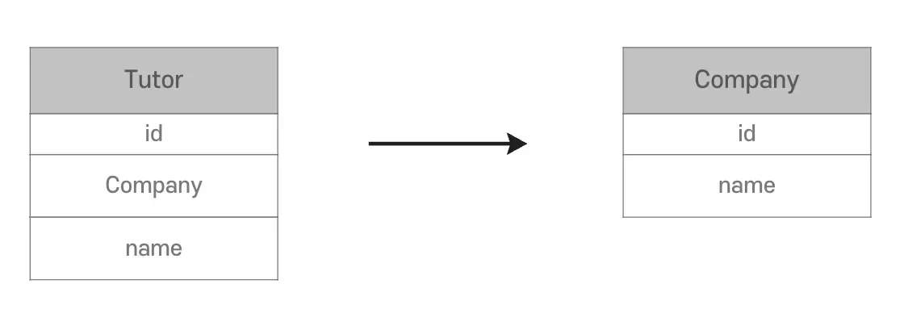
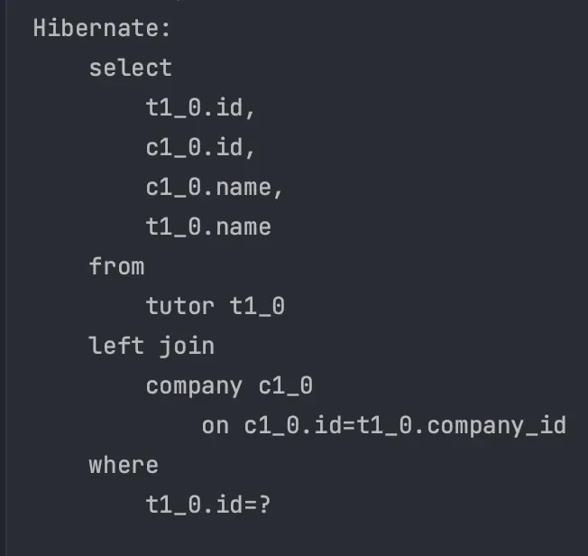
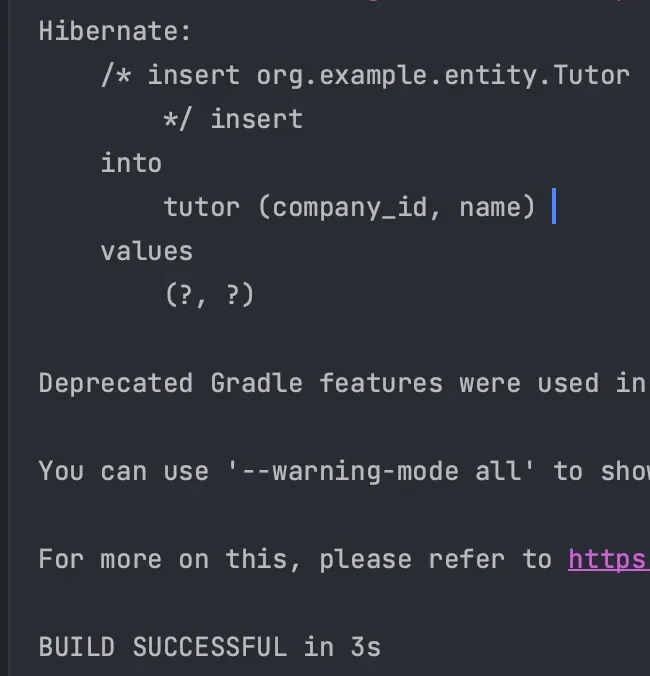
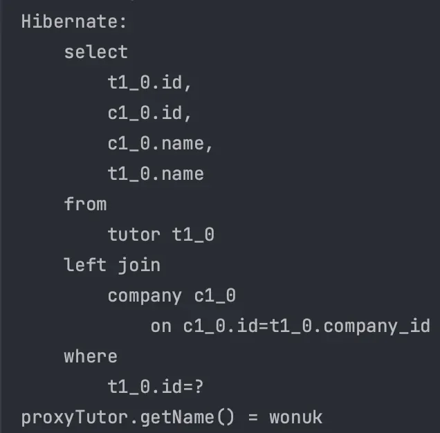
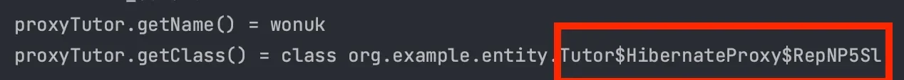
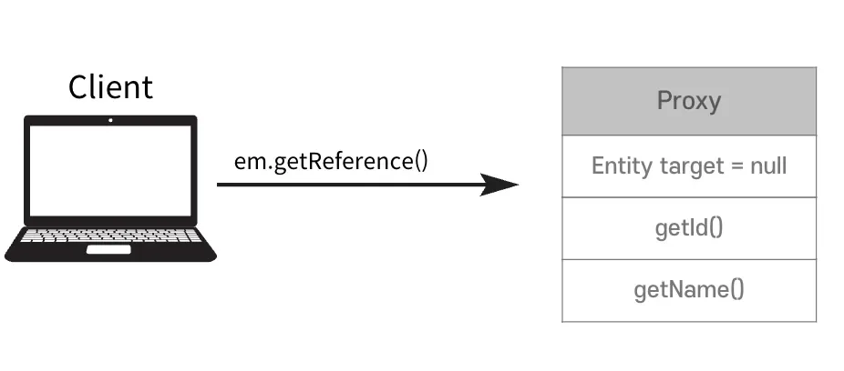
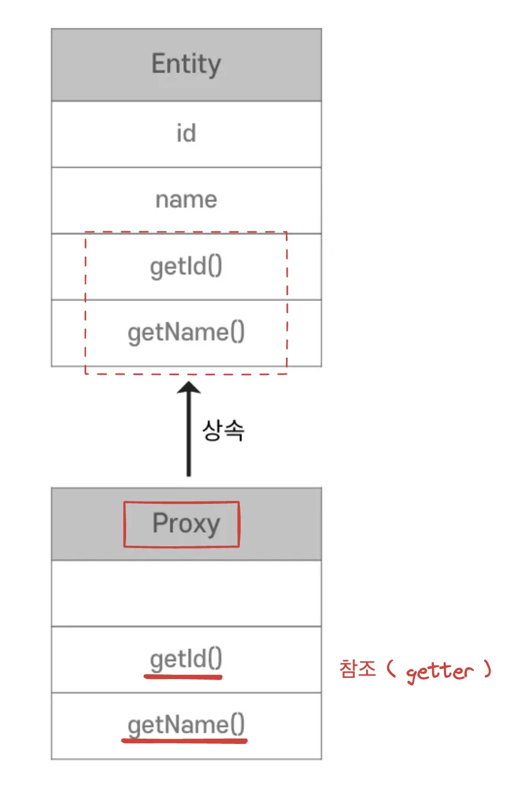
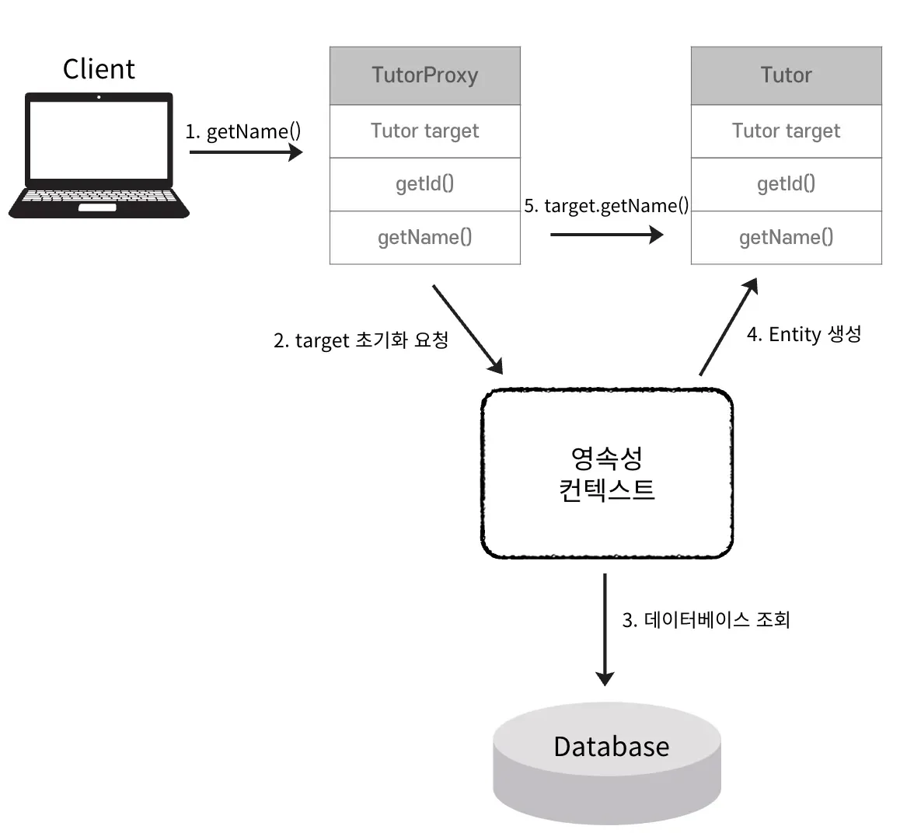
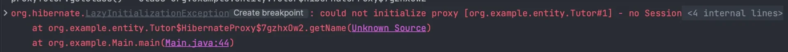
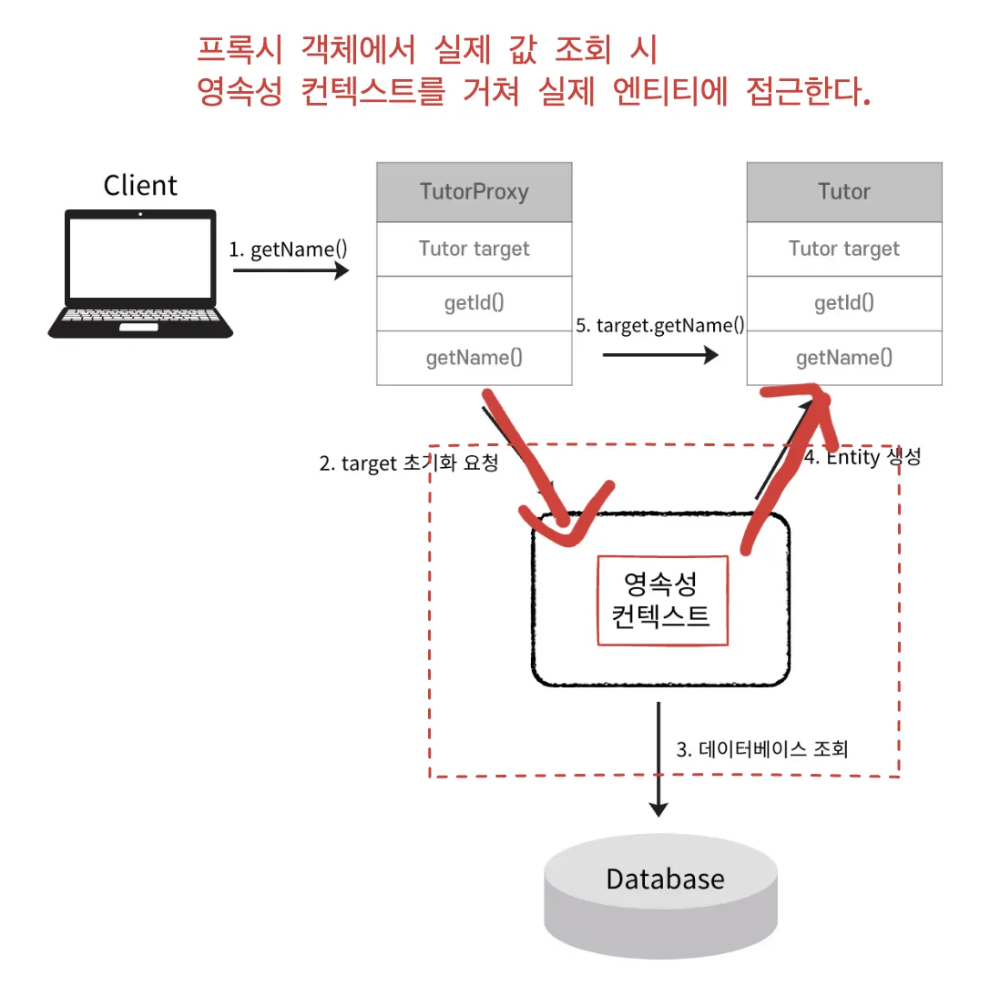

<a id="14beda9b0fe18148bd38d43f3abf85cf"></a>

## Entity 조회

---

> 📖 
> 
> <a id="14beda9b0fe181d29bcfe72e06c196cd"></a>
> 
> <code>em&#46;getReference()</code>는 <u>JPA의 EntityManager에서 제공</u>하는 메서드로 특정 엔티티의 프록시 객체를 반환한다&#46; 
> 
> <a id="14beda9b0fe1803a96a3d9ccfccab6da"></a>
> 
> 지연 로딩(Lazy Loading)을 활용해 데이터베이스 조회를 미루고 실제로 엔티티의속성에 접근할 때 데이터베이스를 조회하도록 한다&#46;

> ☝🏻 
> 
> <a id="53e93bb2671746b0b8b464652c715b1f"></a>
> 
> <code>em&#46;find()</code>는 데이터베이스를 통해 실제로 저장된 Entity를 조회한다&#46;<br>이때 <u>연관관계를 설정한 엔티티까지 같이 조회</u>된다&#46;  → <u><code>N &#43; 1</code></u><u> 문제</u>
> 
> - <code>&#64;ManyToOne</code>  &#45; 기본값&#58; <u>즉시로딩</u>

<details>
<summary>Entity 조회</summary>

<details>
<summary>Entity, 연관관계</summary>



---

<details>
<summary>&#91; 코드 &#93; <code>Entity</code>&#58; Tutor</summary>

<a id="14beda9b0fe180edbea6e1b6b03dc4b4"></a>

```java
@Getter
@Entity
@Table(name = "tutor")
public class Tutor {

    @Id
    @GeneratedValue(strategy = GenerationType.IDENTITY)
    private Long id;

    private String name;

    @ManyToOne
    @JoinColumn(name = "company_id")
    private Company company;

    protected Tutor() {
    }

    public Tutor(String name) {
        this.name = name;
    }

    public void setCompany(Company company) {
        this.company = company;
    }
}
```

</details>

<details>
<summary>&#91; 코드 &#93; <code>Entity</code>&#58; Company</summary>

<a id="bb02839d82654c46a6d6763f909bb590"></a>

```java
@Getter
@Entity
@Table(name = "company")
public class Company {

    @Id
    @GeneratedValue(strategy = GenerationType.IDENTITY)
    private Long id;

    private String name;

    protected Company() {
    }

    public Company(String name) {
        this.name = name;
    }
}
```

</details>

</details>

---

<a id="14beda9b0fe180d0bd2ee335f688491c"></a>

```java
// 1. tutor의 company를 함께 조회하는 경우
Tutor findTutor = em.find(Tutor.class, 1L);

String tutorName = findTutor.getName();
Company tutorCompany = findTutor.getCompany();

System.out.println("tutorName = " + tutorName);
System.out.println("tutorCompany.getName() = " + tutorCompany.getName());
```

<a id="14beda9b0fe1805ba222e29286979ed6"></a>

```java
// 2. tutor만 조회하는 경우
Tutor findTutor = em.find(Tutor.class, 1L);

String tutorName = findTutor.getName();

System.out.println("tutorName = " + tutorName);
```

1. <code>Tutor</code>를 조회할 때 <code>Company</code>를 함께 조회
    - <code>Company</code> 를 매번 함께 조회하는 것은 낭비이다&#46;

1. <code>Tutor</code>만 조회
    - Company 조회를 위해 <u>추가적인 조회 SQL 이 실행</u>되어야 한다&#46; 

- 이때 <u>프록시</u>를 사용하여 <strong>효율적</strong>으로 관리할 수 있다&#46; 

</details>

<details>
<summary><code>em&#46;find()</code> vs  <code>em&#46;getReference()</code></summary>

<details>
<summary><code>em&#46;find()</code> → DB 조회 ( select 쿼리 날림 )</summary>

<a id="14beda9b0fe1801f97b3d615de05558a"></a>

```java
public class Main {
    public static void main(String[] args) {
        EntityManagerFactory emf = Persistence.createEntityManagerFactory("entity");

        EntityManager em = emf.createEntityManager();

        EntityTransaction transaction = em.getTransaction();

        transaction.begin();

        try {

            Tutor tutor = new Tutor("wonuk");
            em.persist(tutor);

            // 영속성 컨텍스트 초기화
            em.flush();
            em.clear();

            // Entity 객체 조회
            Tutor findTutor = em.find(Tutor.class, tutor.getId());

            transaction.commit();
        } catch (Exception e) {
            transaction.rollback();
        } finally {
            em.close();
        }

        emf.close();
    }
}
```

- 실행결과
    - 조회 SQL이 실행된다&#46;

    

</details>

<details>
<summary><code>em&#46;getReference()</code>  →  조회 ❌ </summary>

- 데이터베이스에 저장된 Entity가 아닌 가짜 <u>Entity 객체</u>를 조회한다&#46; 

<a id="14beda9b0fe180dfb1f5d9498002b8f3"></a>

```java
Tutor proxyTutor = em.getReference(Tutor.class, tutor.getId());
```

- 실행결과
    

</details>

<details>
<summary><code>proxyTutor&#46;getName()</code> → <u>실제  값 사용</u> 시, <u>조회 발생</u></summary>

<a id="14beda9b0fe1808cb5f4fb51538620cd"></a>

```java
System.out.println("proxyTutor.getName() = " + proxyTutor.getName());
```

- 실행결과
    - 실제 값이 사용되는 시점에 SQL Query가 실행됨

    

</details>

<details>
<summary><code>proxyTutor</code>  ( <code>em&#46;getReference()</code> 로 조회한 객체 )</summary>

<a id="14beda9b0fe180589f7ff1af0828a37b"></a>

```java
System.out.println("proxyTutor.getClass() = " + proxyTutor.getClass());
```

- 실행결과
    - Hibernate가 만드는 Proxy 객체

    

</details>

</details>

<a id="14beda9b0fe180b0aa0fdd0b1c548026"></a>

## Proxy

---

> 📖 
> 
> <a id="455c031cc3534764859886f7ddd4e6b5"></a>
> 
> JPA에서 엔티티 <u>객체의 </u><u>지연 로딩 (Lazy Loading)</u><u>을 지원</u>하기 위해 사용하는 <u>대리 객체</u>
> 
> <a id="14beda9b0fe180a09eeae3003ba84e4e"></a>
> 
> <u>실제 엔티티 객체를 생성</u>하거나 <u>데이터베이스에서 값을 읽어오지 </u><u>않</u>고 <u>엔티티 참조를 사용할 수 있</u>다&#46;

<details>
<summary>Proxy 객체</summary>



- 데이터베이스 조회를 지연하는 가짜(Proxy) 객체를 조회
    - 실제 Entity
        -  <code>==</code>  비교  →  ❌

        - <code>instanceof</code> → <strong>O</strong>
            - 원본(주) 객체를 상속한, 참조값만 보관하는 가짜 객체

            - 상속이기 때문에 <code>instanceof</code>는 가능하다&#46;

    

</details>

<details>
<summary>Proxy 객체 초기화  과정</summary>



> 주 객체&#58; <code>target</code>

1. <code>em&#46;getReference()</code>  &#45; 프록시 객체 조회

1. <code>getName()</code> &#45; 프록시 객체의 <code>getName()</code> 호출

1. JPA가 영속성 컨텍스트에 <code>target</code>  초기화 요청

1. 실제 DB 조회

1. Entity 생성

1. <code>target</code> 의 <code>getName()</code> 호출

</details>

<details>
<summary>Proxy 특징</summary>

- <u>최초로 사용( 실제 Entity에 접근 ) 할 때</u>  힌 번만 초기화

- 프록시 객체를 통해 실제 Entity에 접근 가능 

- <code>em&#46;getReference()</code> 호출 시 ,<u>영속성 컨텍스트에 Entity가 존재</u>하면 <u>실제 Entity가 반환</u>됨  
    - select 쿼리 ❌ 

- <u>준영속 상태</u>에서 <u>프록시</u>를 <u>초기화</u>하면 <code>LazyInitializationException</code> 예외 발생
    <a id="14beda9b0fe180f3a72cc5d515628e57"></a>

    ```java
    Tutor proxyTutor = em.getReference(Tutor.class, tutor.getId());
    System.out.println("proxyTutor.getClass() = " + proxyTutor.getClass());

    // 준영속 상태
    em.detach(proxyTutor);

    proxyTutor.getName();
    ```

    - 실행결과 &#45; <code>LazyInitializationException</code>
        

        - <code>detach()</code>
            - 특정 엔티티를 <strong><u>영속성 컨텍스트에서 분리</u></strong>하여 <strong><u>준영속(detached)</u></strong> 상태로 만드는 메서드

            -  따라서 <u>영속성 컨텍스트에서 관리하지 않</u>는다&#46; 

        - 실제 JPA 개발에서 가장 많이 마주치는 <code>Exception</code>

        - 영<u>속성 컨텍스트를 통해</u> 도움 받아야만 <u>실제 Entituy에 접근</u><u> 가능</u>
            

</details>
