<a id="14beda9b0fe1818e8f6acb5fb5122e15"></a>

## 테이블 전략

---

> 📖 
> 
> <a id="14beda9b0fe18174914ed83c109ad7b3"></a>
> 
> JPA에서 <u>엔티티 </u><u>상속 구조</u>를 <u>데이터베이스 </u><u>테이블</u><u>에 </u><u>매핑</u>하는 방법<br>

> ☝🏻 
> 
> <a id="b36f98c7965e4dbd86a934d84dc2e072"></a>
> 
> <u>관계형 데이터베이스의 테이블</u>에는 <u>상속 관계가 없</u>다&#46;

<details>
<summary>상속관계 매핑 구현방법 &#45; 3가지</summary>

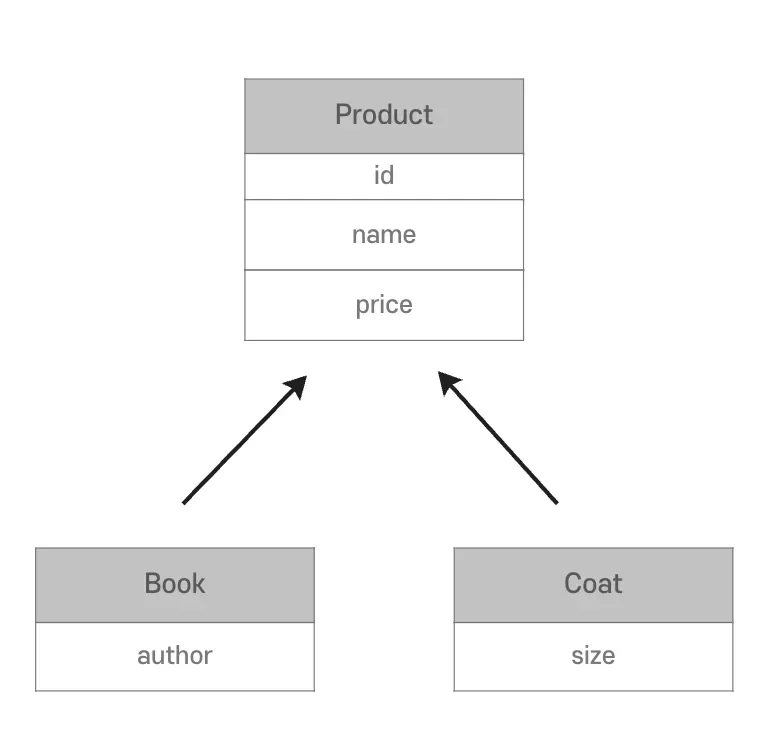

<details>
<summary>1&#46; 조인 전략</summary>

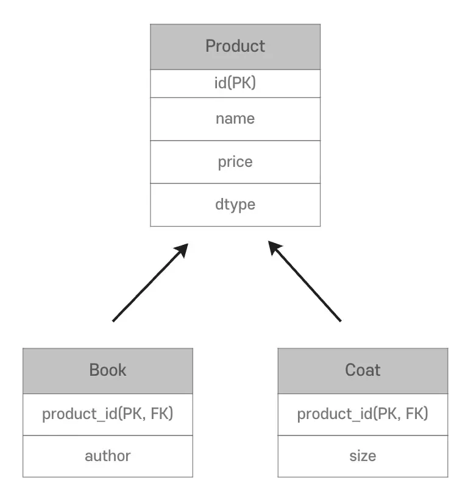

- 각각을 테이블로 만든다&#46; 

- <code>DTYPE</code>으로 어떤 테이블의 데이터인지 구분

</details>

<details>
<summary>2&#46; 단일 테이블 전략</summary>

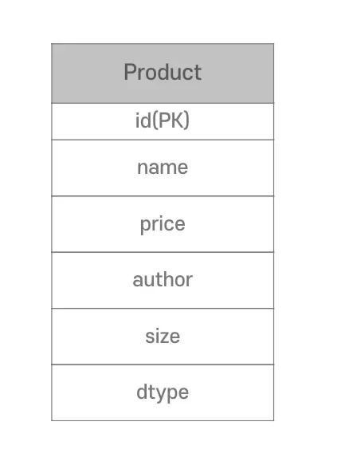

- 하나의 테이블로 생성
    - 자식 엔티티의 모든 필드들이 하나의 테이블에 담김

- <code>DTYPE</code>으로 어떤 테이블의 데이터인지 구분

- <code>author</code> 혹은 <code>size</code>가 <code>null</code>이 허용
    - 모든 자식 엔티티들의 필드들이 하나의 테이블에 담기기 때문에, <br>각 자식 엔티티의 해당되는 필드 값들만 DB로 넘어간다&#46;<br>따라서 다른 자식 엔티티의 필드들은 <code>null</code> 로 초기화된다&#46;

</details>

<details>
<summary>3&#46; 구현 클래스</summary>

- 구현 클래스 각각을 테이블로 만든다&#46;

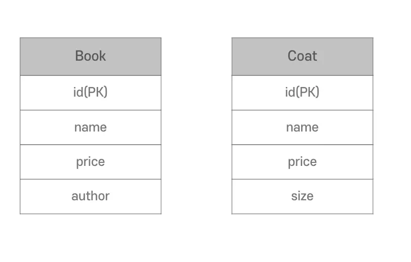

</details>

</details>

<a id="14beda9b0fe1803fbf43fe198f5bf015"></a>

## JPA의 테이블 전략

---

> 📖 
> 
> <a id="14beda9b0fe1803fb687f3223c9fc5b8"></a>
> 
> JPA는 모든 전략으로 테이블을 구현할 수 있도록 지원한다&#46; 
> 
> - JPA 테이블 전략 방법 정리
>     - <code>&#64;Inheritance</code>
> 
>     - <code>&#64;DiscriminatorColum</code>
> 
>     - <code>&#64;DiscriminatorValue</code>

<details>
<summary><strong>Annotation</strong></summary>

<details>
<summary><u><code>&#64;Inheritance</code></u><code>(strategy = InheritanceType&#46;&#36;{전략})</code></summary>

1. <code>JOINED</code>&#58; 조인

1. <code>SINGLE&#95;TABLE</code>&#58; 단일 테이블(Default)

1. <code>TABLE&#95;PER&#95;CLASS</code>&#58; 구현 클래스

</details>

<details>
<summary><u><code>&#64;DiscriminatorColum(</code></u><code>name = ”dtype”)</code></summary>

- <code>dtype</code> 컬럼 생성 (관례)&#46;

- 이름 변경 가능

- 기본 값 &#58; <code>DTYPE</code>

</details>

<details>
<summary><u><code>&#64;DiscriminatorValue</code></u><code>(&#34;&#36;{값}&#34;)</code> </summary>

- <code>dtype</code> 값 지정

- 기본 값&#58; 클래스 이름

</details>

</details>

<details>
<summary>예시</summary>

<details>
<summary>1) <u>싱글 테이블</u> 전략 ( <code>SINGLE&#95;TABLE</code> ) &#91; 기본값 (<code>Default</code>) &#93;</summary>

<details>
<summary>&#91; 코드 &#93; <code>부모 엔티티</code>  Product</summary>

<a id="14beda9b0fe180b68a86f0a3d301b78b"></a>

```java
@Entity
@Table(name = "product")
@DiscriminatorColumn(name = "dtype")
public abstract class Product {

    @Id
    @GeneratedValue(strategy = GenerationType.IDENTITY)
    private Long id;

    private String name;

    private BigDecimal price;

    public Product() {
    }

    public Product(String name, BigDecimal price) {
        this.name = name;
        this.price = price;
    }
}
```

</details>

<details>
<summary>&#91; 코드 &#93; <code>자식 엔티티</code>  Book</summary>

<a id="14beda9b0fe180c3af73f6c3f0905867"></a>

```java
@Entity
@Table(name = "book")
@DiscriminatorValue(value = "B")
public class Book extends Product {

    private String author;

    public Book() {
    }

    public Book(String author, String name, BigDecimal price) {
        super(name, price);
        this.author = author;
    }
}
```

</details>

<details>
<summary>&#91; 코드 &#93; <code>자식 엔티티</code> Coat</summary>

<a id="14beda9b0fe180f98a4ce159394869a0"></a>

```java
@Entity
@Table(name = "coat")
@DiscriminatorValue(value = "C")
public class Coat extends Product {

    private Integer size;
}
```

</details>

<details>
<summary>테스트 </summary>

<details>
<summary>&#91; 코드 &#93; Main</summary>

<a id="14beda9b0fe180648385d893b86ccc2f"></a>

```java
public class Main {
    public static void main(String[] args) {
        EntityManagerFactory emf = Persistence.createEntityManagerFactory("entity");

        EntityManager em = emf.createEntityManager();

        EntityTransaction transaction = em.getTransaction();

        transaction.begin();

        try {

            Book book = new Book("wonuk", "spring-advanced", BigDecimal.TEN);
            em.persist(book);

            transaction.commit();
        } catch (Exception e) {
            transaction.rollback();
        } finally {
            em.close();
        }

        emf.close();
    }
}
```

</details>

- 실행 결과
    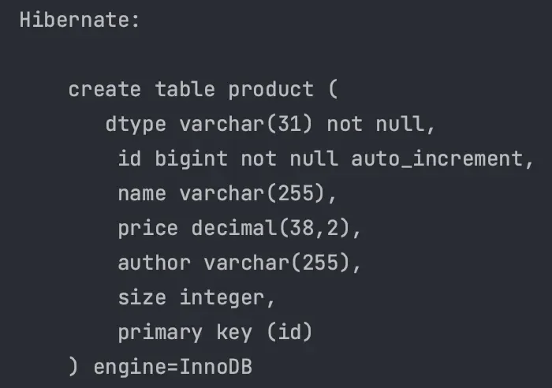

    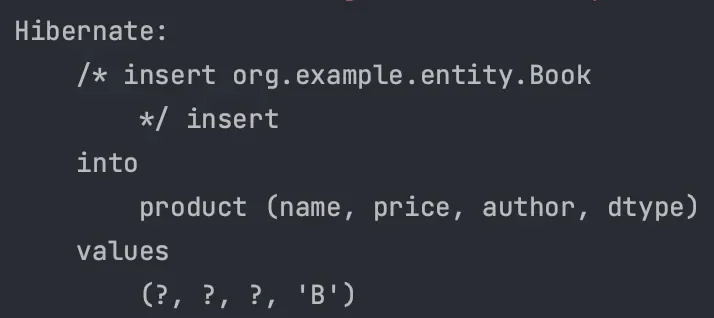

    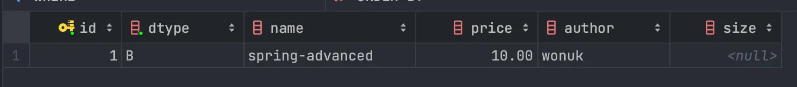

</details>

</details>

<details>
<summary>2) <u>조인 테이블</u> 전략 ( <code>JOINED</code> )</summary>

<details>
<summary>&#91; 코드 &#93; <code>부모 엔티티</code>  Product</summary>

<a id="6d2019e662604b27a2b0d332ce12453e"></a>

```java
@Entity
@Table(name = "product")
@DiscriminatorColumn(name = "dtype")
@Inheritance(strategy = InheritanceType.JOINED)
public abstract class Product {

    @Id
    @GeneratedValue(strategy = GenerationType.IDENTITY)
    private Long id;

    private String name;

    private BigDecimal price;

    public Product() {
    }

    public Product(String name, BigDecimal price) {
        this.name = name;
        this.price = price;
    }

    public Long getId() {
        return id;
    }
}
```

</details>

<details>
<summary>&#91; 코드 &#93; <code>자식 엔티티</code>  Book</summary>

<a id="bb83ef0d61494dd4b0d99c848f27dc75"></a>

```java
@Entity
@Table(name = "book")
@DiscriminatorValue(value = "B")
public class Book extends Product {

    private String author;

    public Book() {
    }

    public Book(String author, String name, BigDecimal price) {
        super(name, price);
        this.author = author;
    }
}
```

</details>

<details>
<summary>&#91; 코드 &#93; <code>자식 엔티티</code> Coat</summary>

<a id="4a4db96673554f87952029af5200646c"></a>

```java
@Entity
@Table(name = "coat")
@DiscriminatorValue(value = "C")
public class Coat extends Product {

    private Integer size;
}
```

</details>

<details>
<summary>테스트 </summary>

<details>
<summary>&#91; 코드 &#93; Main</summary>

<a id="5f591b27b2ee450992c0561725c09b82"></a>

```java
public class Main {
    public static void main(String[] args) {
        EntityManagerFactory emf = Persistence.createEntityManagerFactory("entity");

        EntityManager em = emf.createEntityManager();

        EntityTransaction transaction = em.getTransaction();

        transaction.begin();

        try {

            Book book = new Book("wonuk", "spring-advanced", BigDecimal.TEN);
            em.persist(book);

            em.flush();
            em.clear();

            Book findBook = em.find(Book.class, book.getId());


            transaction.commit();
        } catch (Exception e) {
            transaction.rollback();
        } finally {
            em.close();
        }

        emf.close();
    }
}
```

</details>

<details>
<summary>실행 결과</summary>

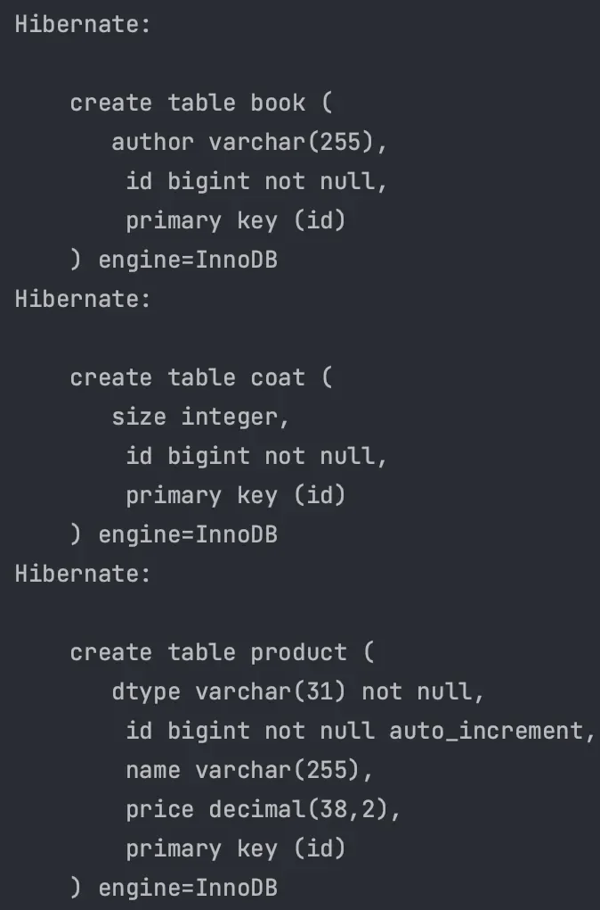

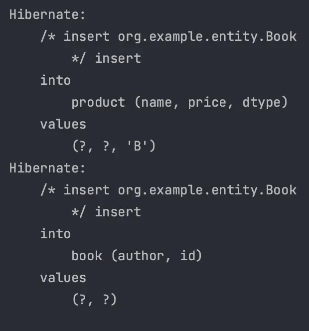

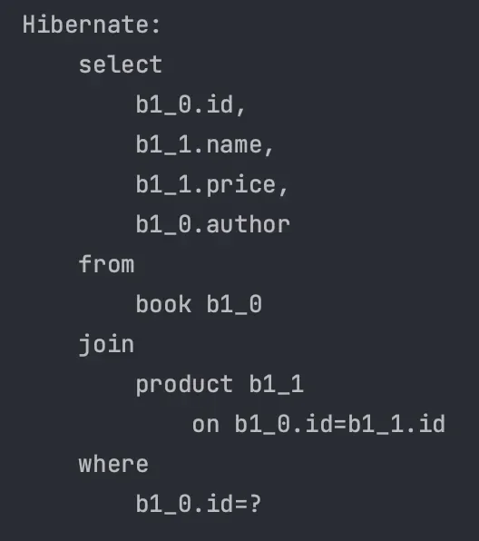

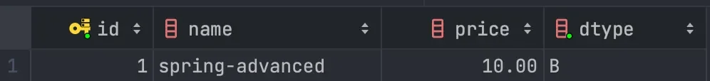

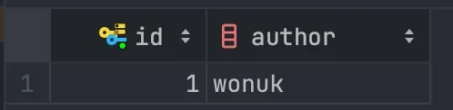

</details>

</details>

> ☝🏻 
> 
> <a id="52fcc5362d9f43b382469e37750a3a82"></a>
> 
> JPA의 <u>조인 전략</u>에서 <u><code>&#64;DiscriminatorColumn</code></u><u>을 선언하지 않</u>으면 <u><code>DTYPE</code></u><u> 컬럼이 생성되지 않</u>는다&#46; 
> 
> <a id="14beda9b0fe180a08672c5dd6f4de104"></a>
> 
> (<u>부모 클래스의 기본 키</u>를 <u>자식 클래스에서 외래 키</u>로 사용)
> 
> <a id="14beda9b0fe180f3963aff159f22417f"></a>
> 
> <u>JOIN을 통해 테이블을 구분</u>할 수 있지만, <u><code>DTYPE</code></u><u> 컬럼을 넣</u>어주는 것이 <u>명확</u>하다&#46;

</details>

<details>
<summary>3) <u>구현 테이블</u> 전략 ( <code>TABLE&#95;PER&#95;CLASS</code> )</summary>

<details>
<summary>&#91; 코드 &#93; <code>부모 엔티티</code>  Product</summary>

<a id="3be891521da0479da7ab94becfcbe121"></a>

```java
@Entity
@Table(name = "product")
@Inheritance(strategy = InheritanceType.TABLE_PER_CLASS)
public abstract class Product {

    @Id
    @GeneratedValue(strategy = GenerationType.AUTO)
    private Long id;

    private String name;

    private BigDecimal price;

    public Product() {
    }

    public Product(String name, BigDecimal price) {
        this.name = name;
        this.price = price;
    }

    public Long getId() {
        return id;
    }
}
```

</details>

<details>
<summary>&#91; 코드 &#93; <code>자식 엔티티</code>  Book</summary>

<a id="b5c53d58467848acb779c9b2eee5bf18"></a>

```java
@Entity
@Table(name = "book")
@DiscriminatorValue(value = "B")
public class Book extends Product {

    private String author;

    public Book() {
    }

    public Book(String author, String name, BigDecimal price) {
        super(name, price);
        this.author = author;
    }
}
```

</details>

<details>
<summary>&#91; 코드 &#93; <code>자식 엔티티</code> Coat</summary>

<a id="4063a02e013a4b40ab90fb5b137075de"></a>

```java
@Entity
@Table(name = "coat")
@DiscriminatorValue(value = "C")
public class Coat extends Product {

    private Integer size;
}
```

</details>

<details>
<summary>테스트 </summary>

<details>
<summary>&#91; 코드 &#93; Main</summary>

<a id="f405a040791143e7a0dfe649454c9f31"></a>

```java
public class Main {
    public static void main(String[] args) {
        EntityManagerFactory emf = Persistence.createEntityManagerFactory("entity");

        EntityManager em = emf.createEntityManager();

        EntityTransaction transaction = em.getTransaction();

        transaction.begin();

        try {

            Book book = new Book("wonuk", "spring-advanced", BigDecimal.TEN);
            em.persist(book);

            em.flush();
            em.clear();

            Book findBook = em.find(Book.class, book.getId());


            transaction.commit();
        } catch (Exception e) {
            transaction.rollback();
        } finally {
            em.close();
        }

        emf.close();
    }
}
```

</details>

<details>
<summary>실행 결과</summary>

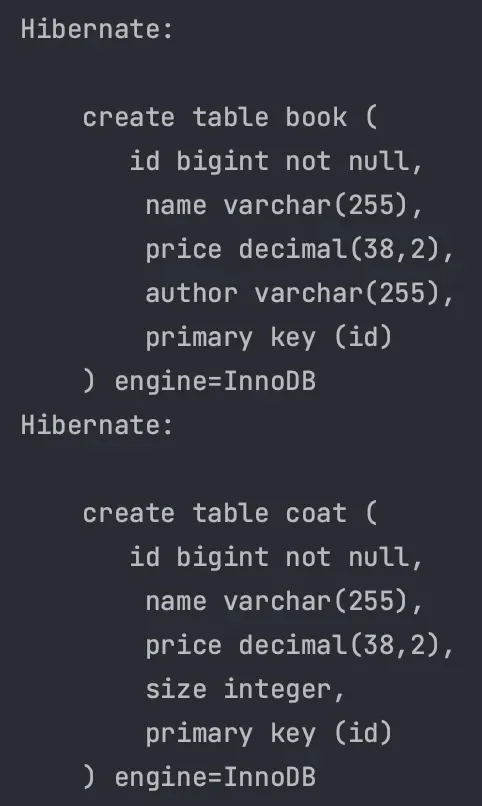

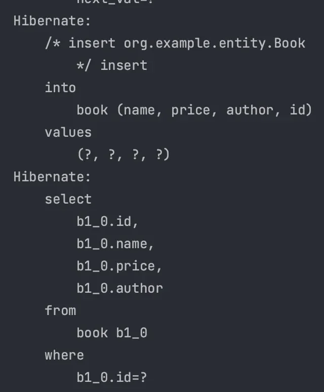

</details>

</details>

> ☝🏻 
> 
> <a id="71387082cf3a463fa5f5d97ef6d7db4a"></a>
> 
> <u>부모( </u><u><code>Product</code></u><u> )테이블</u>은 <u>실제 생성되는 테이블이 아니기 때문</u>에 반드시  추상 클래스 ( <code>abstract</code> )여야 한다&#46;

> ☝🏻 
> 
> <a id="14beda9b0fe180b1a135fab5205d5b54"></a>
> 
> JPA <u>구현 클래스 전략</u>에서는 <u>상속 관계를 무시하고 각 테이블이 별도의 ID 시퀀스를 관리</u>해야 한다&#46; 동일한 <code>&#64;Id</code> 값을 가진 데이터가 여러 테이블에 존재할 수 있다&#46; <br>→  <code>GenerationType&#46;IDENTITY</code> 를 사용하지 못한다&#46;

</details>

</details>

<details>
<summary><strong>🤬 </strong>TABLE&#95;PER&#95;CLASS 문제점</summary>

> 📌 
> 
> <a id="e360f165cee94ede8e559e58f5c04f2e"></a>
> 
> 부모 클래스로 조회하면 모든 테이블을 조회해야 한다&#46;

<details>
<summary>&#91; 코드 &#93;</summary>

<a id="14beda9b0fe180d28018e7c126bfa62a"></a>

```java
public class Main {
    public static void main(String[] args) {
        EntityManagerFactory emf = Persistence.createEntityManagerFactory("entity");

        EntityManager em = emf.createEntityManager();

        EntityTransaction transaction = em.getTransaction();

        transaction.begin();

        try {

            Book book = new Book("wonuk", "spring-advanced", BigDecimal.TEN);
            em.persist(book);

            em.flush();
            em.clear();

            Product findProduct = em.find(Product.class, book.getId());

            transaction.commit();
        } catch (Exception e) {
            transaction.rollback();
        } finally {
            em.close();
        }

        emf.close();
    }
```

</details>

<details>
<summary>실행결과</summary>

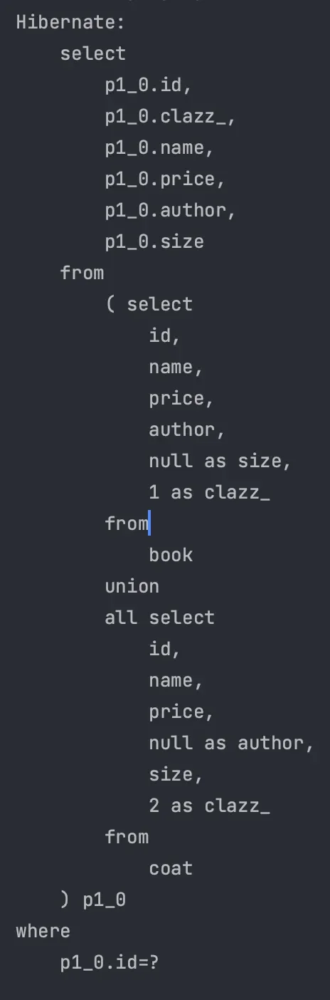

</details>

</details>

<details>
<summary>각 테이블 전략의 장단점</summary>

<details>
<summary><strong>JOINED</strong></summary>

- 장점
    1. <u>테이블 정규화</u>

    1. <u>외래 키 참조 무결성</u>

    1. <u>저장공간 효율</u>

- 단점
    1. <u>조회시 </u><u><code>JOIN</code></u><u>을 많이 사용</u>한다&#46; 

    1. 데이터 저장시 I<u>NSERT SQL 이 2번 호출</u>된다&#46;

    1. <u>SQL Query가 복잡</u>하여 <u>성능이 저하</u>될 수 있다&#46;

</details>

<details>
<summary><strong>SINGLE&#95;TABLE</strong></summary>

- 장점
    1. <u>JOIN을 사용하지 않</u>는다&#46;

    1. <u>실행되는 SQL이 단순</u>하다&#46;

- 단점
    1. <u>자식 Entity가 매핑한 컬럼</u>은 모두 <code>null</code>을 허용한다&#46;

    1. <u>단일 테이블에 모든 것을 저장</u>하므로 테이블이 커질 수 있다&#46;

    1. <u>상황에 따라서</u> 조회 성능이 오히려 느려질 수 있다&#46;

</details>

<details>
<summary><strong>TABLE&#95;PER&#95;CLASS ( 사용 X )</strong></summary>

> <u>테이블끼리 연관짓기 힘</u>들다, 사용하지 않는것을 권장한다&#46;

- 장점
    1. <u>자식 클래스를 명확하게 구분</u>해서 처리할 수 있다&#46;

    1. <u><code>not null</code></u><u> 제약조건 사용</u>이 가능하다&#46;

- 단점
    1. <u>여러 자식 테이블을 함께 조회</u>할 때 <u>성능이 느리다&#46;</u>

    1. <u>부모 객체 타입으로 조회</u>할 때 <u>모든 테이블을 조회</u>해야 한다&#46;

</details>

</details>

<details>
<summary><strong>선택 기준</strong></summary>

> 두 방법의 장단점을 구분하여 <u>상황에 맞는 선택</u>을 해야한다&#46;

- <u>비지니스적으로 복잡</u>하다 →<code>JOINED</code>
    - <u>객체 지향적인 개발에</u> 어울리는 방법

- <u>단순하고 확장 가능성이 없</u>다 →  <code>SINGLE&#95;TABLE</code>

</details>

> ✏️ 
> 
> <a id="14beda9b0fe180278d19d33dec589c44"></a>
> 
> 설계상 <code>TABLE&#95;PER&#95;CLASS</code> 와 같이 <u>단순히 공통 컬럼이 필요</u>하다면 <code>&#64;MappedSuperclass</code> 를 사용하면 된다&#46; 
> 
> <a id="14beda9b0fe180c8a6e6e7c246993350"></a>
> 
> ( 이전 스프링 숙련 &#45; JPA Auditing에서 학습)
