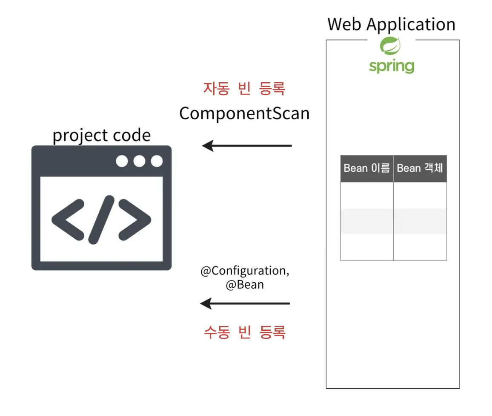
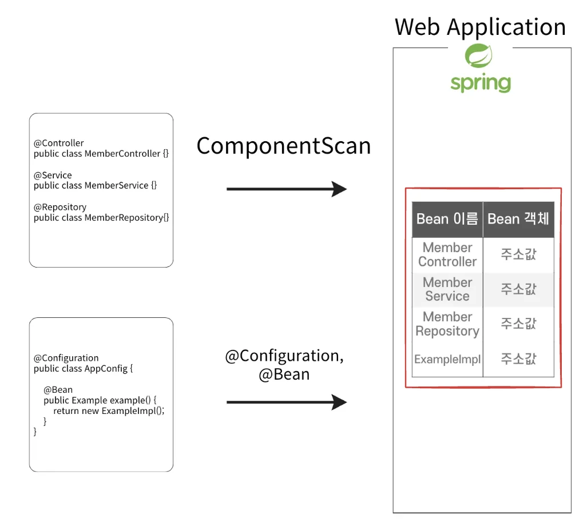
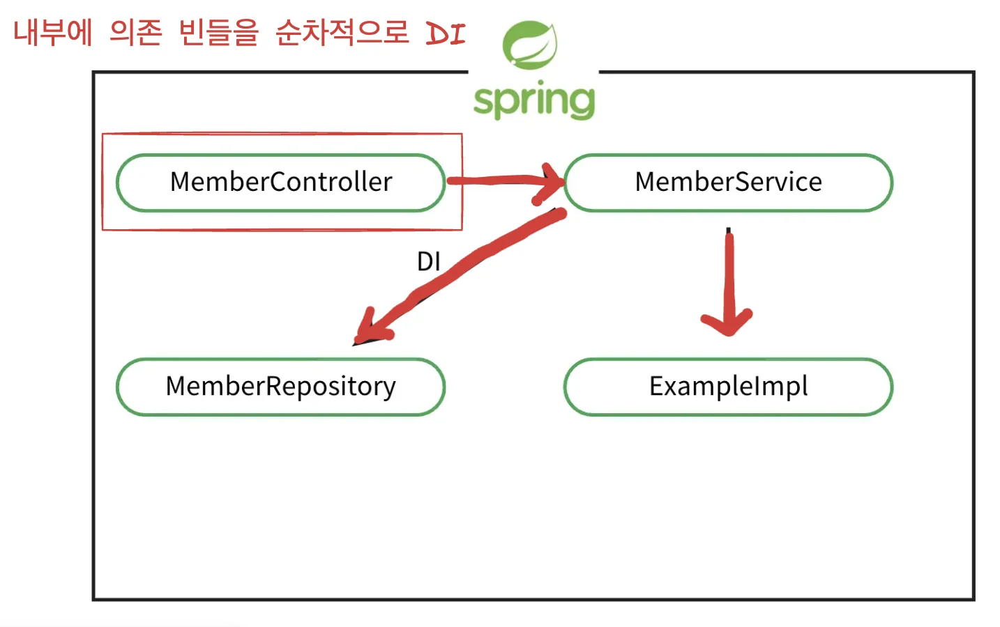
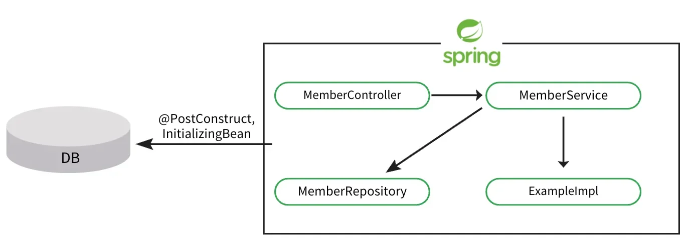
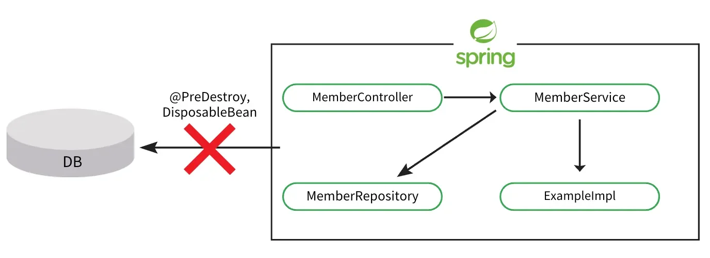

<a id="14beda9b0fe181ec9221c24cb9025e22"></a>

## 생명주기와 콜백

---

> 📖 
> 
> <a id="14beda9b0fe181b4946ee4d767f5678e"></a>
> 
> 콜백 메서드는 Spring <u>Bean 생명주기</u>의  <u>특정 시점에 실행</u>되도록 설정된 메서드<br>초기화, 종료 시점에 필요한 작업(리소스 초기화, 정리)을 처리할 때 주로 사용한다,

> ☝🏻 
> 
> <a id="f7658d2316ef42b4bd3e1dba45298e48"></a>
> 
> Spring 에서 <u>Bean의 생성, 관리, 소멸(라이프 사이클)</u>을 <u>자동으로 관리</u>한다&#46;<br>따라서 개발자가 <u>직접 빈(객체)의 생명주기를 관리할 필요가 없</u>다&#46; 

<details>
<summary>Spring에서<u> 빈의 &#91; 생성, 주입,  사용, 소멸 &#93;</u> 과정에서의 콜백 메서드 (초기화, 소멸 ) 호출</summary>

<details>
<summary>1&#46; Spring Container 생성</summary>



- 애플리케이션이 실행되면 Spring은 <code>ApplicationContext</code> 또는 <code>BeanFactory</code>와 같은 <u>컨테이너를 생성</u>

- 컨테이너는 <code>&#64;Congfiguration</code>, <code>&#64;ComponentScan</code>  또는 XML 파일 등 설정을 통해 Bean의 정보를 읽는다&#46; 

</details>

<details>
<summary>2&#46; Bean 인스턴스 생성</summary>



- 컨테이너는 읽어온 Bean 인스턴스를 생성한다&#46; 

- 일반적으로 <u>기본 생성자가 호출</u>되어 <u>객체가 생성</u>된다&#46; 

- 이 과정에서 싱글톤 Bean은 앱이 시작할 때 미리 생성된다&#46; 

<details>
<summary>🧐  의존성 주입 시에도 프로토타입 빈으로 생성되어 주입 되는가?</summary>

- 프로토타입 빈
    <a id="14ceda9b0fe18044af42ee1a0a920814"></a>

    <strong>요청할 때마다 새로운 인스턴스를 생성</strong>하는 스코프

    <a id="14beda9b0fe1812789e5c6e5b063d984"></a>

    <strong>컨테이너가 생성 이후 생명 주기를 관리하지 않음</strong>

</details>

</details>

<details>
<summary>3&#46; 의존성 주입 ( Dependency Injection, DI )</summary>



- 생성된 Bea에 의존하는 다른 Bean들이 있을 경우, Spring은 지정된 의존성 주입을 수행한다&#46;

- 생성자 주입 사용 ( setter, 필드 주입 권장하지 않음 )

> ✏️ 
> 
> <a id="e03ac9477d884ea182182f43d259e0b5"></a>
> 
> Spring Bean은 <u>의존관계 주입 완료 후</u> <u>콜백 메서드를 통해 초기화 작업</u><u>(해당 Bean이 사용될 준비를 마치는 과정)을 수행할 수 있</u>다&#46;

</details>

<details>
<summary>4&#46; 초기화 콜백</summary>



- <code>&#64;PostConstruct</code> 또는 <code>InitializingBean</code>의 <code>afterPropertiesSet()</code> 메서드 호출

- 주로 데이터베이스 연결, 리소스 준비, 설정 작업 등이 수행

</details>

<details>
<summary>5&#46; Bean 사용</summary>

- Bean이 초기화되고 의존성이 주입된 후, 앱에서 자유롭게 Bean 사용 가능

- 컨테이너는 앱 요청에 따라 필요한 Bean을 제공하고, Bean들은 비지니스 로직을 수행함

</details>

<details>
<summary>6&#46; 소멸 전 콜백</summary>



- <code>&#64;PreDestory</code> 또는 <code>DisposableBean</code>의 <code>destory()</code> 메서드 호출

- Application이 종료되거나 컨테이너가 종료되기 직전, 스프링에서 소멸메서드( <code>destory()</code> )를 호출하여 리소스를 정리
    - 주로 파일 닫기, 데이터베이스 연결 해제 등 리소스를 정리하기 위해 사용

</details>

<details>
<summary>7&#46; Spring 종료 ( Bean 소멸 )</summary>

- Bean의 소멸 메서드가 호출된 후, Spring은 Bean을 메모리에서 제거한다&#46; 

- 이로써 해당 Bean은 더이상 사용 될 수 없고, 모든 리소스가 정리된다&#46;

</details>

</details>

<details>
<summary>생명주기 요약</summary>

1. Spring Container 초기화

1. Bean 인스턴스 생성

1. 의존성 주입 ( DI )

1. 초기화 메서드 호출 ( <code>&#64;PostConstructor</code>, <code>afterPropertiesSet()</code> )
    - 빈 생성 및 의존관계 설정이 완료된 후 호출

1. Bean 사용

1. 소멸 메서드 호출 ( <code>&#64;PreDestroy</code>, <code>destroy()</code>)
    - Bean이 소멸되기 직전에 호출

1. 빈 소멸

</details>

<details>
<summary>Spring의 생명주기 콜백 지원</summary>

1. InitializingBean, DisposableBean Interface

1. &#64;Bean 속성

1. <code>&#64;PostConstruct</code>, <code>&#64;PreDestroy</code>  Annotation

</details>

<a id="14ceda9b0fe180898077da623c38c35f"></a>

## InitializingBean, DisposableBean

---

> 📖 
> 
> <a id="14ceda9b0fe180e18239da3f4248e3bf"></a>
> 
>  초기화 콜백 메서드&#58; <code>InitializingBean</code>의 <code>afterPropertiesSet()</code> 
> 
> - Bean이 생성되고 모든 의존성이 주입된 후 호출
> 
> <a id="14ceda9b0fe180b09d04ecc27e94a259"></a>
> 
> 소멸 콜백 메서드&#58; <code>DisposableBean</code>의 <code>destroy()</code>
> 
> - 컨테이너가 종료되기 전 호출

> ☝🏻 
> 
> <a id="14ceda9b0fe180c88141f8ee4712f36e"></a>
> 
> <u>인터페이스를 사용</u>하여 <u>콜백 메서드를 사용</u>하는 방법은 최근에는 잘 사용하지 않는다&#46;<br>→ 전체적인 동작 흐름을 코드로 이해하기 위한 예시

<details>
<summary>예시</summary>

<details>
<summary>&#91; 코드 &#93; MyBean &#45;  InitializingBean, DisposableBean 상속하여 콜백 메서드 사용</summary>

<a id="14ceda9b0fe1808ab5e9cbc6dfd18a73"></a>

```java
public class MyBean implements InitializingBean, DisposableBean {

    private String data;

    public MyBean() {
        System.out.println("Bean 생성자 호출");
        System.out.println("data = " + data);
    }

    public void setData(String data) {
        this.data = data;
    }

    public String getData() {
        return data;
    }

    // InitializingBean 인터페이스의 초기화 메서드
		@Override
    public void afterPropertiesSet() throws Exception {
        System.out.println("MyBean 초기화 - afterPropertiesSet() 호출됨");
        System.out.println("data = " + data);
    }

    // DisposableBean 인터페이스의 종료 메서드
    @Override
    public void destroy() throws Exception {
        System.out.println("MyBean 종료 - destroy() 호출됨");
        data = null;
    }

    public void doSomething() {
        System.out.println("MyBean 작업 중...");
    }
}
```

</details>

<details>
<summary>&#91; 코드 &#93; configuration &#45; 수동 빈 등록</summary>

<a id="14ceda9b0fe180be849acde57871fe9d"></a>

```java
@Configuration
public class AppConfig {

    @Bean
    public MyBean myBean() {
        MyBean myBean = new MyBean();
        // 의존관계 설정
        myBean.setData("Example");
        return myBean;
    }

}
```

</details>

<details>
<summary>&#91; 코드 &#93; 테스트</summary>

<a id="14ceda9b0fe1803f9596c680d6bdf8c2"></a>

```java
public class InterfaceCallback {

    public static void main(String[] args) {
        // Spring 컨테이너 생성 및 설정 클래스 등록
        AnnotationConfigApplicationContext context = new AnnotationConfigApplicationContext(AppConfig.class);

        // Bean 사용
        MyBean myBean = context.getBean(MyBean.class);
        myBean.doSomething();

				// 종료 되기전 호출
        System.out.println(myBean.getData());
        // 컨테이너 종료 (DisposableBean 호출됨)
        context.close();
        System.out.println(myBean.getData());
    }
}
```

</details>

---

<details>
<summary>출력 결과</summary>

<a id="14ceda9b0fe1805f8664ca5ad314a657"></a>

```java
// 1. Bean 생성자 호출
Bean 생성자 호출
data = null
// 2. 의존관계 설정 setData()
// 3. 초기화
MyBean 초기화 - afterPropertiesSet() 호출됨
// 4. Bean 사용
data = Example
MyBean 작업 중...
// 5. Spring 종료 전 Data 출력
Example
// 6. destroy() -> data = null
MyBean 종료 - destroy() 호출됨
// 7. close 이후 Data 출력
null
```

</details>

</details>

> ✏️ 
> 
> <a id="b60b8b2bfbb8470a900bcf23e9ab4d21"></a>
> 
> <u>인터페이스 사용</u>의 단점
> 
> - Spring에 의존적
>     - <u>외부 라이브러리</u> 등의 <u>코드에 적용할 수 없</u>다
> 
> - Method 이름을 바꿀 수 없다&#46;  ( 오버라이딩 )
