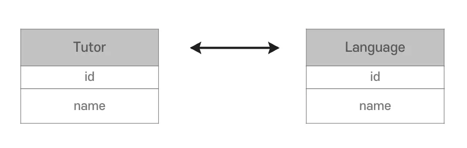
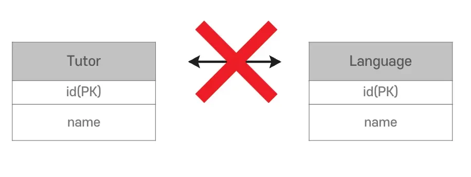
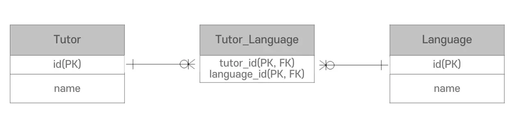
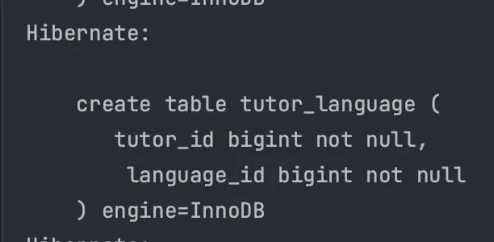
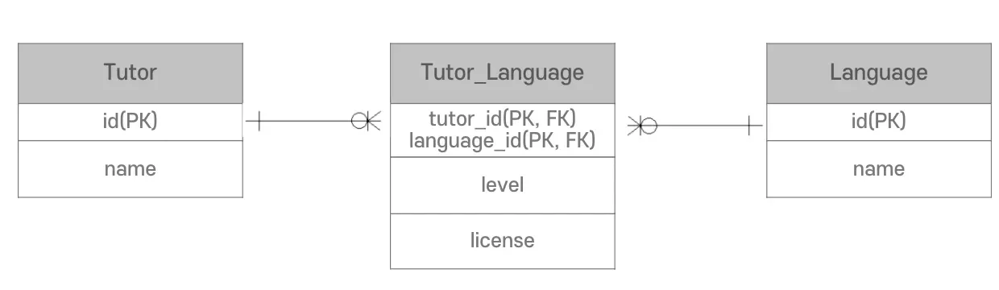
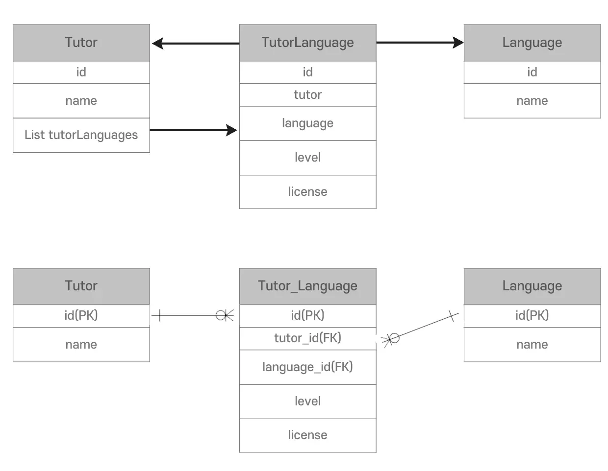
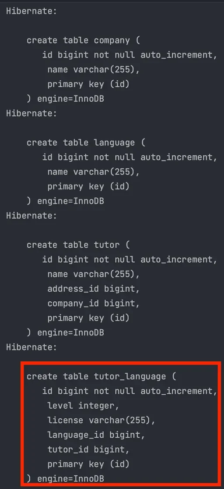

<a id="14beda9b0fe1818eb61ccbc067c7f8cc"></a>

## N &#58; M 연관관계

---

> 📖 
> 
> <a id="14beda9b0fe1819090dfe455db6a84ac"></a>
> 
> 두 Entity가  <code>&#64;ManyToMany</code>를 통해 서로 다수의 관계를 가진다&#46; 
> 
> <details>
> <summary>ex) 상품, 카테고리 </summary>
> 
> - 하나의 상품에는 여러 개의 카테고리가 해당될 수 있다&#46;
>     - 상품 &#58; 카테고리 = 1 &#58; N
> 
> - 하나의 카테고리는 여러 개의 상품에 담길 수 있다&#46; 
>     - 카테고리 &#58; 상품 = 1 &#58; M
> 
> <a id="14beda9b0fe18078ba1bce48b4c88df2"></a>
> 
> → 상품 &#58; 카테고리 = N &#58; M
> 
> </details>

<details>
<summary>N &#58; M 연관관계</summary>

<details>
<summary>객체 </summary>



- Conllection을 사용하여 N&#58;M 설정이 가능

</details>

- 데이터베이스
    <details>
    <summary>관계형 데이터베이스는 <code>N&#58;M</code> 연관관계를 구현할 수 없다&#46; </summary>

    

    </details>

    <details>
    <summary>증간 테이블을 추가해, <code>1&#58;N</code>, <code>N&#58;1</code> 관계로 설정</summary>

    

    </details>

</details>

<a id="14beda9b0fe18093ba76dfd605fec25d"></a>

## N &#58; M 단방향, 양방향

---

> 📖 
> 
> <a id="7e2edfd7af804aa08da4d02da452835a"></a>
> 
> <code>&#64;ManyToMany</code>를 통해 참조 가능한 

<details>
<summary>예시 &#45; 단방향</summary>

<details>
<summary>Entity&#58; Tutor</summary>

<a id="14beda9b0fe1804c82fcfc66bb8ba035"></a>

```java
@Entity
@Table(name = "tutor")
public class Tutor {

    @Id
    @GeneratedValue(strategy = GenerationType.IDENTITY)
    private Long id;

    private String name;

    @ManyToOne
    @JoinColumn(insertable = false, updatable = false)
    private Company company;

    @OneToOne
    @JoinColumn(name = "address_id", unique = true)
    private Address address;

    @ManyToMany
    @JoinTable(
            name = "tutor_language",
            joinColumns = @JoinColumn(name = "tutor_id"),
            inverseJoinColumns = @JoinColumn(name = "language_id")
    )
    private List<Language> languages = new ArrayList<>();

    public Tutor() {
    }

    public Tutor(String name) {
        this.name = name;
    }

    public Long getId() {
        return id;
    }

    public String getName() {
        return name;
    }
}
```

</details>

<details>
<summary>Entity&#58; Language</summary>

<a id="14beda9b0fe180d0aeafc9dc387382d9"></a>

```java
@Entity
@Table(name = "language")
public class Language {

    @Id
    @GeneratedValue(strategy = GenerationType.IDENTITY)
    private Long id;

    private String name;

}
```

</details>

<details>
<summary>실행결과</summary>

- 기존 테이블 삭제 후 실행(충돌 방지)



</details>

</details>

<details>
<summary>예시 &#45; 양방향</summary>

- Entity&#58; Tutor ( 위와 동일 )

<details>
<summary>Entity&#58; Language</summary>

<a id="14beda9b0fe180c3b6f8c2c25b09290a"></a>

```java
@Entity
@Table(name = "language")
public class Language {

    @Id
    @GeneratedValue(strategy = GenerationType.IDENTITY)
    private Long id;

    private String name;

    @ManyToMany(mappedBy = "languages")
    private List<Tutor> tutors = new ArrayList<>();
}
```

</details>

</details>

<a id="14beda9b0fe1800a84bdc8d008f741e7"></a>

### N &#58; M 매핑의 문제점

---

> 📖 
> 
> <a id="f11e35d1f0b44ccdab87d9e0924f5181"></a>
> 
> <code>&#64;ManyToMany</code>로 <u>N&#58;M 연관관계 설정</u>을 하게되면 편리해 보이지만 <u>실제로 사용하기 까다롭다&#46;</u>
> 
> - <code>N&#58;M</code> ⇒  &#91; <code>1&#58;N</code> ← <code>중간 테이블</code> → <code>M&#58;1</code> &#93; 

<details>
<summary>N&#58;M 매핑의 문제점</summary>



1. 실제 설계에서는 <code>level</code>, <code>license</code> 와 같은 추가적인 데이터가 필요하다&#46;
    - <code>&#64;ManyToMany</code>에서 사용할 수 없다&#46; 

1. 중간 테이블이 숨겨져 있어서 생각하지 못한 SQL Query가 실행된다&#46; 

1. <u><code>tutor&#95;id</code></u><u>, </u><u><code>language&#95;id</code></u><u>가 묶</u>어서 <u>PK로 설정</u>된다&#46;
    - PK가 종속적이면 사이드 이펙트가 생시낟&#46;

    - <u>PK 값</u>은 <u>비지니스적으로 의미없는 </u><u><code>Long</code></u><u>값으로 설정</u>하는 것이 <u>유연성에 좋</u>다&#46;

</details>

<details>
<summary>문제점 해결</summary>

> ✏️ 
> 
> <a id="2374a30c460c456b934de4ffe96c0ffe"></a>
> 
> 중간 테이블을 실제 <code>Entity</code>로 만들어서 관리
> 
> <details>
> <summary><code>N&#58;M</code> ⇒  &#91; <code>1&#58;N</code> ← <code>중간 테이블</code> → <code>M&#58;1</code> &#93; </summary>
> 
> - <code>&#64;ManyToMany</code>
>     <a id="14beda9b0fe180d5b3bed656f2d1c35d"></a>
> 
>     ⇒  <code>&#64;OneToMany</code>  ←  중간 테이블  →  <code>&#64;ManyToOne</code>
> 
> </details>



<details>
<summary>&#91; 코드 &#93;</summary>

<details>
<summary><code>중간 테이블</code>&#58; TutorLanguage</summary>

<a id="14beda9b0fe18045967de75c62cfa2b0"></a>

```java
@Entity
@Table(name = "tutor_language")
public class TutorLanguage {

    @Id
    @GeneratedValue(strategy = GenerationType.IDENTITY)
    private Long id;

    @ManyToOne
    @JoinColumn(name = "tutor_id")
    private Tutor tutor;

    @ManyToOne
    @JoinColumn(name = "language_id")
    private Language language;

    private Integer level;
    private String license;
}
```

</details>

<details>
<summary><code>Entity</code>&#58; Language</summary>

<a id="14beda9b0fe1801eb3ebcb0c93d95f9c"></a>

```java
@Entity
@Table(name = "language")
public class Language {

    @Id
    @GeneratedValue(strategy = GenerationType.IDENTITY)
    private Long id;

    private String name;

    @OneToMany(mappedBy = "language")
    private List<TutorLanguage> tutorLanguages = new ArrayList<>();
}
```

</details>

<details>
<summary><code>Entity</code>&#58; Tutor</summary>

<a id="14beda9b0fe1802f8188c15c6450eaa0"></a>

```java
@Entity
@Table(name = "tutor")
public class Tutor {

    @Id
    @GeneratedValue(strategy = GenerationType.IDENTITY)
    private Long id;

    private String name;

    @ManyToOne
    @JoinColumn(insertable = false, updatable = false)
    private Company company;

    @OneToOne
    @JoinColumn(name = "address_id", unique = true)
    private Address address;

    @OneToMany(mappedBy = "tutor")
    private List<TutorLanguage> tutorLanguages = new ArrayList<>();

    public Tutor() {
    }

    public Tutor(String name) {
        this.name = name;
    }

    public Long getId() {
        return id;
    }

    public String getName() {
        return name;
    }
}
```

</details>

<details>
<summary>실행결과</summary>

- 기존 테이블 삭제 후 실행(충돌 방지)

- <code>&#60;class&#62;org&#46;example&#46;entity&#46;TutorLanguage&#60;/class&#62;</code><em> </em>주석제거



</details>

</details>

</details>

> ✏️ 
> 
> <a id="1b92638f7f3d40a0acf891dd146ed392"></a>
> 
> 데이터베이스 설계 관점에서는 <code>&#64;ManyToMany</code> 방식이 맞지만 실제 코드 구현에는 중간 테이블을 만드는 방법이 편리하다&#46;

> ☝🏻 
> 
> <a id="2531ba3c1944447496b4536baa9cacc0"></a>
> 
> 양방향 연관관계 매핑은 매우 주의해서 사용해야한다 &#46;
