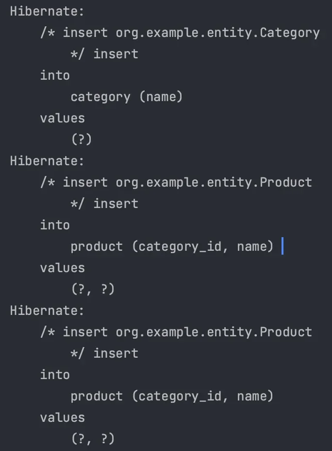
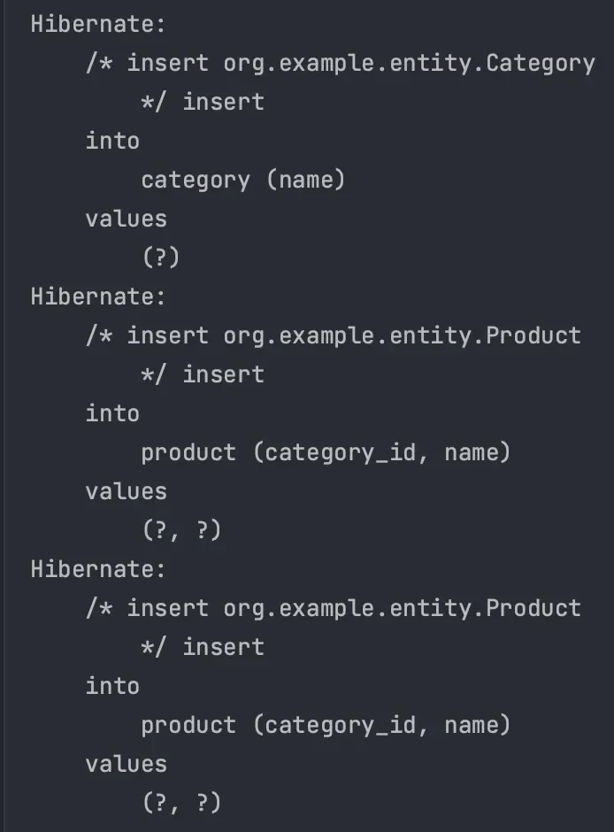
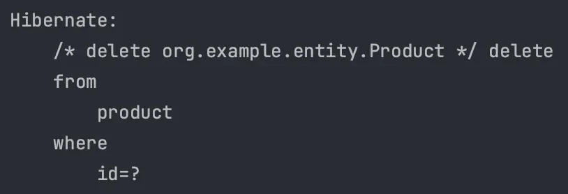
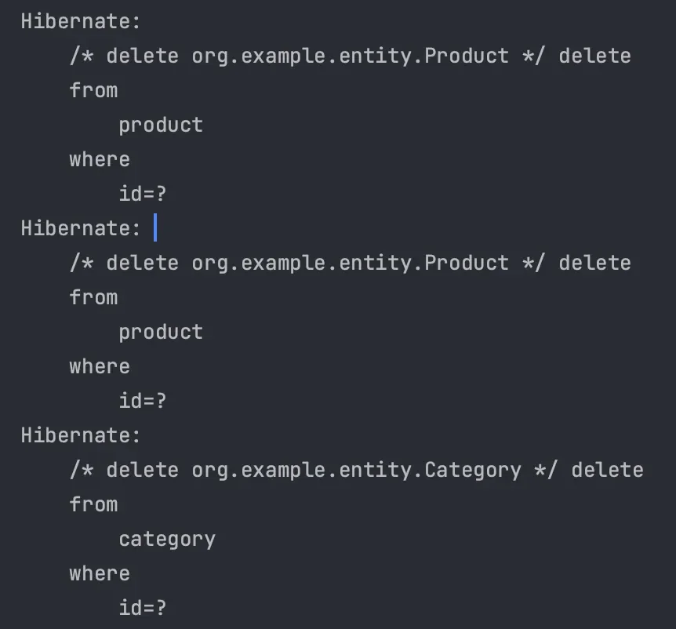

<a id="14beda9b0fe1815584cfdd60c56d83b6"></a>

## Cascade

---

> 📖 
> 
> <a id="14beda9b0fe181b3a9f6fab20261a74d"></a>
> 
> 영속성 전이(Casecade)란 JPA에서 <u>특정 엔티티를 저장, 삭제 등</u>의 작업을 할 때 <u>연관된 엔티티에도 동일한 작업을 자동으로 적용</u>하도록 설정하는 기능

> ☝🏻 
> 
> <a id="b8dc5f07d31847fd8348f98b48dc9378"></a>
> 
> 영속성 전이는 지연 로딩, 즉시 로딩과는 아무 관련이 없다&#46;

<details>
<summary>예시 </summary>

> 1&#58;N, N&#58;1 양방향 연관관계

<details>
<summary>&#91; 코드 &#93; <code>Entity</code>&#58; Category</summary>

<a id="14beda9b0fe18064bbacfce2232459b7"></a>

```java
@Getter
@Entity
@Table(name = "category")
public class Category {

    @Id
    @GeneratedValue(strategy = GenerationType.IDENTITY)
    private Long id;

    private String name;

    @OneToMany(mappedBy = "category")
    private List<Product> productList = new ArrayList<>();

    protected Category() {
    }

    public Category(String name) {
        this.name = name;
    }

    public void addProduct(Product product) {
        productList.add(product);
        product.setCategory(this);
    }

}
```

</details>

<details>
<summary>&#91; 코드 &#93; <code>Entity</code>&#58; Product</summary>

<a id="dc5fd0eb5c3e4e438308f519953cbfaa"></a>

```java
@Getter
@Entity
@Table(name = "product")
public class Product {
    @Id
    @GeneratedValue(strategy = GenerationType.IDENTITY)
    private Long id;

    private String name;

    @ManyToOne
    @JoinColumn(name = "category_id")
    private Category category;

    protected Product() {
    }

    public Product(String name) {
        this.name = name;
    }

    public void setCategory(Category category) {
        this.category = category;
    }
}
```

</details>

---

<details>
<summary>&#91; 코드 &#93; 테스트</summary>

<a id="14beda9b0fe180338653e1051abe60a4"></a>

```java
public class Main {
    public static void main(String[] args) {
        EntityManagerFactory emf = Persistence.createEntityManagerFactory("entity");

        EntityManager em = emf.createEntityManager();

        EntityTransaction transaction = em.getTransaction();

        transaction.begin();

        try {

            Category category = new Category("food");
            em.persist(category);

            Product product1 = new Product("pizza");
            Product product2 = new Product("kimchi");
            category.addProduct(product1);
            category.addProduct(product2);

            em.persist(product1);
            em.persist(product2);


            transaction.commit();
        } catch (Exception e) {
            transaction.rollback();
            e.printStackTrace();
        } finally {
            em.close();
        }

        emf.close();
    }
}
```

- 실행 결과
    - 총 3번의 SQL이 실행
        

</details>

</details>

<details>
<summary>cascade 속성 적용</summary>

<details>
<summary>&#91; 코드 &#93; <code>Entity</code>&#58; Category</summary>

<a id="b725ef423475417e91ed6ac4a1641c90"></a>

```java
@Getter
@Entity
@Table(name = "category")
public class Category {

    @Id
    @GeneratedValue(strategy = GenerationType.IDENTITY)
    private Long id;

    private String name;

    @OneToMany(mappedBy = "category", cascade = CascadeType.ALL)
    private List<Product> productList = new ArrayList<>();

    protected Category() {
    }

    public Category(String name) {
        this.name = name;
    }

    public void addProduct(Product product) {
        productList.add(product);
        product.setCategory(this);
    }

}
```

</details>

---

<details>
<summary>&#91; 코드 &#93; 테스트</summary>

<a id="5effdf2bf8d54b4cbfd091bd26b403b2"></a>

```java
public class Main {
    public static void main(String[] args) {
        EntityManagerFactory emf = Persistence.createEntityManagerFactory("entity");

        EntityManager em = emf.createEntityManager();

        EntityTransaction transaction = em.getTransaction();

        transaction.begin();

        try {

            Category category = new Category("food");

            Product product1 = new Product("pizza");
            Product product2 = new Product("kimchi");
            category.addProduct(product1);
            category.addProduct(product2);

						em.persist(category);

            transaction.commit();
        } catch (Exception e) {
            transaction.rollback();
            e.printStackTrace();
        } finally {
            em.close();
        }

        emf.close();
    }
}
```

- 실행 결과
    > ✏️ 
    > 
    > <a id="89c6483d643244a9b73584552f103b42"></a>
    > 
    > <code>1</code>의 속성을 가지는 엔티티 하나만 저장( <code>em&#46;persist(category)</code>)이 되어도 <code>N</code>의  속성을 가지는 엔티티들이 자동으로 저장된다&#46; 
    > 
    > - Category &#58; Product = <code>1&#58;N</code>

    - 총 3번의 SQL이 실행
        

</details>

</details>

<a id="14beda9b0fe1800780d8c8acab2843bf"></a>

## 사용 방법과 주의점

---

> 📖 
> 
> <a id="14beda9b0fe18068bc30c6d7d97f044d"></a>
> 
> 영속성 전이는 연관관계 매핑과는 아무 관련이 없다&#46;

<details>
<summary>영속성 전이 ( Casecade ) </summary>

> 단순히 Entity 저장, 삭제할 때 연관된 Entity에도 동일한 작업이 적용된다&#46; 

- 속성 종류
    - ALL&#58; 모두 적용

    - PERSIST&#58; 영속(저장)

    - REMOVE&#58; 삭제

    - <del>MERGE</del>

    - <del>REFRESH</del>

    - <del>DETACH</del>

</details>

<details>
<summary>사용 방법</summary>

- <u>단일 Entity에 완전히 종속</u>적인 경우 생명주기가 같다면 사용
    - ex) 블로그 글의 댓글처럼 항상 글을 통해서 관리하는 경우

    - ex) 상품과 상품 이미지처럼 특정 상품에 종속되는 경우

- 작가 &#45; 책
    - 책은 특정 작가와 연관되지만 작가가 활동하지 않아도 책은 보존된다&#46; 

    - 이런 경우 사용 ❌

</details>

<a id="14beda9b0fe180c19988e5bb651bcc75"></a>

## 고아 객체

---

> 📖 
> 
> <a id="7d06097dcd474779992253715507d007"></a>
> 
> JPA에서 <u>부모 엔티티와의 </u><u>연관관계가 끊</u>어진 <u>자식 엔티티</u>를 말한다&#46; ( 부모 자식 관계, <code>1&#58;N</code> ) 

<details>
<summary>고아 객체 삭제 &#45; <code>orphanRemoval = true</code></summary>

- 부모 엔티티와 연관관계가 끊어진 자식 Entity를 자동으로 삭제한다&#46; 

- <code>orphanRemoval = true</code>, 기본값&#58; <code>false</code>

</details>

<details>
<summary>예시 1 ) 고아 객체 사용</summary>

<details>
<summary>&#91; 코드 &#93; Category</summary>

<a id="14beda9b0fe1808b979ad41cdd0ea4b9"></a>

```java
@Getter
@Entity
@Table(name = "category")
public class Category {

    @Id
    @GeneratedValue(strategy = GenerationType.IDENTITY)
    private Long id;

    private String name;

    @OneToMany(mappedBy = "category", cascade = CascadeType.ALL, orphanRemoval = true)
    private List<Product> productList = new ArrayList<>();

    protected Category() {
    }

    public Category(String name) {
        this.name = name;
    }

    public void addProduct(Product product) {
        productList.add(product);
        product.setCategory(this);
    }

}
```

</details>

<details>
<summary>&#91; 코드 &#93; 테스트</summary>

<a id="5bc0c5caa3af4c3fb2e17ed3a6e7064b"></a>

````java
```java
public class OrphanRemovalMain {
    public static void main(String[] args) {
        EntityManagerFactory emf = Persistence.createEntityManagerFactory("entity");

        EntityManager em = emf.createEntityManager();

        EntityTransaction transaction = em.getTransaction();

        transaction.begin();

        try {

            Category category = new Category("food");

            Product product1 = new Product("pizza");
            Product product2 = new Product("kimchi");
            category.addProduct(product1);
            category.addProduct(product2);

            em.persist(category);

            em.flush();
            em.clear();

            Category findCategory = em.find(Category.class, category.getId());
            findCategory.getProductList().remove(0);

            transaction.commit();
        } catch (Exception e) {
            transaction.rollback();
            e.printStackTrace();
        } finally {
            em.close();
        }

        emf.close();
    }
```
````

</details>

---

<details>
<summary>실행 결과</summary>

- Collection에서 제거 →  객체 삭제



</details>

</details>

<details>
<summary>예시 2 ) <code>CascadeType&#46;ALL</code> 제거</summary>

<details>
<summary>&#91; 코드 &#93; Category</summary>

<a id="ae008e26a5a448149c1c3851f4d3abdf"></a>

```java
@Getter
@Entity
@Table(name = "category")
public class Category {

    @Id
    @GeneratedValue(strategy = GenerationType.IDENTITY)
    private Long id;

    private String name;

    @OneToMany(mappedBy = "category", orphanRemoval = true)
    private List<Product> productList = new ArrayList<();

    protected Category() {
    }

    public Category(String name) {
        this.name = name;
    }

    public void addProduct(Product product) {
        productList.add(product);
        product.setCategory(this);
    }

}
```

</details>

<details>
<summary>&#91; 코드 &#93; 테스트</summary>

<a id="e8473dd367dc4b6da795125d62c36931"></a>

```java

public class OrphanRemovalMain {
    public static void main(String[] args) {
        EntityManagerFactory emf = Persistence.createEntityManagerFactory("entity");

        EntityManager em = emf.createEntityManager();

        EntityTransaction transaction = em.getTransaction();

        transaction.begin();

        try {

            Category category = new Category("food");

            Product product1 = new Product("pizza");
            Product product2 = new Product("kimchi");
            category.addProduct(product1);
            category.addProduct(product2);

            em.persist(category);
            // cascade 제거
            em.persist(product1);
            em.persist(product2);

            em.flush();
            em.clear();

            // cascade 제거
            Category findCategory = em.find(Category.class, category.getId());
            em.remove(findCategory);

            transaction.commit();
        } catch (Exception e) {
            transaction.rollback();
            e.printStackTrace();
        } finally {
            em.close();
        }

        emf.close();
    }
}
```

</details>

---

<details>
<summary>실행 결과</summary>

- Collection 제거, 부모 엔티티가 제거 → 자식 엔티티인 product 자동 삭제됨 
    <a id="14beda9b0fe18054b714d217ec799e53"></a>

    → 쿼리 3번 실행 



</details>

</details>

> ✏️ 
> 
> <a id="9b2c031b153d4d64a9917c34cdb8d7c3"></a>
> 
> <code>CascadeType&#46;ALL</code>과 <code>orphanRemoval=true</code> 를 <u>함께 사용</u>하는 경우 부모 Entity를 통해서 자식 Entity의 생명주기를 관리할 수 있다&#46; <u>도메인 주도개발(Domain Driven Design)</u>에 주로 사용한다&#46;<br>(<u>자식 Entity는 별도의 Repository Layer가 없</u>어도 된다&#46;)
