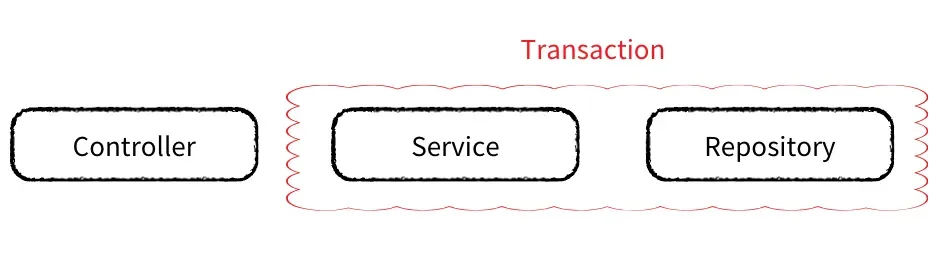
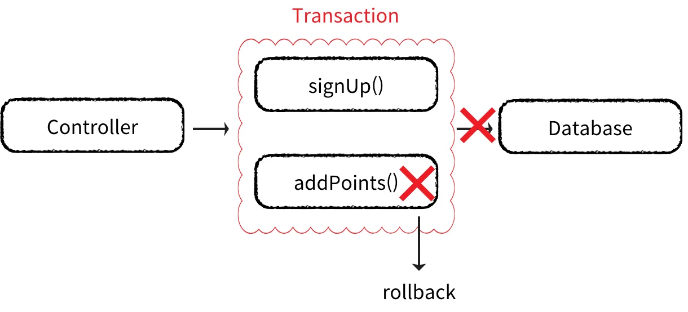
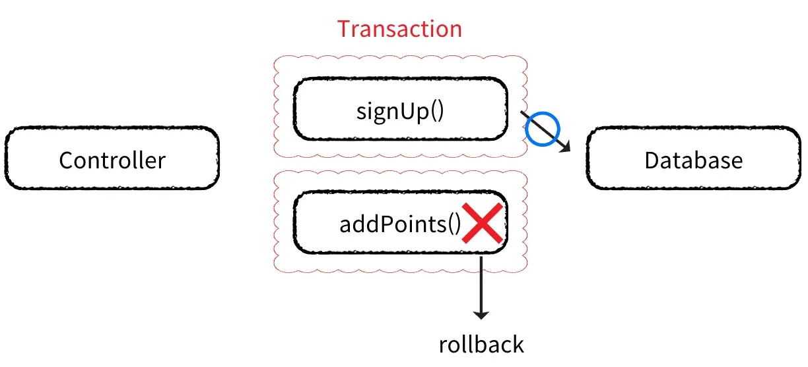

<a id="14beda9b0fe1817a9110d2087bd00f29"></a>

## 트랜잭션 전파

---

> 📖 
> 
> <a id="14beda9b0fe18138b90cf9c0b4a1eb90"></a>
> 
> <u>하나의 트랜잭션</u>이 <u>다른 트랜잭션 내에서 어떻게 동작</u>할지를 <u>결정</u>하는 규칙
> 
> <a id="14beda9b0fe180919e78f7fa2a8cba5c"></a>
> 
> <u>여러 개의 트랜잭션이 포함된 시스템</u>에서 <u>특정 작업</u>이 <u>다른 작업</u>에 <u>어떻게 영향</u>을 미칠지를 정의

> ✏️ 
> 
> <a id="14beda9b0fe181f2b7a0f42736030733"></a>
> 
> 현재 클래스의 트랜잭션과 다른 클래스의 트랜잭션을 교통정리 한다&#46;

<details>
<summary>트랜잭션 전파 ( Propagation )</summary>



</details>

<details>
<summary><strong>코드 예시</strong></summary>

- <code>REQUIRED</code>(Default) 사용

<a id="14beda9b0fe1801b876de0f19bfb87b0"></a>

```java
@Service
@RequiredArgsConstructor
public class MemberService {
    
    private final PointPolicy pointPolicy;

    @Transactional
    public void signUp(Member member) {
        // 회원 등록
        memberRepository.save(member);

        // 포인트 지급
	        // 하위 메서드인 addPoints()에 트랜잭션이 전파되어 
	        // 하위 메서드가 실패하면, 회원 등록 메서드까지 롤백 처리된다. 
        pointPolicy.addPoints(member.getId(), 100);
    }
}

@Component
public class PointPolicy {
    public void addPoints(Long memberId, int points) {
        // 포인트 지급 로직
        pointRepository.save(new Point(memberId, points));
    }
}
```

- <code>signUp()</code> 메서드에 <code>&#64;Transactional</code> 을 통해 트랜잭션 설정



- <u>하위 </u><u><code>addPoints()</code></u><u> 메서드</u>에 <u>트랜잭션이 전파</u>되어 <strong><u>하위 메서드가 실패</u></strong>하면 <u>롤백</u>된다&#46;
    - <u>포인트 지급 로직</u>에서 <u>문제 발생</u> → <u>회원 등록까지  </u><strong><u>롤백</u></strong> 처리됨

</details>

<details>
<summary>트랜잭션 전파 종류</summary>

> <code>propagation</code> 속성

1. <code>REQUIRED</code>(Default)
    - 기존 트랜잭션이<u> 있</u>다면<u> 기존 트랜잭션을 사용</u>한다&#46;

    - 기존 트랜잭션이 <u>없</u>다면 <u>트랜잭션을 새로 생성</u>한다&#46;

1. <code>REQUIRES&#95;NEW</code>
    - 항상 새로운 트랜잭션을 시작하고, <u>기존의 트랜잭션은 보류</u>한다&#46;

    - <u>두 트랜잭션은 </u><u>독립적</u><u>으로 동작</u>한다&#46;

1. <code>SUPPORTS</code>
    - <u>기존 트랜잭션이 있</u>으면<u> 해당 트랜잭션을 사용</u>한다&#46;

    - 기존 트랜잭션이 <u>없</u>으면 <u>트랜잭션 없이 실행</u>한다&#46;

1. <code>NOT&#95;SUPPORTED</code>
    - 기존 트랜잭션이 있어도 <u>트랜잭션을 중단</u>하고 <u>트랜잭션 없이 실행</u>된다&#46;

1. <code>MANDATORY</code>
    - 기존 트랜잭션이 반드시 있어야한다&#46;

    - 트랜잭션이 없으면 실행하지 않고 예외를 발생시킨다&#46;

1. <code>NEVER</code>
    - 트랜잭션 없이 실행되어야 한다&#46;

    - 트랜잭션이 있으면 예외를 발생시킨다&#46;

1. <code>NESTED</code>
    - 현재 트랜잭션 내에서 중첩 트랜잭션을 생성한다&#46;

    - 중첩 트랜잭션은 독립적으로 롤백할 수 있다&#46;

    - 기존 트랜잭션이 Commit되면 중첩 트랜잭션도 Commit 된다&#46;

</details>

<details>
<summary><code>REQUIRES&#95;NEW</code> &#45; 독립된 트랜잭션으로 관리</summary>

> <u>회원 가입</u>과<strong> </strong><strong><u>동시에</u></strong> <u>회원에게 포인트를 지급</u>해야 하는 경우

- 요구사항 &#58; 포인트 지급에 <strong><code>실패</code></strong>해도 회원가입은 완료되어야 한다&#46;

- <code>REQUIRES&#95;NEW</code> 설정(독립적인 트랜잭션 유지)
    - 포인트 지급 로직에서 문제가 발생해도 회원 등록은 롤백되지 않는다&#46;

> ✏️ 
> 
> 
> 
> <a id="c2e116b08e064bfeb48e8ce89adc7966"></a>
> 
> 트랜잭션 내부에 호출되는 하위 함수인 addPoints() 메서드에 <u><code>REQUIRES&#95;NEW</code></u><u> 선언</u>을 하여 <u>상위 메서드의 트랜젝션이 전파되지 않고 독립적으로 실행될 수 있</u>게 한다&#46; <br>이로 인해 <u>하위 메서드 영역에서 실패가 발생되어서 상위의 영역에 영향(롤백)을 주지 않</u>도록 처리할 수 있다&#46; 

<a id="14beda9b0fe180f5a16fd00af9dbbf90"></a>

```java
@Service
@RequiredArgsConstructor
public class MemberService {

    private final PointPolicy pointPolicy;

    @Transactional
    public void signUp(Member member) {
        // 회원 등록
        memberRepository.save(member);

        // 포인트 지급
        pointPolicy.addPoints(member.getId(), 100);
    }
}

@Component
public class PointPolicy {

    @Transactional(propagation = Propagation.REQUIRES_NEW)
    public void addPoints(Long memberId, int points) {
        // 포인트 지급 로직
        pointRepository.save(new Point(memberId, points));
    }
    
}
```

</details>
