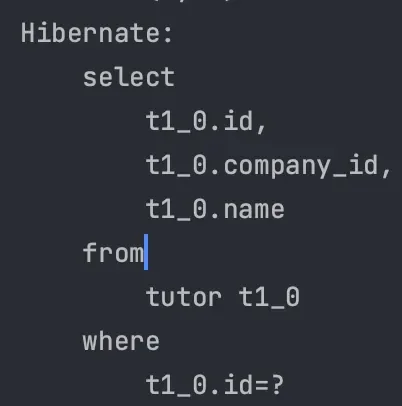
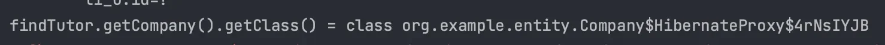
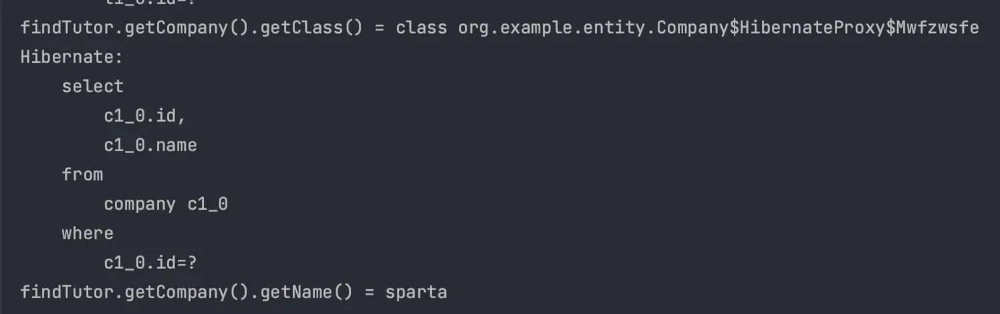
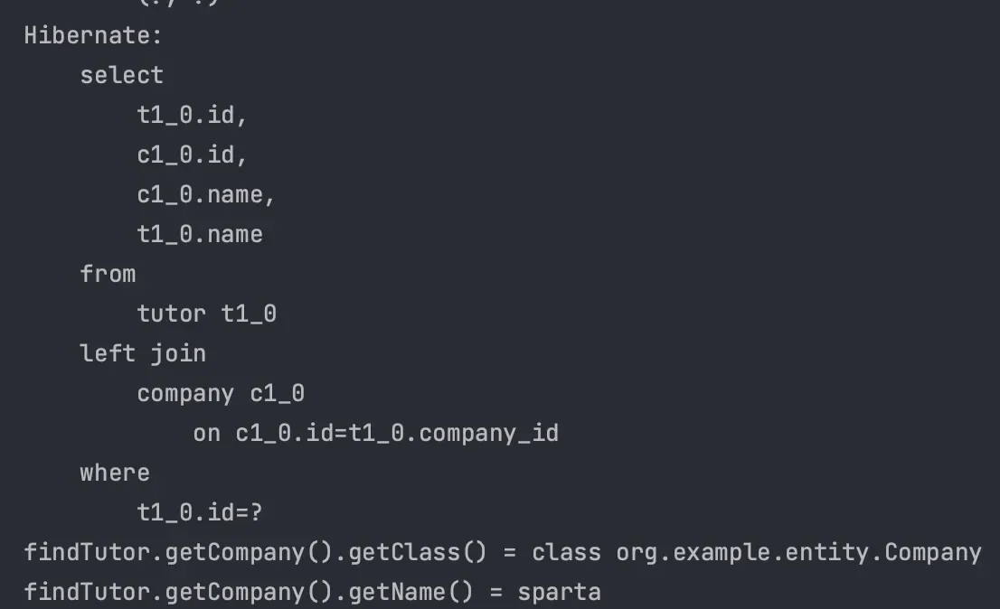
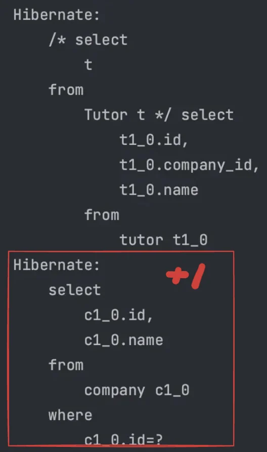

<a id="14beda9b0fe181ca8eb3ff2e10444abf"></a>

##  Lazy Loading ( 지연 로딩 ) 

---

> 📖 
> 
> <a id="14beda9b0fe1817692d3e82dddad2dd6"></a>
> 
> <u>지연 로딩(Lazy Loading)</u>은 <u>프록시 객체를 사용</u>한 방식으로<br><u>데이터를 실제 사용</u> 시,<u> 데이터베이스에서 조회</u>한다&#46; 

<details>
<summary>JPA의 지연로딩</summary>

> ✏️ 
> 
> <a id="21bc7553adf04dc9901ffedafd00ed9d"></a>
> 
> <code>&#64;ManyToOne( fetch = FetchType&#46;</code><u><code>LAZY</code></u><code> )</code>

- <code>fetch</code> 속성 &#45; <code>FactType&#46;Lazy</code>&#58; 지연로딩

- 지연로딩을 사용 → Proxy 객체 조회, 

- <u>연관된 객체</u>를 매번 함께 조회하는 것이 낭비인 경우 사용 


</details>

<details>
<summary>예시 &#45; 지연로딩</summary>

<details>
<summary>&#91; 코드 &#93; <code>Entity</code>&#58; Tutor</summary>

<a id="14beda9b0fe180208ed4ee26cd21f58d"></a>

```java
@Getter
@Entity
@Table(name = "tutor")
public class Tutor {

    @Id
    @GeneratedValue(strategy = GenerationType.IDENTITY)
    private Long id;

    private String name;
		
    @ManyToOne(fetch = FetchType.LAZY)
    @JoinColumn(name = "company_id")
    private Company company;

    protected Tutor() {
    }

    public Tutor(String name) {
        this.name = name;
    }
    
    public void setCompany(Company company) {
        this.company = company;
    }
}
```

</details>

<details>
<summary>&#91; 코드 &#93;  테스트 </summary>

- Tutor 엔티티 내부의 company 연관관계 ( <code>&#64;ManyToOne</code> )

<a id="725fcb99bcf7460d9f9ac29f36e9afa6"></a>

```java
public class FetchTypeLazyMain {
    public static void main(String[] args) {
        EntityManagerFactory emf = Persistence.createEntityManagerFactory("entity");

        EntityManager em = emf.createEntityManager();

        EntityTransaction transaction = em.getTransaction();

        transaction.begin();

        try {

            Company company = new Company("sparta");
            em.persist(company);

            Tutor tutor = new Tutor("wonuk");
            tutor.setCompany(company);
            em.persist(tutor);

            // 영속성 컨텍스트 초기화
            em.flush();
            em.clear();

            // em.find()
            Tutor findTutor = em.find(Tutor.class, tutor.getId());

            transaction.commit();
        } catch (Exception e) {
            transaction.rollback();
            e.printStackTrace();
        } finally {
            em.close();
        }

        emf.close();
    }
}
```

</details>

---

<details>
<summary>실행결과</summary>

- <code>Tutor</code>만 조회한다&#46;



</details>

<details>
<summary><code>getCompany()</code> &#45; 프록시 조회</summary>

<a id="14beda9b0fe180e281baccbb59d98ac2"></a>

```java
System.out.println("findTutor.getCompany().getClass() = " + findTutor.getCompany().getClass());
```

- 실행결과  &#45; 프록시로  조회



</details>

<details>
<summary><code>getCompany()&#46;getName()</code> &#45; 실제 값  조회</summary>

<a id="14beda9b0fe1800db403e1ee544b9246"></a>

```java
System.out.println("findTutor.getCompany().getName() = " + findTutor.getCompany().getName());
```

- 실행 결과  &#45; 실제 값 접근(<code>&#46;getName()</code>) 시 조회 SQL이 실행된다&#46; 
    

</details>

> ✏️ 
> 
> <a id="69be9c576e7d48299bf33d5329785bb1"></a>
> 
> <u>지연로딩</u> 사용 → <u>연관된 객체 </u><u>Proxy로 조회</u>

</details>

<a id="14beda9b0fe18065ab92c35fb45e2f12"></a>

##  Eager Loading ( 즉시 로딩 )

---

> 📖 
> 
> <a id="a980706c2def4e19a0f3e8482b214e4b"></a>
> 
> 엔티티 조회 시, 연관된 엔티티가 같이 조회된다&#46;

<details>
<summary>JPA의 즉시로딩</summary>

> ✏️ 
> 
> <a id="164d8a42d63f4a208ec5281eb3b82356"></a>
> 
> <code>&#64;ManyToOne( fetch = FetchType&#46;</code><u><code>EAGER</code></u><code> )</code> ( 기본값 )

- <code>fetch</code> 속성 &#45; <code>FactType&#46;EAGER</code>&#58; 즉시로딩

- Proxy 객체를 조회하지 않고 한 번에 연관된 객체까지 조회

- <u>연관된 객체를 매번 함께 조회</u>하는것이 <u>효율적</u>인 경우에 사용

</details>

<details>
<summary>예시 &#45; 즉시로딩</summary>

<details>
<summary>&#91; 코드 &#93; <code>Entity</code>&#58; Tutor</summary>

<a id="8b74aeb4fef04051b2fbc5bbf3881b19"></a>

```java
@Getter
@Entity
@Table(name = "tutor")
public class Tutor {

    @Id
    @GeneratedValue(strategy = GenerationType.IDENTITY)
    private Long id;

    private String name;
		
    @ManyToOne(fetch = FetchType.EAGER)
    @JoinColumn(name = "company_id")
    private Company company;

    protected Tutor() {
    }

    public Tutor(String name) {
        this.name = name;
    }
    
    public void setCompany(Company company) {
        this.company = company;
    }
}
```

</details>

<details>
<summary>&#91; 코드 &#93;  테스트 </summary>

- Tutor 엔티티 내부의 company 연관관계 ( <code>&#64;ManyToOne</code> )

<a id="515f9047045a440f8bbf5a3b58dfb480"></a>

```java
public class FetchTypeLazyMain {
    public static void main(String[] args) {
        EntityManagerFactory emf = Persistence.createEntityManagerFactory("entity");

        EntityManager em = emf.createEntityManager();

        EntityTransaction transaction = em.getTransaction();

        transaction.begin();

        try {

            Company company = new Company("sparta");
            em.persist(company);

            Tutor tutor = new Tutor("wonuk");
            tutor.setCompany(company);
            em.persist(tutor);

            // 영속성 컨텍스트 초기화
            em.flush();
            em.clear();

            // em.find()
            Tutor findTutor = em.find(Tutor.class, tutor.getId());
            
             // getCompany()
            System.out.println("findTutor.getCompany().getClass() = " + findTutor.getCompany().getClass());

            // getCompany().getName()
            System.out.println("findTutor.getCompany().getName() = " + findTutor.getCompany().getName());

            transaction.commit();
        } catch (Exception e) {
            transaction.rollback();
            e.printStackTrace();
        } finally {
            em.close();
        }

        emf.close();
    }
}
```

</details>

---

<details>
<summary>실행결과</summary>

- <code>JOIN</code>을 사용해 <u>한번의 SQL로 모두 조회</u>한다&#46;  ( Proxy X )


</details>

</details>

<a id="14beda9b0fe180eca408fa800bd70ca9"></a>

## 즉시 로딩 주의점

---

> 📖 
> 
> <a id="bb82844ae5c3457799a17a831381ac61"></a>
> 
> <u>즉시로딩</u>을 사용하면, JPQL에서  <code>N&#43;1</code> 문제가 발생된다&#46; 

> ✏️ 
> 
> <a id="504b79b239bf45fab5b4230f4841a601"></a>
> 
> 지연로딩에서도 N&#43;1문제가 발생된다&#46; 자세한 내용은 3주차 &#45; fetch join 확인

<details>
<summary>즉시 로딩 시, 주의점</summary>

> 즉시 로딩을 사용하면, <u>예상하지 못한 SQL이 실행</u>된다&#46;  → JPQL에서 <code>N&#43;1</code> 문제 발생

> ☝🏻 
> 
> <a id="2ef218387bdd4a4688bfb47e0694a722"></a>
> 
> 연관된 Entity만큼 모두 <code>JOIN</code> 되어 조회된다&#46; 



</details>

<details>
<summary>연관관계 Anotaion 기본값</summary>

- <code>&#64;OneToMany</code>, <code>&#64;ManyToMany</code> 의 기본 값 &#58; 지연 로딩

- <u><code>&#64;ManyToOne</code></u>, <code>&#64;OneToOne</code> 의 기본 값 &#58; 즉시 로딩
    <a id="14beda9b0fe180759a15d3ea539fec09"></a>

    → <code>FetchType&#46;LAZY</code> 설정 필요

> ✏️ 
> 
> <a id="77dc68be8a174e129cdab5a84560e808"></a>
> 
> 꼭 필요한 경우가 아니라면 지연로딩을 사용해야 한다&#46;

</details>

<details>
<summary>예시 &#45;  N &#43; 1 문제</summary>

- JPQL 

<a id="14beda9b0fe180139cf4cf0ce4b537d5"></a>

```java
List<Tutor> tutorList = em.createQuery("select t from Tutor t", Tutor.class).getResultList();
```

<details>
<summary>실행 결과</summary>



- 조회 SQL이 N&#43;1 번 실행된다&#46; 
    - 처음 실행된 최초 SQL Query&#58; <code>1</code> ( <code>Tutor</code> )

    - 연관된 객체 조회 SQL Query&#58; <code>N</code> ( <code>Company</code> )

- <strong><u>JPQL은 SQL이 그대로 변환</u></strong>되어 조회된 <code>Tutor</code> 만큼 <u>EAGER(즉시로딩)</u>로 설정된 <code>Company</code> 가 함께 조회된다&#46; 

- <code>em&#46;find()</code> 는 JPA가 내부적으로 최적화한다&#46;

</details>

<details>
<summary><u>N &#43; 1 문제</u>를 해결하는 방법</summary>

- 모든 연관관계 → 지연로딩 ( <code>fetch = FetchType&#46;</code><u><code>LAZY</code></u> )

- JPQL <code>fetch join</code>&#58; <u>Runtime</u>에  원하는 Entity를 함께 조회 가능

- <code>&#64;EntityGraph</code>

- <code>&#64;BatchSize</code>

- Native Query

</details>

</details>
