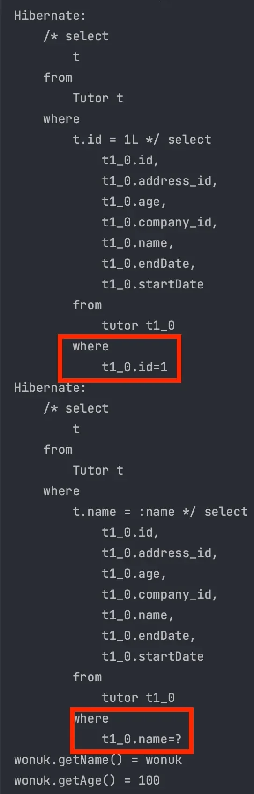
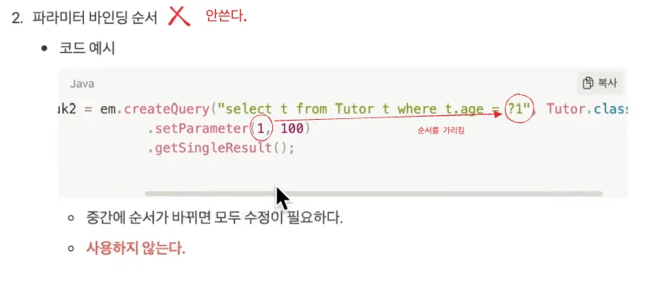

<a id="14ceda9b0fe181c28181cc9dd871aefe"></a>

## 기본 문법

---

> 📖 
> 
> <a id="14ceda9b0fe18172a661d3499dc0f30e"></a>
> 
> JPQL &#45; Entity 객체를 대상으로 <u>SQL Query 생성</u>

<details>
<summary>JPQL 문법 규칙</summary>

- 테이블 이름이 아닌 <u>Entity 이름</u>을 사용

- <u>Entity</u>와 <u>필드</u>는 <u>대소문자 구분</u>
    - <code>Tutor</code>, <code>tutor</code>  다름 

- JPQL 키워드(<code>SELECT</code>, <code>from</code>, <code>Where</code>)는 <u>대소문자를 구분하지 않</u>음
    - <code>select</code>, <code>SELECT</code> 둘다 가능

- 별칭(alias)은 필수,  <u><code>as</code></u><u> 는 생략 가능</u>

</details>

<details>
<summary>기본 문법</summary>

<a id="14ceda9b0fe180169730e560d263e0d5"></a>

```sql
SELECT <별칭> FROM <엔티티 이름> [AS <별칭>] [WHERE 조건] [GROUP BY 속성] [HAVING 조건] [ORDER BY 속성]
```

- <code>update</code>, <code>delete</code> 의 사용 가능

- <code>GROUP BY</code>, <code>HAVING</code>, <code>ORDER BY</code> 등의 집합과 정렬 기능을 사용 가능

<a id="14ceda9b0fe18057b3a5f54cfd944072"></a>

```sql
select
	SUM(p.price), // 상품 가격의 총합
	AVG(p.price), // 평균 가격
	MAX(p.price), // 최대 가격
	MIN(p.price)  // 최소 가격
	COUNT(p),     // 상품 수
from Product p
```

</details>

<a id="14ceda9b0fe180b99517d80629f731c6"></a>

## 반환 타입 및 결과

---

> 📖 
> 
> <a id="14ceda9b0fe1807fb8f7cc8def049c22"></a>
> 
> JPQL에서 데이터베이스 쿼리를 실행하기 위해 <strong><u>TypedQuery</u></strong> 와 <strong><u>Query</u></strong>  두 가지 타입 제공<br>이를 통해 JPA 쿼리 API로 작성된 쿼리를 실행 및 해당하는 결과를 반환 받는다&#46;

<details>
<summary>반환 타입</summary>

<details>
<summary>1&#46; <code>TypeQuery</code></summary>

- <u>반환 타입이 명확</u>할 때 사용
    - 주로 Entity나 특정 타입의 결과를 반환할 때 사용

- 컴파일 시 타입 검사 가능

---

<details>
<summary>예시</summary>

<details>
<summary><code>TypedQuery&#60;Entity&#62;</code></summary>

- JPA 쿼리의 결과 타입을 명시적으로 지정

- 반환될 Entity를 TypeQuery 안에 명시
    - TypeQuery 사용 시, 컴파일 타임에서 타입 검사가 가능해 더 안전하게 코드 작성 가능

</details>

<details>
<summary><code>em&#46;createQuery( Query, 반환 타입&#60;Entity&#62; );</code></summary>

- <u>첫번쨰 인자</u>로 <code>쿼리</code>를 넘기고, <u>두번째 인자</u>로 <code>변환될 타입</code>을 명시함

</details>

<details>
<summary>Query&#58;  <code>“select t from Tutor t&#34;</code></summary>

- Tutor 엔티티의 모든 데이터 선택

-  <code>SELECT &#42; FROM tutor</code> 와 동일

</details>

<a id="14eeda9b0fe18074b51dce3983b55b86"></a>

```sql
TypedQuery<Tutor> typeQuery1 = em.createQuery("select t from Tutor t", Tutor.class);
TypedQuery<String> typeQuery2 = em.createQuery("select t.name from Tutor t", String.class);
```

</details>

</details>

<details>
<summary>2&#46; <code>Query</code></summary>

- 반환 타입이 명확하지 않는 경우 사용
    - 결과를 알 수 없거나, 다양한 타입의 데이터를 변환할 때 사용한다&#46; 

- 결과 처리 시, <code>형 변환 ( Casting )</code>이  필요할 수 있다&#46; 

---

<details>
<summary>예시 1 &#45; <code>Query</code> </summary>

<details>
<summary><code>Query</code></summary>

- 반환 타입이 명확하지 않는 경우, Query를 명시하여 사용한다&#46; 

- 컴파일 타입에서 타입을 알수 없다&#46; 
    - <u>쿼리 실행 결과는 런타임에 결정</u>되며, 일반적으로 <u>Object 타입으로 반환</u>

</details>

<details>
<summary><code>em&#46;createQuery(Query)</code></summary>

- 첫번째 인자로 쿼리만을 넘긴다&#46; 
    - <code>TypeQuery</code> 와는 다르게 동적으로 쿼리가 정해지기 떄문에, 두번쨰 인자로 반환타입을 넘기지 않는다&#46; 

</details>

<a id="14eeda9b0fe180e188d1fe3472eef299"></a>

```sql
Query query = em.createQuery("select t.name, t.age from Tutor t");
```

</details>

<details>
<summary>예시 2 &#45; 동적 쿼리를 작성  ( 자세한 내용은 아래 <u>파라미터 바인딩</u> 참조 )</summary>

> ✏️ 
> 
> - 1&#46; Query&#58; <code>select e from Entity e </code><u><code>where e&#46;field = &#58;field</code></u>
> 
> - 2&#46; Query query = <code>em&#46;createQuery( </code><u><code>{ 쿼리 }</code></u><code> )</code>
> 
> - 3&#46; <code>query&#46;setParameter(”field”, “할당할 값”)</code>
>     - <code>첫번째 인자</code>&#58; <u>필드 변수명</u>을 문자열로 넘김
> 
>     - <code>두번쨰 인자</code>&#58; <u>필드 변수에 할당할 값</u>을 문자열로 넘김

<a id="14eeda9b0fe1809fbfb2e825856f618f"></a>

```sql
String dynamicQuery = "select t from Tutor t where t.name = :name";

Query query = em.createQuery(dynamicQuery);

query.setParameter("name", "John");

List<Tutor> tutors = query.getResultList();
```

</details>

</details>

</details>

<details>
<summary><code>TypeQuery</code> vs <code>Query</code></summary>

| 특징 | TypeQuery | Query |
| --- | --- | --- |
| 타입 안정성 | 높음 ( 지정한 타입으로 변환 ) | 낮음 ( 결과를 Object로 처리 ) |
| 사용 목적 | 결과 타입 명확할 때 | 결과 타입 명확하지 않을 때 |
| 형 변환 필요성 | 자동 형 변환 지원 | 수동 형변환 필요 (Casting) |
| 결과 처리 방식 | 지정한 클래스 타입 | <code>Object</code>, <code>Object&#91;&#93;</code> |

</details>

<details>
<summary>결과 조회</summary>

<details>
<summary>1&#46; <code>getResultList()</code></summary>

- 결과가 <u>하나 이상</u>인 겨우 사용

- List 반환
    - 결과가 없는 경우, 빈 List(<code>&#91;&#93;</code>) 반환

---

<details>
<summary>예시 </summary>

- Query와 동일하게 반환될 타입을 넘기지 않음
    - Query만 인자로 넘김

<a id="14eeda9b0fe180dd9d41fc24c7105991"></a>

```sql
List resultList = em.createQuery("select t from Tutor t").getResultList();
```

</details>

</details>

<details>
<summary>2&#46; <code>getSingleResult()</code></summary>

- 결과가 <u>딱 하나</u>일 때 사용

- 결과가 없거나 여러 개라면 <u>예외 발생</u>

---

<details>
<summary>예시</summary>

- TypeQuery와 동일하게 <code>쿼리</code> 와 <code>반환될 타입</code>을 넘긴다&#46; 

- <code>&#46;getSingleResult()</code>
    - <u>두번쨰 인자로 정의</u>한 <code>Entity</code>로 <u>데이터를 가져온</u>다&#46; 
        - <u>반환 타입</u>을 가져오는 Entity로 정의한다&#46;

<a id="14eeda9b0fe18043bd63e3c52c8e8ce6"></a>

```sql
Tutor singleResult = em.createQuery("select t from Tutor t where t.id = 1L", Tutor.class).getSingleResult();
```

</details>

</details>

</details>

> ✏️ 
> 
> <a id="20ae998ff430409dabc574eb683e71cb"></a>
> 
> <u>Spring Data JPA</u>에서는 조회 결과가 없는 경우 <u><code>null</code></u><u>을 반환</u>하거나 <u><code>Optional</code></u><u>을 반환</u>한다&#46;

<a id="14ceda9b0fe1804db6d3fb43c92955c6"></a>

## 파라미터 바인딩

---

> 📖 
> 
> <a id="5e370786196c40e6b5ce4d69798a299c"></a>
> 
> <u>파라미터 바인딩</u>은 <u>쿼리에 동적으로 값을 전달</u>하여 <u>SQL 인젝션을 방지</u>, <u>쿼리 재사용</u>  가능토록하는 기능이다&#46;

<details>
<summary>Entity 필드 이름 </summary>

> ✏️ 
> 
> - 1&#46; Query&#58; <code>select e from Entity e </code><u><code>where e&#46;field = &#58;field</code></u>
> 
> - 2&#46; Query query = <code>em&#46;createQuery( </code><u><code>{ 쿼리 }</code></u><code> )</code>
> 
> - 3&#46;  파라미터 바인딩&#58;<code>query&#46;setParameter(”field”, “할당할 값”)</code>
>     - <code>첫번째 인자</code>&#58; <u>필드 변수명</u>을 문자열로 넘김
> 
>     - <code>두번쨰 인자</code>&#58; <u>필드 변수에 할당할 값</u>을 문자열로 넘김

<details>
<summary>코드 예시</summary>

- 메서드 체이닝 사용 가능

<a id="14eeda9b0fe180b39637f5ee99bd36de"></a>

```sql
Tutor wonuk = em.createQuery("select t from Tutor t where t.name = :name", Tutor.class)
                    .setParameter("name", "wonuk")
                    .getSingleResult();

System.out.println("wonuk.getName() = " + wonuk.getName());
System.out.println("wonuk.getAge() = " + wonuk.getAge());
```

<details>
<summary>실행 결과</summary>



</details>

</details>

</details>

<details>
<summary>🤬 &#91;단점&#93; 파라미터 바인딩 순서</summary>



- <u>중간에 순서가 바</u>뀌면 모두 수정이 필요하다&#46;
    - <u>사용하지 않음</u>

<a id="14eeda9b0fe180089c82d1cad8dc2fc5"></a>

```sql
Tutor wonuk2 = em.createQuery("select t from Tutor t where t.age = ?1", Tutor.class)
										 .setParameter(1, 100)
										 .getSingleResult();
```

</details>
