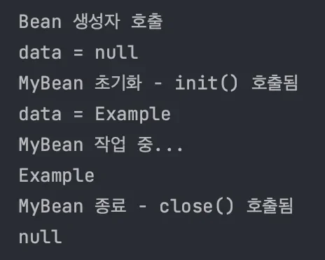
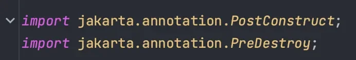
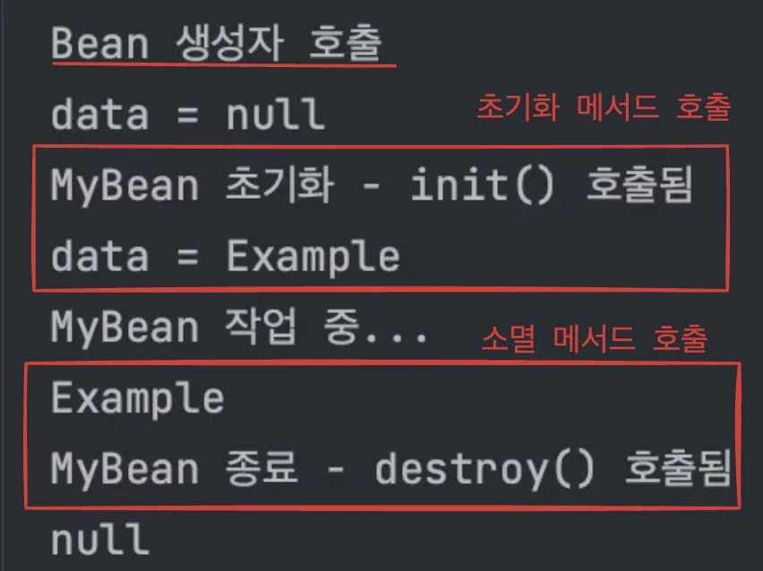
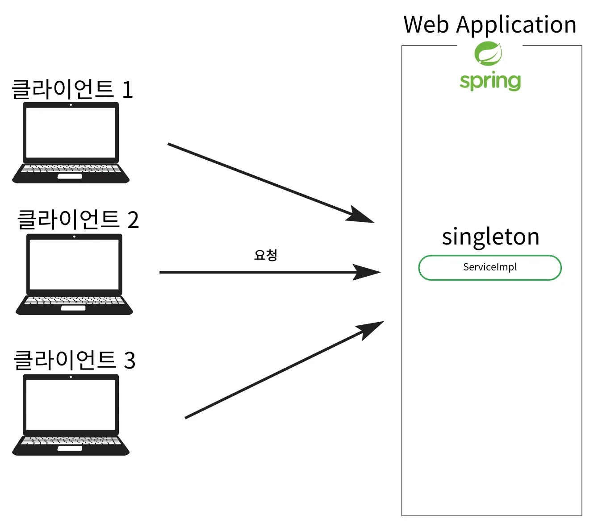
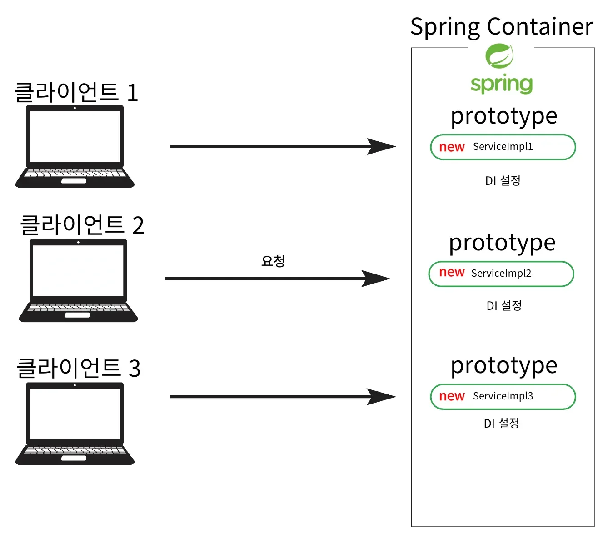
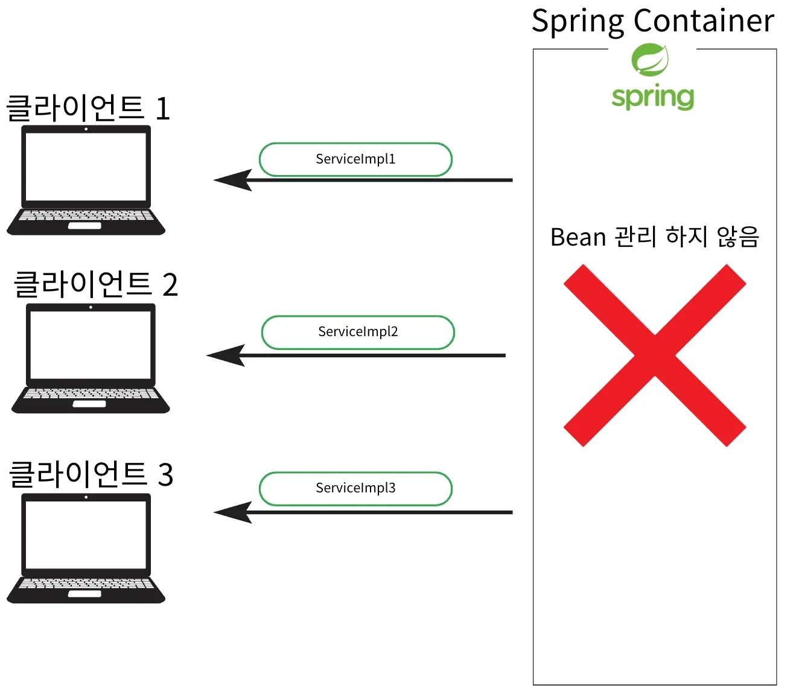

<a id="14ceda9b0fe18168a822e05e4c8dc884"></a>

## &#64;Bean 속성

---

> 📖 
> 
> <a id="14ceda9b0fe1817cb9a4f2e120cac60a"></a>
> 
> Spring에서 <u>생명주기 콜백을 지원</u>하는 방법으로 <u>설정 정보</u><u>에 초기화 메서드와 종료  메서드를 지정</u>

<details>
<summary><u>설정 정보</u>에 초기화 메서드, 종료 메서드 지정</summary>

> 📌 
> 
> <a id="655d6aeb9fad4ea6b2f0e9c68716f39d"></a>
> 
> <code>Bean( </code><u><code>initMethod</code></u><code> = “초기화 메서드명” , </code><u><code>destroyMethod</code></u><code> = “소멸 메서드명” )</code>

<details>
<summary>&#91; 코드 &#93; 클래스에 <u>빈 등록 시 설정할</u> 초기화, 소멸 메서드 생성</summary>

<a id="14ceda9b0fe180d8b8e6c9318c031ba7"></a>

```java
public class MyBeanV2 {

    private String data;

    public MyBeanV2() {
        System.out.println("Bean 생성자 호출");
        System.out.println("data = " + data);
    }

    public void setData(String data) {
        this.data = data;
    }

    public String getData() {
        return data;
    }
		
		// 초기화 메서드 
    public void init() {
        System.out.println("MyBean 초기화 - init() 호출됨");
        System.out.println("data = " + data);
    }
		
		// 소멸 메서드 
    public void close() {
        System.out.println("MyBean 종료 - close() 호출됨");
        data = null;
    }

    public void doSomething() {
        System.out.println("MyBean 작업 중...");
    }

}
```

</details>

<details>
<summary>&#91; 코드 &#93; <u>수동 빈 등록</u> 시, &#91; 초기화, 소멸 &#93; 콜백 메서드 설정</summary>

<a id="f184028db4da48899781f4677fc51d4d"></a>

```java
@Configuration
public class AppConfigV2 {

    @Bean(initMethod = "init", destroyMethod = "close")
    public MyBeanV2 myBeanV2() {
        MyBeanV2 myBeanV2 = new MyBeanV2();
        // 의존관계 설정
        myBeanV2.setData("Example");
        return myBeanV2;
    }

}
```

</details>

---

<details>
<summary>&#91; 코드 &#93; 테스트 </summary>

<a id="03c78d60a73f471ea3797957eb3690bf"></a>

```java
public class InterfaceCallbackV2 {

    public static void main(String[] args) {
        // Spring 컨테이너 생성 및 설정 클래스 등록
        AnnotationConfigApplicationContext context = new AnnotationConfigApplicationContext(AppConfigV2.class);

        // Bean 사용
        MyBeanV2 myBeanV2 = context.getBean(MyBeanV2.class);
        myBeanV2.doSomething();

        // Bean 소멸 전 필드
        System.out.println(myBeanV2.getData());

        // 컨테이너 종료 (destroy 호출)
        context.close();

        // Bean 소멸 후 필드
        System.out.println(myBeanV2.getData());
    }

}
```

- 실행 결과
    

</details>

</details>

> ✏️ 
> 
> <a id="46fc7fba799247469dc0ea075e1a27c4"></a>
> 
> 설정 정보 사용
> 
> - <u>Bean</u>이 Spring 내부적으로 <u>구현된 코드에 의존하지 않</u>음
> 
> - <u>특정 메서드명</u>에 <u>종속되지 않</u>음 ( 자유롭게 설정 가능 )
> 
> - <u>외부 라이브러리</u>에도 초기화, 종료 메서드에 적용 가능

> ✏️ 
> 
> <a id="ab8ae137f55f4087a44303391f6d3dc7"></a>
> 
> <code>&#64;Bean</code>의 <u>destoryMethod 속성</u>은 종료 <u>메서드 추론 기능</u>으로 대부분의 라이브러리 종료 메서드 이름인 close, shutdown이 기본값으로 등록되어 이름이 둘 중 하나라면 명시하지 않아도 동작하도록 구성되어 있다&#46; 

<a id="14ceda9b0fe180189738f01226f97194"></a>

## &#64;PostConstruct, &#64;PreDestroy

---

> 📖 
> 
> <a id="12b6bc8f95784471a299efa5f8568a42"></a>
> 
> Beand의 생명주기 동안 특정 작업을 실행하기 위해 사용하는 Annotation<br>Spring Bean의 초기화, 소멸 시점에 호출되는 메서드를 지정
> 
> - 초기화 콜백 메서드&#58; <strong><code>&#64;PostConstruct</code></strong>
> 
> - 소멸 콜백 메서드&#58; <strong><code>&#64;PreDestroy</code></strong>

<details>
<summary>Java 표준 Annotation</summary>

> ☝🏻 
> 
> <a id="021f4b4626a14154a55b5477e270971f"></a>
> 
> <u>자바의 표준 Annotation</u>이기 때문에 <u>Spring이 아니여도 Anotaion이 동작</u>한다&#46; 
> 
> 
> 
> > <u>최신 Spring에서 권장</u>하는 방법이다&#46;

- <strong><code>&#64;PostConstruct</code></strong>
    - <u>Bean 생성 및 의존성 주입이 완료된 후</u>  호출되는 메서드 지정 

    - 초기화 작업 시 사용
        - 초기화 콜백 메서드 지정

- <strong><code>&#64;PreDestroy</code></strong>
    - <u>Bean이 소멸되기 직전에 호출</u>되는 메서드 지정 

    - 주로 리소스 정리 작업을 할 때 사용한다&#46; 

</details>

<details>
<summary>예시 </summary>

<details>
<summary>&#91; 코드 &#93; <code>&#64;PostConstruct</code>, <code>&#64;PreDestroy</code>를 사용하여 초기화, 소멸 메서드 지정</summary>

<a id="d86a3d5b342f4ee6b2a96c826e6c6ea3"></a>

```java
public class MyBeanV3 {

    private String data;

    public MyBeanV3() {
        System.out.println("Bean 생성자 호출");
        System.out.println("data = " + data);
    }

    public void setData(String data) {
        this.data = data;
    }

    public String getData() {
        return data;
    }

    // 초기화 메서드
    @PostConstruct
    public void init() {
        System.out.println("MyBean 초기화 - init() 호출됨");
        System.out.println("data = " + data);
    }

    // 소멸 메서드
    @PreDestroy
    public void destroy() throws Exception {
        System.out.println("MyBean 종료 - destroy() 호출됨");
        data = null;
    }

    public void doSomething() {
        System.out.println("MyBean 작업 중...");
    }

}
```

</details>

<details>
<summary>&#91; 코드 &#93; 수동 빈 등록</summary>

<a id="2fd4c9c4421a43559176b0db0ed8d40e"></a>

```java
@Configuration
public class AppConfigV3 {

    @Bean
    public MyBeanV3 myBeanV3() {
        MyBeanV3 myBeanV3 = new MyBeanV3();
        // 의존관계 설정
        myBeanV3.setData("Example"); // 주입 완료된 후 초기화 메서드 호출
        return myBeanV3;
    }

}
```

</details>

---

<details>
<summary>&#91; 코드 &#93; 테스트 </summary>

<a id="37968fc549414e95a60cfae8cfb9e8d0"></a>

```java
public class InterfaceCallbackV3 {

    public static void main(String[] args) {
        // Spring 컨테이너 생성 및 설정 클래스 등록
        AnnotationConfigApplicationContext context = new AnnotationConfigApplicationContext(AppConfigV3.class);

        // Bean 사용 
        MyBeanV3 myBeanV3 = context.getBean(MyBeanV3.class);
        myBeanV3.doSomething();

        // Bean 소멸 전 필드
        System.out.println(myBeanV3.getData());

        // 컨테이너 종료 (destroy 호출)
        context.close();

        // Bean 소멸 후 필드
        System.out.println(myBeanV3.getData());
    }

}
```

- 실행 결과
    

    > ☝🏻 
    > 
    > <a id="d07c50e0537647afb121b3bdafc5eaba"></a>
    > 
    > 생성자 호출
    > 
    > - <u>의존성 주입이 완료되기 전</u>이기 때문에 null 값이 호출됨

</details>

</details>

> ✏️ 
> 
> <a id="9f28cb8e32e44756895a78513190cb1e"></a>
> 
> 표준 Annotation 방식의 <u>단점</u>
> 
> - <u>외부 라이브러리 적용 불가능</u>

> ✏️ 
> 
> <a id="14ceda9b0fe1805298c5e960dbe2a020"></a>
> 
> <u>외부 라이브러리</u>에 <u>초기화, 종료 메서드 사용</u><br>→ &#64;Bean의 <code>initMethod</code>, <code>destroyMethod</code>  사용

<a id="14ceda9b0fe1809c8accde341df622e4"></a>

## Bean Scope

---

> 📖 
> 
> <a id="14ceda9b0fe1805c8912e4581731786c"></a>
> 
> Spring 컨테이너에서 Bean이 어떻게 생성되고 관리되는지를 정의하는 개념<br>Spring은 <u>다양한 범위(스코프)를 제공</u>하여 <u>Bean 생명주기를 설정</u>할 수 있는데,<br><u>각 스코프</u>는 Bean이 얼마나 오래 유지되는지, 여러 번 사용할 수 있는지 등을 결정한다&#46; 

<details>
<summary>Bean Scope 종류</summary>

<details>
<summary>1&#46; 싱글톤 ( singleton )</summary>



- 기본 설정 스코프

- Spring 컨테이너 내에서 Bean이 하나만 생성, <br>모든 요청이 같은 객체를 사용

</details>

<details>
<summary>2&#46; 프로토타입 ( prototype )</summary>



- 요청할 때마다 새로운 인스턴스가 생성

- 필요한 의존관계를 주입



- 생성한 프로토타입 Bean을 클라이언트에 반환

- <u>컨테이너</u>는 <u>프로토타입 Bean</u>의 <strong><u>생성, 의존관계 주입, 초기화</u></strong><strong> 까지만 수행</strong>

- 그 이후  <u>생명주기 (소멸, </u><u><code>&#64;PreDestroy</code></u><u>)는 관리하지 않</u>음
    - 클라이언트가 직접 종료 메서드를 호출

</details>

<details>
<summary>3&#46; 웹 스코프 </summary>

- request
    - <u>HTTP 요청마다 새로운 Bean이 생성</u>된다&#46; 

    - <u>웹 요청이 들어오면 Bean 생성</u>되고 <u>요청이 완료되면 소멸</u>된다&#46; 

    - Spring MVC 로 만든 Web App에서 사용 

- Session
    - HTTP 세션 동안 하나의 Bean 인스턴스를 유지한다&#46; 

    -  세션이 시작되면 생성되고 종료될 때 소멸

- application
    - 서블릿 컨텍스트 내에서 Bean이 단일 인스턴스로 존재

    - <u>애플리케이션이 구동</u>되는 동안 <u>동일한 객체 유지</u>

</details>

</details>

<details>
<summary>Bean Scope 등록 방법</summary>

> ✏️ 
> 
> <a id="c1a6beea76354330a683d85150205ed9"></a>
> 
> 자동, 수동 등록 시, <code>&#64;Scope</code> Annotation으로 명시

- 자동 등록
    <a id="14ceda9b0fe1807a8751e2b12a50f7c1"></a>

    ```java
    // 자동 등록
    @Scope("singleton") // 생략 가능(기본 값)
    @Component // @Service 사용 가능
    public class MemberServiceImpl implements MemberService { ... }
    ```

- 수동 등록
    <a id="aece0b7619c349ac93ad39701e7a2f8e"></a>

    ```java
    // 수동 등록
    @Configuration
    public class AppConfig {

        @Scope("singleton") // 싱글톤 기본 값, 생략 가능
        @Bean
        public MemberService memberService() {
    		    return new MemberServiceImpl();
        }
        
    }
    ```

<a id="14ceda9b0fe18025b670ceef98437cf0"></a>

  

</details>

<details>
<summary>예시</summary>

<details>
<summary>싱글톤</summary>

<details>
<summary>&#91; 코드 &#93; 빈 </summary>

<a id="e83b918c9d8846faa039bbac12e49962"></a>

```java
public class SingletonBean {

    public SingletonBean() {
        System.out.println("Bean 생성자 호출");
    }

    // 초기화 메서드
    @PostConstruct
    public void init() {
        System.out.println("init() 호출");
    }

    // 소멸 메서드
    @PreDestroy
    public void destroy() throws Exception {
        System.out.println("destroy() 호출");
    }

    public void doSomething() {
        System.out.println("SingletonBean 작업 중...");
    }

}
```

</details>

<details>
<summary>&#91; 코드 &#93; 수동 등록,  빈에 <code>&#64;Scope(&#34;singleton&#34;)</code> 명시</summary>

> <code>&#64;Scope(&#34;singleton&#34;)</code> 기본값이기 때문에 생략 가능

<a id="936c75b1ad0940d58f2bd4e99aaf0669"></a>

```java
@Configuration
public class SingletonAppConfig {

    @Scope("singleton")
    @Bean
    public SingletonBean singletonBean() {
        SingletonBean singletonBean = new SingletonBean();
        return singletonBean;
    }

}
```

</details>

---

<details>
<summary>&#91; 코드 &#93; 테스트 </summary>

<a id="0d8da289acbb4f0998fceb0d1328928e"></a>

```java
public class Singleton {

    public static void main(String[] args) {
        // Spring 컨테이너 생성 및 설정 클래스 등록
        AnnotationConfigApplicationContext context = new AnnotationConfigApplicationContext(SingletonAppConfig.class);

        // Bean 사용
        SingletonBean singletonBean = context.getBean(SingletonBean.class);
        SingletonBean singletonBean2 = context.getBean(SingletonBean.class);

        System.out.println("singletonBean = " + singletonBean);
        System.out.println("singletonBean2 = " + singletonBean2);

        singletonBean.doSomething();

        // 컨테이너 종료
        context.close();

    }

}
```

- <strong>출력결과(정상 호출)</strong>
    <a id="14ceda9b0fe180eba2c6dcdb0870f9fa"></a>

    ```java
    Bean 생성자 호출
    init() 호출
    singletonBean = com.example.springcallback.scope.SingletonBean@76ed1b7c
    singletonBean2 = com.example.springcallback.scope.SingletonBean@76ed1b7c
    SingletonBean 작업 중...
    destroy() 호출
    ```

    - 같은 Bean 객체가 조회된다&#46;

    - 초기화, 종료 메서드 정상 실행

</details>

</details>

<details>
<summary>프로토타입</summary>

<details>
<summary>&#91; 코드 &#93; 빈 </summary>

<a id="14ceda9b0fe180ee971ce898134ad1bc"></a>

```java
public class ProtoTypeBean {

    public ProtoTypeBean() {
        System.out.println("Bean 생성자 호출");
    }

    // 초기화 메서드
    @PostConstruct
    public void init() {
        System.out.println("init() 호출");
    }

    // 소멸 메서드
    @PreDestroy
    public void destroy() throws Exception {
        System.out.println("destroy() 호출");
    }

    public void doSomething() {
        System.out.println("ProtoTypeBean 작업 중...");
    }

}
```

</details>

<details>
<summary>&#91; 코드 &#93; 수동 등록,  빈에 <code>&#64;Scope(&#34;prototype&#34;)</code> 명시</summary>

<a id="96f48fd85342417cbc31ae6f192a046a"></a>

```java
@Configuration
public class ProtoTypeAppConfig {

    @Scope("prototype")
    @Bean
    public ProtoTypeBean protoTypeBean() {
        ProtoTypeBean protoTypeBean = new ProtoTypeBean();
        return protoTypeBean;
    }

}
```

</details>

---

<details>
<summary>&#91; 코드 &#93; 테스트 </summary>

<a id="22652a9df6b849a5842926a0a606ab83"></a>

```java
public class ProtoType {

    public static void main(String[] args) {
        // Spring 컨테이너 생성 및 설정 클래스 등록
        AnnotationConfigApplicationContext context = new AnnotationConfigApplicationContext(ProtoTypeAppConfig.class);

        // Bean 사용
        System.out.println("protoTypeBean 조회");
        ProtoTypeBean protoTypeBean = context.getBean(ProtoTypeBean.class);
        System.out.println("protoTypeBean2 조회");
        ProtoTypeBean protoTypeBean2 = context.getBean(ProtoTypeBean.class);

        System.out.println("singletonBean = " + protoTypeBean);
        System.out.println("singletonBean2 = " + protoTypeBean2);

        protoTypeBean.doSomething();

        // 컨테이너 종료
        context.close();

    }

}
```

- 출력 결과
    - 조회할 때 Bean이 생성되고 초기화

    - <u>close가 되어</u>도 클라이언트가 직접 소멸하지 않아서 소멸되지 않는다&#46;&#46;
        - <code>&#64;PreDestroy</code> 실행안됨

    <a id="14ceda9b0fe180f59948c93961aa2d09"></a>

    ```java
    protoTypeBean 조회
    Bean 생성자 호출
    init() 호출
    protoTypeBean2 조회
    Bean 생성자 호출
    init() 호출
    singletonBean = com.example.springcallback.prototype.ProtoTypeBean@7c1e2a9e
    singletonBean2 = com.example.springcallback.prototype.ProtoTypeBean@fa36558
    ProtoTypeBean 작업 중...
    ```

</details>

</details>

</details>

> ✏️ 
> 
> <a id="a9369e414cfb4155926929ffd7fde02b"></a>
> 
> <u>Bean Scope</u>는 <u>싱글톤, 프로토타입, request</u>가 주로 사용된다&#46;

<details>
<summary>사용처</summary>

1. <strong>Singleton(Default)</strong>
    - 대부분의 <u>Sevice, Repository</u> 등 <u>Application 전체에서 공유되는 Bean</u>

    - 상태를 가지면 안된다&#46;

1. <strong>Prototype</strong>
    - <u>매번 새로운 인스턴스가 필요</u>한 경우

    - <u>상태를 가지는 객체(특정 설정값이 다른 임시 작업 객체)</u>

1. <strong>Request</strong>
    - Web Application에서 <u>요청별로 별도의 Bean이 필요한 경우</u>

    - <u>요청 데이터를 처리하는 객체</u>
        - 모델, 서블릿 등

</details>
