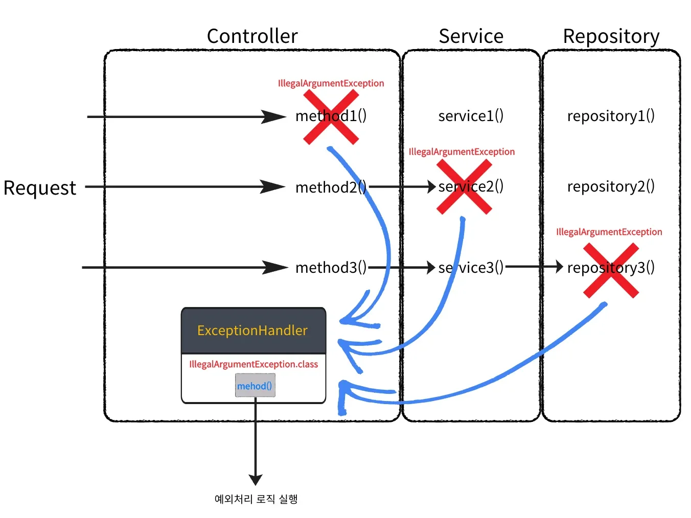
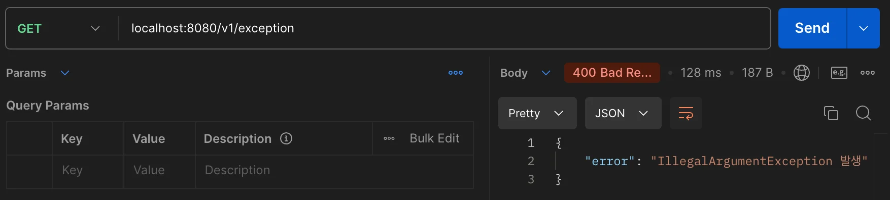
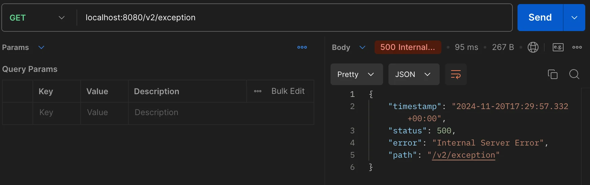
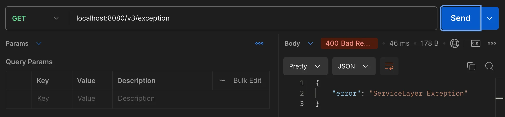
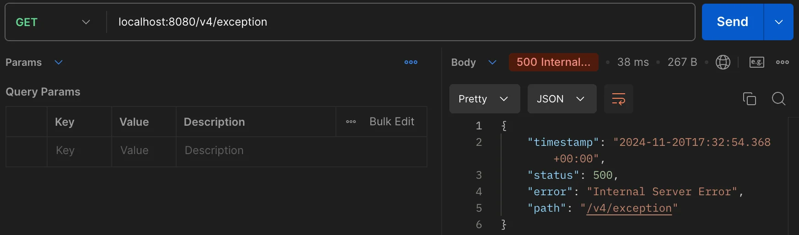
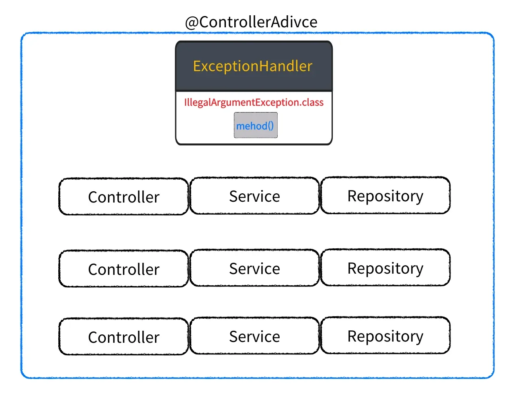

<a id="14ceda9b0fe18100b374cffd5a6d8c2b"></a>

## <code>&#64;ExceptionHandler</code>

---

> 📖 
> 
> <a id="14ceda9b0fe181689770cd930bc55862"></a>
> 
> 컨트롤러 클래스 내, <u>특정 예외를 처리</u>하는 메서드를 정의하는 Annotaion 
> 
> <a id="14ceda9b0fe180d880a7ef1bd2ff0def"></a>
> 
> → <u>예외가 발생</u>했을 때 설정된 메서드가 호출되어 예외를 처리 

<details>
<summary><strong><code>&#64;ExceptionHandler</code></strong></summary>



- 특정 컨트롤러에서 발생한 예외를 처리하기 위한 메서드 지정

- <u>단일 컨트롤러 내</u>에서 예외 처리

- <u>계층별로 알맞은 예외 발생 (</u><u><code>throw new</code></u><u>) 처리만 하면 된다</u>&#46; 

</details>

<details>
<summary>예시 </summary>

<details>
<summary>&#91; 코드 &#93; </summary>

<a id="14ceda9b0fe180c7825ce7e1d8e0df0e"></a>

```java
@RestController
@RequiredArgsConstructor
public class ExceptionHandlerController {

    private final ExceptionHandlerService exceptionHandlerService;

    @RequestMapping("/v1/exception")
    public void illegalArgumentException() {

        throw new IllegalArgumentException("IllegalArgumentException 발생");

    }

    @RequestMapping("/v2/exception")
    public void nullPointerException() {

        throw new NullPointerException("NPE 발생");
    }

    @RequestMapping("/v3/exception")
    public void serviceLayerException() {

        exceptionHandlerService.throwNewIllegalArgumentException();
    }

    // IllegalArgumentException을 처리하는 메서드
    @ExceptionHandler(IllegalArgumentException.class)
    public ResponseEntity<Map<String, String>> handleIllegalArgumentException(IllegalArgumentException ex) {

        Map<String, String> response = new HashMap<>();
        response.put("error", ex.getMessage());

        return ResponseEntity
                .status(HttpStatus.BAD_REQUEST)
                .body(response);
    }
}
```

<a id="14ceda9b0fe180c4a628f0b49723fa0a"></a>

```java
@RestController
public class NonExceptionHandlerController {

    @RequestMapping("/v4/exception")
    public void illegalArgumentException() {

        throw new IllegalArgumentException("IllegalArgumentException 발생");

    }
}
```

<a id="14ceda9b0fe180dbabc6fc764403d931"></a>

```java
@Service
public class ExceptionHandlerService {

    public void throwNewIllegalArgumentException() {
        throw new IllegalArgumentException("ServiceLayer Exception");
    }
}
```

</details>

<details>
<summary><strong>실행결과</strong></summary>

1. <code>IllegalArgumentException</code>
    

    - <code>&#64;ExceptionHandler</code> 로 정의된 예외처리 메서드 실행

1. <code>NullPointerException</code>
    

    - <code>&#64;ExceptionHandler</code>에 정의되지 않은 Exception은 500 Error

1. <code>serviceLayerException()</code>
    

    - <code>&#64;ExceptionHandler</code> 이 선언된 컨트롤러가 호출하는 다른 계층의 예외처리

1. <code>NonExceptionHandlerController</code>
    

    - <code>&#64;ExceptionHandler</code> 이 선언되지 않은 컨트롤러의 예외처리 불가

</details>

</details>

> ✏️ 
> 
> <a id="0996b017f85f44b3b4a135239a13f915"></a>
> 
> 문제점
> 
> - Controller에 <u>Exception 처리를 위한 책임 추가</u>  →  단일 책임원칙 위반
> 
> - <u>단일 컨트롤러 내</u>의 예외만 처리 가능 → <u>컨트롤러 예외처리 중복</u>
> 
> - 코드 재사용, 유지보수성 ↓ 

> ☝🏻 
> 
> <a id="9fd86d3bce59464da280a65c54083f88"></a>
> 
> <code>CustomException</code> 사용자 정의 <code>Exception</code>을 만들어서 처리할 수 있다&#46;

<a id="14ceda9b0fe180f49ba3ec0c8a3e122e"></a>

## <code>&#64;ControllerAdvice</code>, <strong><code>&#64;RestControllerAdvice</code></strong>

---

> 📖 
> 
> - <strong><code>&#64;ControllerAdvice</code></strong>
>     - Application 전역에서 발생된 예외를 처리함
> 
> - <strong><code>&#64;RestControllerAdvice</code></strong><strong> </strong>
>     - &#64;ControllerAdvice와 동일한 기능을 제공하지만, <br><u>&#64;RestController를 포함</u>하고 있어 반환값이 자동으로 JSON 형태로 변환됨
> 
>     - REST API에서 발생하는 예외를 처리할 때 사용

<details>
<summary><strong><code>&#64;ControllerAdvice</code></strong></summary>



- Application 전역에서 발생한 예외를 처리

</details>

<details>
<summary><strong><code>&#64;RestControllerAdvice</code></strong></summary>

- REST API의 예외 처리

- 반환 값&#58; <code>JSON</code>

</details>

<details>
<summary>예시 </summary>

<a id="14ceda9b0fe180c297a0c6a3ed41f344"></a>

```java
@RestControllerAdvice
public class GlobalExceptionHandler {

    @ExceptionHandler(IllegalArgumentException.class)
    public ResponseEntity<Map<String, String>> handleIllegalArgumentException(IllegalArgumentException ex) {

        Map<String, String> response = new HashMap<>();
        response.put("error", ex.getMessage());

        return ResponseEntity
                .status(HttpStatus.BAD_REQUEST)
                .body(response);
    }
}
```

</details>

<details>
<summary>Anotaion 정리</summary>

| Annotation | 용도 | 반환 형식 | 예시 처리 범위 |
| --- | --- | --- | --- |
| <code>&#64;ExceptionHandler</code> | 특정 컨트롤러 내에서 발생한 예외 처리 | 뷰 이름, String 등 | 단일 컨트롤러 내 |
| <code>&#64;ControllerAdvice</code> | 애플리케이션 전체에서 발생한 예외 처리 | 뷰 이름, String 등 | 모든 컨트롤러에 전역 적용 |
| <code>&#64;RestControllerAdvice</code> | REST API에서 발생한 예외를 JSON 형식으로 처리 | ResponseEntity (JSON) | 모든 컨트롤러에 전역 적용 (RESTful 서비스) |

</details>

---

<details>
<summary>예시 2</summary>

<a id="151eda9b0fe18093b48ee2159e36b9ec"></a>

```sql

```

</details>
