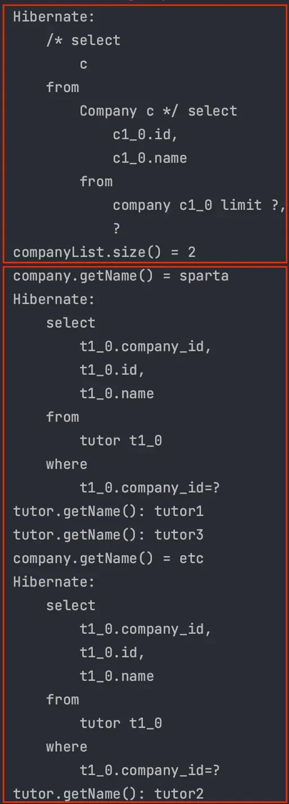
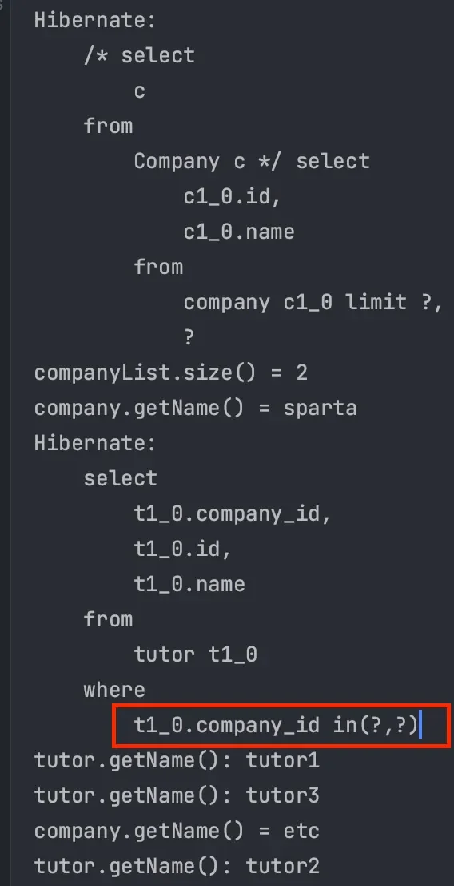

<a id="14ceda9b0fe1810e844ae42609bd69b6"></a>

## &#64;BatchSize

---

> 📖 
> 
> <a id="14eeda9b0fe1809bba27f3f5d4655c83"></a>
> 
> JPA에서 <u>N&#43;1 문제를 해결</u>하기 위해 사용되는 설정<br><u>지연 로딩(Lazy Loading)</u> 시 <u>한 번에 로드할 엔티티의 개수를 조정</u>
> 
> <a id="14eeda9b0fe180f48eb4f6aba8812df9"></a>
> 
> → 여러 개의 엔티티 효율적으로 조회 가능

> ☝🏻 
> 
> <a id="28801daea3f54cefa13eefdbc4dce52c"></a>
> 
> <u>메모리를 사용하여 페이징을 처리</u>하면 OOM(OutOfMemory) 문제가 발생될 수 있다&#46;

> ✏️ 
> 
> <a id="cf269ee629cf4345898d46e819339b18"></a>
> 
> <u>Global 설정</u>보다 필드에 직접 선언한 <code>&#64;BatchSize</code> 의 우선순위가 더 높다&#46;

<details>
<summary>코드 예시</summary>

<a id="14eeda9b0fe180368410e144aabf255b"></a>

```java
String query = "select c from Company c";

List<Company> companyList = em.createQuery(query, Company.class)
        .setFirstResult(0)
        .setMaxResults(2)
        .getResultList();

System.out.println("companyList.size() = " + companyList.size());

for (Company company : companyList) {
    System.out.println("company.getName() = " + company.getName());
    
    for (Tutor tutor : company.getTutorList()) {
        System.out.println("tutor.getName(): " + tutor.getName());
    }
}
```

- 실행결과
    

    1. Company 전체 조회

    1. 조회 결과 2개 ( <code>sparta</code>, <code>etc</code> ) 에 각각 지연 로딩

</details>

<details>
<summary><code>&#64;BatchSize</code></summary>

<a id="14eeda9b0fe180548f83d6de369bb97a"></a>

```java
@Entity
@Table(name = "company")
public class Company {

    @Id
    @GeneratedValue(strategy = GenerationType.IDENTITY)
    private Long id;

    private String name;

    @BatchSize(size = 100)
    @OneToMany(mappedBy = "company")
    private List<Tutor> tutorList = new ArrayList<>();

    public Company() {
    }

    public Company(String name) {
        this.name = name;
    }

    public Long getId() {
        return id;
    }

    public String getName() {
        return name;
    }

    public List<Tutor> getTutorList() {
        return tutorList;
    }

}
```

- 실행 결과
    

    - 한 번의 <code>IN</code> Query에 식별자(PK)를 조회된 개수만큼 넣는다&#46; 

    - 설정 파일의 <code>hibernate&#46;jdbc&#46;batch&#95;size</code> 를 통해 Global 적용이 가능하다&#46;
        - <code>xml</code>, <code>yml</code>, <code>properties</code> 모두 가능

</details>

<a id="14ceda9b0fe18051b19ceb12042075ff"></a>

## 정리

---

> 📖 
> 
> <a id="184e32cd4c8e449abeb1b4bfd99cd8b6"></a>
> 
> JPQL은 정적 쿼리에 최적화 되어 있고, 문자열로 SQL을 작성하기 때문에 작성하기 까다롭다&#46; 

<details>
<summary><strong>JPQL의 한계</strong></summary>

1. 동적 쿼리를 사용하기 어렵다&#46;

1. SQL을 문자열로 작성하여 사용하기 까다롭다&#46;

1. SQL의 모든 기능을 사용할 수 없다 ( <code>Native Query</code> 사용 )

</details>

<details>
<summary>fetch join 정리 </summary>

1. <u>SQL의 </u><u><code>JOIN</code></u><u>과 비슷하지</u><u>만 다르다</u>
    -  <u>연관된 엔티티나 컬렉션을 한 번의 쿼리로 함께 로드</u>하는 기능

    - <u>지연 로딩 설정된 엔티티</u>도 <code>fetch join</code>으로  한번에 로드 가능하다&#46;

1. <code>N&#43;1 문제</code> 해결 가능

1. 데이터의 중복이 발생할 수 있다&#46; ( <code>DISTINCT</code> )

1. 컬렉션 페이징 처리가 힘들다&#46;
    - <code>&#64;BatchSize</code> 적용

1. 조회 시 여러 테이블이 <code>JOIN</code> 된다면 일반 <code>JOIN</code>을 사용하면 된다&#46;
    - JPQL 또는 QueryDSL로 필요한 데이터만 조회하여 DTO로 반환

</details>
