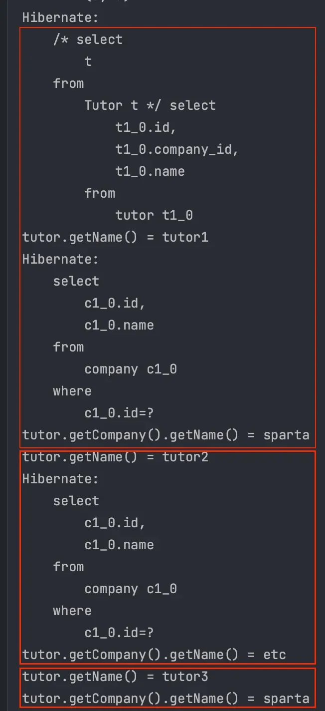
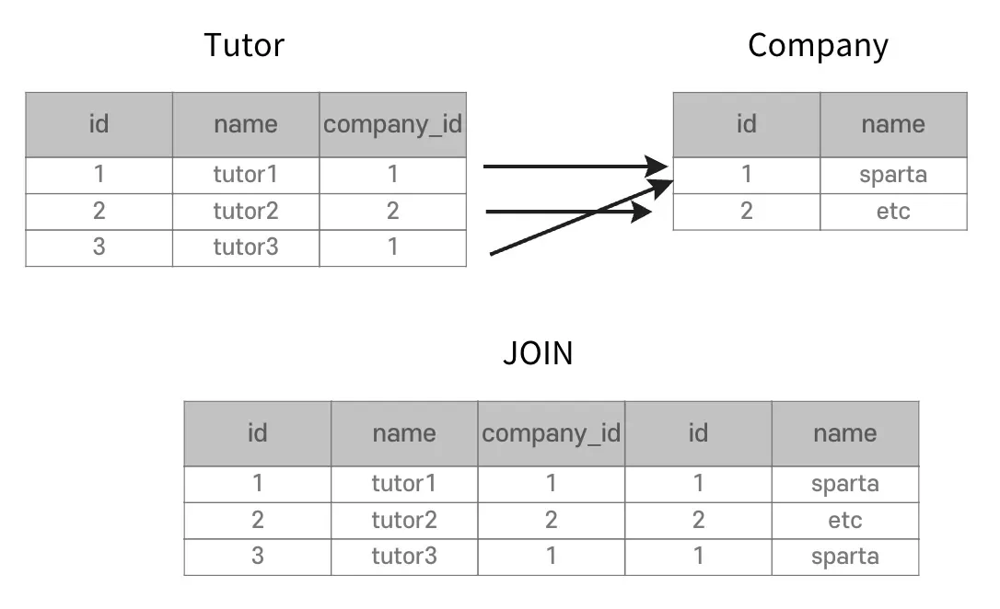
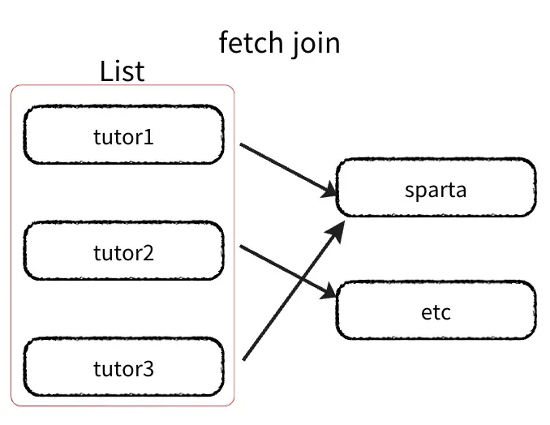
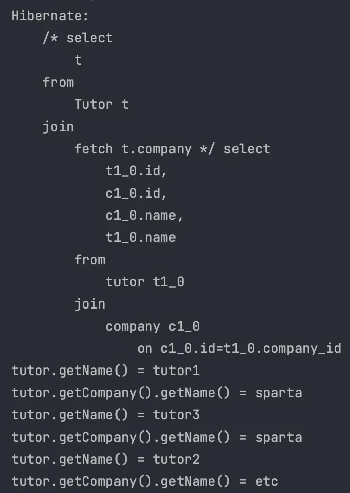
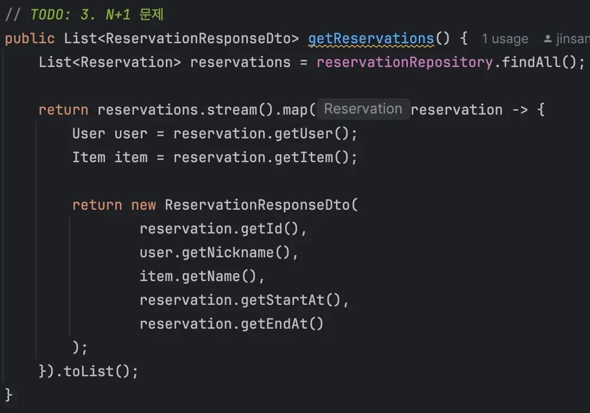
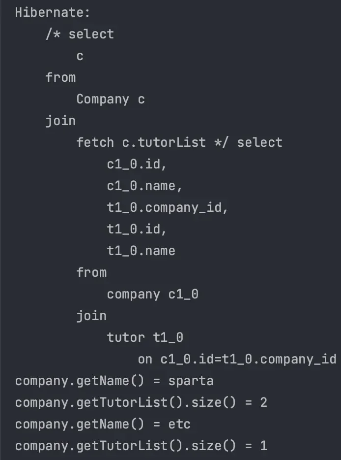
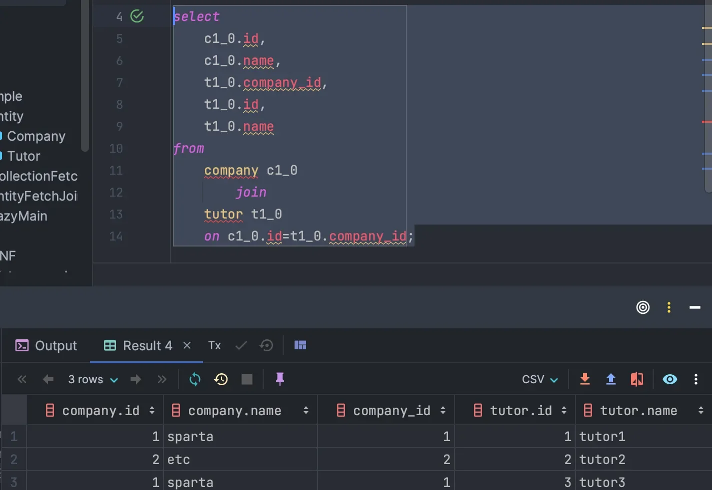
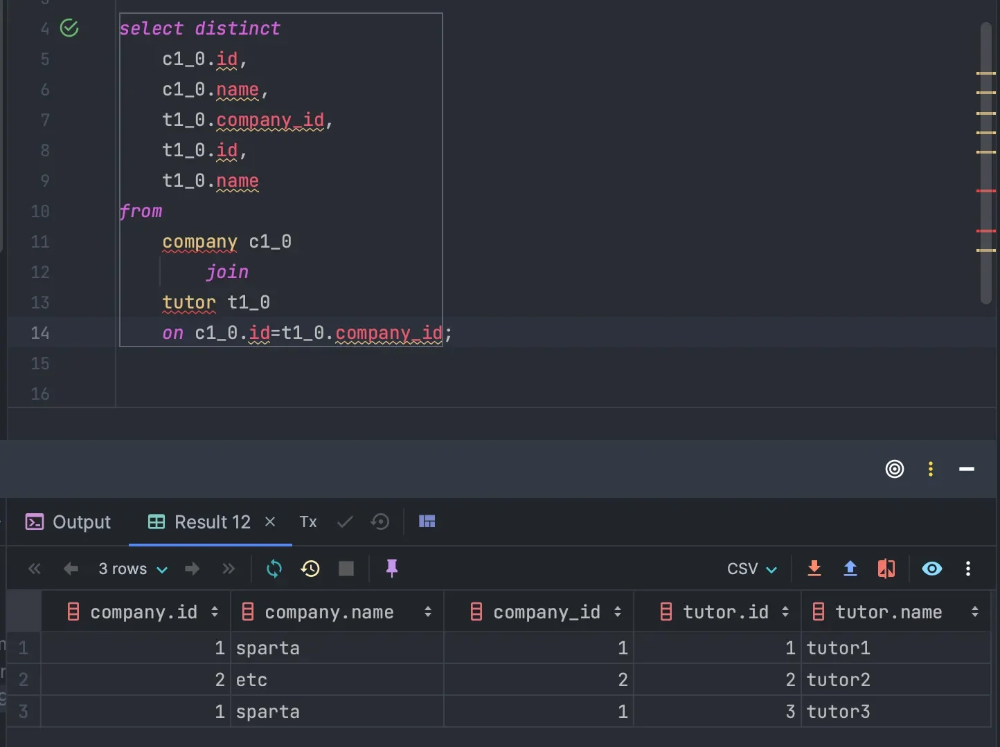
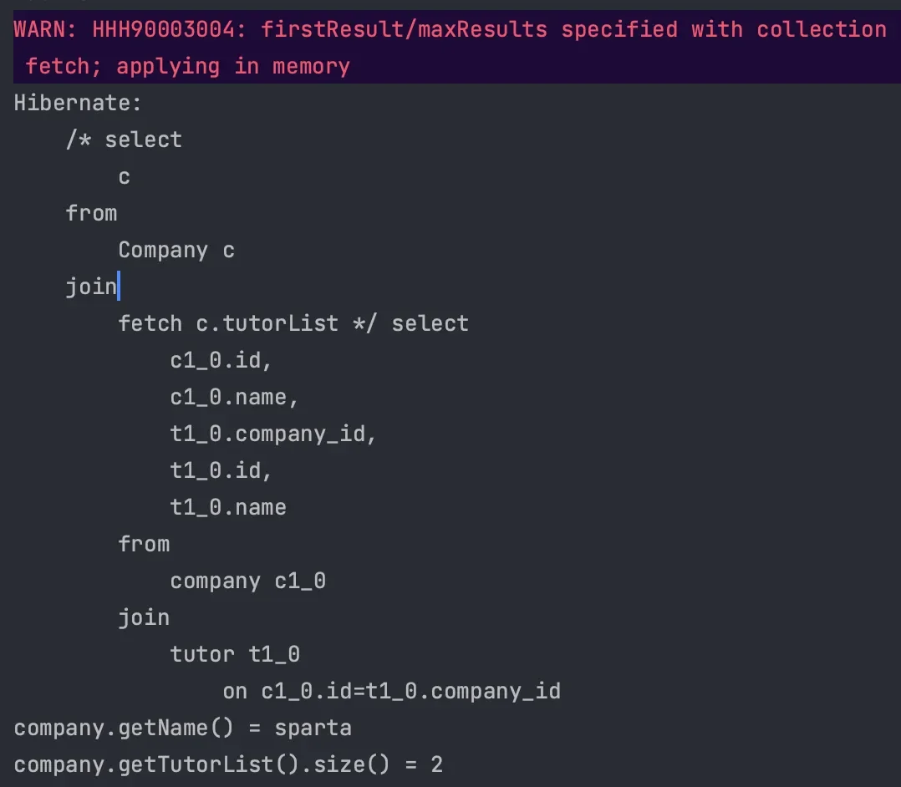

<a id="14ceda9b0fe181e98003d605347a4f2e"></a>

## N &#43; 1 문제

---

> 📖 
> 
> <a id="14ceda9b0fe1810781b6d33da2f1874f"></a>
> 
> JPA가 <u>연관된 엔티티를 조회</u>할 때 <u>추가적인 쿼리를  반복적으로 실행</u>하기 때문에 발생하는 문제

<details>
<summary>지연 로딩의 <code>N&#43;1</code></summary>

<details>
<summary>ex) Tutor &#58; Company &#45; <code>N&#58;1</code> 양방향 연관관계</summary>

<details>
<summary>&#91; 코드 &#93; Tutor</summary>

<a id="14eeda9b0fe180b9bde3c9352934c6c0"></a>

```java
@Entity
@Table(name = "tutor")
public class Tutor {

    @Id
    @GeneratedValue(strategy = GenerationType.IDENTITY)
    private Long id;

    private String name;

    @ManyToOne(fetch = FetchType.LAZY)
    @JoinColumn(name = "company_id")
    private Company company;

    public Tutor() {
    }

    public Tutor(String name) {
        this.name = name;
    }

    public Long getId() {
        return id;
    }

    public String getName() {
        return name;
    }

    public void setCompany(Company company) {
        this.company = company;
    }
}
```

</details>

<details>
<summary>&#91; 코드 &#93; Company</summary>

<a id="04812655a00f495992a26a23412f0e1f"></a>

```java
@Entity
@Table(name = "company")
public class Company {

    @Id
    @GeneratedValue(strategy = GenerationType.IDENTITY)
    private Long id;

    private String name;

    @OneToMany(mappedBy = "company")
    private List<Tutor> tutors = new ArrayList<>();

    public Company() {
    }

    public Company(String name) {
        this.name = name;
    }

    public Long getId() {
        return id;
    }

    public String getName() {
        return name;
    }

    public List<Tutor> getTutors() {
        return tutors;
    }

}
```

</details>

---

<details>
<summary>테스트 </summary>

<a id="14eeda9b0fe1807f9866c3ad7bc64a63"></a>

```java
public class LazyMain {
    public static void main(String[] args) {
        EntityManagerFactory emf = Persistence.createEntityManagerFactory("entity");

        EntityManager em = emf.createEntityManager();

        EntityTransaction transaction = em.getTransaction();

        transaction.begin();

        try {

            Company sparta = new Company("sparta");
            Company etc = new Company("etc");

            em.persist(sparta);
            em.persist(etc);

            Tutor tutor1 = new Tutor("tutor1" );
            Tutor tutor2 = new Tutor("tutor2" );
            Tutor tutor3 = new Tutor("tutor3" );

            tutor1.setCompany(sparta);
            tutor2.setCompany(etc);
            tutor3.setCompany(sparta);

            em.persist(tutor1);
            em.persist(tutor2);
            em.persist(tutor3);

            em.flush();
            em.clear();

            String query = "select t from Tutor t";
            List<Tutor> tutorList = em.createQuery(query, Tutor.class).getResultList();

            for (Tutor tutor : tutorList) {
                System.out.println("tutor.getName() = " + tutor.getName());
                System.out.println("tutor.getCompany().getName() = " + tutor.getCompany().getName());
            }

            transaction.commit();
            
        } catch (Exception e) {
            transaction.rollback();
        } finally {
            em.close();
        }

        emf.close();
    }
}
```

- 실행 결과
    

    - 반복문 1
        1. <code>tutor1&#126;3</code> 조회 및 1차 캐시에 저장

        1. <code>tutor1</code> 출력

        1. <code>sparta</code> 조회 및 1차 캐시에 저장

        1. <code>sparta</code> 출력

    - 반복문 2
        1. 1차 캐시의 <code>tutor2</code> 출력

        1. <code>etc</code> 조회 및 1차 캐시에 저장

        1. <code>etc</code> 출력

    - 반복문 3
        1. 1차 캐시의 <code>tutor3</code> 출력

        1. 1차 캐시의 <code>sparta</code> 출력

    - 튜터(N), 회사(1)가 많아질수록 더 많은 N &#43; 1 문제가 생긴다&#46;

</details>

</details>

</details>

> ☝🏻 
> 
> <a id="39b83a56835a437eb1e51bb876807ee7"></a>
> 
> <code>N &#43; 1 문제</code>는 <u>지연 로딩, 즉시 로딩 모두에서 발생</u>한다&#46;

<a id="14ceda9b0fe1800aa2e6f4836b685d86"></a>

## Entity fetch join

---

> 📖 
> 
> <a id="14ceda9b0fe180158900f64fbe3e336d"></a>
> 
> JPQL에서 <u>성능 최적화</u>를 위해 <u>fetch join을 제공</u>한다&#46;<br><u>연관된 엔티티나 컬렉션을 </u><u>SQL 한번</u><u>으로 조회</u> 기능하다&#46;

> ✏️ 
> 
> <a id="14ceda9b0fe1804ca4bacde6e02d4e74"></a>
> 
> <u>fetch join</u>은 <u>SQL의 JOIN과는 다른 종류</u>이고 <u>객체 그래프를 SQL 한 번에 조회</u>한다&#46; <br><u>실무에서 굉장히 많이 활용</u>한다&#46;

<details>
<summary><strong><u><code>N&#58;1</code></u></strong><strong>   fetch join ( </strong><strong>Entity</strong><strong>)</strong></summary>

> Tutor &#58; Company &#45; <code>N&#58;1</code> 양방향 연관관계

- 일반 JOIN
    

- fetch join
    - 튜터 조회시 연관된 회사도 함께 조회

    

</details>

<details>
<summary>코드 예시 1</summary>

<a id="14eeda9b0fe180bdac3df83cad3bb853"></a>

```java
String query = "select t from Tutor t join fetch t.company";
```

- 실행 결과
    - <code>drop table</code> 로 데이터 중복 제거
        

        - <u>지연로딩을 설정</u>해도 <code>fetch join</code>이 <u>우선권을 가진다</u>&#46;

        - <code>fetch join</code> 후 <u>모든 Entity가 영속성 컨텍스트로 관리</u>된다&#46;
            - Proxy 객체가 아닌, <u>진짜 Entity 객체를 조회</u>한다&#46;

</details>

<details>
<summary>코드 예시 2</summary>

> <a href="#/post/158eda9b-0fe1-80fa-96f1-eb2bd6377a5c">페이지</a> 

<details>
<summary>문제 </summary>



- 설명
    - 모든 예약을 조회하는 기능

    -  사용자와 물건에 대한 정보를 가져오기 위해 별도로 접근하고 있다&#46;

- 현재 조건
    - 모든 예약을 조회할 때 연관된 테이블에 있는 정보를 가져오면서 <code>N&#43;1 문제</code> 발생
        - findAll() 메서드로 모든 Reservation 엔티티를 가져온다&#46; 

        - 그 후, <code> getUser()</code>와 <code>getItem()</code> 메서드를 호출하여 각각의 사용자와 아이템 정보를 가져오는데 <br>이때, <strong><u>각 호출은 데이터베이스에 추가 쿼리를 발생</u></strong>한다&#46;  →  <code>N&#43;1 문제</code>
            <details>
            <summary>쿼리 확인</summary>

            -  select 문 3번 발생 &#45; reservation, user, item

            <a id="5248215bf0534a9ab31d617fcd93f219"></a>

            ```java
            Hibernate: 
                select
                    r1_0.id,
                    r1_0.end_at,
                    r1_0.item_id,
                    r1_0.start_at,
                    r1_0.status,
                    r1_0.user_id 
                from
                    reservation r1_0
            Hibernate: 
                select
                    u1_0.id,
                    u1_0.email,
                    u1_0.nickname,
                    u1_0.password,
                    u1_0.role,
                    u1_0.status 
                from
                    user u1_0 
                where
                    u1_0.id=?
            Hibernate: 
                select
                    i1_0.id,
                    i1_0.description,
                    m1_0.id,
                    m1_0.email,
                    m1_0.nickname,
                    m1_0.password,
                    m1_0.role,
                    m1_0.status,
                    i1_0.name,
                    o1_0.id,
                    o1_0.email,
                    o1_0.nickname,
                    o1_0.password,
                    o1_0.role,
                    o1_0.status,
                    i1_0.status 
                from
                    item i1_0 
                left join
                    user m1_0 
                        on m1_0.id=i1_0.manager_id 
                left join
                    user o1_0 
                        on o1_0.id=i1_0.owner_id 
                where
                    i1_0.id=?
            ```

            </details>

- 개선
    - 동일한 데이터를 가져올 때 N&#43;1 문제가 발생하지 않게 수정

</details>

<details>
<summary>해결</summary>

- fetch Join 활용
    - repository
        <a id="6ab6563ec6764f10b18564ebf891e3d6"></a>

        ```java
        @Query("SELECT r FROM Reservation r JOIN FETCH r.user JOIN FETCH r.item")
        List<Reservation> findAllWithUserAndItem();
        ```

    - Service
        <a id="1ecb2b2ce12b44309744b64714431dfe"></a>

        ```java
        public List<ReservationResponseDto> getReservations() {
        		  List<Reservation> reservations = reservationRepository.findAllWithUserAndItem();
        		
        		  return reservations.stream().map(reservation -> {
        		      User user = reservation.getUser();
        		      Item item = reservation.getItem();
        		
        		      return new ReservationResponseDto(
        		              reservation.getId(),
        		              user.getNickname(),
        		              item.getName(),
        		              reservation.getStartAt(),
        		              reservation.getEndAt()
        		      );
        		  }).collect(Collectors.toList());
        }
        ```

    <details>
    <summary>쿼리 확인</summary>

    <a id="66986b452fb84511babda63cb9f2a5a9"></a>

    ```java
    Hibernate: 
        select
            r1_0.id,
            r1_0.end_at,
            i1_0.id,
            i1_0.description,
            i1_0.manager_id,
            i1_0.name,
            i1_0.owner_id,
            i1_0.status,
            r1_0.start_at,
            r1_0.status,
            u1_0.id,
            u1_0.email,
            u1_0.nickname,
            u1_0.password,
            u1_0.role,
            u1_0.status 
        from
            reservation r1_0 
        join
            user u1_0 
                on u1_0.id=r1_0.user_id 
        join
            item i1_0 
                on i1_0.id=r1_0.item_id
    ```

    </details>

</details>

</details>

<a id="14ceda9b0fe180238a2be8e675742601"></a>

## Collection fetch join

---

> 📖 

> ☝🏻 
> 
> <a id="cc7f5fcc4a974f748f40b7f33aeb8297"></a>
> 
> <code>&#64;OneToMany</code> 의<u> 기본 FetchType은 </u><strong><u>LAZY</u></strong><u> </u>이다

<details>
<summary><strong><u><code>1&#58;N</code></u></strong><strong> fetch join ( </strong><strong>Collection</strong><strong> )</strong></summary>

<a id="14eeda9b0fe1808191defb1d2e3201be"></a>

```java
String query = "select c from Company c join fetch c.tutorList";
List<Company> companyList = em.createQuery(query, Company.class).getResultList();

for (Company company : companyList) {
		System.out.println("company.getName() = " + company.getName());
		System.out.println("company.getTutorList().size() = " + company.getTutorList().size());
}
```

- 실행 결과
    - 데이터 중복이 발생되지 않음

    

</details>

<details>
<summary>🤬  <u>SQL Query의 조회</u> 결과는 <u>데이터가 중복</u>된다&#46;</summary>



- Hibernate 6&#46;0 이상 부터는 <code>DISTINCT</code>가 자동으로 적용된다&#46;

<details>
<summary>☝🏻 Hibernate 6&#46;0 이전</summary>

> 실행되는 Query에는 <code>DISTINCT</code>가 조회되지 않는다&#46;

<a id="14eeda9b0fe18008ab90c877f6647585"></a>

```java
String query = "select distinct c from Company c join fetch c.tutorList";
```

</details>

</details>

<details>
<summary><strong>JPQL의 DISTINCT</strong></summary>

> ☝🏻 
> 
> - Database의 <code>DISTINCT</code>&#58;  <u>완전히 데이터가 같</u>아야 <u>중복이 제거</u>된다&#46;
> 
> - <u>JPQL</u>의 <code>DISTINCT</code>&#58; <u>같은 PK값을 가진 Entity</u>를 제거한다&#46;



<details>
<summary><strong>☝🏻 주의점 </strong></summary>

> ✏️ 
> 
> <a id="d4b83ef230764a1c9a6f0e1f1f937138"></a>
> 
> <code>C</code><u><code>ollection</code></u><u> 에 fetch join을 사용</u>하면 페이징을 메모리에서 수행한다&#46;

<details>
<summary>코드 예시</summary>

<a id="14eeda9b0fe180c8be13d4cda2abfd38"></a>

```java
String query = "select c from Company c join fetch c.tutorList";
List<Company> companyList = em.createQuery(query, Company.class)
        .setFirstResult(0)
        .setMaxResults(1)
        .getResultList();
```

- 실행 결과
    

    - 전체를 조회하는 SQL이 실행된다&#46;
        - <code>setFirstResult()</code>, <code>setMaxResult()</code> 가 SQL에 반영되지 않는다&#46;

    - <u>모든 데이터를 조회</u>하여 <u>메모리에서 페이징을 처리</u>한다&#46;
        - <u>필요없는 데이터까지 전체 로드한 후</u> <u>필터링</u>한다&#46;

</details>

</details>

</details>
