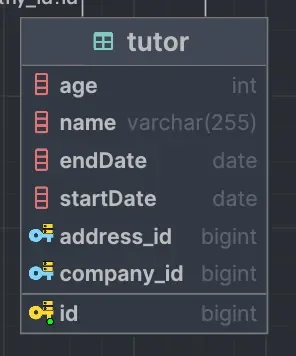
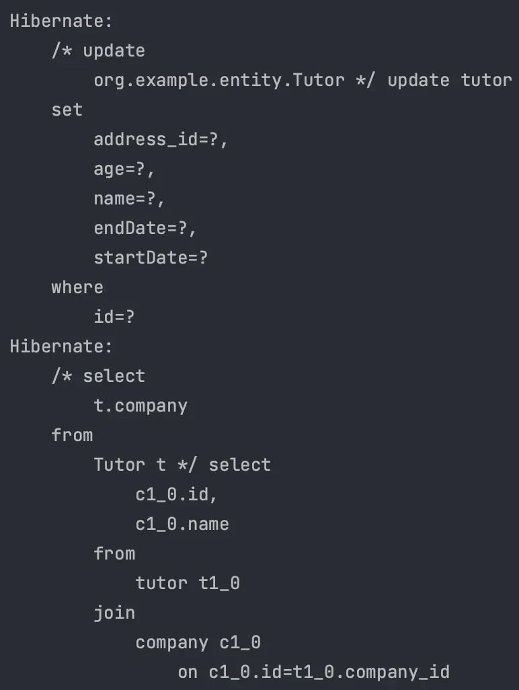
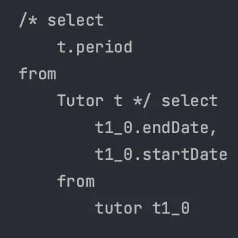
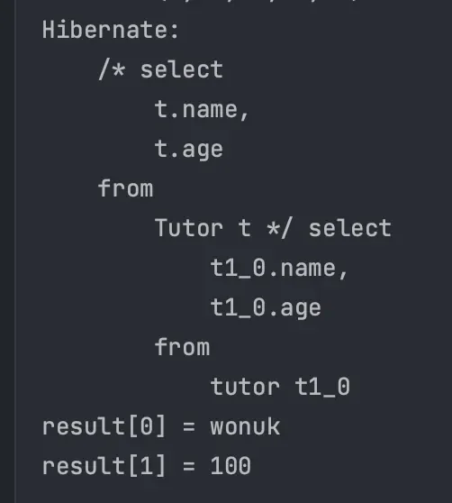
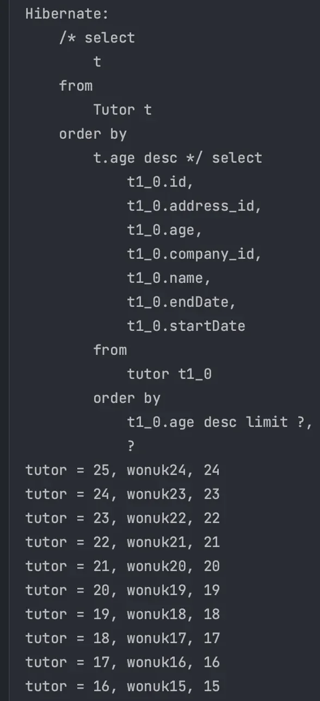
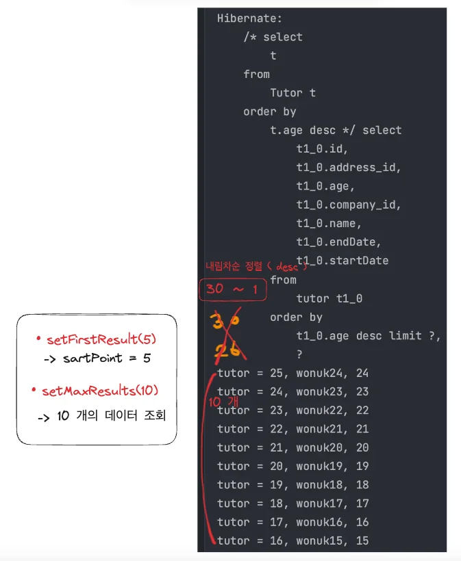

<a id="14ceda9b0fe181bca2f2d7d334e70608"></a>

## Embedded Type

---

> 📖 
> 
> <a id="14ceda9b0fe18122b198ceec58291bea"></a>
> 
> JPA는 <u>새로운 값 타입</u>을 <code>&#64;Embedded</code>, <code>&#64;Embeddable</code> 을 사용하여 <u>직접 정의해서 사용</u>할 수 있다&#46; 
> 
> <a id="14eeda9b0fe180dab933f3f12913ecc2"></a>
> 
> 이를 임베이드 타입이라 하며, <u>직접 정의한 임베디드 타입</u>도 <code>int</code>, <code>String</code> 과 <u>같은 </u><u>값 타입</u>이다&#46;
> 
> - <code>&#64;Embeddable</code>&#58; 임베디드 값 타입으로 클래스 정의
> 
> - <code>&#64;Embedded</code>&#58;  임베디드로 정의한 값 타입 사용

<details>
<summary>코드 예시</summary>

<a id="14eeda9b0fe180318226c486dd8d577e"></a>

```java
@Entity
public class Tutor {
		
		@Id
		@GeneratedValue
		private Long id;
		
		private String name;
		// Embedded 사용
		
		@Embedded
		private Period Period;

}

// Embedded 정의
@Embeddable
public class Period {
  
  @Temporal(TemporalType.DATE)
  Date startDate;
  
  @Temporal(TemporalType.Date)
  Date endDate;
  
  public boolean isWork (Date date) {
	    // startDate <= date <= endDate 확인
      return (startDate == null || !date.before(startDate)) &&
             (endDate == null || !date.after(endDate));
  }
}
```

- 실행 결과
    - 하나의 임베디드 타입으로 정의  → 여러 Entity에서 재사용 가능
        - <u>응집도 증가</u> → <u>단일 책임 원칙 준수</u>

        - <u>독립적인 로직</u><u> </u>작성 가능

    

</details>

<a id="14ceda9b0fe1804f8841e79b26cccb81"></a>

## 프로젝션

---

> 📖 
> 
> <a id="11b347bf1c0743fe919fd0e87081ca04"></a>
> 
> Entity 전체가 아닌 <u>특정 필드만 선택</u>하여 <u>조회</u><br><u>필요한 데이터만 조회</u>하기 때문에 <u>성능을 최적화</u>하고 <u>네트워크 비용을 줄</u>일 수 있다&#46; 

<details>
<summary>프로젝션</summary>

- <code>SELECT</code> 문에 조회할 대상(<code>Entity</code>, <code>Embedded</code>, <code>Scala</code>)을 지정 가능

- <code>DISTINCT</code> 중복 제거 가능

---

<details>
<summary>예시</summary>

<a id="14eeda9b0fe180a7986ed411177cb62b"></a>

```sql
SELECT t FROM Tutor t                      // Entity
SELECT t.company FROM Tutor t              // Entity
SELECT t.period                            // Embedded
SELECT t.name, t.age FROM Tutor t          // Scala
SELECT DISTINCT t.name, t.age FROM Tutor t // 중복 제거
```

</details>

</details>

<details>
<summary>Entity 프로젝션</summary>

<a id="14eeda9b0fe18022b70ee7ac4920a405"></a>

```java
Tutor tutor = new Tutor("wonuk", 100);
em.persist(tutor);

// 영속성 컨텍스트 초기화
em.flush();
em.clear();

List<Tutor> tutorList = em.createQuery("select t from Tutor t", Tutor.class).getResultList();

Tutor wonuk = tutorList.get(0);
wonuk.setName("wonuk2");

// 실제로는 다른 방식을 사용한다. -> 묵시적 JOIN
Company company = em.createQuery("select t.company from Tutor t", Company.class).getSingleResult();

// join을 명시적으로 사용 -> 명시적 JOIN
Company companyV2 = em.createQuery("select t from Tutor t join t.company", Company.class).getSingleResult();

```

- 실행 결과
    - <u>Entity 프로젝션을 사용</u>하면 영속성 컨텍스트가 관리한다&#46; 

    - <u>연관된 Entity를 </u><u><code>JOIN</code></u><u>하여 조회</u>할 수 있다&#46; 

    

</details>

> ☝🏻 
> 
> <a id="9b7e19617e624bacbfafa1c0860c0077"></a>
> 
> <u>묵시적 조인을 사용</u>하면 <u>실행되는 SQL Query를 예측하기 어렵다</u>&#46; 
> 
> <a id="14eeda9b0fe180deb271e57858ceca8d"></a>
> 
> → 명시적 조인 사용

<details>
<summary>Embedded 프로젝션</summary>

<a id="14eeda9b0fe180fc8921c0e5203d4c14"></a>

```java
em.createQuery("select t.period from Tutor t", Period.class).getResultList();
```

- 실행 결과
    

    - <strong>&#91;</strong><strong> X </strong><strong>&#93; 임베디드 값 타입(</strong><strong><code>Period</code></strong><strong>) 직접 조회 불가능</strong>
        - <strong> </strong> <code>select period frome Period p</code> 

    - <strong>&#91; </strong><strong>O</strong><strong> &#93; Entity 조회 후 where절을 통해 조건으로 임베디드 값 타입 조회</strong>
        - <code>select t from Tutor t where </code><u><code>t&#46;period</code></u><u><code>&#46;startDate</code></u><code> &#60; ?</code> Embedded

        - <code>t&#46;period</code> 로 접근해야하기 때문에 직관적이지 못하다&#46;  
            - <code>&#64;MappedSuperclass</code> 상속을 사용하여 코드 작성한다&#46; 

    - <strong>&#91; </strong><strong>O</strong><strong> &#93; 상속 &#45; </strong><code>&#64;MappedSuperclass</code>
        - <u>상속을 사용</u>하는것이 <u>편리하고 직관적</u>이다&#46;

        - <code>select t from Tutor t where </code><u><code>t&#46;startDate</code></u><code> &#60; ?</code> 

</details>

<details>
<summary>🧐 Scala 란?</summary>


</details>

<details>
<summary>Scala 프로젝션</summary>

> ☝🏻 
> 
> <a id="14eeda9b0fe1808a887ff3bcae666ad6"></a>
> 
> Scala 프로젝션은 DTO 형태로 반환받을 수 있다&#46;

<a id="14eeda9b0fe180259514cb5fb1cff61d"></a>

```java
List resultList = em.createQuery("select t.name, t.age from Tutor t").getResultList();

Object o = resultList.get(0);
Object[] result = (Object[]) o;
System.out.println("result[0] = " + result[0]);
System.out.println("result[1] = " + result[1]);

List<Object[]> resultList = em.createQuery("select t.name, t.age from Tutor t").getResultList();

Object[] result = resultList.get(0);
System.out.println("result[0] = " + result[0]);
System.out.println("result[1] = " + result[1]);
```

- 실행결과
    - <u>나머지 코드 주석 필요</u>



</details>

<a id="14ceda9b0fe18030bfbbc118612f750a"></a>

## Paging

---

> 📖 
> 
> <a id="b86c959c3f304bbababe729079d94e45"></a>
> 
> 데이터베이스의 <u>쿼리 결과를 특정 범위로 제한</u>하는 기능
> 
> <a id="14eeda9b0fe18021b788e984ca13dc0f"></a>
> 
> <u>대량의 데이터 중</u>에서 <u>원하는 페이지의 데이터만 조회</u>하기 위해 사용

<details>
<summary>JPQL Paging</summary>

- <code>setFirstResult(int startPosition)</code>
    - 조회 시작 위치

- <code>setMaxResult(int maxResult)</code>
    - 조회할 데이터 수

---

<details>
<summary>예시 </summary>

- 쿼리 
    <details>
    <summary><code>&#34;select t from Tutor t order by t&#46;age desc&#34;</code></summary>

    - <code>select</code> &#58; 조회

    - <code>from Tutor t</code> &#58; Tutor 엔티티로 조회

    - <code>order by t&#46;age</code> &#58; 나이 순으로 정렬

    - <code>desc</code>&#58; 내림차순

    </details>

<a id="14eeda9b0fe180608bdee7b8bac61096"></a>

```java
List<Tutor> tutorList = em.createQuery("select t from Tutor t order by t.age desc", Tutor.class)
                    .setFirstResult(5)
                    .setMaxResults(10)
                    .getResultList();

for (Tutor tutor : tutorList) {
    System.out.println("tutor = " + tutor.getId() + ", " + tutor.getName() + ", " + tutor.getAge());
}
```

- 실행 결과
    - MySQL의 페이징 문법
        <details>
        <summary>jpql</summary>

        

        </details>

        

</details>

</details>

> ☝🏻 
> 
> <a id="14ceda9b0fe1800988ddffe1fe404224"></a>
> 
> <code>ORACLE</code>은 <u>페이징</u>에 <u><code>ROWNUM</code></u><u>을 사용</u>한다
